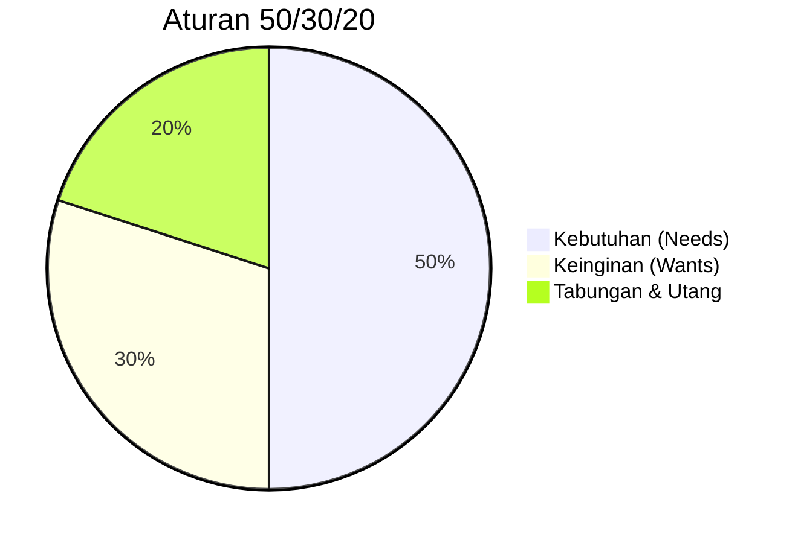

## Kemandirian Finansial dan Tekanan Ekonomi

Pernahkah kamu merasa bahwa meskipun gajimu sudah naik, saldo di rekening bank seolah-olah menguap begitu saja sebelum pertengahan bulan? Atau mungkin, kamu merasa tertekan saat melihat teman sebaya sudah bisa membeli properti, sementara kamu masih berjuang membayar tagihan langganan bulanan?

Selamat datang di realitas finansial fase *Quarter-Life Crisis*. Di bagian ini, kita akan membahas mengapa tekanan ekonomi di usia 20-an terasa jauh lebih berat dibandingkan generasi sebelumnya, dan bagaimana cara menghadapi ketidakpastian ini tanpa mengorbankan kesehatan mentalmu.

## 1. Realitas Biaya Hidup

Salah satu pemicu utama stres di usia dewasa muda adalah **gap antara ekspektasi gaya hidup dan kenyataan daya beli**. Secara matematis, kita menghadapi tantangan yang disebut inflasi gaya hidup dan inflasi ekonomi riil.

### Konsep Inflasi dan Daya Beli

Bayangkan uangmu sebagai sebuah wadah. Jika harga barang naik tetapi jumlah uangmu tetap, maka "volume" barang yang bisa kamu tampung akan mengecil. Dalam ekonomi, ini dirumuskan sebagai:

$$
\text{Daya Beli} \ (\text{Purchasing Power}) = \frac{\text{Pendapatan} \ (I)}{\text{Tingkat Harga} \ (P)}
$$

**Analogi Ember yang Bocor**

> Bayangkan kemandirian finansialmu adalah sebuah ember yang ingin kamu isi penuh dengan air (tabungan). Namun, ember tersebut memiliki lubang-lubang kecil (biaya langganan, kenaikan harga sewa, kenaikan harga pangan). Masalahnya, di era sekarang, lubang-lubang tersebut membesar lebih cepat daripada debit air yang kamu tuangkan ke dalamnya.

**Faktor Penyebab Tekanan:**

- **Kenaikan Harga Properti:** Harga rumah naik jauh melampaui kenaikan rata-rata gaji tahunan.
- **Gaya Hidup Digital:** Biaya yang dulu tidak ada (Internet, Spotify, Netflix, Cloud Storage) kini menjadi "kebutuhan pokok".
- **Pajak Sosial:** Keinginan untuk tetap relevan dalam pergaulan (nongkrong di kafe, *healing*, konser) yang biayanya terus meningkat.

## 2. Godaan Berutang

Di tengah tekanan ekonomi, akses terhadap kredit menjadi pedang bermata dua. Bagi dewasa muda, godaan untuk menutup celah finansial dengan utang seringkali menjadi awal dari krisis yang lebih dalam.

### Mengenal Utang Produktif vs Konsumtif

Tidak semua utang itu buruk, namun dalam *Quarter-Life Crisis*, banyak yang terjebak dalam utang konsumtif karena tekanan sosial.

- **Paylater & Pinjol (Pinjaman Online):** Kemudahan akses membuat banyak individu terjebak dalam bunga majemuk yang memberatkan.
	- *Rumus Bunga Majemuk:* $A = P(1 + r)^n$
		- Artinya, jika kamu menunda pembayaran, utangmu tumbuh secara eksponensial, bukan linear.
- **Studi Kasus Singkat:** Rina (24 tahun) menggunakan fitur *Paylater* untuk membeli ponsel baru seharga Rp10.000.000 dengan bunga 3% per bulan. Jika ia hanya membayar minimum, dalam satu tahun ia bisa membayar hampir 1,5 kali lipat dari harga asli. Tekanan untuk melunasi ini seringkali memicu kecemasan setiap kali notifikasi jatuh tempo muncul.

## 3. "Money Anxiety" dan Ketidakpastian Global

Tekanan ekonomi berdampak langsung pada beban mental, bukan hanya terlihat dari angka saldo di layar ATM. Stres psikologis muncul dari rasa tidak aman (*insecurity*) terhadap masa depan.

**Tanda-Tanda Stres Ekonomi:**

1. **Paralisis Keputusan:** Takut mengeluarkan uang sedikit pun karena khawatir akan ada keadaan darurat.
2. **Rasa Bersalah Berlebih:** Merasa berdosa setelah membeli barang yang sebenarnya dibutuhkan.
3. **Vigilansi Finansial:** Terus-menerus mengecek saldo bank dengan perasaan cemas.

> **Important:** Stres ekonomi global (resesi, perubahan iklim, ketidakstabilan politik) menciptakan perasaan bahwa "berusaha keras pun tidak akan cukup". Ini bisa memicu sikap apatis atau *burnout* finansial.

## 4. Langkah Membangun Kemandirian Finansial

Menghadapi tekanan ini memerlukan pendekatan yang pragmatis sekaligus welas asih terhadap diri sendiri.

### A. Aturan 50/30/20 (Versi Modifikasi)

Gunakan prinsip ini untuk mengatur aliran danamu secara sistematis:

- **50% untuk Kebutuhan (Needs):** Sewa, makan, tagihan wajib.
- **30% untuk Keinginan (Wants):** Hiburan dan gaya hidup.
- **20% untuk Tabungan & Utang (Savings/Debt):** Dana darurat atau cicilan.

Kalau ketiga pos itu kamu gambar dalam satu lingkaran, porsinya tampak seperti ini.

Jika kamu merasa 50% tidak cukup untuk kebutuhan, mampukah kamu menekan bagian 'Wants' untuk sementara, atau apakah kamu perlu mencari tambahan pendapatan?

### B. Membangun Dana Darurat (Emergency Fund)

Target awal bukanlah kekayaan, melainkan **ketenangan pikiran**. Memiliki dana darurat setara 3 bulan biaya hidup dapat menurunkan tingkat stres secara nyata saat menghadapi ketidakpastian ekonomi global.

### C. Literasi Investasi

Mulailah belajar tentang instrumen yang melawan inflasi, seperti Reksadana atau Emas. Ingat, investasi terbaik saat kamu berusia 20-an adalah **investasi pada keahlian diri sendiri** (human capital) untuk meningkatkan daya tawar di pasar kerja.

## Menghadapi Kenaikan Biaya Hidup

**Skenario:** Kamu tinggal di kota besar dengan inflasi tahunan sebesar 5%. Jika pengeluaran bulananmu saat ini adalah Rp5.000.000, maka tahun depan kamu membutuhkan:

$$
5.000.000 \times (1 + 0{,}05) = \text{Rp}5.250.000
$$

Jumlah itu hanya untuk mempertahankan standar hidup yang **sama**.

**Tindakan yang Bisa Diambil:**

1. **Audit Langganan:** Hapus aplikasi atau layanan yang tidak digunakan lebih dari 3 bulan.
2. **Negosiasi Gaji/Cari Side Hustle:** Karena biaya hidup naik secara matematis, maka pendapatan kamu juga harus tumbuh secara matematis.
3. **Financial Fasting:** Tetapkan satu minggu dalam sebulan di mana kamu hanya mengeluarkan uang untuk hal-hal yang benar-benar esensial.

## Mandiri Bukan Berarti Sendirian

Kemandirian finansial di masa *Quarter-Life Crisis* bukan soal menjadi kaya dalam semalam, tetapi tentang keberanian **mengambil kendali atas hidupmu**. Tekanan ekonomi memang nyata dan seringkali tidak adil secara sistemik, namun dengan pemahaman yang baik tentang arus kas dan pengelolaan mental yang sehat, kamu bisa melewati fase ini dengan lebih tangguh.

*Refleksi: Apa satu pengeluaran kecil yang jika kamu hentikan hari ini, akan memberikan rasa lega secara psikologis karena kamu merasa memegang kendali kembali?*
