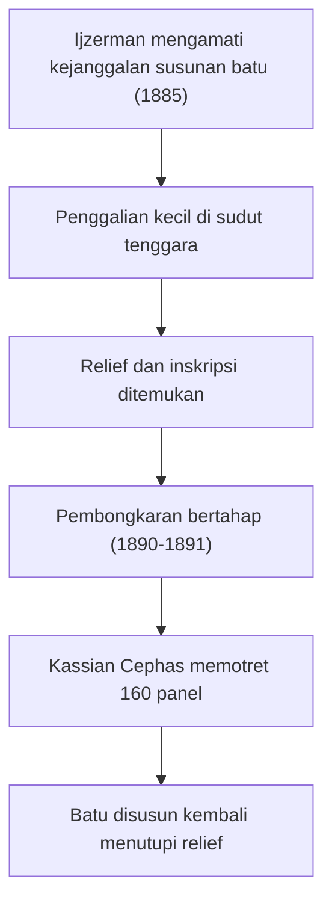

## Misteri Kaki Tersembunyi Candi Borobudur

Bayangkan kamu sedang membangun sebuah gedung pencakar langit yang megah, namun di tengah jalan, kamu menyadari bahwa fondasinya tidak cukup kuat untuk menopang beban puncak yang berat. Apa yang akan kamu lakukan? Kamu mungkin akan mempertebal bagian bawahnya, meskipun itu berarti menutupi ukiran indah yang baru saja selesai dipahat.

Inilah awal mula dari salah satu misteri arkeologi terbesar di dunia: **Kaki Tersembunyi (Hidden Base) Candi Borobudur.** Di balik struktur tambahan yang kita lihat sekarang, terdapat 160 panel relief **Karmawibhangga** yang sengaja "dikubur" oleh para pembangun aslinya.

### 1. Penemuan yang Tidak Disengaja (1885)

Selama berabad-abad, dunia tidak tahu bahwa Borobudur menyimpan rahasia di bagian dasarnya. Rahasia ini baru terungkap pada tahun **1885** oleh **Jan Willem Ijzerman**, ketua pertama *Archaeologische Vereeniging* (Perhimpunan Arkeologi) di Yogyakarta.

#### Kronologi Penemuan

1. **Observasi Struktur:** Ijzerman memperhatikan adanya kejanggalan pada susunan batu di bagian paling bawah candi. Bagian ini tampak seperti struktur tambahan yang menempel pada struktur asli.
2. **Pembongkaran Kecil:** Ia melakukan penggalian kecil di sudut tenggara.
3. **Kejutan Arkeologis:** Di balik tumpukan batu tersebut, ia menemukan dinding yang dipenuhi dengan relief indah dan prasasti singkat (inskripsi) yang memberikan instruksi bagi para pemahat.

> "Seolah-olah alam semesta ingin menyimpan catatan moralitas manusia di tempat yang paling gelap agar tetap abadi."

### 2. Mengapa Ditutup? Perdebatan Teori

Hingga saat ini, para ahli masih memperdebatkan alasan utama penutupan 160 panel relief ini. Terdapat dua perspektif utama: **Perspektif Teknis (Arsitektural)** dan **Perspektif Filosofis (Keagamaan)**.

#### A. Masalah Gravitasi

Secara teknis, Borobudur dibangun di atas bukit alami yang tanahnya tidak stabil. Seiring pembangunan berjalan menuju stupa utama yang sangat berat, terjadi tekanan luar biasa ke arah bawah dan samping.

**Analogi "Kue Lapis":** Bayangkan sebuah kue lapis yang lembut. Jika kamu menaruh beban berat di puncaknya, bagian bawah kue akan mulai melebar atau "mbleber" ke samping karena tidak kuat menahan beban.

Dalam fisika bangunan, hal ini berkaitan dengan tekanan ($P$) dan luas penampang ($A$):

$$
P = \frac{F}{A}
$$

Di mana:
- $P$ = Tekanan (*Pressure*)
- $F$ = Gaya/Beban (*Force*) dari struktur candi
- $A$ = Luas Alas (*Area*)

Untuk mengurangi tekanan ($P$) agar tanah tidak amblas atau struktur tidak pecah, para arsitek Jawa Kuno memutuskan untuk memperluas area alas ($A$). Dengan menambahkan "kaki tambahan" yang lebar, beban candi terdistribusi lebih merata. **Konsekuensinya, relief Karmawibhangga harus dikorbankan demi keselamatan seluruh bangunan.**

#### B. Tingkatan Kamadhatu

Secara simbolis, bagian dasar Borobudur melambangkan **Kamadhatu**, yaitu dunia keinginan manusia yang penuh dengan nafsu, dosa, dan hukum sebab-akibat yang kasar. Beberapa ahli berpendapat bahwa penutupan ini melambangkan pengekangan nafsu duniawi agar seseorang dapat fokus menuju pencerahan di tingkat yang lebih tinggi.

### 3. Proses Dokumentasi dan Penutupan Kembali

Setelah ditemukan oleh Ijzerman, pemerintah Hindia Belanda menyadari pentingnya temuan ini. Namun, mereka juga sadar bahwa jika struktur tambahan dibongkar secara permanen, Candi Borobudur terancam runtuh.

**Langkah-langkah yang diambil saat itu:**

- **Pembongkaran Bertahap (1890-1891):** Struktur tambahan dibongkar bagian demi bagian hanya untuk difoto.
- **Peran Kassian Cephas:** Fotografer pribumi pertama, Kassian Cephas, ditugaskan untuk memotret ke-160 panel tersebut. Inilah satu-satunya catatan visual lengkap yang kita miliki saat ini.
- **Penutupan Permanen:** Setelah didokumentasikan, batu-batu tersebut disusun kembali menutupi relief hingga hari ini.

Jika dirunut dari penemuan sampai penutupan kembali, urutan kejadiannya tampak seperti ini.

### 4. Bagian yang Masih Terbuka

Jika kamu berkunjung ke Borobudur saat ini, kamu masih bisa melihat **4 panel** yang sengaja dibiarkan terbuka di sudut tenggara. Ini dilakukan agar pengunjung dapat menyaksikan sebagian kecil dari keindahan "Kaki Tersembunyi" tersebut tanpa mengorbankan stabilitas struktur.

### Pelajaran dari Kaki Tersembunyi

Kisah penutupan relief ini memberikan pelajaran berharga dalam berbagai bidang modern:

1. **Arsitektur & Teknik Sipil:** Pentingnya perhitungan beban fondasi sejak awal perencanaan. Dalam proyek modern, kegagalan memperhitungkan "beban tambahan" bisa berakibat fatal.
2. **Manajemen Prioritas:** Terkadang, kita harus "mengorbankan" sesuatu yang indah atau berharga (relief) demi tujuan yang lebih besar atau keselamatan jangka panjang (keutuhan candi).
3. **Arkeologi Digital:** Kasus Borobudur menunjukkan bahwa dokumentasi (seperti foto Kassian Cephas) sangat krusial. Di masa depan, teknologi seperti *LIDAR* dan *3D Scanning* akan menjadi cara kita "melihat" apa yang tersembunyi tanpa harus merusak fisik aslinya.
