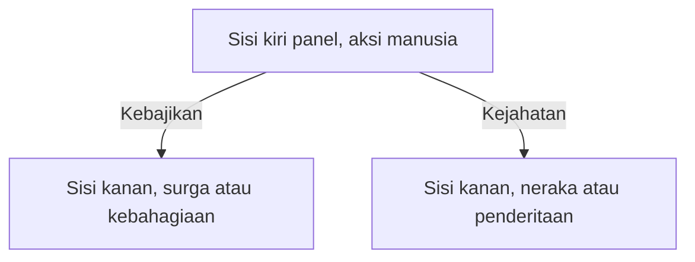

## Metode Pembacaan dan Struktur Visual Relief Karmawibhangga

Bayangkan kamu sedang berdiri di kaki Candi Borobudur. Di hadapanmu, terbentang deretan panel batu berisi cerita. Membaca relief Karmawibhangga bukan sekadar melihat gambar, melainkan mengikuti urutan perbuatan dan akibatnya.

Untuk memahami pesan moral di balik 160 panel yang ada di kaki tersembunyi (*Kamadhatu*), kita memerlukan "kunci" teknis untuk membuka kode visualnya. Bab ini akan memandumu memahami struktur fisik panel dan metode pembacaan yang berakar pada tradisi pradaksina.

### 1. Arah Pembacaan Pradaksina

Dalam tradisi Buddhisme, sebuah monumen suci tidak dikunjungi secara acak. Ada aturan navigasi yang disebut **Pradaksina**.

**Apa itu Pradaksina?** Pradaksina adalah ritual penghormatan dengan cara mengelilingi objek suci (seperti candi atau stupa) searah jarum jam.

- **Secara Teknis:** Pengunjung memosisikan candi selalu di sebelah kanan (*right-hand side*).
- **Urutan:** Dimulai dari pintu sisi Timur, lalu bergerak menuju Selatan, Barat, Utara, dan kembali lagi ke Timur.
- **Filosofi:** Gerakan ini mengikuti arah peredaran matahari di langit, melambangkan keselarasan dengan alam semesta dan penghormatan kepada Sang Buddha.

> **Insight Memorable:** Membaca relief dengan cara Pradaksina berarti kamu selalu menjaga candi di sisi kananmu sambil berjalan maju.

### 2. Komposisi Visual Panel Sebab dan Akibat

Setiap panel relief Karmawibhangga bukanlah satu adegan tunggal yang statis. Para pemahat Jawa Kuno menggunakan teknik narasi visual untuk menggambarkan hukum karma.

#### Struktur Pembagian Panel

Secara umum, satu panel relief sering kali dibagi menjadi dua atau tiga bagian komposisi secara horizontal untuk menunjukkan alur waktu:

1. **Sisi Kiri (Sebab/Aksi):** Biasanya menggambarkan aktivitas manusia di dunia. Contoh: Seseorang yang sedang berburu, bersedekah, atau menghina orang tua.
2. **Sisi Kanan (Akibat/Konsekuensi):** Menggambarkan hasil dari perbuatan di sisi kiri. Jika di kiri ia berburu, di kanan ia digambarkan menderita sakit atau berada di alam neraka.
3. **Elemen Pemisah:** Untuk memisahkan satu adegan dengan adegan lainnya dalam satu panel, pemahat sering menggunakan pohon, pilar bangunan, atau sosok orang yang berdiri membelakangi adegan sebelumnya.

#### Komik Tanpa Kata

Pikirkan panel relief ini seperti sebuah **Strip Komik** modern.

- **Kotak 1 (Kiri):** Kamu makan makanan tidak sehat secara berlebihan.
- **Kotak 2 (Kanan):** Kamu merasakan sakit perut. Dalam relief, kedua "kotak" ini berada dalam satu bingkai batu panjang tanpa garis pembatas yang kaku.

### 3. Logika "Jika-Maka" dalam Relief

Secara teknis, setiap panel mengikuti logika sebab-akibat sederhana yang bisa kita representasikan secara matematis atau sebagai percabangan untuk memudahkan pemahaman.

**Rumus Karma dalam Relief:**

$$
\text{Perbuatan (Action)} \rightarrow \text{Hasil (Result)}
$$

$$
\text{Karma} \times \text{Keadaan} = \text{Vipaka (Buah)}
$$

Dalam bentuk percabangan, logika jika-maka itu dapat kamu baca sebagai panduan sederhana berikut: bila aksi manusia di sisi kiri panel berupa kebajikan, sisi kanan menunjukkan surga atau kebahagiaan; bila berupa kejahatan, sisi kanan menunjukkan neraka atau penderitaan.

### 4. Hierarki dan Perspektif Objek

Para seniman Shailendra menggunakan teknik visual tertentu untuk menunjukkan status sosial atau urgensi spiritual:

- **Perspektif Hierarki:** Tokoh yang lebih penting (raja, biksu, atau dewa) biasanya digambarkan duduk di tempat yang lebih tinggi (balai-balai) atau memiliki ukuran tubuh yang sedikit lebih besar dan proporsional dibandingkan rakyat jelata.
- **Posisi Tubuh:** Tokoh yang sedang melakukan "sebab" biasanya digambarkan aktif bergerak, sedangkan tokoh yang menerima "akibat" sering kali digambarkan dalam posisi pasif, merenung, atau menderita.

### 5. Storyboarding dan UX Design

Prinsip pembagian panel Karmawibhangga sebenarnya masih relevan dalam dunia profesional modern, terutama dalam bidang kreatif:

1. **Storyboarding Film:** Bagaimana seorang sutradara menyusun urutan kejadian dalam satu *frame* untuk menunjukkan perkembangan karakter.
2. **User Experience (UX) Design:** Desainer aplikasi menggunakan urutan visual (kiri ke kanan) untuk memandu pengguna dari "Aksi" (menekan tombol) ke "Hasil" (transaksi berhasil).
3. **Analisis Data:** Memahami bahwa setiap titik data saat ini adalah "Akibat" dari serangkaian variabel "Sebab" di masa lalu.

**Contoh Skenario:** Dalam sebuah kampanye sosial tentang lingkungan:

- **Sisi Kiri (Sebab):** Gambar orang membuang sampah plastik ke sungai.
- **Sisi Kanan (Akibat):** Gambar banjir yang merendam permukiman mereka sendiri. Ini adalah penggunaan struktur "Karmawibhangga" dalam komunikasi visual modern untuk menciptakan efek jera.

> **Pesan Utama:** Struktur relief Karmawibhangga bukan dibuat untuk estetika semata. Urutan **Pradaksina** melatih kedisiplinan fisik, sementara pembagian **Sebab-Akibat** pada panel melatih cara berpikir sebab-akibat. Dengan memahami cara membacanya, kamu tidak lagi melihat batu berukir saja, tetapi membaca urutan perbuatan dan akibatnya.
