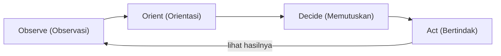

## Fleksibilitas Kognitif dan Adaptasi

Bayangkan kamu sedang mengemudi menuju pertemuan penting menggunakan aplikasi GPS. Tiba-tiba, jalan utama ditutup karena perbaikan darurat. Apa yang kamu lakukan? Apakah kamu berhenti di tengah jalan, marah pada aspal, dan menyerah? Ataukah kamu membiarkan GPS melakukan *recalculating* dan mengikuti rute alternatif dengan tenang?

**Fleksibilitas Kognitif** adalah kemampuan "recalculating" dalam otak kita. Ini adalah kapasitas mental untuk beralih di antara konsep yang berbeda, atau menyesuaikan strategi ketika aturan main dalam hidup tiba-tiba berubah.

## 1. Pohon Oak vs. Bambu

Dalam dunia resiliensi, ada sebuah perumpamaan klasik tentang pohon Oak dan sebatang Bambu saat menghadapi badai besar:

- **Pohon Oak** sangat besar, kuat, dan kaku. Ia melawan angin dengan segala kekuatannya. Namun, ketika angin melampaui batas kekuatannya, Oak akan tumbang atau patah.
- **Bambu** mungkin terlihat lebih lemah, tetapi ia fleksibel. Saat badai menerjang, ia melengkung mengikuti arah angin. Setelah badai berlalu, ia tegak kembali tanpa kerusakan berarti.

Fleksibilitas kognitif tidak berarti lemah. Ini adalah tentang kemampuan beradaptasi.

> "Ukuran kecerdasan adalah kemampuan untuk berubah." , Albert Einstein

### Mengapa Ini Penting?

Di era modern, perubahan terjadi dengan kecepatan eksponensial. Keahlian yang relevan hari ini mungkin usang tahun depan. Orang yang memiliki fleksibilitas kognitif tinggi cenderung:

1. Lebih rendah tingkat stresnya karena tidak terpaku pada satu ekspektasi.
2. Lebih kreatif dalam memecahkan masalah (*problem-solving*).
3. Lebih cepat pulih dari kegagalan karena segera mencari "Rencana B".

## 2. Siklus OODA

Untuk melatih kecepatan dalam mencari solusi alternatif, kita bisa meminjam strategi militer yang dikembangkan oleh Kolonel John Boyd, yaitu **Siklus OODA (Observe, Orient, Decide, Act)**.

1. **Observe (Observasi):** Mengumpulkan data mentah. Apa yang sebenarnya terjadi? Jangan berasumsi.
2. **Orient (Orientasi):** Inilah bagian fleksibilitas kognitif. Singkirkan biasmu. Bagaimana situasi baru ini mengubah posisimu?
3. **Decide (Memutuskan):** Berdasarkan orientasi baru, pilih opsi terbaik dari berbagai alternatif yang muncul.
4. **Act (Bertindak):** Eksekusi keputusan tersebut dengan cepat, lalu kembali ke tahap observasi untuk melihat hasilnya.

Keempat tahap itu membentuk putaran yang bisa kamu lihat pada bagan berikut.

*Pernahkah kamu terus melakukan hal yang sama berkali-kali meskipun hasilnya selalu gagal? Itu adalah tanda 'Cognitive Rigidity' (Kekakuan Kognitif). Bagaimana jika kamu mencoba tahap 'Orient' secara berbeda hari ini?*

## 3. Teknik Melatih Otak yang Fleksibel

Fleksibilitas kognitif adalah otot mental. Jika tidak dilatih, ia akan kaku. Berikut adalah cara melatihnya:

### A. Berpikir Divergen (The Alternative Uses Test)

Ambil satu benda sederhana, misalnya klip kertas. Dalam 2 menit, tuliskan sebanyak mungkin kegunaan benda tersebut selain untuk menjepit kertas.

- *Contoh:* Menjadi kunci slot kartu SIM, pembersih kuku, kail pancing kecil, atau dekorasi seni.
- **Tujuan:** Memaksa otak keluar dari jalur berpikir fungsional yang standar.

### B. Prinsip "Yes, And..." (Improvisasi)

Ini adalah aturan emas dalam teater improvisasi. Ketika seseorang memberimu situasi (bahkan yang buruk sekalipun), jangan katakan "Tidak, tapi...". Katakan **"Ya, dan..."**.

- *Situasi:* "Server kita mati tepat saat peluncuran produk."
- *Respon Fleksibel:* " **Ya**, server mati, **dan** kita akan menggunakan momen ini untuk mengirim email personal ke pelanggan tentang masa tunggu, sekaligus memberikan kode diskon sebagai permohonan maaf."

### C. Mengubah Rutinitas Kecil

Otak menjadi malas jika selalu berada di jalur yang sama.

- Cobalah pulang lewat jalan yang berbeda.
- Gunakan tangan non-dominan untuk menyikat gigi.
- Ubah urutan kerja harianmu.
- **Mengapa?** Ini membangun *neuroplastisitas*, membuat otak terbiasa dengan ketidaknyamanan kecil sehingga siap menghadapi perubahan besar.

## 4. Pivot ke Teknologi Baru

Dalam dunia rekayasa perangkat lunak atau manajemen proyek, fleksibilitas kognitif adalah perbedaan antara sistem yang *fragile* (rapuh) dan *resilient* (tangguh).

**Skenario:** Sebuah tim pengembang sedang membangun fitur utama menggunakan teknologi X. Di tengah jalan, ditemukan celah keamanan fatal pada teknologi X yang tidak bisa diperbaiki dengan cepat.

**Respon Kaku (Rigid):** Memaksakan menggunakan teknologi X dengan tambalan ala kadarnya karena sudah terlanjur mengalokasikan anggaran dan waktu (Sunk Cost Fallacy).

**Respon Fleksibel (Adaptive):** Menerima kenyataan bahwa teknologi X tidak lagi layak. Melakukan pivot dengan cepat ke teknologi Y, meskipun harus melakukan *refactoring* pada sebagian kode.

### Jalur Alternatif Saat Perubahan Kritis

Sistem yang adaptif punya jalur cadangan (*fallback*), dan pola yang sama bisa kamu terapkan dalam cara berpikirmu. Saat perubahan tak terduga datang, nilai dulu apakah perubahan itu kritis. Kalau tidak kritis, rencana awal tetap dijalankan. Kalau kritis, gunakan tahap Orient untuk mencari alternatif, misalnya:

1. Pivot ke Rencana B.
2. Beralih ke sistem cadangan.
3. Menghentikan langkah dan mengevaluasi ulang.

Setelah itu, tahap Decide dan Act memilih alternatif terbaik lalu menjalankannya. Ibarat sistem yang tangguh, kegagalan rencana utama tidak membuatmu runtuh karena stres, tetapi membuatmu beralih ke jalur alternatif.

## 5. Menghitung Keberhasilan Adaptasi

Secara matematis, peluang kesuksesan kita dalam lingkungan yang tidak pasti ($\mathbb{P}\_{\text{s}}$) berbanding lurus dengan jumlah alternatif valid ($n$) yang dapat kita hasilkan dalam waktu singkat ($t$).

$$
\mathbb{P}_{\text{s}} \approx \sum_{i=1}^{n} \frac{A_i}{t}
$$

Di mana:

- $A\_i$ adalah efektivitas dari alternatif ke-$i$.
- Semakin banyak alternatif ($n$) yang bisa dipikirkan otakmu secara fleksibel, semakin tinggi probabilitasmu untuk bertahan dan menang.

## Menjadi Cair

**Penting:** Fleksibilitas kognitif bukan berarti kamu tidak memiliki prinsip atau tujuan. Tujuanmu tetap sama (misal: sampai ke tujuan), namun rute yang kamu ambil bisa berubah seribu kali.

> **Key Takeaway:** Ketangguhan bukan tentang seberapa kuat kamu menahan beban tanpa bergerak, tetapi seberapa cepat kamu bisa menari di tengah badai dan menemukan langkah baru saat musiknya berubah.

*Refleksikan satu tantangan yang sedang kamu hadapi saat ini. Jika pendekatan saat ini belum berhasil, apa tiga alternatif berbeda,sekalipun terdengar tidak biasa,yang bisa kamu coba besok?*
