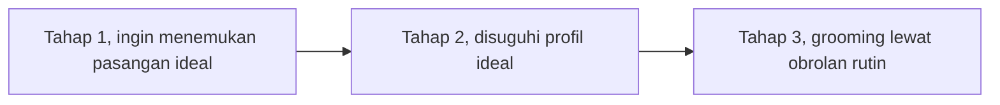

## Kenalan dari Layar dan Batas Percaya

Pesan pertama datang pagi-pagi, sapaan hangat dari kenalan yang baru kamu kenal lewat sebuah grup diskusi daring. Malamnya datang pesan lagi, menanyakan apakah kamu sudah makan. Besok pagi begitu lagi, besok malam juga. Tidak lama kemudian, kamu mulai menunggu notifikasi itu, dan hari terasa janggal kalau satu sapaan terlewat.

Sebelum lanjut, satu hal perlu jelas. Bab ini tidak mengajakmu mencurigai semua orang yang kamu kenal lewat layar. Yang dibahas adalah cara mengatur kecepatan percaya, yaitu memberi kepercayaan sedikit demi sedikit sesuai apa yang sudah terbukti, bukan sesuai seberapa sering pesannya datang.

### Sapaan Rutin dalam Tahap Awal Penipuan Asmara

Peneliti Whitty mewawancarai dua puluh orang yang pernah menjadi korban penipuan asmara daring (*romance scam*), baik yang kehilangan uang maupun yang tidak. Dari wawancara itu ia menyusun [model tahapan penipuan asmara daring](https://doi.org/10.1093/bjc/azt009). Tiga tahap pertamanya adalah:

- Tahap 1, korban termotivasi untuk menemukan pasangan yang ideal.
- Tahap 2, korban disuguhi profil yang tampak ideal.
- Tahap 3, proses *grooming*, tahap saat penipu membangun kepercayaan korban.

Urutan tiga tahap itu bisa kamu lihat ringkas pada bagan berikut.

Tahap ketiga paling dekat dengan skenario pembuka. Whitty menggambarkan obrolan yang sering, pagi dan malam, sebagai hal yang membuat hubungan itu menjadi rutinitas, dan rutinitas itu membuatnya lebih sulit ditinggalkan. Dalam model ini, penipu membangun kepercayaan yang cukup untuk kemudian menipu korban demi uang.

Pelajarannya bukan bahwa pesan selamat pagi itu berbahaya. Sapaan rutin juga bisa datang dari orang yang tulus. Pelajarannya, rasa dekat yang tumbuh dari kebiasaan belum sama dengan kepercayaan yang sudah teruji.

### Ketika AI Ikut Menulis Pesan Rayuan

Ada lapisan baru yang perlu kamu tahu. Survei vendor [McAfee](https://www.mcafee.com/blogs/internet-security/love-bytes-how-ai-is-shaping-modern-love/) pada Januari 2024 terhadap 7.000 orang dewasa di tujuh negara mencatat hampir satu dari empat orang Amerika pernah mempercantik foto atau konten kencan mereka dengan AI (*artificial intelligence*, kecerdasan buatan). Survei yang sama mencatat bahwa hanya 24% responden yakin bisa mengenali pesan tulisan AI.

[Laporan Mashable](https://mashable.com/article/singles-using-ai-to-date-up-300-percent-match) tentang survei Match dan Kinsey Institute terhadap sekitar 5.000 lajang di Amerika Serikat mencatat 26% memakai AI untuk membantu urusan kencan, sementara 36% menganggap memakai AI untuk membuat percakapan sebagai alasan untuk mundur (*dealbreaker*).

Angka-angka ini mengingatkan bahwa pesan yang manis dan rapi belum tentu ditulis sendiri oleh pengirimnya. Itu bukan alasan mencurigai setiap kalimat indah, tetapi alasan untuk menilai seseorang dari tindakan yang konsisten, bukan dari kata-kata saja.

### Gambaran Kekerasan Berbasis Gender dari CATAHU 2025

Di Indonesia, Komnas Perempuan mencatat dalam [CATAHU 2025](https://komnasperempuan.go.id/catatan-tahunan-detail/catahu-2025-menguatkan-data-mengatasi-kerentanan-mendesak-negara-bersikap-untuk-keadilan-korban) sebanyak 376.529 kasus kekerasan berbasis gender terhadap perempuan sepanjang 2025, dan 89,76% di antaranya terjadi di ranah personal. Angka ini menggambarkan kekerasan berbasis gender yang tercatat secara umum, bukan risiko bertemu kenalan daring.

[Lembar fakta CATAHU 2025](https://komnasperempuan.go.id/file-manager/frontend/Lembar%20Fakta%20CATAHU%20Komnas%20Perempuan%202025?ref=IkltVjVTakZqTWxa66993c4d1ef55c649529ce5934120c9994fNVNXcHZhVm96Vm14ak0xRnBURU5LYldGWGVHeGliVVowV2xOSk5rbHFWVFJQVjBwcFdtcGthVXhYUm1sTmFrVjBUa2RWTVU1RE1EVk5SRWw2VEZSRmVsbDZTbWhhUjBacFRUSkpORTE1TlZGU1JWbHBURU5LYTFsWVVteFlNMHBzWTFoV2JHTXpVV2xQYVVsNVRVUkpNa3hVUVhwTVZFMTNTVVJGTUU5cVZUVlBha1V5U1dsM2FWcFlhSGRoV0Vwb1pFZHNkbUpwU1RaSmFrbDNUV3BaZEUxRVRYUk5la0ZuVFZSVk5rNVVhelpOVkZscFpsRTlQU0k9Ig%3D%3D) menyebut bahwa di antara pengaduan yang masuk ke Komnas Perempuan, kekerasan berbasis gender *online* (KBGO) masih menjadi bentuk yang paling dominan, dengan 1.091 kasus pada 2025. Bacalah angka ini dengan tepat. Angka 1.091 hanya menghitung pengaduan ke Komnas Perempuan, bukan jumlah seluruh kasus KBGO di Indonesia.

### Kebiasaan Aman Sebelum Bertemu Kenalan Daring

Panduan kencan aman dari [RAINN](https://rainn.org/strategies-to-reduce-risk-increase-safety/tips-for-safer-dating-online-and-in-person/) bisa kamu sesuaikan menjadi beberapa kebiasaan sederhana:

- Luangkan waktu untuk mengenal orangnya, dan bertemu hanya saat kamu sudah nyaman. Desakan untuk cepat bertemu adalah tanda bahaya (*red flag*).
- Jangan terburu-buru memindahkan obrolan keluar dari platform tempat kalian berkenalan. McAfee juga mencatat bahwa penipu cepat memindahkan percakapan ke aplikasi chat lain.
- Cari tahu tentang orang itu sebelum bertemu, dan jangan bagikan alamat rumah, tempat kerja, atau rutinitas harianmu.
- Jangan pernah mengirim uang kepada orang yang belum pernah kamu temui. McAfee juga menyarankan agar kamu menceritakan kenalan barumu kepada orang yang kamu percaya.
- Saat bertemu, beri tahu teman atau keluarga ke mana kamu pergi, siapa yang kamu temui, dan kapan kamu pulang. Bagikan lokasimu.
- Pilih tempat umum yang terang dan ramai, jangan saling berkunjung ke rumah sebelum kepercayaan terbangun, atur transportasimu sendiri, dan siapkan rencana untuk pergi.

Kalau ada yang membuatmu tidak nyaman, panduan itu menyarankan agar kamu mendengarkan firasatmu: berhenti berkomunikasi, blokir orangnya, dan laporkan perilaku yang mengganggu. Panduan itu juga menegaskan bahwa kamu tidak berutang waktu atau sopan santun kepada siapa pun saat keamanan atau kenyamananmu terancam. Buku ini berpandangan bahwa orang yang tulus semestinya mau menunggu sampai kamu siap.

### Inti Pembahasan

- Model Whitty menggambarkan tiga tahap awal penipuan asmara daring: motivasi mencari pasangan ideal, profil yang tampak ideal, lalu *grooming* lewat obrolan pagi dan malam yang membuat hubungan sulit ditinggalkan.
- Dalam survei McAfee, hanya 24% yang yakin bisa mengenali pesan tulisan AI, jadi kata-kata manis perlu dibaca bersama tindakan.
- Tujuannya bukan mencurigai semua kenalan daring. Kuncinya adalah mengatur kecepatan percaya.

Setelah melihat dengan jernih, kadang kamu sampai pada keputusan untuk tidak melanjutkan, entah karena ada yang janggal atau sekadar karena perasaanmu tidak sama. Lalu kenapa mengatakan tidak terasa begitu berat?
