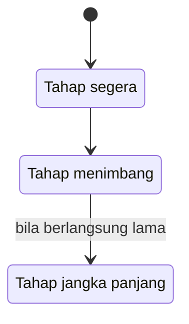

## Dari Sisi yang Tidak Dipilih

Kamu membuka aplikasi chat untuk kesekian kalinya malam ini, dan pesan terakhirmu masih belum berbalas. Tanda dibaca sudah muncul sejak sore. Kamu menutup layar, lalu membukanya lagi beberapa menit kemudian, seolah menyegarkan halaman bisa memunculkan jawaban.

Sebagian besar buku ini berbicara kepada orang yang tidak membalas perasaan. Bab ini sengaja berpindah kursi. Kita melihat dari sisi orang yang menyukai tetapi tidak dipilih, supaya kamu bisa memahami orang yang kamu tolak, dan mungkin juga memahami dirimu sendiri kalau kamu pernah berada di posisi itu.

### Otak yang Ikut Mencatat Pengucilan

Apakah ditolak benar-benar terasa sakit, atau itu hanya kiasan? Pertanyaan itu menjadi judul penelitian [Eisenberger, Lieberman, dan Williams (2003)](https://doi.org/10.1126/science.1089134). Peserta bermain lempar bola virtual sambil otaknya dipindai, dan ada saat mereka diikutsertakan serta saat mereka dikucilkan dari permainan.

Hasilnya, bagian otak bernama *anterior cingulate cortex* (korteks singulat anterior) lebih aktif saat peserta dikucilkan dibandingkan saat diikutsertakan. Makin aktif bagian itu, makin tinggi rasa tertekan yang dilaporkan peserta sendiri. Sebaliknya, aktivitas *right ventral prefrontal cortex* (korteks prefrontal ventral kanan) berhubungan dengan rasa tertekan yang lebih rendah.

Penelitian ini memakai permainan sederhana, bukan kisah cinta, jadi ia tidak menakar seberapa sakit ditolak gebetan. Namun ia memberi alasan untuk tidak menertawakan orang yang bilang "sakit" setelah diabaikan. Rasa itu tidak bisa diremehkan begitu saja.

### Empat Kebutuhan yang Terguncang

[Williams dan Nida (2011)](https://doi.org/10.1177/0963721411402480) merangkum penelitian tentang *ostracism* (pengucilan, yaitu diabaikan atau disisihkan). Menurut mereka, pada tahap paling awal, pengucilan dirasakan sebagai rasa sakit dan sebagai ancaman terhadap empat kebutuhan dasar:

- **Rasa memiliki**, perasaan bahwa kamu bagian dari sesuatu dan diterima.
- **Harga diri**, penilaian bahwa dirimu cukup berharga.
- **Kendali**, perasaan bahwa kamu bisa memengaruhi apa yang terjadi padamu.
- **Keberadaan yang bermakna**, keyakinan bahwa kehadiranmu diperhatikan dan berarti.

Bayangkan lagi layar chat yang sunyi tadi. Kamu tidak tahu apakah dia sibuk atau memang tidak ingin membalas, sehingga rasa kendali ikut goyah. Kamu bertanya-tanya apa yang salah dari dirimu, sehingga harga diri ikut tersentuh.

Di bab 8 kita sudah melihat bahwa menurut para peneliti, *ghosting* (menghilang tanpa kabar) dapat dianggap salah satu bentuk pengucilan, dengan tahap reaksi yang berujung pada penerimaan ([Pancani dan rekan, 2021](https://doi.org/10.1177/02654075211000417)). Empat kebutuhan ini memberi nama untuk apa yang terasa hilang di sepanjang jalan itu.

### Tiga Tahap Setelah Diabaikan

Williams dan Nida juga membagi pengalaman dikucilkan ke dalam tiga tahap:

1. **Tahap segera (refleksif).** Rasa sakit muncul, dan empat kebutuhan tadi terasa terancam.
2. **Tahap menimbang (reflektif).** Tahap tempat orang mengatasi pengalaman itu, atau *coping*.
3. **Tahap jangka panjang (pasrah).** Pengucilan yang berlangsung lama dapat bergeser ke sini.

Siapa yang mengucilkan dan apa alasannya hanya sedikit berpengaruh pada rasa sakit di tahap segera. Siapa dan mengapa baru lebih berperan di tahap menimbang. Jadi wajar kalau kamu tetap merasa perih walaupun kamu tahu dia punya alasan yang masuk akal.

Bagaimana dengan tahap ketiga? Dalam tulisan sebelumnya, [Williams (2009)](https://doi.org/10.1016/S0065-2601(08)00406-1) menulis bahwa paparan pengucilan yang berkepanjangan pada akhirnya mengarah pada rasa pasrah, keterasingan, ketidakberdayaan, dan depresi. Ini bukan ramalan untuk setiap orang yang pernah ditolak, melainkan catatan bahwa diabaikan terus-menerus dalam waktu lama bukan perkara kecil.

Kalau dirangkum dalam satu gambar, perjalanan dari tahap segera sampai tahap jangka panjang terlihat seperti ini.

### Cerita yang Disusun Pihak yang Berharap

Penelitian [Baumeister, Wotman, dan Stillwell (1993)](https://doi.org/10.1037/0022-3514.64.3.377) mengumpulkan kisah dari kedua sisi cinta yang tidak berbalas. Ketika orang yang pernah berharap menengok ke belakang, mereka mengingat campuran emosi, ada yang positif dan ada yang sangat negatif. Mereka yakin bahwa ketertarikan itu sebenarnya timbal balik, dan merasa telah dibuat berharap.

Mereka juga menyusun cerita tentang apa yang terjadi, dan cerita itu disusun untuk membangun kembali harga diri. Di mata mereka, orang yang menolak tampak tidak konsisten dan misterius. Tambahkan temuan di bab 7 tentang penolakan yang terasa tidak pernah disampaikan dengan tegas, dan kamu bisa membayangkan berapa banyak pertanyaan yang tersisa di sisi ini.

Pemahaman ini berguna dari dua arah. Kalau kamu yang menolak, kamu jadi tahu bahwa sikap yang menurutmu wajar bisa terbaca membingungkan dari seberang. Kalau kamu yang pernah berharap, kamu boleh mengakui bahwa ceritamu sendiri mungkin ikut disusun untuk melindungi harga diri. Itu manusiawi, bukan aib.

### Langkah Mundur yang Menjaga Harga Diri

Bagian ini saran buku ini, bukan temuan Williams dan Nida. Karena yang terguncang adalah empat kebutuhan tadi, tahap menimbang bisa kamu pakai untuk menguatkannya lagi. Beberapa pegangan yang bisa kamu coba:

- **Hormati pilihannya.** Perasaanmu nyata, dan keputusannya juga nyata. Tidak membalas perasaan adalah hak dia, sama seperti menyukai adalah hakmu.
- **Mundur ketika balasan berhenti.** Kalau pesan-pesanmu tidak lagi dijawab, berhentilah mengirim. Keputusan untuk berhenti ada di tanganmu, dan itu cara kecil untuk mengambil kembali rasa kendali.
- **Bangun rasa memiliki di tempat lain.** Luangkan waktu bersama teman, keluarga, atau kelompok yang membuatmu merasa diterima.
- **Isi lagi harga dirimu.** Kemampuan, minat, dan kebaikan yang kamu tunjukkan kepada orang lain tetap milikmu, apa pun jawabannya.
- **Beri arti pada hari-harimu.** Kegiatan kecil yang bermakna bagimu membuat hari tidak habis untuk menunggu.

Langkah-langkah ini bukan resep yang menjamin rasa sakit hilang dalam waktu tertentu. Kalau rasa berat itu bertahan lama dan mulai mengganggu keseharianmu, bercerita kepada orang yang kamu percaya atau kepada tenaga profesional adalah langkah yang wajar.

### Recap

- Menurut Williams dan Nida, pada tahap awal pengucilan mengancam empat kebutuhan, yaitu rasa memiliki, harga diri, kendali, dan keberadaan yang bermakna.
- Tahapnya ada tiga, yaitu segera, menimbang, dan jangka panjang. Konteks lebih berperan di tahap menimbang, dan paparan yang berkepanjangan dapat mengarah pada rasa pasrah, walau itu bukan ramalan untuk setiap orang.
- Menghormati pilihannya, mundur ketika balasan berhenti, serta membangun lagi rasa memiliki dan harga diri di tempat lain adalah langkah yang bisa kamu ambil.

Perasaan seperti ini tidak hanya muncul di usia dewasa. Kadang ia sudah hadir di masa seragam sekolah, ketika naksir seseorang bisa terasa seperti seluruh dunia.
