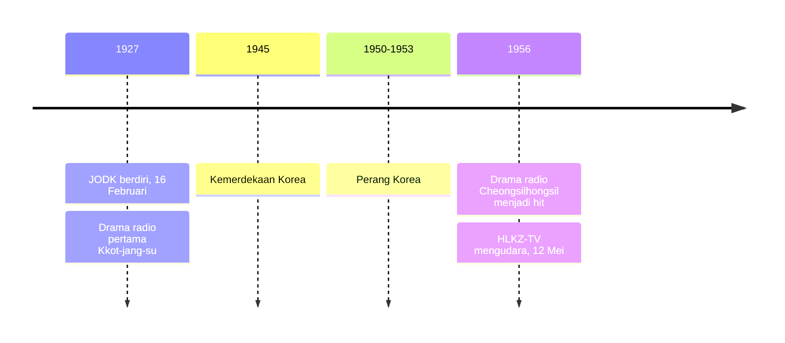

## Akar Awal Era Drama Radio dan Kelahiran Televisi

Hari ini jutaan orang di seluruh dunia terpaku pada layar *smartphone* untuk menyaksikan episode terbaru drama Korea. Namun, fondasi industri hiburan Korea Selatan dibangun lebih dulu di atas frekuensi suara dan kekuatan imajinasi. Jauh sebelum efek visual CGI yang canggih hadir, Korea telah memiliki tradisi bercerita yang kuat melalui media audio.

Bagian ini akan membawa kamu menelusuri perkembangan drama audio dari tahun 1920-an hingga siaran televisi pertama di Seoul pada pertengahan 1950-an.

## 1. Kelahiran Drama Radio (1920-an - 1940-an)

Bayangkan sebuah masa di mana tidak ada layar untuk ditatap. Satu-satunya jendela menuju dunia luar adalah sebuah kotak kayu besar yang mengeluarkan suara statis. Inilah era drama radio, sebuah medium yang menuntut pendengarnya menjadi "sutradara" bagi imajinasi mereka sendiri.

### Masa Penjajahan dan JODK

Sejarah drama Korea dimulai pada **16 Februari 1927**, dengan berdirinya stasiun radio pertama di Korea, **JODK** (Gyeongseong Broadcasting Station).

Konteks sejarah saat itu cukup rumit karena Korea berada di bawah penjajahan Jepang. Akibatnya, siaran harus dilakukan dalam dua bahasa, yaitu Jepang dan Korea. Di tengah situasi inilah lahir drama radio pertama berjudul *Kkot-jang-su* (Penjual Bunga) pada tahun 1927. Bagi masyarakat setempat, drama radio berfungsi sebagai sarana hiburan langka sekaligus cara untuk melestarikan identitas budaya dan bahasa Korea dari represi penjajah.

> **Analogi Theater of the Mind**
> Drama radio ibarat sebuah *theater of the mind*. Tanpa dekorasi panggung atau kostum mewah, aktor harus menyampaikan emosi, jarak, dan tindakan hanya melalui intonasi suara dan efek suara manual (seperti meremas kertas untuk suara api atau memukul kelapa untuk menirukan suara langkah kuda).

## 2. Zaman Keemasan Radio (Pascakemerdekaan & 1950-an)

Setelah kemerdekaan pada tahun 1945 dan berakhirnya Perang Korea (1950–1953), radio menjadi media massa yang dominan. Masyarakat yang sedang berjuang membangun kembali negara mereka mencari pelarian dalam cerita-cerita melodrama.

### Fenomena "Cheongsilhongsil"

Pada tahun 1956, drama radio berjudul **"Cheongsilhongsil"** (Benang Biru, Benang Merah) menjadi hit besar. Karya ini menciptakan standar baru bagi elemen-elemen khas K-Drama modern: kisah melodrama cinta yang rumit dan penuh air mata membuat pendengar terikat secara emosional. Pada masa itu, orang-orang rela berkerumun di sekitar satu-satunya radio di desa demi menyimak kelanjutan cerita. Kepopuleran ini juga melahirkan fenomena baru, di mana para pengisi suara (*voice actor*) menjadi selebritas di Korea bahkan sebelum wajah mereka dikenal publik.

## 3. Kelahiran Televisi (1956 - 1959)

Transisi dari suara ke gambar tidak terjadi dalam semalam. Ini adalah proses teknis yang penuh tantangan dan kegagalan awal.

### Pionir HLKZ-TV yang Terlupakan

Pada **12 Mei 1956**, stasiun televisi pertama di Korea, **HLKZ-TV** (Daehan Broadcasting Network), mulai mengudara.

Siaran perdana stasiun ini menampilkan drama televisi pertama Korea berjudul *The Gate of Heaven* (Cheonguk-ui Mun). Karena teknologi perekam video (*video tape recorder* atau VTR) belum tersedia, seluruh produksi harus disiarkan secara langsung (*live*). Sistem siaran langsung tanpa jeda ini menuntut konsentrasi penuh. Jika aktor lupa dialog atau salah mengucapkan kalimat, kesalahan itu langsung tersiar ke para penonton tanpa ada kesempatan untuk diedit. Begitu pula saat properti panggung jatuh atau rusak di tengah adegan; pertunjukan harus terus berjalan apa adanya.

### Tantangan Ekonomi

Pada masa itu, televisi adalah barang mewah, di mana harga satu unitnya bisa setara dengan harga rumah kecil. Jumlah unit televisi di seluruh Seoul saat itu diperkirakan hanya sekitar 300 unit. Akibatnya, banyak orang menonton televisi di tempat umum atau di rumah tetangga yang lebih kaya. Keterbatasan kepemilikan ini melahirkan tradisi komunal menonton bersama, yang nantinya ikut membentuk eratnya budaya menonton bersama di Korea.

Tonggak-tonggak dari siaran radio pertama sampai televisi pertama itu bisa kamu lihat ringkas pada garis waktu berikut.

## 4. Radio vs. Televisi Awal

Berikut adalah perbedaan mendasar dalam produksi drama pada masa transisi tersebut:

| Fitur | Drama Radio (1920-an - 1950-an) | Drama TV Awal (Akhir 1950-an) |
| --- | --- | --- |
| **Media Utama** | Suara & Efek Foley | Visual & Dialog Langsung |
| **Teknologi** | Transmisi Analog | Sinyal Gelombang VHF |
| **Metode Produksi** | Rekaman/Langsung | 100% Siaran Langsung (*Live*) |
| **Imajinasi Penonton** | Sangat Tinggi (Membayangkan visual) | Terfokus pada ekspresi wajah aktor |
| **Aksesibilitas** | Luas (Radio murah dan terjangkau) | Sangat Terbatas (Hanya untuk kalangan elit) |

## 5. Bagaimana Radio Membentuk TV

Meskipun medianya berbeda, banyak unsur drama radio terbawa ke dalam drama televisi pertama. Ada beberapa pola kesinambungan utama yang patut dicatat:
- Format narasi yang episodik (bersambung) telah dikembangkan secara matang di radio sebelum diadopsi oleh stasiun televisi.
- Karena keterbatasan visual pada kamera awal, naskah drama televisi pertama sangat bergantung pada dialog yang kuat dan puitis, sebuah warisan langsung dari era radio.
- Banyak aktor drama televisi generasi pertama merupakan mantan pengisi suara radio. Mereka harus belajar cara mengekspresikan karakter menggunakan bahasa tubuh, bukan lagi sekadar mengandalkan vokal.

## Mengapa Sejarah Ini Penting Sekarang?

Memahami akar awal ini membantu kita memahami mengapa K-Drama modern sangat ahli dalam dua hal: **Dialog Emosional** dan **Musik Latar (OST)**.

Dalam industri modern, teknik *cliffhanger* yang sering digunakan penulis skenario papan atas seperti Kim Eun-sook sebenarnya berakar dari sandiwara radio tahun 1950-an. Saat itu, ketegangan di akhir siaran dibuat sedemikian rupa agar pendengar kembali menyalakan radio mereka keesokan harinya. Begitu pula dengan dominasi musik latar atau *original soundtrack* (OST) dramatis dalam drakor saat ini. Kepekaan audio tersebut merupakan bentuk evolusi langsung dari metode era radio, di mana suasana emosional harus dibangun sepenuhnya lewat suara tanpa bantuan elemen visual.

## Warisan Kreatif Siaran Langsung

Tuntutan siaran langsung pada akhir tahun 1950-an membentuk etos kerja yang keras di kalangan kru dan aktor televisi Korea. Tanpa kesempatan untuk melakukan rekaman ulang, proses latihan dilakukan berulang kali dengan disiplin yang ketat. Di sisi lain, antusiasme masyarakat yang besar terhadap cerita-cerita melodrama, meskipun di tengah keterbatasan ekonomi pascaperang, membuktikan bahwa kebutuhan akan narasi dan hiburan telah menjadi bagian penting dari ketahanan sosial mereka.

> **Catatan Sejarah:** Kelahiran drama Korea tidak diawali oleh kemewahan. Industri ini tumbuh dari berbagai keterbatasan. Dari keterbatasan visual era radio, lahir kekuatan imajinasi pendengar. Dari keterbatasan teknis televisi awal, lahir kedisiplinan tinggi dalam siaran langsung. Kombinasi faktor-faktor ini menjadi fondasi industri hiburan Korea Selatan di masa depan.
