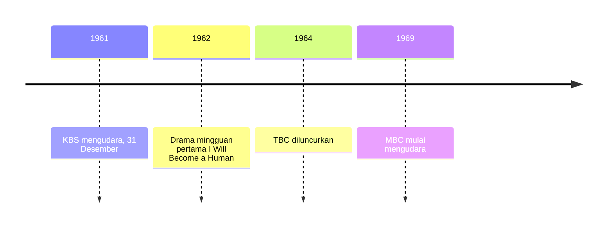

## Era Hitam Putih dan Formasi Dasar (1960-an)

Bayangkan sebuah masa ketika televisi masih menjadi barang baru yang langka. Benda elektronik di sudut ruangan ini mampu mengumpulkan seluruh warga desa di dalam satu rumah yang cukup beruntung untuk memilikinya. Seperti itulah suasana Korea Selatan pada dekade 1960-an. Setelah melewati masa transisi dari media radio, televisi mulai mengambil alih peran sebagai penutur cerita utama bangsa.

Pada dekade ini, K-Drama tidak lahir dari sinematografi mewah atau aktor berhonor tinggi. Sebaliknya, industri ini dirintis dari studio-studio sempit dengan teknologi serba terbatas, visual hitam putih, serta semangat kolektif untuk membangun kembali identitas nasional pascaperang.

## 1. Kelahiran KBS dan Siaran Nasional

Pasca-Perang Korea, pemerintah menyadari potensi televisi sebagai medium komunikasi massa. Maka, pada 31 Desember 1961, KBS (Korean Broadcasting System) resmi mengudara sebagai stasiun televisi milik negara.

**Analogi Radio dengan Mata**

> Jika drama radio pada dekade 1950-an menjadi "teater pikiran" (*theater of the mind*) tempat pendengar membayangkan sendiri wajah para tokoh, drama televisi era 1960-an hadir sebagai "radio dengan mata". Pada awal perjalanannya, teknik pengambilan gambar masih terasa kaku karena hanya merekam adegan layaknya panggung teater yang difilmkan.

### Karakteristik Produksi Awal

* **Siaran langsung (live)** menjadi pilihan utama karena teknologi rekaman pita magnetik (*videotape*) masih terlampau mahal dan langka. Alhasil, jika aktor melakukan kesalahan atau lupa naskah, penonton di seluruh negeri akan langsung mengetahuinya saat itu juga.
* Karena masih menggunakan **format hitam putih**, penyampaian emosi sangat bergantung pada kedalaman ekspresi wajah aktor serta permainan cahaya (*lighting*) yang dramatis.
* Dengan **rasio layar** standar $4:3$, visual yang dihasilkan terasa padat dan memusatkan fokus penonton langsung pada gerak-gerik karakter.

## 2. Drama Mingguan Pertama "I Will Become a Human" (1962)

Tonggak sejarah besar tercapai pada 1962 saat KBS merilis drama mingguan pertama berjudul *I Will Become a Human* (*Naneun Ingani Doeryeonda*). Momen ini menandai awal mula masyarakat Korea mengenal format drama serial.

### Mengapa Format Mingguan?

Ditinjau dari sisi teknis, memproduksi drama setiap hari mustahil dilakukan dengan keterbatasan sumber daya kala itu. Format mingguan memberikan ruang bagi penulis untuk merangkai naskah dan aktor untuk berlatih, meskipun tantangan siaran langsung masih ada dalam proses produksi.

Bagi para aktor pada masa itu, format mingguan dan keharusan siaran langsung mendatangkan tekanan berat. Bayangkan kamu harus menghafal puluhan halaman naskah dan berakting tanpa henti selama setengah jam penuh di depan kamera yang menyiarkan setiap gerakanmu secara langsung ke seantero negeri. Tanpa adanya kesempatan untuk merekam ulang atau menghapus kesalahan, konsentrasi penuh menjadi tuntutan mutlak yang tidak bisa ditawar.

## 3. Nilai Keluarga dan Restorasi Moral

Alur cerita drama era 1960-an belum sekompleks kisah ketegangan (*thriller*) politik atau fantasi modern seperti sekarang. Fokus narasi saat itu berpusat pada nilai-nilai keluarga serta etika Konfusianisme.

### Mengapa Nilai Keluarga Sangat Kuat?

1. **Penyembuhan luka pascaperang**. Masyarakat yang dilanda trauma akibat kehilangan anggota keluarga menemukan semacam terapi sosial dalam drama yang mengangkat persatuan keluarga.
2. Peran drama sebagai **media edukasi moral** bentukan pemerintah. Televisi dipakai untuk menyebarkan pesan modernisasi sekaligus menanamkan kembali nilai luhur seperti bakti kepada orang tua (*filial piety*).
3. Kepopuleran **genre Shinpa**, yaitu melodrama emosional yang menyorot pengorbanan seorang ibu atau nasib malang anak yatim piatu untuk menyentuh perasaan penonton.

**Pola Cerita yang Sering Muncul:**

* Ketegangan domestik yang jamak ditemui, seperti konflik menantu versus mertua.
* Perjuangan adaptasi kaum urban yang berpindah dari desa ke kerasnya kota besar.
* Pesan moral tentang pentingnya kejujuran dan etos kerja keras dalam kehidupan sehari-hari.

## 4. Munculnya Kompetisi TBC dan MBC

KBS memang memelopori industri ini, namun pertengahan hingga akhir dekade 1960-an ditandai oleh kemunculan stasiun televisi swasta yang membawa kompetisi.

* **TBC (Tongyang Broadcasting Company)** yang diluncurkan pada 1964 segera memantapkan posisinya sebagai pionir drama harian (*daily drama* atau *il-il deurama*).
* Stasiun **MBC (Munhwa Broadcasting Corporation)** mulai mengudara pada 1969 dengan membawa teknik penceritaan yang dinamis.

Kompetisi sengit antarstasiun ini memicu peningkatan kualitas akting dan keragaman cerita. Para penulis skenario mulai berani bereksperimen dengan dialog yang lebih natural, meninggalkan gaya kaku khas teater klasik.

Urutan kemunculan stasiun dan drama mingguan pertama sepanjang dekade ini tersusun seperti di bawah.

## Jejak 1960-an dalam K-Drama Modern

Meski industri kini memakai resolusi 4K dan teknologi CGI, fondasi yang diletakkan pada dekade 1960-an masih terlihat dalam K-Drama modern:

* **Struktur drama harian (daily drama)** yang tayang sore hari. Jenis tayangan ini biasanya menyasar ibu rumah tangga dan memiliki akar sejarah yang kuat dari tradisi drama keluarga era 1960-an.
* Kehadiran **sentimen "Han"**, yaitu perasaan duka mendalam sekaligus ketabahan yang kerap muncul dalam melodrama modern seperti *Autumn in My Heart*. Ini adalah bentuk evolusi langsung dari genre *Shinpa* tempo dulu.
* Konsep **hierarki keluarga** dan penghormatan kepada orang tua tetap menjadi sumbu konflik utama dalam drama populer modern seperti *Reborn Rich* atau *Sky Castle*. Nilai-nilai ini awalnya dibangun lewat narasi-narasi di dekade 1960-an.

## Perbandingan Teknis Era 1960-an dan Era Modern

Untuk memahami skala evolusi ini, lihat perbandingan sederhana berikut:

| Aspek | Era 1960-an | Era Modern (Sebagai Perbandingan) |
| --- | --- | --- |
| **Warna/Resolusi** | Hitam & Putih (B&W) | Berwarna dengan *Ultra High Definition* (UHD) |
| **Metode** | Mayoritas *Live* atau Rekaman Dasar | *Pre-produced* dengan Editing Canggih |
| **Distribusi** | Frekuensi Terestrial Terbatas | Global via OTT (Netflix/Disney+) |
| **Fokus Cerita** | Restorasi Keluarga & Moral | Diversifikasi Genre & Kritik Sosial |

> **Insight:** Era 1960-an mungkin tampak bersahaja secara visual. Namun, tanpa keberanian stasiun televisi perintis seperti KBS dan TBC dalam menguji format serial mingguan dan harian, K-Drama hari ini tidak akan memiliki fondasi narasi seperti sekarang. Di balik keterbatasan teknologi masa itu, mereka berhasil meletakkan dasar bagi budaya menonton di Korea.
