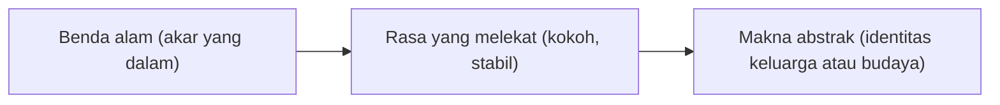

## Ketika Alam Menjadi Bahasa Batin

Bayangkan seorang perempuan bernama Laras berdiri di ujung dermaga, memandangi kabut tebal yang pelan-pelan menelan garis cakrawala. Pagi tadi ia kehilangan pekerjaan. Kapal-kapal yang sempat tampak di kejauhan lenyap satu per satu, sampai yang tersisa hanya bidang putih yang sunyi dan tak bertepi.

Penulis adegan itu tidak perlu menulis bahwa Laras sedih dan kehilangan arah. Kabut sudah mengatakannya. Banyak pembaca akan menangkap kabut itu sebagai masa depan yang mendadak tak terbaca, sebuah tujuan hidup yang hilang dari pandangan.

Dalam sastra, alam sering bekerja seperti itu. Gunung, hujan, dan bunga menjadi bahasa yang dipakai penulis untuk menyampaikan hal-hal yang terlalu rumit atau terlalu pedih untuk diucapkan terus terang. Buku ini mengajakmu belajar membaca bahasa tersebut.

### Jembatan antara Benda dan Gagasan

Simbolisme alam adalah teknik sastra yang meminjam unsur dunia fisik, seperti tumbuhan, hewan, cuaca, atau bentang alam, untuk mewakili gagasan abstrak, perasaan, atau keadaan jiwa manusia. Salah satu cara membayangkannya adalah sebuah jembatan. Di satu ujung berdiri benda yang bisa dilihat dan diraba, misalnya akar pohon yang menghunjam dalam ke tanah. Di ujung lain ada sesuatu yang tak berwujud, misalnya warisan keluarga atau keteguhan memegang prinsip. Simbol adalah bentang yang menyambungkan keduanya.

Jembatan itu jarang diseberangi dalam satu lompatan. Biasanya pembaca bergerak dari benda ke rasa yang melekat padanya, lalu dari rasa itu ke sebuah makna. Akar yang dalam memberi kesan kokoh dan stabil, dan kesan tersebut dapat tumbuh menjadi gambaran tentang identitas sebuah keluarga atau budaya.

Tiga langkah itu, bila digambar, membentuk rantai pendek berikut.

Teknik ini memungkinkan penulis menunjukkan perasaan tanpa menyebut namanya. Alih-alih menulis bahwa seorang tokoh sedang berduka, penulis dapat melukiskan langit yang perlahan tertutup awan kelabu yang berat. Prinsip yang dikenal sebagai *show, don't tell* ini sering dikaitkan dengan Chekhov. Prinsip itu berangkat dari nasihat dalam [surat Chekhov kepada saudaranya, Alexander, pada Mei 1886](https://quoteinvestigator.com/2013/07/30/moon-glint/). Di sana Chekhov menyarankan agar penulis menangkap detail kecil ketika melukiskan alam, misalnya kilau pecahan kaca botol di bendungan penggilingan, untuk mengisyaratkan cahaya bulan. Kalimat pendek tentang bulan dan pecahan kaca yang kerap dikutip atas namanya adalah ringkasan nasihat itu yang muncul belakangan.

### Mengapa Penulis Berpaling ke Alam

Alam akrab bagi banyak orang, di mana pun mereka tinggal. Matahari dipahami sebagai pemberi hidup, dan gelap membawa rasa tak menentu. Keakraban itu memberi penulis setidaknya tiga keuntungan.

Pertama, alam menyentuh naluri dasar. Banyak dari kita merasa tenang di tengah hutan yang hijau dan gelisah ketika guntur bergemuruh. Kedua, satu gambar alam dapat memadatkan banyak makna. Setangkai bunga layu di atas meja bisa bercerita tentang cinta yang usai atau masa muda yang telah lewat, tanpa penjelasan panjang. Ketiga, alam memberi wujud pada hal yang sulit dirumuskan. Harapan, keputusasaan, dan pencerahan susah ditangkap dengan definisi, dan alam menyediakan bentuk yang bisa dilihat untuk ketiganya.

Satu hal layak diingat sejak awal. Makna sebuah simbol sering bersifat subjektif dan dipengaruhi budaya, sehingga pembaca dari tradisi berbeda bisa menangkap hal yang berlainan dari benda yang sama. Daya dasarnya tetap serupa, yaitu memakai keindahan dan kekuatan alam untuk membedah kerumitan jiwa.

### Kapan Pohon Hanya Pohon

Tidak setiap pohon dalam cerita adalah simbol. Kadang pohon memang hanya pohon. Untuk memisahkan simbol dari deskripsi latar, kamu bisa mengajukan tiga pertanyaan.

Pertanyaan pertama menyangkut penekanan. Apakah penulis memberi benda itu perhatian khusus, dengan deskripsi yang rinci atau tak biasa? Pertanyaan kedua menyangkut pengulangan. Apakah benda itu muncul lagi dan lagi pada saat-saat genting dalam cerita? Pertanyaan ketiga menyangkut konteks. Apakah kemunculannya bertepatan dengan perubahan emosi atau perkembangan tokoh?

Coba bandingkan dua cara menulis tentang hutan. Pada cara pertama, seorang tokoh menyusuri hutan supaya sampai ke desa, dan hutan itu sekadar ruang yang harus dilewati. Pada cara kedua, hutan seakan menelan cahaya matahari, dan dahan-dahannya yang merambat seperti berusaha menahan langkah sang tokoh tepat ketika keraguan mulai berakar di hatinya. Hutan kedua mendapat penekanan dan jatuh pada momen batin, sehingga wajar dibaca sebagai lambang kebimbangan atau rintangan dalam diri tokoh. Kabut di dermaga Laras lolos dari uji yang sama. Ia dilukiskan dengan saksama dan hadir pada hari hidupnya berubah.

### Makrokosmos dan Mikrokosmos

Di balik teknik ini ada gagasan bahwa dunia luar, makrokosmos, memantulkan dunia di dalam diri manusia, mikrokosmos. Karena itu penulis sering meminjam unsur alam untuk berbicara tentang kondisi manusia. Pertumbuhan dan perubahan kerap hadir lewat siklus tanaman atau aliran sungai. Pergulatan batin muncul sebagai benturan unsur alam, misalnya badai yang menghantam pantai. Kematian dan kelahiran kembali tampil lewat pergantian musim, atau matahari yang terbenam lalu terbit lagi.

### Peta Tiga Belas Bab

Buku ini menelusuri pantulan itu satu per satu. Perjalanan dimulai di bab 2 dengan langit dan cuaca yang seolah ikut merasakan suasana hati tokohnya. Bab 3 membaca empat musim sebagai perjalanan usia. Bab 4 membahas matahari, kesadaran, dan bahaya berada terlalu dekat dengannya, lalu bab 5 beralih ke bulan dan sisi batin yang tersembunyi. Bab 6 mengikuti air yang membasuh sekaligus menenggelamkan, dan bab 7 masuk ke pohon serta hutan yang bisa menjadi labirin batin. Bab 8 mendengarkan badai, petir, dan angin dalam dada tokoh, bab 9 mendaki puncak gunung dan turun ke dasar lembah, dan bab 10 memetik bunga dengan kecantikan dan kerapuhannya. Bab 11 membahas lanskap batin. Bab 12 menguji bekal tadi pada tiga novel, dan bab 13 menimbang perbandingan karya klasik dan modern, dari keagungan alam sampai kecemasan ekologis.

Sambil membaca, ingat-ingat karya yang kamu sukai, entah novel, film, atau lagu. Unsur alam apa yang berulang kali muncul di sana, dan apakah maknanya bergeser seiring cerita berjalan?

### Intisari

Simbolisme alam menjembatani benda yang bisa dilihat dengan perasaan dan gagasan yang tak berwujud, sehingga penulis dapat menunjukkan isi hati tokoh tanpa menyebutnya. Penekanan, pengulangan, dan konteks membantumu memisahkan simbol dari latar biasa, sementara makna yang kamu temukan tetap diwarnai budaya dan pengalamanmu sendiri. Pernahkah kamu merasa langit di luar jendela seolah ikut berduka bersamamu, dan apa jadinya bila seorang penulis sengaja meminjam perasaan itu?
