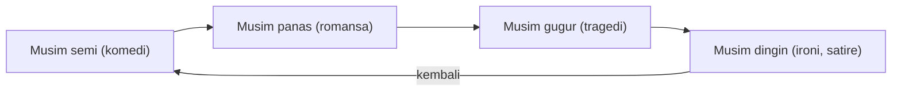

## Empat Musim sebagai Perjalanan Usia

Sebuah puisi dari tahun 1922 dibuka dengan tuduhan yang ganjil, yakni bahwa April, bulan musim semi ketika tunas mulai bermunculan, adalah bulan terkejam. Puisi itu [The Waste Land](https://www.poetryfoundation.org/poems/47311/the-waste-land) karya T.S. Eliot, dan larik "April is the cruellest month" membuka bagian pertamanya, "The Burial of the Dead". Di sana hujan musim semi mengusik akar-akar yang lesu dan membangunkan kenangan bersama hasrat. Musim dingin malah dikenang sebagai masa yang menghangatkan, ketika orang terlindung di bawah salju yang membuat lupa.

Bayangkan dibangunkan dari tidur yang nyenyak oleh cahaya yang terlalu terang. Salah satu cara membaca larik Eliot berangkat dari rasa seperti itu. Bangun berarti merasakan lagi, dan kenangan ikut hidup bersama tunas, sementara salju tadi memberi kelegaan untuk tidak mengingat apa-apa. April dalam puisi Chaucer adalah bulan yang memulihkan, dan larik Eliot dibaca sebagai pembalikan atas April yang ramah itu. Paradoks semacam ini hanya terasa tajam kalau ada pola yang dilanggar, dan pola itulah yang ingin kita urai di sini.

### Peta Musim Northrop Frye

Pola itu punya rumusan yang rapi dalam kritik sastra. Northrop Frye, dalam [Anatomy of Criticism](https://press.princeton.edu/books/paperback/9780691202563/anatomy-of-criticism) (1957), memasangkan empat jenis alur cerita yang ia sebut mythoi dengan empat musim. Komedi berpasangan dengan musim semi, romansa dengan musim panas, tragedi dengan musim gugur, sedangkan ironi dan satire menempati musim dingin. R. D. Denham, dalam [uraiannya tentang metode kritik Frye](https://macblog.mcmaster.ca/fryeblog/critical-method/theory-of-myths.html), menyejajarkan keempatnya dengan tahap usia, yaitu masa muda, kedewasaan, usia tua, dan kematian.

Skema ini sebuah cara membaca, sebuah tradisi tafsir yang membantu kita menangkap gema di balik latar. Penulis tetap bebas menaruh pesta pernikahan di tengah salju atau pemakaman di bawah pohon yang sedang berbunga. Kita yang tinggal di Indonesia pun hidup dengan dua musim, kemarau dan hujan, sehingga kerangka empat musim ini adalah kacamata yang kita pinjam dari khazanah sastra yang sedang dibicarakan.

### Dari Tunas Hijau ke Matahari Tegak

Dalam tradisi baca ini, musim semi membuka cerita. Tunas menyembul setelah tanah lama membeku, kuncup belum mekar, dan hujan terasa membasuh. Tokoh yang diperkenalkan pada musim ini sering dibaca sedang berada di masa muda, ketika banyak hal masih terasa mungkin, atau sedang mengalami kebangkitan batin. Frye menautkan musim ini dengan komedi, sehingga larik Eliot terasa seperti tamu yang membawa kabar duka ke sebuah pesta.

Musim panas tiba ketika matahari berada di titik tertingginya dan hari terasa panjang. Hutan rimbun, buah matang di dahan. Pembaca kerap menyamakannya dengan kedewasaan, masa ketika tokoh berada di puncak tenaga, kecantikan, atau karyanya. Terik yang sama juga bisa menyengat, dan panasnya dapat dibaca sebagai amarah atau gairah yang lepas kendali. Puncak membawa risiko terbakar oleh ambisinya sendiri. Dalam peta Frye, musim ini milik romansa.

### Daun Emas dan Salju yang Menyimpan Benih

Musim gugur menyerupai sore hari dalam siklus ini. Daun berganti warna menjadi emas dan cokelat sebelum lepas dari ranting, udara mulai dingin, dan ladang dipanen. Bagi banyak pembaca, musim ini melambangkan usia tua, masa menuai apa yang dulu ditanam. Ia juga menyimpan keindahan yang rapuh, karena segala yang memukau perlahan memudar. Frye memasangkannya dengan tragedi.

Musim dingin menutup lingkaran. Salju menyelimuti tanah, pohon berdiri gundul, dan suasana menjadi hening. Sastra sering menaruh kematian, kesepian, atau berakhirnya sebuah zaman di musim ini, dan Frye menempatkan ironi serta satire di sini. Keheningan itu sekaligus memberi ruang untuk merenung. Sebagian pembaca melihat musim dingin sebagai jeda, karena benih masih menunggu di bawah salju sampai musim semi kembali.

Jika keempat musim dijajarkan bersama pasangan alurnya dalam skema Frye, lingkarannya tampak seperti ini.

### Prajurit yang Menua Bersama Tahun

Peta ini terasa berguna saat kamu sendiri menulis. Misalnya kamu ingin mengisahkan Wiraga, seorang prajurit yang angkuh, yang perlahan berubah menjadi pertapa yang arif. Kamu bisa memperkenalkannya pada musim panas, berlatih di bawah terik dengan tenaga yang membuat orang segan. Di musim gugur ia kalah atau kehilangan seseorang, dan rambutnya mulai memutih seperti daun yang mengering. Ketika musim dingin datang, ia menyepi di gunung bersalju dan menimbang kesalahan masa lalunya dalam sunyi. Kalender di latar, yang bergeser dari terik ke daun kering lalu ke salju, sudah membisikkan perubahan Wiraga. Kalau kamu ingin memberinya harapan, satu tunas di tepi jalan setapak pada musim semi berikutnya sudah cukup.

Cobalah menguji peta ini pada cerita terakhir yang kamu baca atau tonton. Di musim apa kisah itu berakhir, dan apakah musimnya terasa menggemakan nasib tokoh utamanya? Kalau ceritanya lahir di negeri sendiri, mungkin yang bergema adalah hujan pertama atau kemarau yang panjang.

### Benang Merah

Empat musim memberi sastra semacam kalender batin. Frye merangkumnya sebagai empat pasangan alur dan musim, dan pembacanya menyejajarkan tiap musim dengan tahap usia, dari masa muda sampai kematian. Peta itu sebuah tradisi membaca, dan pola yang dikenali pembaca juga bisa dibalik, seperti April milik Eliot yang menyakitkan. Sekarang angkat pandanganmu dari daun yang gugur ke benda terang yang menggantung di atas seluruh kalender itu, matahari yang dalam sastra dapat menerangi dan juga membakar siapa pun yang datang terlalu dekat.
