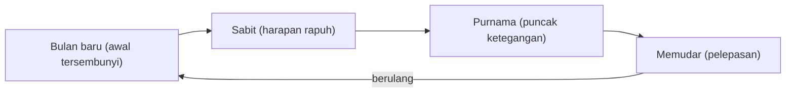

## Bulan dan Sisi Batin yang Tersembunyi

Lewat tengah malam, cahaya bulan di halaman rumahmu membuat tepi pagar, jemuran, dan pohon jambu kehilangan garisnya. Semua benda masih di tempatnya, tetapi tak satu pun terlihat utuh. Ember di dekat keran tampak seperti orang yang berjongkok, dan bayangan daun bergeser pelan di dinding. Halaman yang kamu kenal sejak kecil mendadak terasa asing. Rasa ganjil semacam itu sering dipanggil para penulis ketika cerita mereka perlu menyentuh hal yang belum berani diucapkan tokohnya.

### Cahaya Pinjaman dari Matahari

Bulan tidak menyala sendiri. Sinar yang sampai ke mata kita pada malam hari adalah cahaya matahari yang dipantulkan permukaannya, sehingga tiba dalam keadaan redup dan lembut. Sifat memantul ini membuat bulan mudah dibaca sebagai lambang perenungan, cermin yang menimbang ulang apa yang terjadi di siang hari. Langit dalam pathetic fallacy di bab 2 ikut berduka bersama tokoh, sedangkan bulan sering bekerja lebih diam dan sekadar memantulkan batin orang yang menatapnya.

Kamu sudah bertemu pasangan Sol dan Luna di bab 4, dalam simbolisme alkimia yang dibaca Jung, dengan matahari untuk kesadaran dan bulan untuk ketidaksadaran. Banyak tradisi juga memasangkan bulan dengan sisi feminin, dan pasangan itu lebih tepat dipahami sebagai kebiasaan budaya.

Cahaya bulan jarang memperlihatkan detail yang tajam. Garis wajah, warna baju, dan jarak antarbenda menjadi kabur, sehingga orang yang berjalan di bawahnya harus menebak dengan perasaan. Dari pengalaman itu banyak pembaca menangkap bulan sebagai wakil pengetahuan intuitif, jenis tahu yang datang dari firasat lebih dulu daripada dari hitungan. Tokoh yang akrab dengan malam berbulan juga bisa digambarkan peka dan mampu menangkap hal yang luput dari orang lain.

### Wajah yang Berganti Setiap Malam

Matahari tampak bulat setiap hari, sementara bulan terus berganti rupa. Dari bulan baru yang tak terlihat, ia muncul sebagai sabit tipis, tumbuh menjadi purnama, lalu menyusut sampai hilang, dan putaran itu berulang. Satu putaran fase, dari bulan baru ke bulan baru berikutnya, berlangsung sekitar 29,5 hari, seperti dijelaskan halaman [fase bulan dari NASA](https://science.nasa.gov/moon/moon-phases/).

Karena tidak pernah menetap, bulan menjadi lambang yang pas untuk perasaan yang naik dan turun. Dalam banyak cerita, tiap fase dapat dibaca dengan makna tersendiri. Bulan baru sering dikaitkan dengan awal yang tersembunyi, benih rahasia yang belum tampak. Sabit tipis bisa menandai harapan yang masih rapuh. Purnama sering dibaca sebagai puncak ketegangan, saat rahasia akhirnya terbuka. Bulan yang memudar lebih dekat dengan pelepasan dan tenaga yang menurun menuju akhir.

Urutan tafsir tadi membentuk lingkaran yang pulang ke titik awalnya, sama seperti fase yang menjadi sumbernya.

### Bayang-bayang dan Kebenaran Setengah Terungkap

Sebagian pembaca meminjam kerangka Jung dan membaca dunia malam berbulan sebagai gambaran ketidaksadaran, tempat hasrat, ketakutan, dan kenangan yang kita sembunyikan dari orang lain. Cahaya bulan melahirkan bayangan yang menipu mata, dan bayangan itu dapat dibaca sebagai sisi gelap seorang tokoh, wajah lain yang biasanya ia tutupi.

Cahaya yang samar juga cocok untuk kebenaran yang baru terlihat sebagian. Misalnya, kamu menulis tentang Dinda yang curiga kakaknya menyembunyikan utang. Di halaman belakang, di bawah bulan yang tertutup awan tipis, ia melihat kakaknya membakar setumpuk kertas. Dinda hanya menangkap nyala api dan punggung yang membungkuk, tanpa sempat membaca satu kata pun. Cahaya itu memberinya cukup bahan untuk curiga dan terlalu sedikit untuk yakin, persis seperti posisinya di dalam cerita.

### Dari Luna ke Lunatic

Kata Inggris *lunatic* sampai lewat bahasa Anglo-Prancis dari bahasa Latin akhir *lunaticus*, yang berakar pada *luna*, bulan. Mula-mula kata itu menunjuk orang yang gangguannya dianggap mengikuti fase bulan. Kepercayaan lama tersebut masih tersimpan dalam bahasa, dan sastra memanfaatkannya. Tokoh yang biasanya tenang dapat tampak goyah di bawah sinar bulan, atau tenggelam dalam murung yang panjang dan hening.

Manusia serigala yang berubah wujud setiap purnama ikut memperkuat kaitan itu dalam benak banyak orang. Aturan purnama yang tetap itu sebagian besar lahir dari film abad ke-20, dan legenda yang lebih tua hanya sesekali menyebut bulan. Jadi, ketika kamu memakai purnama untuk menandai tokoh yang lepas kendali, kamu sedang meminjam citra populer modern.

### Jendela Victor dan Kamar Harker

Dua adegan Gotik berikut memakai bulan untuk suasana yang ganjil, akrab sekaligus mengerikan. Dalam [Frankenstein](https://www.gutenberg.org/files/84/84-h/84-h.htm) karya Mary Shelley (1818), Victor sedang bekerja di laboratoriumnya ketika bulan terbit di atas laut. Ia mendongak dan, dalam terang bulan, melihat makhluk ciptaannya di jendela. Bagi banyak pembaca, cahaya yang menemani kerjanya kini memperlihatkan akibat kerja itu sendiri.

[Dracula](https://www.gutenberg.org/cache/epub/345/pg345-images.html) karya Bram Stoker (1897) punya adegan sejenis. Dalam jurnalnya pada pertengahan Mei, Jonathan Harker mencatat tiga perempuan yang ia lihat dalam cahaya bulan di kamarnya di kastel. Bulan di situ dapat dibaca sebagai terang yang cukup untuk membuat sesuatu yang mustahil terlihat nyata.

Puisi Romantik pun mengenal bulan yang lebih sunyi, misalnya bulan yang terus mendaki langit ketika sang pelaut tertinggal sendirian di antara awak yang telah mati dalam *The Rime of the Ancient Mariner* karya Coleridge, yang dibahas lebih jauh di bab 13.

Coba ingat buku atau film yang terakhir kamu nikmati. Adakah adegan penting yang terjadi di bawah bulan, dan apakah cahayanya membuat tempat itu tampak indah atau malah menyeramkan?

### Inti Pembahasan

Bulan bersinar dengan cahaya pinjaman, berganti wajah dalam putaran sekitar 29,5 hari, dan menerangi benda tanpa mempertegas garisnya. Karena itu ia sering dibaca sebagai lambang perenungan, intuisi, perasaan yang tidak menetap, dan kebenaran yang baru terlihat separuh. Kata *lunatic* menyimpan kepercayaan lama tentang bulan dan gangguan jiwa, dua adegan Gotik, Frankenstein dan Dracula, menaruh sosok yang mengerikan di bawah sinarnya, dan manusia serigala yang terikat purnama lebih banyak berutang pada film abad ke-20. Tarikan bulan yang sesungguhnya bekerja pada laut, mengangkat dan menurunkan pasang, dan air yang ia gerakkan itu menyimpan lambangnya sendiri, yang dapat membasuh sekaligus menenggelamkan.
