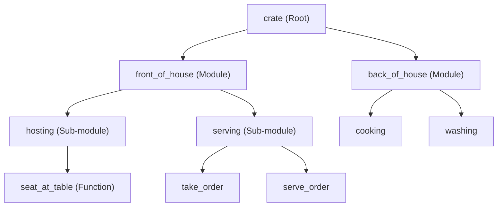

## Pengenalan Sistem Modul Rust

Menulis seluruh kode di dalam satu file `main.rs` mungkin terasa praktis saat kamu membangun aplikasi berskala kecil. Namun, bayangkan jika kamu harus mengembangkan sistem navigasi pesawat atau platform e-commerce besar. Menumpuk jutaan baris kode dalam satu file bukan hanya tidak efisien, melainkan juga membuat kode berantakan.

Di sinilah Rust module system berguna. Fitur ini membantu kita memecah codebase yang kompleks menjadi bagian-bagian kecil yang lebih terkelola, logis, dan terstruktur.

## Mengapa Kita Membutuhkan Module System?

Bayangkan kamu bekerja di perpustakaan besar tanpa rak, tanpa kategori, dan tanpa label. Seluruh buku ditumpuk begitu saja di lantai. Meskipun kamu yakin buku yang kamu cari ada di tumpukan tersebut, proses mencarinya pasti akan memakan waktu lama.

Kondisi serupa terjadi dalam pemrograman. Seiring bertambahnya fitur aplikasi, codebase akan menghadapi beberapa tantangan utama:

- **Namespace Pollution dan Naming Collisions**
  Ketika proyek membesar, bentrokan nama fungsi sangat mungkin terjadi. Misalnya, fungsi `tambah()` pada module kalkulator akan bertabrakan dengan fungsi `tambah()` untuk operasi database jika keduanya dideklarasikan di ruang lingkup global yang sama.
- **Readability**
  Membaca dan melacak alur logika di dalam satu file berisi ribuan baris melelahkan dan membuang waktu.
- **Privacy dan Encapsulation**
  Idealnya, tidak semua komponen kode bebas diakses dari mana saja. Logika internal yang sensitif harus disembunyikan agar terhindar dari modifikasi yang tidak disengaja oleh module lain.

> **Insight:** Module system tidak sekadar merapikan struktur file, tetapi juga mengatur **scope** dan **privacy** kode kamu.

## Package, Crate, dan Module

Sebagai gambaran praktis, kita bisa menggunakan analogi sebuah **kota** untuk memahami bagaimana Rust mengorganisasi kode:

### 1. Package

Jika dianalogikan sebagai kota, maka **package** adalah **batas teritorial kota** tersebut. Package merupakan proyek Cargo yang kamu bangun, lengkap dengan file `Cargo.toml` sebagai cetak biru (*blueprint*) aturan pembangunannya serta daftar *dependencies* eksternal yang diperlukan.

Dalam satu package, kamu bisa menyimpan satu atau lebih crate, dengan syarat minimal terdapat satu crate (baik berupa library maupun binary) dan paling banyak satu library crate.

### 2. Crate

**Crate** adalah gedung di dalam kota tersebut, yaitu unit terkecil dari kode yang dapat dikompilasi langsung oleh compiler Rust. 

Crate terbagi menjadi dua jenis:
- **Binary Crate** menghasilkan program yang bisa langsung dijalankan karena memiliki fungsi `main`. File utamanya berada di `src/main.rs`.
- **Library Crate** berfungsi sebagai pustaka kode pendukung tanpa fungsi `main`. Crate jenis ini diekspos agar bisa dimanfaatkan oleh program lain, dengan file entry point utama di `src/lib.rs`.

### 3. Module

Jika crate diibaratkan sebagai gedung, maka **module** adalah **ruangan-ruangan** di dalamnya. Module mengelompokkan fungsi, struct, enum, dan trait yang saling berkaitan agar kode lebih rapi.

Selain mempermudah pengelompokan, module bertugas mengatur **visibility** (apakah suatu bagian kode boleh diakses secara publik atau hanya boleh digunakan secara internal di dalam module tersebut).

## Struktur Hierarki Module

Rust menyusun kode melalui **module tree**. Struktur hierarki ini mirip dengan sistem direktori folder di komputer kamu.

Sebagai contoh, jika kita membangun sistem manajemen restoran, visualisasi module tree akan tampak seperti berikut:



Pemisahan `hosting` dan `serving` ke dalam sub-module yang berbeda di bawah `front_of_house` bertujuan agar tanggung jawab masing-masing bagian terdefinisi dengan jelas. Ketika kamu perlu memperbarui logika pelayanan restoran, kamu cukup berfokus pada module `serving` tanpa harus terganggu oleh kode penerimaan tamu di module `hosting`.

## Penerapan pada E-Commerce System

Pada proyek skala besar, kode program dikelompokkan berdasarkan domain bisnis. Contoh berikut menunjukkan bagaimana sebuah platform e-commerce memanfaatkan module system untuk merapikan strukturnya:

```rust
// Struktur module di dalam src/lib.rs atau src/main.rs

// Module pembayaran
mod payments {
    struct CreditCard {
        number: String,
        cvv: u32,
    }

    fn process_payment() {
        // Logika transaksi internal
    }
}

// Module inventory
mod inventory {
    pub fn check_stock(item_id: u32) -> bool {
        // Logika pemeriksaan stok barang
        true
    }
}

fn main() {
    // Entry point aplikasi
    println!("E-Commerce Application Running...");
}
```

Melalui pembagian ini, jika tim keamanan perlu memperbarui algoritma enkripsi *credit card*, fokus mereka cukup diarahkan ke dalam `mod payments`. Perubahan tersebut tidak akan memengaruhi fungsionalitas di dalam `mod inventory` karena batas lingkup keduanya terisolasi dengan jelas.

## Ringkasan Konsep

Tabel berikut mempermudah pemahaman mengenai hubungan antarkonsep di atas:

| Konsep | Analogi | Fungsi Utama |
| --- | --- | --- |
| **Package** | Batas teritorial kota | Wadah proyek yang dikelola oleh Cargo |
| **Crate** | Gedung utama | Unit kompilasi (menghasilkan file executable atau library) |
| **Module** | Ruang di dalam gedung | Mengelompokkan kode dan mengatur scope serta privacy |
| **Path** | Rute navigasi (path) | Cara memanggil suatu item (contoh: `crate::math::add`) |

Pembahasan berikutnya mencakup aspek teknis penggunaan kata kunci `mod` untuk mendeklarasikan module, serta mekanisme kontrol akses guna melindungi data internal.

Memikirkan rancangan module tree sejak awal merupakan langkah awal yang penting sebelum kamu menuliskan baris kode pertama pada software project yang akan dibangun.
