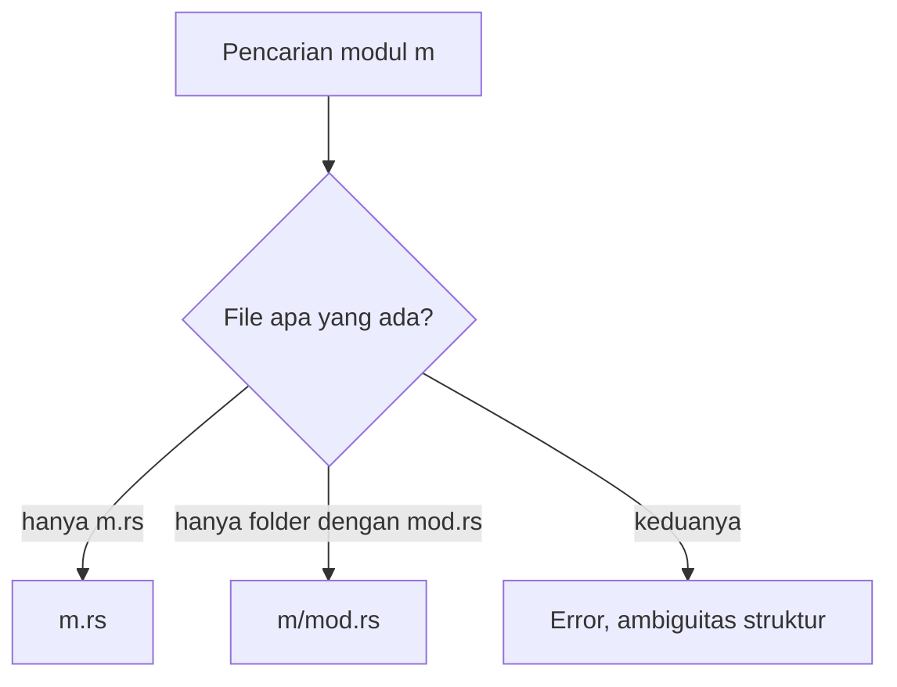

## Perbandingan Struktur mod.rs vs Pola Modern

Saat mulai mendalami Rust, kamu mungkin akan menemukan dua cara berbeda dalam menyusun folder dan file modul. Jika kamu melihat tutorial lama atau proyek yang sudah berumur, kamu akan sering menemui file bernama `mod.rs`. Namun, pada proyek modern, file tersebut seolah menghilang.

Mengapa hal ini terjadi? Apakah cara lama sudah usang? Di bawah ini, kita akan melihat bagaimana organisasi kode Rust berkembang.

## Dua Cara Menandai Folder Modul

Misalkan kamu sedang membangun sistem perpustakaan dengan rak besar bernama **"Auth"** (Autentikasi). Di dalam rak ini, terdapat kategori sub-rak seperti **"Login"** dan **"Permissions"**.

Di Rust, compiler memiliki dua cara untuk mendeteksi bahwa folder **"Auth"** merupakan modul yang menampung sub-modul:

- **Pola Klasik (Pre-Rust 2018)**: Menggunakan file penanda khusus bernama `mod.rs` di dalam folder.
- **Pola Modern (Rust 2018+)**: Folder dipasangkan dengan file bernama sama di tingkat luar, membuat strukturnya lebih bersih.

> **Insight Penting:** Kedua pola ini masih didukung demi menjaga kompatibilitas ke belakang (*backward compatibility*). Meski begitu, komunitas sangat menyarankan penggunaan pola modern untuk proyek baru.

## 1\. Pola Klasik

Sebelum edisi Rust 2018, jika kamu ingin sebuah folder dianggap sebagai modul, kamu wajib menaruh file `mod.rs` di dalamnya. File ini berfungsi sebagai pintu masuk utama modul tersebut.

### Struktur File Klasik

```
src/
├── main.rs
└── auth/
    ├── mod.rs      <-- File utama modul 'auth'
    └── login.rs    <-- Sub-modul 'auth::login'
```

Di dalam `main.rs`, kamu perlu mendeklarasikan modul ini:

```rust
mod auth;
```

Selanjutnya, deklarasikan sub-modul di dalam `src/auth/mod.rs`:

```rust
pub mod login; // Mencari file login.rs di folder yang sama
```

### "Resepsionis di Dalam Ruangan"

Sebagai analogi, bayangkan setiap departemen di kantor memiliki pintu tertutup. Untuk mengetahui isi departemen "Auth", kamu harus masuk terlebih dahulu ke dalam ruangan tersebut dan menemui resepsionis yang bertugas di meja `mod.rs`.

## 2\. Pola Modern

Edisi Rust 2018 menghadirkan cara yang lebih rapi. Alih-alih menyembunyikan deklarasi di dalam folder, kamu meletakkan file deklarasi sejajar dengan folder tersebut.

### Struktur File Modern

```
src/
├── main.rs
├── auth.rs         <-- File utama modul 'auth' (Pengganti mod.rs)
└── auth/
    └── login.rs    <-- Sub-modul 'auth::login'
```

Di sini, `auth.rs` berpasangan dengan folder `auth/`. File `auth.rs` memberi tahu compiler tentang keberadaan modul `auth`, sedangkan folder `auth/` menampung sub-modulnya.

### "Papan Nama di Luar Pintu"

Dengan pola baru ini, papan informasi (`auth.rs`) digantung tepat di luar pintu sebelum kamu masuk ke folder `auth`. Jadi, daftar isi langsung terlihat tanpa harus membuka folder terlebih dahulu.

## Perbandingan Visual & Teknis

| Fitur | Pola `mod.rs` (Klasik) | Pola Modern (2018+) |
| --- | --- | --- |
| **Lokasi Deklarasi** | Di dalam folder (`auth/mod.rs`) | Sejajar dengan folder (`auth.rs`) |
| **Kejelasan IDE** | Sering membuat bingung karena banyak tab bernama "mod.rs" | Jelas, nama file mencerminkan nama modul |
| **Struktur Folder** | Lebih "terkapsul" di dalam satu folder | Lebih "rata" di level direktori |
| **Navigasi** | Sedikit lebih sulit navigasi file | Mudah dicari dengan *search by name* |

## Mengapa Pola Modern Diciptakan?

Pernahkah kamu membuka banyak tab di editor kode dan semuanya bernama `index.js` (di JavaScript) atau `mod.rs` (di Rust)? Situasi ini sering kali membingungkan.

Inilah masalah kegunaan utama yang dipecahkan oleh pola modern. Saat menangani proyek besar dengan pola klasik, tab editor kodenya akan menumpuk dengan nama file yang sama.

Kamu harus mengarahkan kursor ke setiap tab hanya untuk memastikan apakah file itu milik modul `user`, `payment`, atau `inventory`. Sebaliknya, pola modern membuat nama tab editor langsung terbaca jelas, seperti `user.rs`, `payment.rs`, atau `inventory.rs`.

## Refactoring ke Pola Modern

Misalkan kamu mempunyai kode lama yang ingin dirapikan.

**Struktur Lama:**

```
src/
└── network/
    ├── mod.rs
    └── server.rs
```

**Isi `src/network/mod.rs`:**

```rust
pub mod server;

pub fn connect() {
    println!("Menghubungkan ke jaringan...");
}
```

**Langkah Migrasi ke Pola Modern:**

- Pertama, pindahkan file `src/network/mod.rs` keluar ke direktori induk sebagai `src/network.rs`.
- Biarkan file `server.rs` tetap berada di dalam direktori `src/network/`.
- Terakhir, bersihkan folder `src/network/` jika kosong (dalam skenario ini folder tetap dipertahankan karena menampung `server.rs`).

**Hasil Akhir:**

```
src/
├── network.rs      <-- Berisi kode fungsi connect() dan pub mod server;
└── network/
    └── server.rs
```

## Kapan Harus Menggunakan yang Mana?

Walaupun pola modern menjadi standar baru, pola klasik terkadang masih ditemui dalam beberapa kasus:

- **Proyek legacy atau kode warisan**: Jika kamu berkontribusi pada crate lama yang dari awal konsisten memakai `mod.rs`, sebaiknya ikuti gaya penulisan yang sudah ada demi konsistensi.
- **Alat generator kode otomatis**: Beberapa library pembuat kode generator lebih mudah menyusun folder menggunakan pola `mod.rs`.

> **Penting:** Jangan mencampur kedua pola untuk modul yang sama. Jika kamu meletakkan `auth.rs` sekaligus `auth/mod.rs` di proyek, compiler Rust akan memicu error karena ambiguitas jalur.

## Rumus Logika Jalur (Path)

Secara matematis (dalam logika compiler), pencarian modul dapat direpresentasikan sebagai fungsi $f(m)$ di mana $m$ adalah nama modul. Jika ada file `m.rs`, hasilnya:

<div>
$$
f(m) = \text{m.rs}
$$
</div>

Jika yang ada adalah folder dengan `mod.rs`, hasilnya:

<div>
$$
f(m) = \text{m/mod.rs}
$$
</div>

Jika kedua kondisi di atas terpenuhi $\text{m.rs} \cap \text{m/mod.rs}$, maka akan terjadi konflik: $\text{Error} \leftarrow \text{Ambiguitas struktur}$

Alur keputusan compiler tersebut bisa kamu ikuti pada bagan berikut.



## Kesimpulan

Pola modern (`nama_modul.rs` ditambah folder `nama_modul/`) menjadi standar utama saat ini karena mempermudah navigasi dan merapikan visual editor. Meskipun demikian, pemahaman tentang `mod.rs` tetap diperlukan agar kamu tidak bingung ketika membaca dokumentasi atau menjelajahi kode pustaka pihak ketiga di ekosistem Rust.
