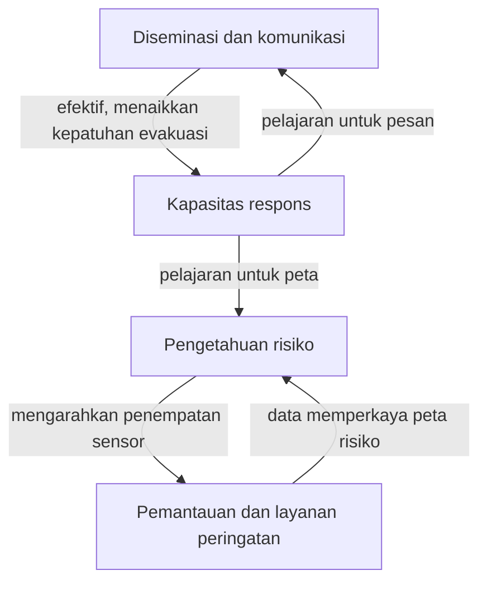

## Empat Pilar Utama Early Warning System

Memahami **empat pilar early warning system** membantu kamu melihat mengapa sistem peringatan dini tidak bisa direduksi menjadi sensor dan sirene saja. Banyak kegagalan EWS bukan karena teknologi tidak ada, tapi karena satu pilar dibiarkan lemah sementara pilar lain diperkuat berlebihan. Daftar periksa yang disiapkan sekretariat Konferensi Internasional Ketiga tentang Peringatan Dini (EWC III, Bonn, 2006) bersama UN/ISDR menyusun EWS *people-centred* di atas empat elemen: pengetahuan risiko, layanan pemantauan dan peringatan, komunikasi dan diseminasi peringatan, serta kemampuan respons masyarakat.

> Sistem peringatan dini yang lengkap dan efektif terdiri atas empat elemen yang saling terkait, mulai dari pengetahuan tentang bahaya dan kerentanan hingga kesiapsiagaan dan kapasitas untuk merespons. Kelemahan atau kegagalan pada satu bagian dapat mengakibatkan kegagalan seluruh sistem.
> - UN/ISDR, *Developing Early Warning Systems: A Key Checklist* (EWC III, 2006)

Empat pilar bekerja sebagai rantai. Kekuatan sistem ditentukan pilar terlemah:

\\[ P_{\text{sukses}} = P_{\text{risiko}} \times P_{\text{monitoring}} \times P_{\text{diseminasi}} \times P_{\text{respons}} \\]

Jika \\( P_{\text{diseminasi}} \\) mendekati nol, maka \\( P_{\text{sukses}} \\) juga mendekati nol, seberapa pun canggih sensor yang kamu pasang.

### 1. Pengetahuan Risiko (*Risk Knowledge*)

Pilar pertama adalah fondasi. Pengetahuan risiko menggabung *bahaya*, *kerentanan*, dan *kapasitas*. Bahaya menjelaskan karakter ancaman seperti sumber gempa atau zona banjir kala ulang 25 tahun. Kerentanan menjelaskan siapa paling terdampak, termasuk kepadatan penduduk dan kualitas bangunan. Kapasitas menjelaskan sumber daya lokal yang bisa dimobilisasi.

Langkah praktis:

* **Inventarisasi bahaya** berbasis data historis seperti katalog gempa 50 tahun.
* **Analisis kerentanan spesifik lokasi**. Di pesisir, kerentanan ditentukan elevasi dan akses jalan, bukan hanya jarak dari pantai.
* **Pemetaan paparan** untuk sekolah, puskesmas, dan permukiman padat.
* **Pembaruan berkala**, karena urbanisasi dapat mengubah peta risiko dalam 5 sampai 10 tahun.

Di Jepang, peta risiko tsunami berbasis skenario megathrust menentukan penempatan sensor dan tinggi tanggul. Kegagalan umum adalah peta hanya tersedia di level kabupaten dan tidak turun ke skala desa.

### 2. Pemantauan dan Layanan Peringatan (*Monitoring and Warning Service*)

Pilar kedua adalah sistem saraf EWS. Tugasnya mendeteksi anomali dan memutuskan kapan peringatan dikeluarkan.

Fungsinya terbagi dua: *monitoring* kontinu dan *forecasting* prediktif. Monitoring mengumpulkan data real time dari seismometer, tide gauge, atau radar cuaca. Forecasting mengolahnya menjadi prakiraan dengan *lead time* cukup untuk bertindak.

Karakteristik layanan yang kuat:

* **Akurasi dan kecepatan**. BMKG menargetkan peringatan gempa kurang dari 5 menit. Keterlambatan 10 menit bisa menghapus waktu evakuasi di dekat pantai.
* **Ambang kuantitatif**. Status *waspada* ke *siaga* harus berdasar angka jelas, misalnya curah hujan \\( 100 \text{ mm} \\) dalam 3 jam atau kenaikan muka air \\( 50 \text{ cm} \\) per jam.
* **Redundansi**. Satu sensor mati tidak boleh membuat sistem buta.
* **Validasi silang** untuk menekan *false alarm*.

*InaTEWS* mengintegrasi data seismik, buoy, dan tide gauge untuk estimasi tinggi gelombang tsunami. Untuk banjir, sistem di DAS Bengawan Solo memakai radar dan model hidrologi untuk prediksi 6 sampai 12 jam sebelumnya. Kelemahan sering ada pada pemeliharaan: baterai tidak diganti atau jaringan putus.

### 3. Diseminasi dan Komunikasi (*Dissemination and Communication*)

Pilar ketiga menentukan apakah peringatan akurat benar-benar sampai dan dipahami. Tujuannya memastikan pesan *diterima*, *dipahami*, dan *dipercaya* dengan prinsip *clear, consistent, credible*.

Elemen kunci:

* **Saluran berlapis**. Kombinasi sirene, SMS broadcast, radio komunitas, pengeras suara masjid, dan grup WhatsApp.
* **Pesan spesifik**. Ganti *waspada banjir* menjadi *TMA Katulampa 180 cm siaga 2, warga RW 03 dan 04 evakuasi ke aula kelurahan dalam 60 menit*.
* **Bahasa dan format lokal**. Gunakan bahasa daerah dan simbol visual untuk wilayah literasi terbatas.
* **Kepercayaan sumber**. Warga lebih patuh pada kepala desa atau relawan yang dikenal.

Di Filipina, peringatan siklon dari PAGASA disederhanakan menjadi kode warna per dusun dan disebar via radio dan kentongan. Model serupa ada di lereng Merapi, di mana HT dan kentongan menjadi cadangan saat listrik padam. Ukur keberhasilan bukan dari jumlah SMS terkirim, tapi dari *waktu tiba pesan* dan *persentase warga yang tahu tindakan yang harus dilakukan*.

### 4. Kapasitas Respons (*Response Capability*)

Pilar keempat menentukan apakah warga mampu bertindak benar setelah menerima peringatan. Kapasitas ini mencakup rencana, infrastruktur, dan latihan.

Komponen utama:

* **Rencana kontingensi dan SOP** spesifik per dusun, mencakup titik kumpul, jalur, dan tugas relawan.
* **Infrastruktur** seperti rambu evakuasi dan shelter dengan akses bagi penyandang disabilitas.
* **Edukasi dan simulasi rutin**. Tanpa latihan, waktu evakuasi bisa dua kali lebih lama.
* **Pendataan kelompok rentan** dengan daftar *by name by address* di level RT.

Di Kamaishi, Jepang, siswa selamat tinggi saat tsunami 2011 karena program *Tsunami Tendenko* yang melatih evakuasi mandiri. Di Indonesia, Desa Tangguh Bencana yang berlatih tiap 6 bulan mencatat waktu evakuasi lebih cepat. Pilar ini sering dianggap tugas BPBD saja, padahal tanpa partisipasi warga, rencana di kertas tidak berjalan saat sirene berbunyi malam hari.

### Umpan Balik Antarpilar

Keempat pilar bukan urutan linear, tapi *loop* umpan balik. Pengetahuan risiko mengarahkan penempatan sensor. Data monitoring memperkaya peta risiko. Diseminasi yang efektif meningkatkan kepatuhan evakuasi, dan pengalaman evakuasi memberi pelajaran untuk memperbaiki pesan dan peta.

Arah umpan balik antarpilar itu tergambar pada skema berikut.

Bayangkan banjir bandang di DAS kecil. Jika pilar 1 tidak mencatat permukiman baru di sempadan sungai, pilar 2 tidak akan memasang sensor di hulu itu. Jika pilar 3 hanya pakai satu aplikasi ponsel, warga tanpa ponsel tidak terjangkau. Jika pilar 4 lemah karena jalur evakuasi tertutup longsor kecil yang tidak pernah disimulasikan, korban tetap jatuh. Karena itu perkuat pilar terlemah dahulu, bukan menambah sensor canggih saat jalur belum jelas.

#### Tabel Indikator Kematangan Tiap Pilar

Gunakan tabel berikut sebagai *checklist* cepat. Beri skor 1 sampai 4 untuk tiap indikator.

| Pilar | Indikator Kunci | Bukti Verifikasi | Target Minimal |
| :--- | :--- | :--- | :--- |
| **1. Risk Knowledge** | Peta bahaya skala desa diperbarui 5 tahunan | Dokumen peta + SK | Semua desa rawan punya peta |
| **1. Risk Knowledge** | Data kerentanan kelompok rentan terdokumentasi | Daftar by name di RT | 100% kelompok rentan terdata |
| **2. Monitoring Warning** | Sensor uptime >95% | Log operasional | Blank data <2 jam |
| **2. Monitoring Warning** | SOP status berbasis ambang | Dokumen SOP + tabletop | SOP diuji 2 kali per tahun |
| **3. Dissemination Communication** | Pesan diuji keterpahaman | Survei keterpahaman | >80% warga paham tindakan |
| **3. Dissemination Communication** | Minimal 3 saluran aktif | Daftar saluran + uji | Sirene, radio, grup warga aktif |
| **4. Response Capability** | Jalur evakuasi bertanda | Foto + peta jalur | Rambu di semua jalur |
| **4. Response Capability** | Simulasi partisipatif | Berita acara | 1 simulasi per 6 bulan |

Saat kamu mengisi tabel ini bersama BPBD dan perwakilan warga, kesenjangan antar pilar langsung terlihat. Dengan begitu **empat pilar early warning system** tidak berhenti sebagai konsep, tapi menjadi sistem yang memberi waktu menyelamatkan nyawa.
