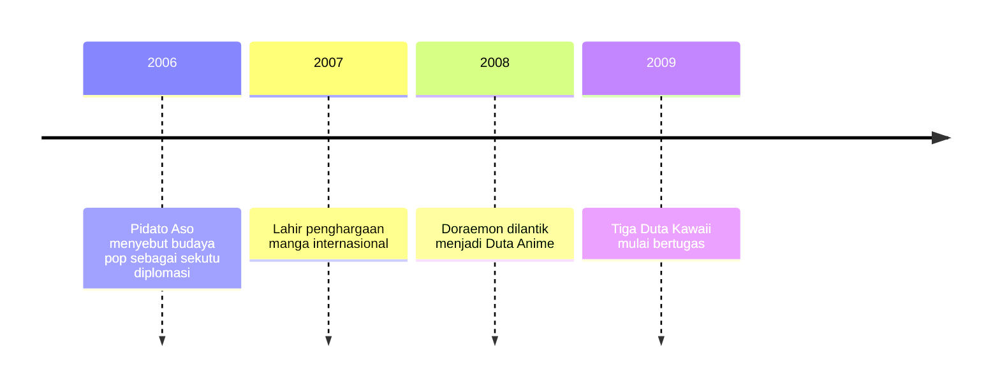

## Diplomasi Pop Kementerian Luar Negeri

Pada 19 Maret 2008, di kantor Kementerian Luar Negeri Jepang, seekor kucing robot biru menerima jabatan yang terdengar ganjil bagi diplomat mana pun. Jabatannya Duta Anime, yang melantiknya Menteri Luar Negeri Masahiko Koumura, dan kucing itu tentu saja Doraemon.

Kementerian yang sehari-hari mengurus kedutaan dan perundingan tidak sampai ke titik itu dalam semalam. Jalannya bisa kamu telusuri mundur sampai ke sebuah pidato dua tahun sebelumnya, dan di ujungnya menunggu kritik akademis yang patut didengar.

### Pidato Aso di Kampus Digital Hollywood

Pada 28 April 2006, Menteri Luar Negeri Taro Aso berbicara di Digital Hollywood University. Yang ia sapa bukan sesama diplomat, melainkan orang-orang yang bekerja di dunia kreatif, dan [pidatonya](https://www.mofa.go.jp/announce/fm/aso/speech0604-2.html) lebih terdengar seperti undangan terbuka daripada laporan kebijakan.

Logikanya sederhana. Diplomasi masa kini bergantung pada opini publik di negara lain. Kalau begitu, budaya pop yang disukai banyak orang semestinya menjadi sekutu diplomasi, bukan sekadar hiburan. Aso menyatakan bahwa kementeriannya ingin memasarkan budaya pop, lalu meminta para kreator ikut menggosok citra merek Jepang.

Ia juga membawa contoh. *Astro Boy* dan Doraemon, katanya, membuat robot terasa ramah, dan serial sepak bola *Captain Tsubasa* menjadi sumber inspirasi bagi Zidane dan Totti. Klaim itu keluar dari mulut seorang menteri yang sedang berpidato, jadi bacalah sebagai retorika, bukan hasil penelitian.

Dua usulan dari pidato itu layak diingat. Yang pertama adalah hadiah manga yang ia bandingkan dengan Hadiah Nobel. Yang kedua, seniman anime muda yang diangkat menjadi duta budaya.

### Hadiah Manga yang Digelar Tiap Tahun

Usulan pertama terwujud setahun kemudian. Pada Mei 2007, atas prakarsa Aso, kementerian itu mendirikan [Japan International MANGA Award](https://www.mofa.go.jp/policy/culture/exchange/pop/manga/index.html). Penghargaan ini digelar setiap tahun sejak itu, dan edisi ke-20 membuka pendaftaran pada 2026.

Yang membuatnya unik adalah penyelenggaranya. Hadiah ini tidak diurus penerbit, tetapi oleh kementerian yang biasa menangani hubungan antarnegara. Umurnya yang panjang juga menunjukkan bahwa ia bukan proyek sekali jalan yang ikut lenyap ketika menterinya berganti.

### Doraemon Diangkat Jadi Duta Anime

Usulan kedua berbelok di tengah jalan. Ketika Koumura melantik Doraemon sebagai *Anime Ambassador* pada 2008, sebuah peristiwa yang tercatat dalam siaran pers kementerian dan Buku Biru Diplomatik 2009, yang diangkat bukan seniman muda seperti gagasan Aso, melainkan tokoh kartun.

Pilihan itu sejalan dengan pidato Aso, yang sudah menyebut Doraemon sebagai tokoh yang membuat robot terasa bersahabat. Tokoh fiksi juga punya kelebihan praktis. Ia tidak menua, tidak lelah berkeliling, dan tidak mungkin salah bicara di depan wartawan. Dengan melantik seekor kucing robot, kementerian mengakui secara terbuka bahwa wajah Jepang di luar negeri ikut dibentuk oleh tokoh kartun.

### Lolita, Harajuku, dan Seragam Sekolah

Setahun kemudian giliran busana. Pada 26 Februari 2009, kementerian mengangkat tiga orang dengan gelar resmi yang panjang sekali, dan mereka dijuluki Duta *Kawaii*. Misako Aoki membawa gaya *Lolita*, Yu Kimura mewakili mode *Harajuku*, dan Shizuka Fujioka mewakili gaya seragam sekolah.

Diplomasi pop ternyata tidak berhenti di layar. Cara anak muda Jepang berpakaian dianggap layak dipromosikan oleh negara. Dalam empat tahun, sebuah kementerian luar negeri membangun kosakata baru yang menempatkan manga, anime, dan busana sebagai aset diplomasi. Keempat langkahnya bisa kamu lihat berderet pada garis waktu berikut.

### Kritik Iwabuchi atas Proyeksi Satu Arah

Tidak semua orang menilainya positif. Koichi Iwabuchi menulis kritik yang tajam dalam [artikelnya di International Journal of Cultural Policy tahun 2015](https://doi.org/10.1080/10286632.2015.1042469), dan runutannya mundur jauh sebelum Aso naik podium. Diplomasi budaya Jepang pascaperang, dalam pembacaannya, mula-mula bertujuan meredakan sentimen anti-Jepang di Asia Tenggara. Kerangka itu kemudian berganti bahasa menjadi *soft power*, lalu *nation branding* atau pencitraan bangsa, dan akhirnya Cool Japan. Labelnya berubah, sedangkan keinginannya serupa: negara ingin dilihat dengan cara tertentu oleh orang lain.

Dari situ Iwabuchi mengajukan dua keberatan. Diplomasi pop semacam ini masih berupa proyeksi satu arah; Jepang mengirim citra, tetapi tidak sungguh-sungguh membuka dialog lintas batas yang memberi pihak lain ruang untuk berbicara dan didengar. Citra yang dipromosikan juga cenderung menyingkirkan keragaman budaya di dalam Jepang sendiri. Yang tampil ke luar adalah versi yang rapi dan mudah dikemas.

Duta berupa tokoh kartun memperjelas persoalan itu. Doraemon bisa hadir di mana saja, tetapi ia tidak bisa mendengar. Kamu boleh menyukainya dengan tulus sejak kecil. Pertanyaan Iwabuchi bukan apakah kesukaan itu keliru, melainkan apakah hubungan yang terbentuk benar-benar berjalan dua arah.

### Yang Perlu Kamu Ingat

- Pidato Taro Aso pada 28 April 2006 menjadikan budaya pop sekutu diplomasi, dengan alasan bahwa diplomasi bergantung pada opini publik.
- Gagasan itu menjadi program: penghargaan manga sejak Mei 2007, Doraemon sebagai Duta Anime pada 2008, dan tiga Duta *Kawaii* pada 2009.
- Iwabuchi mengingatkan bahwa diplomasi pop berakar pada upaya pascaperang meredakan sentimen anti-Jepang, masih cenderung satu arah, dan mengabaikan keragaman di dalam negeri.

Sampai di sini, kementerian luar negeri bekerja dengan simbol, gelar, dan penghargaan. Ceritanya berubah ketika uang publik ikut masuk dan budaya pop mulai dihitung untung ruginya oleh kementerian ekonomi.
