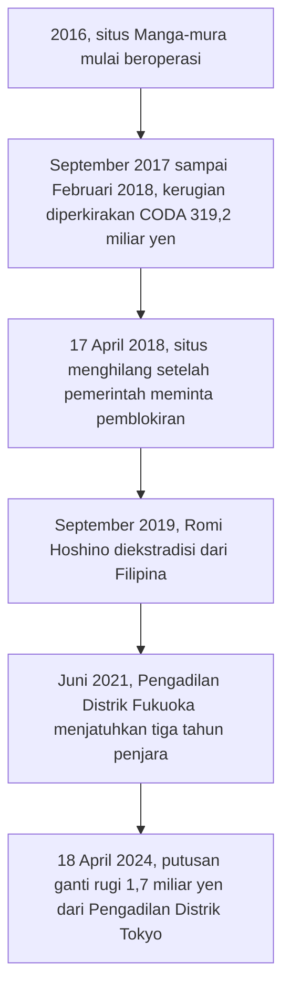

## Manga Digital dan Perang Melawan Pembajakan

Bab terbaru manga favoritmu terbit, dan dua tautan menunggu di layar: aplikasi resmi yang gratis, atau situs bajakan yang menyimpan seluruh arsipnya. Mana yang kamu ketuk? Pilihan sekecil itu sudah menjadi inti pertarungan industri manga beberapa tahun terakhir. Toko buku tidak lagi cukup, sebab pembaca sudah pindah ke ponsel, dan pembajak ikut menunggu di sana.

### Komik Digital Menggeser Versi Cetak

Hitungan Shuppan Kagaku Kenkyujo, lembaga riset penerbitan Jepang, memperlihatkan seberapa jauh perpindahan itu. Pada 2025, komik digital sudah menguasai 76,1 persen pasar komik Jepang, sementara penjualan versi cetak anjlok 14,0 persen dalam setahun. Pasar secara keseluruhan turun 1,7 persen, penurunan pertama setelah tujuh tahun tumbuh berturut-turut.

Ini bukan urusan satu rak di sudut toko. Tahun itu komik menyumbang 44,8 persen dari seluruh pasar penerbitan Jepang. Begitu cara orang membaca manga berubah, seluruh industri buku ikut bergeser bersamanya.

### Kerugian dalam Angka Taksiran

Layar yang memudahkan pembaca juga memudahkan pencuri. Salinan digital gampang disebar, dan satu situs bisa memuat banyak judul tanpa membayar apa-apa kepada pengarangnya.

Besar kerugiannya berupa taksiran. CODA, organisasi antipembajakan konten Jepang, bersama PwC menempatkan kerugian 2022 di kisaran 1,95 sampai 2,202 triliun yen, sekitar lima kali lipat angka 2019. Taksiran yang lebih baru memakai cakupan konten digital dan hasilnya jauh lebih besar: [rilis bersama METI dan CODA](https://www.meti.go.jp/english/press/2026/0126_001.html) pada 26 Januari 2026 menyebut angka sekitar 5,7 triliun yen untuk 2025.

### Jatuhnya Manga-mura

Kasus yang paling terkenal bernama Manga-mura, situs bajakan yang beroperasi sejak 2016. CODA memperkirakan situs ini menimbulkan kerugian 319,2 miliar yen hanya dalam rentang September 2017 sampai Februari 2018. Pada 17 April 2018 situs itu lenyap, setelah pemerintah meminta penyedia layanan internet memblokirnya.

Hilangnya situs ternyata baru babak awal. Pengelolanya, Romi Hoshino, diekstradisi dari Filipina pada September 2019 dan dijatuhi hukuman tiga tahun penjara oleh Pengadilan Distrik Fukuoka pada Juni 2021. Lalu pada 18 April 2024, [Pengadilan Distrik Tokyo](https://www.japantimes.co.jp/news/2024/04/18/japan/crime-legal/manga-mura-copyright-ruling/) memerintahkan ganti rugi 1,7 miliar yen bagi tiga penerbit besar, Kadokawa, Shueisha, dan Shogakukan.

Kalau semua tanggal itu dijajarkan dari atas ke bawah, panjangnya perkara ini langsung terasa.

Hukum memang bisa menutup satu situs. Masalahnya, prosesnya memakan waktu bertahun-tahun, sementara pembaca yang kehilangan satu sumber gratis bisa saja mencari sumber lain.

### Bab Gratis yang Terbit Serentak

Di luar jalur hukum, penerbit juga menawarkan alternatif yang legal di tempat yang sama. Shueisha meluncurkan MANGA Plus pada Januari 2019, layanan yang sudah disinggung di bab 5. Bab baru terbit bersamaan dengan Jepang, bab pertama dan bab terbaru bisa dibaca gratis, dan sejak Agustus 2021 pembatasan wilayahnya dihapus.

Bagi pembaca di luar Jepang, artinya sederhana. Ada pilihan resmi yang tersedia pada hari yang sama, tanpa bayar, dan legal. Pada 2025, Asahi Shimbun mencatat layanan ini dipakai sekitar 5,5 juta pengguna aktif bulanan, dengan sekitar 100 judul dalam sembilan bahasa.

### Pasar Manga Luar Negeri dan Webtoon Korea

Strategi itu bertemu permintaan yang sedang tinggi. Di Amerika Serikat dan Kanada, ICv2 mencatat penjualan komik dan novel grafis mencapai 2,075 miliar dolar AS pada 2021, naik 62 persen, dengan manga sebagai salah satu pendorong terkuat. Di Prancis, data NielsenIQ-GfK menghitung 39,6 juta eksemplar manga terjual pada 2023, dan lebih dari separuh komik yang dibeli di sana adalah manga.

Namun layar ponsel bukan milik manga sendirian. Pada 2019, [Japan Times](https://www.japantimes.co.jp/news/2019/05/05/business/tech/south-koreas-booming-webtoons-put-japans-print-manga-notice/) melaporkan bahwa *webtoon* Korea, komik digital yang dibaca lewat aplikasi, mulai menjadi ancaman serius bagi manga cetak Jepang. Laporan itu melihat pembaca muda yang tumbuh bersama ponsel beralih ke judul-judul berbasis aplikasi. Dari sudut ini, bab gratis di MANGA Plus juga menjadi cara agar manga tetap hadir di layar yang sama tempat webtoon bersaing.

### Recap

Pada 2025, lebih dari tiga perempat pasar komik Jepang sudah berbentuk digital, dan pembajakan ikut pindah ke layar dengan kerugian yang ditaksir mencapai triliunan yen. Kasus Manga-mura menunjukkan bahwa jalur hukum bisa berhasil, tetapi lambat. Penerbit juga menawarkan bab resmi yang gratis dan terbit serentak, di layar yang kini juga diperebutkan *webtoon* Korea.

Sebagian penggemar tidak puas hanya menatap layar. Mereka ingin berdiri di persimpangan, stasiun, dan kota yang mereka kenal dari cerita, lalu memotretnya dengan tangan sendiri. Dari halaman, langkah mereka kini mengarah ke tempat-tempat nyata.
