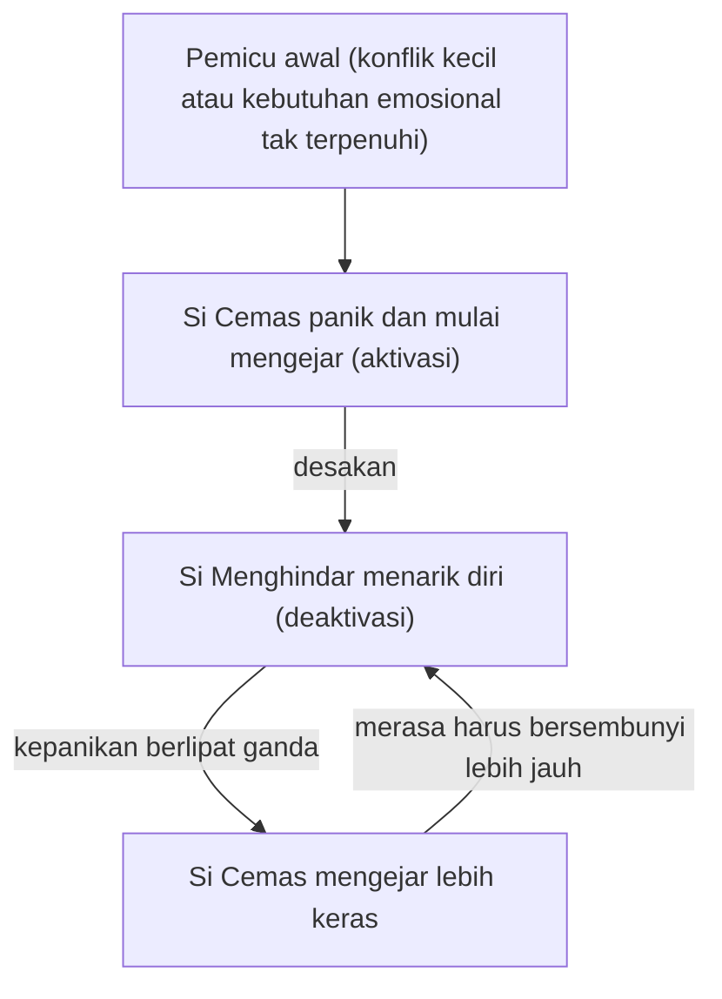

## Dinamika Kelekatan dalam Hubungan Romantis

Pernahkah kamu merasa bahwa semakin kamu mengejar pasangan untuk mendapatkan kejelasan, semakin ia menarik diri? Atau sebaliknya, apakah kamu merasa bahwa setiap kali kamu mencoba memberikan ruang bagi diri sendiri, pasanganmu justru menjadi semakin menuntut?

Pola seperti ini disebut **Dinamika Kelekatan**. Dalam hubungan romantis dewasa, gaya kelekatan kita tidak bekerja secara terisolasi. Gaya-gaya itu berinteraksi layaknya sebuah tarian. Sayangnya, bagi banyak pasangan, tarian ini sering kali berubah menjadi "tarian konflik" yang melelahkan karena adanya benturan antara kebutuhan akan kedekatan dan kebutuhan akan kemandirian.

## 1. Ketertarikan Si Cemas pada Si Menghindar

Sebuah fenomena menarik dalam psikologi hubungan adalah kecenderungan individu dengan gaya kelekatan **Cemas (Anxious)** untuk tertarik pada individu dengan gaya kelekatan **Menghindar (Avoidant)**. Fenomena ini sering disebut sebagai *Anxious-Avoidant Trap*.

**Wawasan Penting:** Kita cenderung memilih pasangan yang mengonfirmasi pandangan terdalam kita tentang diri sendiri dan hubungan.

* **Si Cemas** merasa harus terus berjuang demi mendapatkan cinta. Hal ini secara tidak sadar mengonfirmasi keyakinannya bahwa ia tidak cukup berharga dan selalu dibayangi ketakutan akan penolakan.
* **Si Menghindar** cenderung melihat orang lain sebagai sosok yang membatasi ruang gerak, sehingga ia segera menjaga jarak untuk mempertahankan kemandiriannya.

### Termostat Emosional

Bayangkan sebuah ruangan dengan dua orang dan satu termostat. Si Cemas merasa kedinginan dan terus menaikkan suhu untuk mencari kedekatan, sementara Si Menghindar merasa kepanasan dan terus membuka jendela untuk mencari ruang. Keduanya bertindak berdasarkan insting bertahan hidup, namun tindakan mereka justru membuat pihak lain merasa tidak nyaman.

## 2. Siklus Pengejar-Penghindar (The Pursuer-Distancer Cycle)

Dinamika yang paling umum dan merusak dalam hubungan romantis adalah siklus **Pengejar-Penghindar**. Ini adalah pola komunikasi yang salah satu pasangannya menekan untuk interaksi (pengejar), dan pasangan lainnya menarik diri secara fisik atau emosional (penghindar).

### Bagaimana Siklus Ini Terjadi?

1. **Pemicu awal:** Konflik kecil muncul, atau ada kebutuhan emosional yang tidak terpenuhi secara mendadak.
2. **Reaksi Si Cemas (Aktivasi):** Ancaman kecil ini memicu kepanikan dalam diri Si Cemas. Sistem sarafnya beralih ke mode bertahan (*fight*), yang membuatnya mulai mengejar, melayangkan kritik, atau menelepon pasangan berulang kali.
3. **Reaksi Si Menghindar (Deaktivasi):** Menghadapi desakan tersebut, Si Menghindar merasa sangat tertekan. Demi melindungi diri, ia mengaktifkan mode *flight* atau *freeze* dengan cara diam, meninggalkan ruangan, atau mematikan ponsel.
4. **Eskalasi konflik:** Ketika Si Menghindar menarik diri, kepanikan Si Cemas justru berlipat ganda. Akibatnya, ia mengejar lebih keras, yang kemudian membuat Si Menghindar merasa harus bersembunyi lebih jauh lagi.

Bagan di bawah menunjukkan bagaimana langkah keempat kembali mendorong Si Menghindar menjauh, sehingga pola ini terus berputar.

$$
\text{Konflik} = \text{(Kebutuhan Kedekatan)}_A \times \text{(Ketakutan akan Keintiman)}_B
$$

Jika nilai ketakutan salah satu pihak meningkat, intensitas pengejaran pihak lain biasanya akan meningkat untuk menyeimbangkannya.

## 3. Kisah Sinta dan Budi

Mari kita lihat bagaimana dinamika ini bermain dalam kehidupan nyata:

**Skenario:** Sinta (Cemas) merasa Budi (Menghindar) agak menjauh minggu ini karena sibuk bekerja.

* **Aksi Sinta:** Mengirim pesan bernada cemas: *"Kenapa kamu berubah? Kamu sudah tidak sayang lagi ya?"* Ini adalah bentuk upayanya mencari kepastian.
* **Reaksi Budi:** Setelah membaca pesan itu, Budi merasa terbebani dan berpikir, *"Aku baru pulang kerja, kenapa harus ada drama lagi?"* Akhirnya, ia mendiamkan pesan tersebut selama empat jam.
* **Eskalasi Sinta:** Karena tidak ada balasan, kecemasan Sinta memuncak hingga ia menelepon 15 kali. Pikirannya dipenuhi asumsi bahwa Budi akan meninggalkannya.
* **Respons Budi:** Menghadapi desakan tersebut, Budi mematikan ponsel lalu pergi ke gym karena merasa ruang pribadinya diinvasi.

Keduanya berakhir dengan rasa terluka. Sinta merasa diabaikan dan tidak dicintai, sementara Budi merasa ruang gerak dan privasinya tidak dihargai. Tanpa kesadaran akan gaya kelekatan masing-masing, mereka akan terus terjebak dalam lingkaran setan yang sama.

## 4. Dinamika Kelekatan Lainnya

Meskipun pasangan Cemas-Menghindar paling sering dibahas karena konflik mereka yang dramatis, pola hubungan lainnya juga memiliki karakteristik unik:

### A. Aman + Tidak Aman (Cenderung Lebih Stabil)

Ketika seseorang dengan gaya kelekatan **Aman (Secure)** berpasangan dengan individu yang Cemas atau Menghindar, hubungan tersebut cenderung lebih stabil.

Dalam dinamika ini, pasangan dengan gaya Aman bertindak sebagai jangkar yang kokoh. Mereka tidak mudah terpicu oleh kecemasan berlebih atau aksi penarikan diri pasangannya. Kehadiran yang konsisten dan menenangkan ini secara perlahan membantu pasangan yang tidak aman untuk belajar lebih tenang dan percaya diri hingga mencapai kondisi *Earned Security*.

### B. Menghindar + Menghindar (Saling Menjaga Jarak)

Pasangan yang sama-sama memiliki gaya kelekatan menghindar jarang terlibat dalam pertengkaran hebat, tetapi hubungan mereka sering kali terasa hampa.

Keduanya sama-sama menjaga jarak aman demi melindungi diri dari keintiman. Risiko terbesar dari pola ini adalah hubungan yang perlahan mendingin karena tidak adanya kedekatan emosional yang tulus.

### C. Cemas + Cemas (Saling Menuntut Kepastian)

Hubungan antara dua orang yang sama-sama cemas biasanya dipenuhi dengan gairah yang tinggi, namun juga diwarnai banyak drama.

Kedua belah pihak terus-menerus menuntut kepastian dan validasi dari pasangannya. Pola ini rentan memicu kelelahan mental akibat fluktuasi emosi yang ekstrem dan pasang surut konflik yang melelahkan.

## 5. Memutus Siklus Konflik

Untuk mengubah dinamika hubungan, langkah pertama yang harus dilakukan adalah berhenti menyalahkan karakter pasangan dan mulai melihat pola interaksi tersebut sebagai musuh bersama yang sebenarnya.

### Strategi untuk Si Cemas

1. **Latih Self-Soothing:** Saat rasa panik mulai melanda, cobalah menenangkan diri sendiri terlebih dahulu sebelum menuntut penjelasan dari pasangan.
2. **Beri Ruang untuk Bernapas:** Sadari bahwa keputusan pasangan untuk menarik diri biasanya terjadi karena mereka merasa kewalahan (*overwhelmed*), bukan karena rasa sayangnya telah hilang.
3. **Fokus pada Perasaan Sendiri (*I-Statement*):** Sampaikan perasaanmu secara jujur tanpa menyudutkan. Misalnya, *"Aku merasa kesepian saat kita jarang mengobrol,"* alih-alih menuduh dengan *"Kamu selalu mengabaikanku!"*

### Strategi untuk Si Menghindar

1. **Komunikasikan Kebutuhan Ruang:** Jika kamu membutuhkan waktu sendiri, sampaikan dengan jelas agar pasangan tidak panik. Gunakan kalimat penenang seperti, *"Aku butuh waktu sekitar 30 menit untuk menenangkan diri, setelah itu aku janji kita akan mengobrol lagi."*
2. **Kenali Sinyal Tubuh:** Sadari kapan tubuhmu mulai merasa "sesak" atau tertekan agar kamu tidak langsung mematikan emosi atau melarikan diri begitu saja.
3. **Mulai dari Hal Kecil:** Latihlah keterbukaan dengan membagikan satu hal kecil yang kamu rasakan atau alami setiap hari demi menjaga keintiman tetap hidup.

## Dinamika Kelekatan Bukan Takdir

Dinamika kelekatan dalam hubungan romantis bukanlah sebuah takdir yang tidak bisa diubah. Dengan memahami bahwa reaksi defensif pasangan sebenarnya berakar dari luka masa lalu, kita dapat menumbuhkan empati yang lebih dalam.

Mengenali peran kita dalam "tarian" hubungan ini - apakah kita cenderung mengejar atau menghindar - adalah langkah penting untuk mengubah pola tersebut. Kesadaran inilah yang memungkinkan perubahan. Begitu kamu memahami pola kelekatan ini, kamu tidak lagi menjadi korban dari reaksi otomatis diri sendiri, melainkan mulai memegang kendali untuk membangun hubungan yang lebih sehat.
