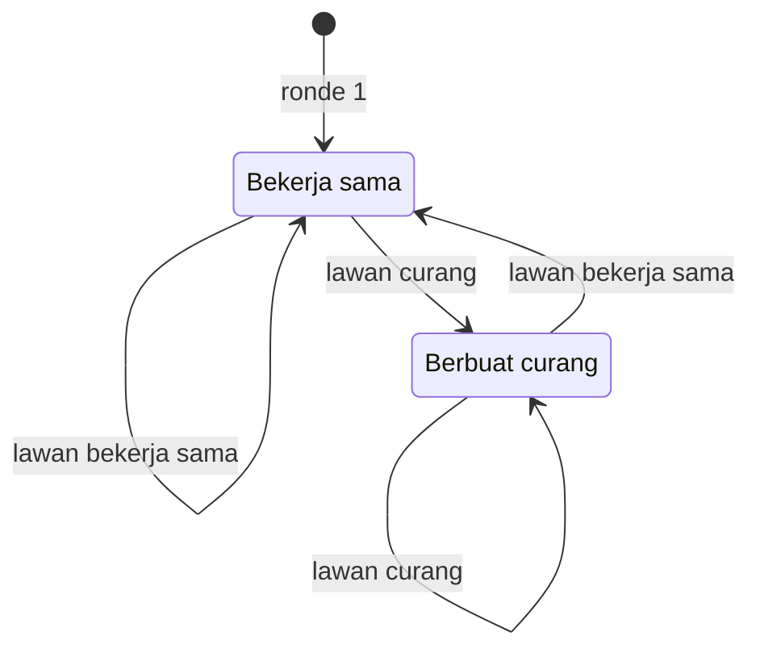
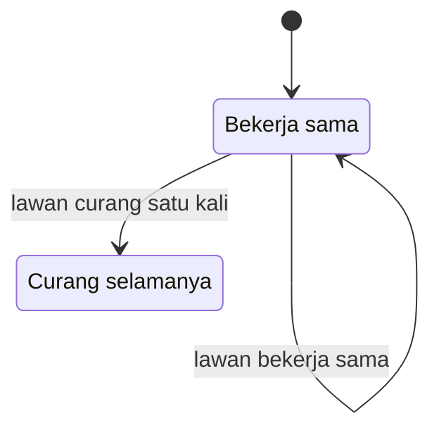

## Permainan Berulang (Repeated Games)

Dalam modul sebelumnya, kita telah mempelajari **Dilema Tahanan (Prisoner's Dilemma)** di mana dua pihak sering kali berakhir dengan hasil buruk karena mereka tidak bisa saling percaya dalam satu kali interaksi. Namun, dalam kehidupan nyata, kita jarang berinteraksi dengan orang lain hanya sekali. Kita bertemu rekan bisnis yang sama, berbelanja di toko yang sama, dan bekerja dengan tim yang sama selama bertahun-tahun.

**Permainan Berulang (Repeated Games)** adalah cabang dari teori permainan yang mempelajari bagaimana perilaku manusia berubah ketika interaksi terjadi berkali-kali. Di sini, dimensi waktu dan masa depan menjadi faktor penentu keputusan kita.

## 1. Bayangan Masa Depan (The Shadow of the Future) sebagai Konsep Dasar

Apa yang membedakan satu kali pertemuan dengan pertemuan yang berulang? Jawabannya adalah **Reputasi** dan **Pembalasan**.

> "Jika saya menipu kamu hari ini, saya mungkin untung sekarang. Tetapi jika saya harus bertemu kamu lagi besok, kamu mungkin tidak akan mau bekerja sama lagi dengan saya."

Dalam permainan berulang, pemain harus mempertimbangkan bukan hanya hasil saat ini (payoff), tetapi juga dampak tindakan mereka terhadap hasil di masa depan. Konsep ini disebut sebagai **Shadow of the Future**. Semakin besar kemungkinan kita bertemu lagi di masa depan, semakin besar insentif kita untuk bekerja sama.

### Faktor Diskonto (Discount Factor) $\delta$

Dalam matematika teori permainan, kita menggunakan simbol $\delta$ (delta) untuk mewakili seberapa besar kita menghargai hasil di masa depan dibandingkan hasil saat ini.

- Jika $\delta$ mendekati 1, kita sangat peduli dengan masa depan.
- Jika $\delta$ mendekati 0, kita hanya peduli dengan hari ini (oportunis).

Nilai sekarang ($\text{PV}$) dari serangkaian keuntungan dapat dirumuskan sebagai:

$$
\text{PV} = \pi_0 + \delta \pi_1 + \delta^2 \pi_2 + \dots = \sum_{t=0}^{\infty} \delta^t \pi_t
$$

## 2. Permainan Berulang Terbatas vs. Tak Terbatas

Perilaku pemain sangat bergantung pada apakah mereka tahu kapan permainan akan berakhir.

### A. Permainan Berulang Terbatas (Finitely Repeated Games)

Jika pemain tahu persis bahwa permainan akan berakhir pada ronde ke-10, sebuah fenomena menarik terjadi yang disebut **Induksi Mundur (Backward Induction)**:

1. Pada ronde ke-10 (terakhir), tidak ada masa depan lagi. Maka, pemain akan berbuat curang (defect) seperti dalam permainan satu kali.
2. Karena semua tahu semua orang akan curang di ronde ke-10, maka di ronde ke-9 tidak ada gunanya membangun kepercayaan. Pemain akan curang di ronde ke-9.
3. Pola ini berlanjut hingga ke ronde pertama.

*Coba renungkan: Jika kamu tahu seorang penyewa rumah akan pindah bulan depan dan tidak akan pernah bertemu kamu lagi, apakah kamu tetap memberikan pelayanan yang sama maksimalnya dengan penyewa yang baru saja menandatangani kontrak 5 tahun?*

### B. Permainan Berulang Tak Terbatas (Infinitely Repeated Games)

Dalam kenyataannya, kita sering tidak tahu kapan sebuah hubungan akan berakhir. Ketidakpastian inilah yang memungkinkan **Kerja Sama (Cooperation)** tetap bertahan sebagai Ekuilibrium Nash. Selama peluang untuk bertemu kembali cukup tinggi, rasa takut akan pembalasan di masa depan menjaga perilaku pemain tetap jujur.

## 3. Strategi dalam Permainan Berulang

Bagaimana kita harus bertindak jika lawan main kita bisa membalas di masa depan? Berikut adalah dua strategi yang paling terkenal:

### 1. Tit-for-Tat (Mata Ganti Mata)

Strategi ini dipopulerkan oleh Anatol Rapoport dalam kompetisi yang diadakan oleh Robert Axelrod. Aturannya sangat sederhana:

- **Ronde 1:** Bekerja sama.
- **Ronde selanjutnya:** Lakukan apa pun yang dilakukan lawan pada ronde sebelumnya.

Aturan sederhana ini dapat kamu bayangkan sebagai dua keadaan yang berganti mengikuti langkah lawan pada ronde sebelumnya.

**Mengapa Tit-for-Tat sangat efektif?**

- **Ramah:** Tidak pernah menjadi yang pertama untuk berbuat curang.
- **Tegas:** Langsung membalas jika lawan berbuat curang.
- **Pemaaf:** Jika lawan kembali bekerja sama, ia akan membalas dengan kerja sama lagi.
- **Jelas:** Lawan dapat dengan mudah memahami pola perilaku kita.

### 2. Strategi Grim Trigger (Pemicu Kejam)

Ini adalah strategi yang jauh lebih ekstrem:

- Bekerja sama selama lawan bekerja sama.
- Jika lawan berbuat curang **satu kali saja**, maka kamu akan berbuat curang selamanya sebagai hukuman.

Bandingkan dengan diagram berikut, di mana satu kecurangan lawan mengunci kamu di keadaan curang tanpa jalan kembali.

> **Pelajaran Utama:** Grim Trigger efektif untuk menakut-nakuti lawan agar tidak berbuat curang, namun sangat rapuh karena satu kesalahan kecil atau kesalahpahaman akan menghancurkan hubungan selamanya.

## 4. Teorema Folk (The Folk Theorem)

Dalam teori permainan, **Teorema Folk** menyatakan bahwa dalam permainan berulang tak terbatas, hampir semua hasil yang saling menguntungkan (di mana setiap pemain mendapatkan lebih dari yang mereka dapatkan jika mereka saling menjatuhkan) dapat dicapai sebagai Ekuilibrium Nash, asalkan pemain cukup sabar ($\delta$ cukup tinggi).

Ini menjelaskan mengapa di komunitas kecil atau pasar tradisional, orang-orang cenderung sangat jujur. Mereka terikat dalam "permainan" yang tidak diketahui kapan berakhirnya, sehingga menjaga keharmonisan jauh lebih menguntungkan daripada keuntungan sesaat dari menipu.

## 5. Tit-for-Tat Menghadapi Satu Kecurangan

Mari kita lihat bagaimana strategi ini bekerja selama lima ronde. Kamu memakai Tit-for-Tat, sedangkan lawanmu selalu bekerja sama kecuali sekali, yaitu di ronde ke-3, ketika ia curang. Poin setiap ronde memakai angka ilustrasi berikut:

- Keduanya bekerja sama: masing-masing mendapat 3 poin.
- Satu pihak curang dan pihak lain bekerja sama: yang curang mendapat 5 poin, yang dicurangi 0 poin.

| Ronde | Langkah kamu | Langkah lawan | Poin ronde (kamu, lawan) | Total poin (kamu, lawan) |
| --- | --- | --- | --- | --- |
| 1 | Kerja sama | Kerja sama | (3, 3) | (3, 3) |
| 2 | Kerja sama | Kerja sama | (3, 3) | (6, 6) |
| 3 | Kerja sama | Curang | (0, 5) | (6, 11) |
| 4 | Curang | Kerja sama | (5, 0) | (11, 11) |
| 5 | Kerja sama | Kerja sama | (3, 3) | (14, 14) |

Di ronde 3 kamu tertinggal 6 lawan 11 karena dicurangi. Di ronde 4 kamu membalas sesuai aturan Tit-for-Tat, sementara lawan sudah kembali bekerja sama, sehingga skor kembali imbang 11 lawan 11. Di ronde 5 kamu ikut bekerja sama lagi, dan setelah lima ronde kalian sama-sama mengantongi 14 poin. Sifat **tegas** dan **pemaaf** tadi terlihat langsung di tabel: satu kecurangan dibalas satu kali, lalu kerja sama pulih.

## 6. Permainan Berulang pada Maskapai, Perjanjian Internasional, dan Langganan

### Perang Harga di Industri Maskapai

Dua maskapai penerbangan mungkin tergoda untuk menurunkan harga tiket secara drastis untuk merebut pelanggan. Namun, karena mereka berkompetisi setiap hari (permainan berulang), mereka tahu jika satu maskapai menurunkan harga, yang lain akan membalas. Akhirnya, keduanya akan rugi. Hasilnya? Harga seringkali stabil di level tinggi karena adanya kesadaran akan "pembalasan" di masa depan.

### Perjanjian Internasional

Negara-negara mematuhi perjanjian pengurangan emisi atau nuklir bukan karena ada polisi dunia yang menangkap mereka, melainkan karena mereka tahu jika mereka melanggar janji, negara lain akan membatalkan kerja sama di bidang ekonomi atau keamanan di masa depan.

### Langganan (Subscription Services)

Perusahaan seperti Netflix atau Spotify memperlakukan kamu dalam konteks permainan berulang. Mereka bersedia merugi di bulan pertama (free trial) demi membangun hubungan jangka panjang di mana kamu terus membayar iuran bulanan selama bertahun-tahun.

## Kesimpulan

Permainan Berulang mengajarkan kita bahwa **etika dan kepercayaan bukan sekadar nilai moral, melainkan strategi matematika yang optimal**. Dalam dunia yang saling terhubung, bertindak egois dalam jangka pendek sering kali menjadi kerugian besar dalam jangka panjang.

**Poin Utama untuk Diingat:**

- **Reputasi adalah modal:** Dalam interaksi berulang, perilaku masa lalu adalah sinyal masa depan.
- **Tit-for-Tat adalah keseimbangan:** Jadilah ramah tapi jangan biarkan diri kamu diinjak-injak.
- **Kesabaran itu menguntungkan:** Pemain yang menghargai masa depan ($\delta$ tinggi) cenderung menciptakan kerja sama yang stabil.

*Refleksi: Dalam hubungan profesional kamu saat ini, apakah kamu sedang bermain dalam mode "Sekali Saja" atau "Berulang"? Bagaimana hal itu memengaruhi cara kamu bernegosiasi?*
