# Systematic Debugging Log: diagrams do not match the reader's theme, and the theme differs between chapters

## 1. Issue Summary

- **Reported Bug (owner, 2026-10-16):** since the Mermaid diagrams were added, diagrams often do not contrast with the selected theme, and the look is unstable across chapters (chapter 1 looks light, chapter 2 dark).
- **Environment:** production `https://dawnbook.belajarcarabelajar.com/books/*`, mdBook v0.5.3 (CI pin, `.github/workflows/deploy.yml:21`), repo `origin/main` at `7ffe0f9`, Cloudflare zone setting `rocket_loader` = `on` (`modified_on` 2026-06-21T20:00:33Z). Probes ran on Chrome headless shell 153 and Playwright WebKit 27.2 (WPE) on the Debian 13 VPS.
- **Affected Subsystem:** the mdBook theme bootstrap in every built book page as delivered through Cloudflare. The diagram pipeline (`scripts/diagrams/*`, `theme.css`) is not at fault.

## 1b. Debugging Loop

```mermaid
stateDiagram-v2
    accTitle: Debugging loop of the diagram theme investigation
    accDescr: Two feedback loops were built first, one on static diagram colours and one on the theme at first paint of the live page. Ten hypothesis chunks ran in parallel. Seven hypotheses about the diagrams, the page cascade, browser engines and theme writers were disproven; the Rocket Loader hypothesis was confirmed by a replay where exactly two script tags separate red from green, and the work waits at the root cause gate before any fix.
    [*] --> FEEDBACK : Owner report
    FEEDBACK --> FEEDBACK : Static colour probe green except a probe artefact
    FEEDBACK --> REPRODUCE : Theme at first paint probe red on the live page
    REPRODUCE --> DIAGNOSE : Live replay, two script tags load-bearing
    DIAGNOSE --> DIAGNOSE : H2 H3 H4 H7 H8 disproven
    DIAGNOSE --> GATE : H1 confirmed with the two-script correction
    GATE --> FIX : Owner approves the root cause
    FIX --> VERIFY : Regression test green
    VERIFY --> [*] : Live probe green after deploy

    state FEEDBACK {
        [*] --> StaticColourProbe
        StaticColourProbe --> FirstPaintProbe
    }
    state DIAGNOSE {
        [*] --> TenChunks
        TenChunks --> ParentReverify
    }
```



## 1c. Phase 0: Feedback Loop

- **Red-capable command** (drives the real delivery path: the live page, served through Cloudflare with Rocket Loader):
  ```bash
  bun docs/code-plan/spikes/2026-10-16-diagram-theme-contrast/probe-theme-paint.ts \
    https://dawnbook.belajarcarabelajar.com/books/state-of-flow/ --theme navy --runs 4
  ```
- **First run output:** `run 1: http 200  FCP 756ms  theme at FCP light (no js class)  final navy  MISMATCH` (class log `1205ms:light sidebar-visible | 1208ms:navy js`), 4/4 runs mismatched, exit 1.
- **Control:** the same command against the same mdBook build served locally without Rocket Loader: 4/4 runs `theme at FCP navy`, exit 0.
- **Stronger loop found during diagnosis:** `probe-theme-paint.ts` judges by class name, so it misses the reverse case (stored `light` on a dark OS paints the coal-coloured `html:not(.js)` fallback, which carries no theme class). `C1/probe-paint-bg.ts` and `C10/probe-paint-bg.ts` read the resolved `--bg` at first paint and catch both directions. They are the loop for verification.
- **Ladder rung used:** headless browser (rung 4), then a differential loop (rung 9) between the live page and a local replay.
- **Loop checks:**
  - [x] Red-capable: drives the live page and asserts the theme at first contentful paint against the stored theme
  - [x] Deterministic: 4/4 live runs, 5/5 replay runs red; 0 green
  - [x] Fast: about 3 s per run
  - [x] Agent-runnable without a human

## 2. Phase 1: Deterministic Reproduction

- **Minimal reproducer:** local replay of the live page `/books/state-of-flow/` with the real `rocket-loader.min.js` (`/tmp/dtc-C1/live/`, server `C1/serve.ts`), four variants at the same public pathname:

  | Variant | Change from the delivered HTML | Theme at first paint (stored navy) | Final | Exit |
  |---|---|---|---|---|
  | A | none | light, no `js` class, 5/5 | navy | 1 |
  | B | only the body bootstrap gets `data-cfasync="false"` | light, 5/5 | light (never applied) | 1 |
  | C | B plus the head script that defines `default_light_theme` and `default_dark_theme` | navy, 0/5 | navy | 0 |
  | D | Rocket Loader removed | navy, 0/5 | navy | 0 |

- **Parent re-run (2026-10-16):** A 3/3 red exit 1, B 3/3 red exit 1 and stays `light`, C 0/3 exit 0. `diff index.html c.html` touches exactly lines 70 and 163.
- **Reverse direction (C1 colour probe, stored light, dark OS):** A paints dark first then white (3/3, exit 1), B stays dark (3/3, exit 1), C and D 0/3 (exit 0).
- **Confirmation:** [x] fails deterministically for the reported reason (wrong theme on screen while the reader has a stored theme).
- **Minimised:** [x] two script tags are load-bearing. Freeing only the bootstrap (B) throws `default_light_theme is not defined`; freeing neither (A) paints the fallback theme.

## 3. Phase 2: Root Cause Analysis

**Ranked hypotheses and results** (chunks C1 to C10, contracts in `2026-10-16-dawnbook-diagram-theme-contrast-subagent-contracts.md`):

| Rank | Hypothesis | Prediction | Probe | Result |
|---|---|---|---|---|
| 1 | H1: Rocket Loader defers the mdBook theme bootstrap, so pages paint before the stored theme is applied | freeing the theme scripts from Rocket Loader makes the first paint use the stored theme in every run | C1 live replay A/B/C/D, parent re-run; C10 simulated Rocket Loader on the built page | **Confirmed**, with the correction that two scripts must be freed together |
| 2 | H3: Chromium leaves the SVG painted in the old theme after a late class switch | late-switch screenshot differs from a fresh render | C2 harness: 8 SVGs (all 7 types), headless shell, full Chrome new headless, full Chrome headful under Xvfb, light and emulated dark OS | **Disproven**: 0 differing pixels in 768 late-vs-fresh comparisons (max channel difference 0), computed styles identical including marker paths; control light vs navy differs on 77 to 99.9 percent of pixels |
| 3 | H2: WebKit leaves the SVG stale after a late switch | WebKit differs, Chromium matches | C3 Playwright WebKit 27.2, 42 screenshot cases plus 14 displayed-frame cases | **Disproven** for WPE WebKit: 0 differing pixels late vs fresh; iOS compositor not testable here |
| 4 | H7: some diagram elements keep hard-coded Mermaid colours | shapes with the same fill in all five themes, outside the by-design pie palette | C8 audit of 1081 visible shapes in 158 SVGs | **Disproven**: only the 17 pie slices (by design, `theme.css:45`); 0 light shapes on dark themes, 0 dark shapes on light themes |
| 5 | H8: the real chapter cascade changes diagram colours | real-page contrast differs from the static probe | C7 real chapter pages, 6570 labels | **Disproven**: 0 fill differences, 0 ratio differences |
| 6 | H4: another code path writes `mdbook-theme` or the theme class on navigation | a writer that runs on chapter navigation | C6 audit of book.js, shared-script.js, hub-runtime.ts, inject-gating.ts, functions | **Disproven**: only the bootstrap, book.js on load or on a click, and the hub toggle (hub pages only) |

- **Synthesis:** the diagrams are correctly themed and repaint correctly; they always show whatever theme `<html>` carries at that moment. What is wrong is which theme `<html>` carries at first paint. C2 also measured that, on a dark OS, a page without the `js` class paints byte-identical to coal (the `@media (prefers-color-scheme: dark) html:not(.js)` rule at `variables-*.css:322` has specificity (0,1,1) and beats `.light, html:not(.js)`), so a reader who stored `light` on a dark-OS device sees dark, then light.
- **Unverified boundary:** iOS Safari's own compositor could not be run here (C3 ran WPE WebKit). External documentation (Cloudflare Rocket Loader pages, mdBook issues, WebKit and Chromium trackers) was not read because TinyFish is not signed in for this session (C4, C5); the diagnosis rests on direct measurements, not on documentation.
- **Static colour finding corrected:** F3's two labels below 3:1 ("Arousal", "Boredom" in `state-of-flow/89fdb4768425.svg`) were a probe defect. The probe counted the fill of a `<line>` (the quadrant divider inherits `fill:#333` from the Mermaid root rule but never paints it). With a paint-aware stack (`isPointInFill`), parent re-run: 0 of 6570 labels below 3:1 in all five themes, exit 0.
- **Execution trace (live page, stored navy, light OS):**
  1. The HTML arrives with `<html class="light sidebar-visible">` and both theme scripts rewritten by Cloudflare to `type="6028af01d7458a3d27015781-text/javascript"`.
  2. The parser skips them; the stylesheet rule `.light, html:not(.js)` (`variables-*.css:141`) applies the light palette. On a dark OS, `@media (prefers-color-scheme: dark) html:not(.js)` (`:322`) applies coal instead.
  3. First contentful paint happens with that palette: page background, text and every inline diagram, whose `theme.css` colours read the same variables.
  4. Rocket Loader then runs its queue in document order, including external scripts before the bootstrap (`toc-*.js`, `pake-compat.js`); the head script defines `default_light_theme`, the bootstrap swaps `light` for the stored theme and adds `js`. Live, this landed 450 to 1000 ms after first paint (F2); on slow mobile links the queue waits on more downloads.
  5. Every chapter is a full page load, so steps 1 to 4 repeat per chapter, with a different delay each time.
- **Violated invariant:** mdBook's contract that the reader's stored theme class is on `<html>` before first paint. mdBook guarantees it with two inline scripts that must run synchronously during parsing, in order (the head script defining the default themes, then the body bootstrap marked "Set the theme before any content is loaded, prevents flash"). Rocket Loader turns both into deferred scripts.
- **Root cause explanation:** Cloudflare Rocket Loader is on for the zone and the two mdBook theme scripts carry no `data-cfasync="false"`. The repository fixed the same class of defect for analytics (`fe902ef`, 2026-07-20) and MathJax (`992bfbb`, 2026-07-29, `books/_template/theme/head.hbs:1,23`), but the stock mdBook theme scripts live in mdBook's own `index.hbs`, which Dawnbook does not override, so they were never covered.
- **Why it surfaced with the Mermaid release (C9):** no theme code, script order or delivery setting changed with the release. The release put a large theme-coloured object into 143 chapters of 58 books in one morning (7 deploys, 2026-10-15T22:14Z to 2026-10-16T02:02Z), and every pre-merge theme check ran on local builds, which never pass through Rocket Loader. A diagram that is light for half a second, then dark, on a navy page reads as "the diagram does not match my theme". The 2026-09-28 "module 1 to module 2 transition glitch" ruled out a theme flash using local output only, so it may be the same symptom.

## 4. Phase 3: Smallest Safe Localized Fix (approved by the owner on 2026-10-16, option "Post-build attribute"; applied)

- **Applied:** `scripts/inject-gating.ts` gains `markThemeScriptsCfAsync(html)` (`MDBOOK_THEME_SCRIPTS` matchers for the default-themes script, the localStorage quote workaround and the bootstrap), called first in `injectSeoAndGating`; it throws when a page has `id="mdbook-theme-toggle"` but any of the three scripts is missing. Regression test `tests/scripts/inject-gating-theme-scripts.test.ts` on `tests/fixtures/mdbook-0.5.3-chapter.html` (an unchanged mdBook v0.5.3 page). RED before the fix: exit 1 (`Expected "<script data-cfasync="false">" Received "<script>"`); GREEN after: 7 pass.

Proposal as presented at the gate:

- **Recommended:** in the post-build pass that already rewrites every built book page (`scripts/inject-gating.ts`, `processDirectory`, called from `scripts/build.ts:37`), add `data-cfasync="false"` to mdBook's theme scripts: the head script that defines `default_light_theme` and `default_dark_theme`, the quote workaround that precedes the bootstrap (kept so mdBook's order is preserved), and the bootstrap. Match on the script content, and fail the build when a page carries the bootstrap but the transform did not apply, so an mdBook upgrade that changes the markup breaks loudly instead of silently restoring the bug. mdBook's own code then runs before first paint, unchanged.
- **Alternatives (C10):** an early theme script in `books/_template/theme/head.hbs` (works, but duplicates mdBook's theme logic and can drift on upgrade); a Cloudflare Configuration Rule turning Rocket Loader off for `/books/*` (works with no repo change, but is outside version control and externally visible, so it is the owner's call); a custom `index.hbs` (forks the whole mdBook template, against GEMINI.md section 1).
- **Regression test seam:** the post-processed HTML of a real mdBook 0.5.3 page (new fixture taken from the built output): the test asserts the three theme scripts carry `data-cfasync="false"`, that nothing else changes, and that a page without the markers fails the check. The Phase 0 colour probe against the live page after deploy is the end-to-end proof.

## 5. Phase 4: Regression Verification

- **Reproduction test:** `bun test tests/scripts/inject-gating-theme-scripts.test.ts` exit 0, 7 pass, 0 fail, 44 expect() calls; identical on 4 runs (V6). Mutation check (V6): an identity `markThemeScriptsCfAsync` in a /tmp copy fails 4 of 7 tests; `diff` shows the one mutated line.
- **Neighbouring suite:** six inject-gating, SERP and build test files, exit 0, 32 pass (V6).
- **Full suite:** `bun test` exit 1, 679 pass, 26 skip, 1 fail: `tests/scrape-shield.test.ts` ENOENT on `output/contribute.html` (a fresh worktree has no build; the same test passes 3/3 in the main checkout). One V6 run also hit `tests/scripts/gsc-batch-indexing-ping.test.ts`, a wall-clock comparison flake (`assertLess(par_time, seq_time)`), unchanged by this diff. Both are pre-existing and outside the changed surface; recorded as debt.
- **Full build (V5):** `bun run build` with mdBook v0.5.3, exit 0, 58 books; 853 of 853 pages with the theme toggle carry the three marked scripts exactly once, the 58 `toc.html` pages are unchanged; against a baseline build with HEAD's `inject-gating.ts`, every page is byte-identical after removing the three attributes. `check:headings` and `check:diagrams` exit 0.
- **End to end, pre-deploy (V1):** pre-Cloudflare pages rewritten the way Cloudflare rewrites them, with the real `rocket-loader.min.js`: FIXED 0 mismatches in 100 loads across navy on a light OS, light on a dark OS, and Auto on a dark OS, for a book index and a chapter; CONTROL red in every mode; no error in FIXED that CONTROL lacks.
- **Reviews:** standards axis (V3) `correct`, no qualifying finding; spec axis (V4) `correct`, one P2 record finding (plan status and log headings stale), fixed in this session. Sibling-caller audit (V2): callers, markup parsers, CSP, script order and const redeclaration all safe.
- **Original scenario:** [ ] Phase 0 loop on the live page after deploy (needs the merge, which deploys through CI): `C10/probe-paint-bg.ts https://dawnbook.belajarcarabelajar.com/books/state-of-flow/ --theme navy --runs 5`, plus `--dark --theme light` and `--dark --theme none`.
- **Debug-tag cleanup:** [x] no `[DEBUG-` tag was used in production files; `rg -n 'DEBUG-' scripts/inject-gating.ts tests/scripts/inject-gating-theme-scripts.test.ts` returns 0 hits.
- **Throwaway harness:** [x] kept under `docs/code-plan/spikes/2026-10-16-diagram-theme-contrast/` with a README of each harness's limits.
- **Confirmed hypothesis:** H1, Cloudflare Rocket Loader deferred mdBook's default-themes script and theme bootstrap, so every page painted the fallback theme before the stored one.
- **Verdict:** [ ] resolved in production (pending deploy); [x] resolved in the build output with 0 regressions in the changed surface.
