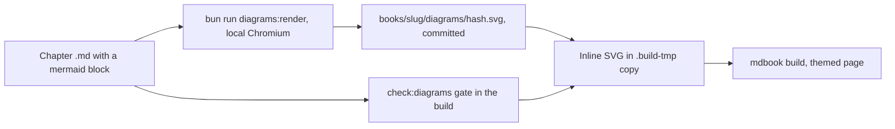

## 1. Delivery Metadata

| Field | Value |
|---|---|
| Session slot | `dawnbook-mermaid-diagrams` |
| Plan | `docs/code-plan/plans/2026-10-16-dawnbook-mermaid-diagrams.md` |
| Spec | `docs/code-plan/specs/2026-10-16-mermaid-diagrams-design.md` |
| Base branch | `main` |
| Head branch | `2026-10-16-dawnbook-mermaid-diagrams/dawnbook-mermaid-diagrams` |
| Type of change | feature (build tooling, authoring rule, two pilot books) |
| Reviewer | two independent audits (standards axis and spec axis), report in `docs/code-plan/artifacts/2026-10-16-dawnbook-mermaid-diagrams-review-report.md` |

## 2. What This Changes

Chapters can now carry Mermaid diagrams. An author writes a fenced `mermaid` block and runs `bun run diagrams:render`, which renders only new or changed diagrams with the local Chromium into a committed per-book cache (`books/<slug>/diagrams/<hash>.svg`, outside `src/`, so it is never a public file and stays behind the paywall). `bun run build` gates every block (`check:diagrams`), then swaps each block for its cached SVG inline in the `.build-tmp` copy; a cache miss exits 1, so CI never needs a browser. One SVG follows all five reader themes because its colours come from mdBook CSS variables, it never shrinks below 0.75 of its natural width (horizontal scroll on phones), and it exposes a title and a description to screen readers. GEMINI.md section 25 is the new authoring rule, with a paste-ready dispatch clause for authoring subagents; MDBOOK_SYSTEM_RULES.md rule 7.7.8 and the AuthoringAgent spec point to it. Two pilot books (`iklan-digital-dan-penargetan-algoritma`, `nudge-theory`) carry three grounded diagrams each.

**Smallest visual:**

**Non-goals:** retrofitting the other 56 books (planned as six later sessions, RF1-RF6 in the plan); mindmap diagrams (refused by the gate); client-side Mermaid; loading the Epilogue web font for diagram labels.

## 3. Acceptance Criteria

| ID | Criterion | Task | Check | Evidence |
|---|---|---|---|---|
| AC-1 | A valid block builds to one inline SVG in `div.dawnbook-diagram`, no `foreignObject`, no `
` | T1, T6 | built pilot pages; `bun test tests/scripts/diagrams-inline.test.ts` | 1 wrapper and 0 `foreignobject` per checked page; tests pass |
| AC-2 | A block with no cached SVG fails the build naming book, file, line and the render command | T3, T6 | moved one cache file away, ran `bun run check:diagrams` | exit 1 with `nudge-theory/src/content/12_...md:11 [cache-miss] ... run bun run diagrams:render --book nudge-theory`; Bun `$` threw exitCode 1 |
| AC-3 | The gate fails for every rule of the source contract | T3, T14, T15 | `bun test tests/scripts/check-diagrams.test.ts` | 63 pass, 0 fail |
| AC-4 | Byte-identical re-render; timeline gets title, desc and aria | T4, T5 | `bun test tests/scripts/render-diagrams.test.ts` | 12 pass, 0 fail |
| AC-5 | Inline SVG text never reaches the meta description | T7 | `bun test tests/scripts/inject-gating-svg.test.ts` | 3 pass; pilot meta descriptions equal the main build |
| AC-6 | Pilots grounded and readable in light and coal at 375 and 1280 px | T10, T11, T13, T14 | gate; contrast harness; screenshots of built pages | gate exit 0; harness 0 text below 3:1 in 5 themes x 2 widths; no desktop scroll; screenshots viewed |
| AC-7 | Rule surfaces in place, symlinks intact | T8, T9 | `test -L CLAUDE.md`, `test -L AGENTS.md` | exit 0, exit 0 |
| AC-8 | Build and tests clean | T12 | `bun run build`, `bun test` | exit 0; 637 pass, 13 skip, 0 fail |

## 4. Local Verification Evidence

> Every row below was produced on the machine holding the working tree, before this branch was pushed.

| Gate | Command | Exit | Result |
|---|---|---|---|
| Diagram gate | `bun run check:diagrams` | 0 | 0 violations, 0 orphaned SVGs |
| Cache complete | `bun run scripts/render-diagrams.ts --check` | 0 | cached 6, missing 0 |
| Build | `bun run build` (mdBook 0.5.4) | 0 | 3 diagrams inlined per pilot book; heading gate and SEO validation passed |
| Tests | `bun test` | 0 | 637 pass, 13 skip, 0 fail (main: 465 pass, the same 13 skip) |
| Tests as CI | `CI=true bun test` | 0 | 625 pass, 26 skip (renderer suite skipped), 0 fail |
| Lockfile | `bun install --frozen-lockfile` | 0 | no changes |
| Browser download | puppeteer postinstall with `.puppeteerrc.json` | 0 | "Skipping downloading browsers", nothing written |
| Untouched books | `diff -rq` of `output/books` against a build of `60debfd` | n/a | only `shared-header.css` differs outside the two pilot books |

- **Before:** no chapter could hold a diagram; ASCII-art diagrams in code fences break on narrow screens; an inlined Mermaid SVG with default settings leaks label `
` text into the meta description and keeps fixed colours (dark text on the coal theme).
- **After:** six pilot diagrams render in every theme with text contrast of at least 3:1 (minimum measured 4.78), natural width at most 940 px, and unchanged meta descriptions.

Measured contrast after the theme work (minimum text / marks per type)

| type | light | rust | coal | navy | ayu |
|---|---|---|---|---|---|
| flowchart, sequence, state, timeline, quadrant | 19.29 / 5.74 | 8.47 / 3.67 | 5.80 / 3.34 | 7.93 / 3.64 | 8.52 / 4.55 |
| pie | 4.78 / 4.35 | 4.78 / 3.31 | 4.78 / 3.34 | 4.78 / 3.99 | 4.78 / 4.21 |
| xychart | 21.00 / 5.74 | 11.54 / 3.67 | 7.13 / 3.34 | 9.46 / 3.64 | 10.72 / 4.55 |

## 5. Independent Review

- [x] Two reviewers that did not produce the work read the diff in parallel: standards axis `correct` (one P3), spec axis `not correct` (two P1, five P2, one P3).
- [x] The parent diff audit ran for every chunk: `git diff` read, targeted tests re-run in the parent, every subagent claim re-verified.
- [x] Every qualifying finding is fixed in this PR; the spec axis re-check found one regression (a test reading a renamed cache file), fixed with a committed fixture.

**Reviewer verdict:** `correct` after the fixes. All P0/P1 findings are closed with evidence (no cached id lacks the diagram id; the gate reports `straight-quote`; `bun test` exits 0). It would change to `not correct` if CI's `bun run build` or `bun test` exits non-zero on this branch.

## 6. Risk, Rollout, Rollback

| Concern | Answer |
|---|---|
| Blast radius | Every book build runs the new gate and inliner; books without diagram blocks build byte-identical HTML. `shared-header.css` gains two rules loaded by all books. |
| Door | Two-way: a revert removes the tooling, the rule and the six pilot diagrams together. |
| Rollout | Default. Merging to `main` deploys through the existing workflow; CI renders nothing. |
| Health signal | The two pilot chapters show their diagrams in every theme; `bun run check:diagrams` stays at 0 violations. |
| Rollback | `git revert` of the merge commit, then the normal deploy. |
| Compatibility | `@mermaid-js/mermaid-cli` 12.0.0 added as an exact devDependency (local renders only); `.puppeteerrc.json` stops Puppeteer's 670 MB browser download in every `bun install`, including CI. |

## 7. Pre-Existing Issues and Deferred Debt

Each item is in the plan's follow-up backlog with its trigger.

- Four candidates are blocked by contradictory chapter text (ikigai zones, tonsillectomy pain peak, EWS command-chain timing, pedagogy percentages). `defer: owner decision on the correct text, before RF3, RF5 and RF6`
- Math backslash and blank-line defects found by the inventory in five books. `defer: manual LaTeX audit session per GEMINI.md section 9`
- `[preprocessor.dawnbook]` has no binary and prints 59 warnings per build. `defer: build-hygiene session, owner choice`
- CI pins mdBook 0.5.3 while local builds use 0.5.4. `defer: next CI workflow edit`
- `searchindex-*.js` is a public asset that holds gated chapter text. `defer: security review of gating, owner decision`
- GEMINI.md section 9 item 1 still describes a `$ ... $` pre-pass removed on 2026-07-31. `defer: next GEMINI.md edit outside section 25`
- Duplicated book-walking helpers in three diagram scripts. `defer: next diagram-tooling change`

## 8. Checklist

- [x] Branch and worktree came from `pr-registry claim`.
- [x] Nothing was committed directly to the base branch.
- [x] Title is imperative; the body is in English, the language of the repository's plans and PRs.
- [x] No em dash in this body, the commit messages, or user-visible strings in the diff (copy-rules scan clean).
- [x] No attribution footer, watermark, badge, or co-author line.
- [x] No secrets, tokens or `.env` content in the diff.
- [x] Every acceptance criterion maps to a check and to evidence.
- [x] PR body written to a file and posted with `--body-file`.
- [ ] Registered in the registry after the PR opens.
- [ ] Task steps ticked from the runner log; readiness checked.
- [ ] Plan closeout decided before the merge.
