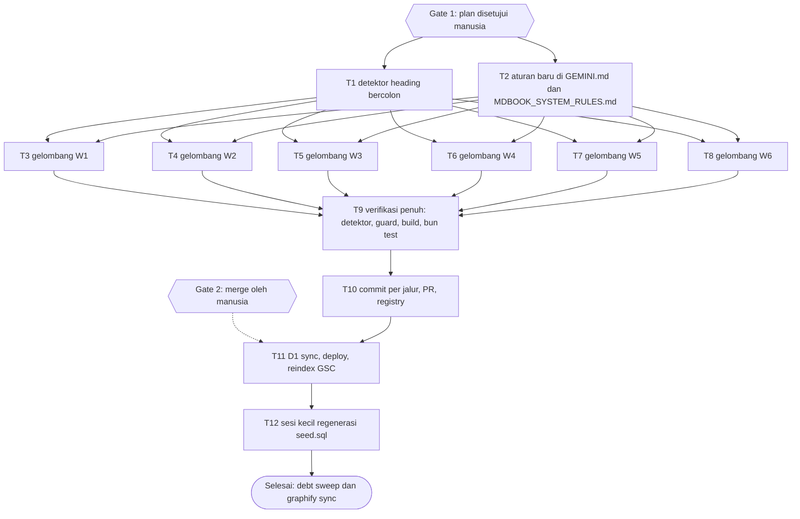

# Dawnbook: Pembersihan Heading Berpola "Judul: Subjudul" (AI Slop)

**Goal:** Hapus pola heading "Label: Subjudul" (dan colon penutup) dari semua buku Dawnbook yang ada, catat larangannya sebagai aturan repo, lalu sinkronkan ulang konten ke D1 setelah merge.

**Architecture:** Detektor baca-saja (`scripts/check-heading-colons.ts`, meniru `scripts/detect-emojis.ts`) menjadi alat ukur dan gerbang verifikasi. Penulisan ulang heading dilakukan manual oleh subagent per buku (GEMINI.md bagian 16 melarang skrip batch untuk menyunting konten), enam gelombang berurutan, dengan parent yang mengaudit diff tiap gelombang. Aturan baru masuk ke GEMINI.md (symlink AGENTS.md/CLAUDE.md) dan MDBOOK_SYSTEM_RULES.md.

**Tech Stack:** Bun 1.4.2, mdBook v0.5.4 (`~/.cargo/bin`), Cloudflare D1 lewat `scripts/migrate-to-d1.ts`, `cf` CLI untuk kueri verifikasi.

**Active Project Profile:** Repo `/home/belajarcarabelajar/Proyek/dawnbook`; sesi bekerja di worktree `/home/belajarcarabelajar/Proyek/dawnbook-wt/dawnbook-heading-colon-cleanup` dari `origin/main` 21a5ad4 (2026-10-11). Cakupan: `books/*/src/content/*.md`, `books/*/src/SUMMARY.md`, `GEMINI.md`, `MDBOOK_SYSTEM_RULES.md`, `scripts/`, `tests/scripts/`. Sumber konfigurasi yang dibaca: GEMINI.md (CLAUDE.md), `package.json`, `scripts/migrate-to-d1.ts`, `docs/code-plan/artifacts/2026-10-06-dawnbook-psikologi-merge-evidence.md`. Terverifikasi: Bun 1.4.2, mdbook v0.5.4, `gh` terautentikasi (belajarcarabelajar). Tidak ada `tsconfig` dan tidak ada skrip lint/typecheck di `package.json` (fakta, bukan celah yang kuisi dengan tebakan).

**Project Commands:** uji `bun test`; build `bash -c "export PATH=$HOME/.cargo/bin:$PATH; bun run build"`; seed D1 `BOOK_SLUG=<slug> bun run scripts/migrate-to-d1.ts` (satu buku) atau tanpa `BOOK_SLUG` (semua, butuh latar belakang karena percobaan tercatat kena timeout lokal 240 detik); deploy `bash scripts/deploy-website.sh` setelah `set -a && source ~/cloudflare/.env && set +a` (GEMINI.md bagian 19); Cloudflare lewat `cf`, bukan `wrangler` (kecuali tiga kondisi pada GEMINI.md).

**Protected Boundaries:** `books/*/book.toml` (GEMINI.md bagian 1: jangan diubah manual per buku; lihat Keputusan D2), `books/_template/`, `books/shared-script.js`, `_headers`, `release-dates.json`, `functions/`, `apps/`. Kredensial hanya di `~/cloudflare/.env`; nilai tidak pernah dicetak. Tidak ada commit langsung ke main.

**Spec:** Permintaan pemilik 2026-10-11 (pesan sesi) plus blok workflow yang ditempel (GEMINI.md bagian 22). Spesifikasi turunan: manifest dan kontrak subagent pada `docs/code-plan/artifacts/2026-10-11-heading-colon-batch-manifest.md`.

**Scope:** Semua `##`-`####` (dan `#`) pada bab dan entri `SUMMARY.md` yang memuat `:` di 56 buku; detektor dan tesnya; aturan baru; sync D1 pasca-merge; regenerasi `db/seed.sql` sebagai sesi kecil lanjutan.

**Non-Goals:** Isi paragraf, tabel, rumus, daftar. Pola berdekatan yang tidak diminta: heading ber-" vs. " (184) dan ber-" - " (66), dicatat di manifest sebagai kandidat debt. Judul `book.toml` (3 buku) menunggu Keputusan D2. Pemasangan detektor ke gerbang `bun run build` (defer: ceiling satu sesi, upgrade-trigger pemilik menyetujui sebagai gerbang pemblokir). Perubahan Hub/Admin/fungsi Cloudflare.

**Visual Map:**



**Reasoning Lenses:** Kompatibilitas (SUMMARY, hub manifest, D1, judul halaman terindeks) dan operasi (sync D1 bertimeout, deploy) adalah dua lensa yang menentukan urutan. Lensa kualitas konten: penulisan ulang harus mempertahankan makna, bukan sekadar membuang colon, sehingga ada sampel review independen dan aturan anti-penyamaran.

**Acceptance Criteria:**

- AC-1: `scripts/check-heading-colons.ts` ada, ber-tes, dan membuktikan dirinya (`--self-test` memuat satu fixture yang HARUS ditandai dan satu yang HARUS lolos).
- AC-2: Nol heading bercolon pada 56 buku (bab dan SUMMARY.md), kecuali baris bertanda `heading-colon-ok` yang tercantum eksplisit di laporan (rekomendasi: nol).
- AC-3: Hanya baris heading dan entri SUMMARY.md yang berubah pada `books/` (diff guard hijau); isi bab tidak berubah satu karakter pun.
- AC-4: Kesejajaran SUMMARY terjaga: entri yang dulu sama persis dengan heading baris pertama tetap sama.
- AC-5: Jumlah heading `##` kembar per buku tidak bertambah (dup guard) dan tidak ada label perancah yang membuka lebih dari 2 heading per buku (sampel review `staid`).
- AC-6: Aturan larangan tercatat di GEMINI.md bagian 24 (satu suntingan, symlink utuh) dan di MDBOOK_SYSTEM_RULES.md (kontrak dispatch + checklist).
- AC-7: `bun run build` exit 0 dan `bun test` exit 0 dengan 0 gagal pada worktree yang sudah dibuild; dua kegagalan baseline diklasifikasikan dengan bukti.
- AC-8: Pasca-merge dan pasca-deploy, D1 `books.content_md` 56 slug sesuai konten lokal dan tidak memuat heading bercolon lama (verifikasi panjang plus sampel `instr`).
- AC-9: Sitemap di-submit ulang ke GSC lewat jalur OAuth dan diverifikasi dengan GET (`lastSubmitted`).
- AC-10: Diff dan PR body bebas em dash, emoji, "Anda", footer atribusi, dan trailer co-author; commit atas nama Iwan Kurniawan tanpa trailer (GEMINI.md bagian 18).

**Traceability:**

| AC | Tugas | Pemeriksaan | Bukti yang dicatat |
|---|---|---|---|
| AC-1 | T1 | `bun test tests/scripts/check-heading-colons.test.ts`, `--self-test` | perintah + exit code |
| AC-2 | T3-T8, T9 | `check-heading-colons.ts` (per gelombang dan penuh) | exit 0 + hitungan |
| AC-3 | T3-T9 | `--diff-guard origin/main` | exit 0 |
| AC-4 | T3-T9 | `--parity-base origin/main` | exit 0 |
| AC-5 | T3-T9 | `--dup-guard origin/main` + review sampel `staid` | exit 0 + laporan review |
| AC-6 | T2 | cek symlink, `git diff` | exit 0 + diff |
| AC-7 | T9 | build, `bun test` | exit 0, 0 fail |
| AC-8 | T11 | kueri `cf d1 query` per slug | tabel panjang lokal vs remote |
| AC-9 | T11 | PUT lalu GET sitemap GSC | HTTP 204, `lastSubmitted` |
| AC-10 | T9, T10 | pemindaian `git diff`, `rg` pada PR body dan pesan commit | exit 1 pada rg (tidak ada kecocokan) |

**Assumptions & Open Questions:** Lihat bagian Keputusan di bawah (D1-D5). Asumsi terukur: 2.516 heading adalah angka pada tip main 21a5ad4; angka dihitung ulang oleh T1 sebelum gelombang pertama dan dicatat di manifest bila berbeda. Asumsi belum terukur: dua kegagalan `bun test` di worktree segar adalah efek tidak adanya `output/`; dikonfirmasi atau dibantah oleh T9.

**Dependencies & Impact:** `SUMMARY.md` memberi judul sidebar dan `manifest.json` Hub (GEMINI.md bagian 5); bab memberi `content_md` D1 lewat `migrate-to-d1.ts`; judul halaman terindeks Google ikut berubah pada sekitar 700 URL (efek SEO nyata, bukan netral: peringkat bisa bergeser sementara sampai reindex). Tidak ada tautan anchor internal `](#...)` (terukur 0). Pelacakan progres memakai path bukan judul, jadi aman (GEMINI.md bagian 5).

**Risks & Rollback:** (1) Subagent mengubah isi bukan heading: ditahan diff guard per gelombang dan audit parent. (2) Penulisan ulang menurunkan mutu judul (colon diganti kata sambung kosong): aturan 2 kontrak dan review sampel. (3) PR besar (sekitar 613 bab + 56 SUMMARY): tiap gelombang dikomit terpisah pada branch yang sama sehingga review bisa per commit. (4) Seed D1 timeout: jalankan per slug dengan `BOOK_SLUG` bila percobaan penuh gagal. Rollback: sebelum merge, `git revert` commit gelombang pada branch; sesudah merge, PR revert sebagai sesi baru lalu seed ulang D1 (konten D1 selalu dapat diregenerasi dari repo).

**Security & Compatibility:** Tidak menyentuh autentikasi atau data pengguna. Kredensial hanya dibaca dari `~/cloudflare/.env`, nilai tidak dicetak. Kompatibilitas: tidak ada perubahan skema D1; hanya nilai `content_md` yang berubah.

**Operations & Rollout:** Urutan wajib pasca-merge (GEMINI.md bagian 19): deploy dulu, lalu seed D1, lalu reindex GSC lewat OAuth (`~/.claude/projects/.../memory/reindex-scripts-403-exit-0.md`; skrip repo mencetak 403 namun exit 0, jadi nilai dari isi keluarannya). Sinyal sehat: `manifest.json` produksi tanpa colon pada judul bab; halaman bab publik (bab 01) 200; D1 panjang `content_md` cocok. Deploy dan seed D1 adalah penulisan produksi yang terlihat eksternal: dijalankan hanya setelah merge oleh manusia dan konfirmasi di titik itu.

**CI/Review Gate:** Pemeriksaan dijalankan lokal pada mesin yang memegang pohon kerja (bukan CI jarak jauh). Review independen: `staid` atas diff tiap gelombang dan atas PR sebelum dibuka; hasilnya laporan terpisah di `docs/code-plan/artifacts/`.

**Documentation:** GEMINI.md bagian 24; MDBOOK_SYSTEM_RULES.md (kontrak dispatch subagent, checklist bagian 8, ringkasan aturan 7.x baru); manifest dan PR body pada `docs/code-plan/artifacts/`.

**Definition of Done:** AC-1 sampai AC-10 `[x]` dengan bukti; plan `Complete` hanya setelah debt sweep; issue plan ditutup oleh `plan-issue-sync` terakhir.

**Plan Status & Version:** InProgress v2. Gate 1 disetujui 2026-10-11. v2 (2026-10-11): kontrak subagent mendapat aturan 10 (variasi kata sambung, label urutan, batas label perancah dihitung atas heading yang ditulis ulang) setelah laporan W1 menunjukkan penyambung "sebagai" dipakai berulang sebagai pengganti colon; AC-5 tidak berubah, hanya cara mengukurnya.

**Reproducibility:** Bun 1.4.2, mdbook v0.5.4, Linux (CachyOS). Perintah pada frontmatter dapat dijalankan dari akar worktree. Detektor deterministik (tanpa jaringan, tanpa waktu). `bun install` belum dijalankan di worktree (tidak ada `node_modules`); `bun test` di worktree segar memberi 331 pass, 13 skip, 2 fail pada baseline sebelum perubahan apa pun.

**Test Reliability:** Tes detektor memakai fixture di direktori sementara; tidak bergantung urutan atau jaringan. Dua kegagalan baseline: satu teridentifikasi (`Local build output (output/contribute.html)` butuh `output/`), satu belum teridentifikasi; keduanya diklasifikasikan di T9 setelah build.

**Privacy & Data Governance:** Konten buku publik/gated; tidak ada data pribadi baru. Kredensial tidak masuk repo, log, atau laporan.

**Dependencies & Supply Chain:** Tidak ada dependensi baru, lockfile tidak berubah.

**UX States:** Perubahan tampilan terbatas pada teks judul (sidebar, judul halaman, heading). Panjang judul baru wajar dibanding lama; tidak ada perubahan CSS (jarak header 1 cm GEMINI.md bagian 4 tidak tersentuh).

**Persistent State & Artifact Storage:** N/A.

**Entity & Sourcing Verification:** Tidak ada paket atau API eksternal baru. Fakta repo diverifikasi langsung dari berkas; fakta jalur reindex dari artefak sesi 2026-10-06 dan memori proyek (diverifikasi ulang saat T11).

**Verification:** Perintah pada `run[]` tiap tugas; bukti dikutip sebagai `[Perintah] -> [Exit] -> [Metrik] -> [Verdict]`.

## Checklist Sesi

Parent memiliki daftar ini. Item dicentang `[x]` hanya bersama bukti (perintah, exit code, hasil). Item baru ditambah, tidak pernah menggantikan item yang sedang berjalan.

- [x] P0 Isolasi: slot + worktree dari `origin/main`. Bukti: `bun scripts/pr-registry.mjs claim --plan 2026-10-11-dawnbook-heading-colon-cleanup --session dawnbook-heading-colon-cleanup --repo <dawnbook>` exit 0 ("claimed", state `isolated`); `git worktree add ... origin/main` membuat worktree di 21a5ad4; `pr-registry status` menampilkan sesi `isolated`.
- [x] P1 Baseline dan bukti sesi lama: `bun test` di worktree segar = 331 pass, 13 skip, 2 fail (exit 1; satu gagal teridentifikasi sebagai butuh `output/`, klasifikasi lengkap dikerjakan T9); `gh auth status` hijau; jalur seed D1 dan reindex GSC dibaca dari `docs/code-plan/artifacts/2026-10-06-dawnbook-psikologi-merge-evidence.md` dan memori proyek (OAuth, bukan skrip SA).
- [x] P2 Deteksi: pemindaian baca-saja `books/*/src/content/*.md`. Bukti: 56 buku, 2.516 heading bercolon di 613 dari 712 berkas, 330 entri SUMMARY, 3 judul `book.toml`; pembeda positif `## Harga yang Dibayar: Stres, Kesehatan, dan Tidur` lolos pola yang sama (kontrol dilempar error bila gagal).
- [x] P3 Klasifikasi: colon penutup 197, berawalan nomor 1.033, judul biasa 1.286, colon hanya di kode/matematika 0, tautan anchor internal 0; label perancah teratas dicatat di manifest bagian 1.
- [x] P4 Manifest chunk dan kontrak subagent: `docs/code-plan/artifacts/2026-10-11-heading-colon-batch-manifest.md` (56 chunk, 6 gelombang seimbang 415-425 heading, satu pemilik per buku).
- [x] P5 Draf aturan baru: bagian "Draf Aturan Baru" pada plan ini (GEMINI.md bagian 24 plus padanan MDBOOK_SYSTEM_RULES.md).
- [x] P6 Plan lolos validator. Bukti: `bun scripts/ultra-plan-runner.mjs <plan.md>` exit 0, `Validation: OK`, 12 tugas, 3 peringatan NEEDS-AGENT yang disengaja (T10-T12), Error Ledger kosong.
- [x] P6b Publish (DIBATALKAN oleh keputusan pemilik 2026-10-11: lanjut tanpa mirror dan issue; defer: satu sesi, daftarkan worktree/proyek dawnbook di konfigurasi vivera lalu publish dan issue-sync, upgrade-trigger pemilik ingin riwayat plan terlihat di vault/GitHub). Alasan blokir: `plan-publish.mjs` dan `plan-issue-sync.mjs` exit 1 dengan pesan eksplisit: publisher menolak karena "no project in plans.publish.json owns" path worktree (entri `dawnbook` hanya mendaftarkan `root`, tanpa `worktrees`, berbeda dengan entri `vivera`); issue-sync menolak karena tidak ada `projects` map untuk nama proyek turunan dari direktori worktree dan `plan.issues.json` belum memuat dawnbook. Perbaikannya mengubah konfigurasi di repo vivera (di luar repo ini), jadi tidak kulakukan tanpa izin; ditanyakan pada Gate 1. Sampai dibuka, mirror dan issue tidak ada, dan `--execute` pada runner akan terkena gerbang mirror (exit 3) kecuali memakai `--skip-mirror-gate` yang mencetak peringatan.
- [x] P7 GATE 1: persetujuan manusia. Bukti: jawaban AskUserQuestion 2026-10-11: setuju mulai eksekusi; D1 colon saja termasuk colon penutup; D2 izinkan hanya baris `title` pada 3 buku; publish mirror/issue dilewati. D3 (penanda `heading-colon-ok`), D4 (satu PR), D5 (deploy setelah merge dengan konfirmasi) memakai rekomendasi plan karena tidak dibantah.
- [x] T1 Detektor hijau. Bukti (parent, dijalankan ulang sendiri): `bun test tests/scripts/check-heading-colons.test.ts` exit 0, 40 pass, 0 fail (RED awal exit 1 untuk modul belum ada, lalu RED kedua untuk tes `books/apps` setelah audit, lalu hijau); `--self-test` exit 0; baseline penuh exit 1 dengan 2.849 pelanggaran = 2.516 heading + 330 SUMMARY + 3 judul book.toml, 56 buku terpindai; hitungan per buku cocok persis dengan pemindaian independen parent (0 selisih pada 56 buku). Cacat ditemukan audit: `books/apps` (tanpa book.toml) terhitung buku ke-57; diperbaiki parent inline (satu baris + satu tes; alasan inline: kontrak sudah dipegang penuh, agen T1 selesai). Komit 80b1146. Cakupan ditambah oleh D2: detektor juga memindai baris `title` di `books/*/book.toml`.
- [x] T2 Aturan tercatat, symlink utuh, nol em dash pada baris tambahan. Bukti (audit parent, dijalankan ulang sendiri): cek symlink exit 0; `git diff -U0 origin/main -- GEMINI.md MDBOOK_SYSTEM_RULES.md | rg -P '^\+.*\x{2014}'` exit 1 (tidak ada); pemindaian "Anda" dan emoji pada baris tambahan exit 1 (tidak ada); `git diff --stat origin/main` hanya GEMINI.md (+13) dan MDBOOK_SYSTEM_RULES.md (+7). Komit b1b38d2. IMPACT dari subagent (referensi ke detektor menggantung sampai T1 masuk) tertutup: detektor ada di komit 80b1146 pada branch yang sama. Teks bagian 24 memuat pengecualian D2 (judul `book.toml` pada buku yang sudah ada diubah sekali oleh parent; untuk buku baru `title` juga tanpa colon).
- [x] T2b Tiga judul `book.toml` (metakognisi, pembelajaran-multidisiplin, quarter-life-crisis) ditulis ulang oleh parent hanya pada baris `title`, sesuai D2. Bukti: komit b71f171; `git diff --name-only origin/main -- books/*/book.toml` menampilkan tepat tiga berkas itu; detektor penuh `TOTAL: 0 violations (... 0 book.toml titles)`; `--diff-guard origin/main` exit 0 (hanya baris `title =` yang boleh berubah pada book.toml). Ditambahkan setelah Gate 1 (+1 item).
- [x] T3 W1 hijau (9 buku, 475 heading dan entri SUMMARY, 109 berkas). Bukti (parent, dijalankan ulang sendiri): detektor `--books <9 slug>` exit 0 (0 pelanggaran, 9 buku terpindai); `--diff-guard origin/main` exit 0 (dengan `--allow-body` untuk 2 baris isi bab yang sengaja diubah parent: nudge-theory bab 09 baris 100 dan arsitektur-kernel-linux bab 04 baris 127, kutipan judul bab lama); `--parity-base` exit 0; `--dup-guard` exit 0; penggaris `hc-measure.js` PASS di 9 buku (batas sambung max(4,15%), heading lebih panjang maks 50%, topik judul bab terjaga); pemindaian em dash, en dash, 'Anda', emoji, FE0F, ZWJ, spasi sebelum tanda baca pada baris tambahan: 0. Dua putaran koreksi mutu setelah audit parent (kata sambung menumpuk; judul bab kehilangan topik) dan satu putaran dari review independen `staid` (sampel tiap 6; 3 PASS, 6 FIX-SMALL, semua diterapkan kecuali advisory ikigai pilar bab 4-7). Komit f65aaac (opsi --allow-body), aeea627..537ccfb (9 buku), 013645c (aturan). IMPACT terkumpul dan ditempatkan: kutipan judul di isi bab (2) selesai parent; db/seed*.sql basi (T12; seed_3/5 legacy juga, dicek di T12); anchor eksternal ke ID heading lama tidak bisa diperiksa dari repo (risiko tercatat). Sisa dari review (di luar lingkup, debt sweep): heading tanpa colon yang berawalan label perancah (mis. 'Aplikasi Dunia Nyata' 10x di teori-permainan), 'Spinlock Si Penjaga yang Gigih' (apositif tanpa tanda baca).
- [x] T4 W2 hijau (9 buku). Bukti: dikomit satu komit per buku (`docs(books): remove colon headings in <slug>`); empat pemeriksaan (detektor, `--diff-guard`, `--parity-base`, `--dup-guard`) dan penggaris dijalankan ulang pada seluruh cabang di T9 (lihat di bawah), semuanya exit 0 dan PASS.
- [x] T5 W3 hijau (10 buku). Bukti: sama dengan T4; kutipan judul lama di badan teks yang ditangani parent (nudge-theory, virtue-ethics, matriks-keputusan, psikologi-di-balik) dicakup `--allow-body` per berkas pada `--diff-guard` T9 (exit 0).
- [x] T6 W4 hijau (10 buku). Bukti: sama dengan T4; empat pemeriksaan seluruh cabang di T9 exit 0.
- [x] T7 W5 hijau (9 buku: geopolitik-dalam-sejarah-piala-dunia, sejarah-evolusi-drama-korea, psikologi-positif, state-of-flow, iklan-digital-dan-penargetan-algoritma, siklus-hidrologi-mikrofisika-awan, metakognisi, teori-teori-kepribadian, kenapa-kebiasaan-susah-diubah). Bukti (parent, dijalankan ulang sendiri setelah perbaikan review): penggaris PASS 9/9; detektor `--books` exit 0 (0 pelanggaran, 1 dikecualikan: judul karya "Guardian: The Lonely and Great God" di sejarah-evolusi-drama-korea bab 10); `--diff-guard`, `--parity-base`, `--dup-guard` exit 0; pindai em dash, 'Anda', FE0F, ZWJ pada baris tambahan: 0. Review independen `staid`: 5 PASS, 4 FIX-SMALL; 13 judul diperbaiki parent (judul melebar atau tidak sesuai isi pada state-of-flow dan geopolitik; judul bab metakognisi dan teori-teori-kepribadian kehilangan topik; pembalikan urutan janggal). Dua perbaikan sempat gagal penggaris (konektor 'di' 13 melebihi batas 12 di geopolitik; label topik hilang di metakognisi bab 11) dan dikoreksi sebelum komit. 9 komit per buku.
- [x] T8 W6 hijau (9 buku: analisis-wacana-kritis-awk-dalam-kriminologi, neurobiologi-sistem-vestibular, relief-karmawibhangga-dan-hukum-sebab-akibat, teori-gaya-kelekatan, mekanisme-koping-dan-manajemen-stres, logika-dan-penalaran-kritis, multiple-intelligences, aerodinamika-dan-desain-airfoil, kenapa-kita-suka-menunda-nunda). Bukti (parent, dijalankan ulang sendiri): penggaris PASS 9/9; detektor exit 0, 0 pelanggaran; tiga guard exit 0 (dengan `--allow-body` untuk neurobiologi bab 01 baris 74, kutipan judul bab 02 lama diselaraskan; memulihkannya akan meninggalkan kutipan judul yang sudah tidak ada); pindai em dash, 'Anda', FE0F, ZWJ: 0. Review independen `staid`: dua FIX-SMALL dan lima OPTIONAL, semua diterapkan kecuali FIX-SMALL 1 (ditolak dengan alasan di atas). Judul bab 09 kenapa-kita-suka-menunda-nunda kini 'Stres, Kesehatan, dan Tidur sebagai Harga yang Dibayar' (topik dari contoh pemilik kembali). 9 komit per buku.
- [x] Catatan kelompok (T4-T8): 56 buku, 65 komit di depan `origin/main` pada saat T9 (9 komit alat, aturan, plan, dan satu komit tiga judul book.toml, ditambah 56 komit per buku).
- [x] T9 Verifikasi penuh hijau. Bukti (parent, segar): detektor penuh `TOTAL: 0 violations (0 chapter headings, 0 SUMMARY entries, 0 book.toml titles), 1 exempted, 56 books scanned`; `--diff-guard origin/main` dengan `--allow-body` untuk enam berkas isi bab (arsitektur-kernel-linux 04, matriks-keputusan 05, neurobiologi 01, nudge-theory 09, psikologi-di-balik 03, virtue-ethics 04) exit 0, dan himpunan berkas dengan baris non-heading yang berubah (dihitung dari `git diff`) sama persis dengan enam berkas itu plus tiga `book.toml`; `--parity-base` exit 0; `--dup-guard` exit 0; penggaris `hc-measure` PASS di semua buku ber-`book.toml` (0 gagal); pindai em dash dan 'Anda' pada seluruh baris tambahan `books/`: 0 (`rg` exit 1). Build `export PATH=$HOME/.cargo/bin:$PATH; bun run build` exit 0 ("SEO Validation passed! All rules (R1-R7) satisfied", sitemap 775 URL); satu-satunya WARN adalah 56x `mdbook-dawnbook` preprocessor opsional tidak ditemukan (lingkungan, ada juga sebelum perubahan, tidak terkait). `bun test`: 381 pass, 13 skip, 1 fail (exit 1). Baseline `origin/main` bersih dijalankan sendiri: 332 pass, 13 skip, 1 fail dengan kegagalan identik `functions/lib/auth.ts > verifySession handles last_seen_at UPDATE failure silently` (lulus bila dijalankan sendiri: `bun test tests/functions/lib/auth.test.ts` 2 pass; gagal hanya pada rangkaian penuh, pengaruh urutan antartes, di luar lingkup dan tidak tersentuh diff: `git diff --stat origin/main -- functions tests/functions` kosong). Baseline kedua (butuh `output/`) hilang setelah build membuat `output/` (diabaikan git). Selisih +49 lulus adalah tes detektor baru. Status git bersih.
- [x] T10 PR terbuka dan tercatat di registry; review `staid` tanpa temuan P0/P1. Bukti: review independen seluruh cabang oleh `staid`: verdict `correct`, 0 P0/P1, satu P2 (heading `> ### Panduan Pedagogis: ...` di dalam blockquote pada `sistem-pengendalian-topik-dalam-wacana-pedagogi-di-sekolah-dasar` bab 10 baris 62 lolos karena regex heading hanya cocok di awal baris). Diperbaiki: tes gagal ditulis dulu (50 lulus, 2 gagal, exit 1), regex `HEADING` dan `FENCE` kini mengenali awalan blockquote dan daftar (52 lulus, 0 gagal, `--self-test` ok), judul ditulis ulang, GEMINI.md bagian 24 diperjelas; komit 7f67fb7 dan 8ece1a4. Verifikasi ulang setelahnya: detektor penuh exit 0 (0 pelanggaran, 56 buku), tiga guard exit 0, build exit 0, `bun test` 384 lulus, 1 gagal (baseline `origin/main`). Body PR `docs/code-plan/artifacts/2026-10-11-heading-colon-cleanup-pr-body.md` dipindai: 0 em dash, 0 footer atribusi, 0 `Co-Authored-By`; 69 komit semuanya atas nama Iwan Kurniawan tanpa trailer. `bun scripts/pr-registry.mjs state dawnbook-heading-colon-cleanup verified`, lalu `git push -u origin <cabang>`, `gh pr create --base main --head <cabang> --body-file ...` menghasilkan https://github.com/belajarcarabelajar/dawnbook/pull/134 (OPEN, 669 berkas), dicatat dengan `pr-registry pr ... --number 134`.
- [ ] GATE 2: merge oleh manusia.
- [ ] T11 Deploy, seed D1, reindex GSC; tabel panjang lokal vs remote untuk 56 slug.
- [ ] T12 Sesi kecil regenerasi `db/seed.sql`.
- [ ] Sweep: debt sweep, learning ledger, graphify sync, `plan-issue-sync` terakhir.

## Global Constraints

- Sapa pembaca dengan "kamu"; "Anda" dilarang (GEMINI.md bagian 16).
- Tanpa em dash di keluaran buku dan artefak; tanpa emoji di bab dan SUMMARY.md (bagian 14).
- Tanpa skrip batch untuk menyunting konten buku; pembacaan baris demi baris dan Edit per heading (bagian 16).
- Tanpa commit langsung ke main; staging dengan jalur eksplisit; subagent tidak menyentuh git.
- Identitas commit: Iwan Kurniawan `<iwan@belajarcarabelajar.com>`, tanpa trailer co-author (bagian 18). PR body tanpa footer atribusi.
- Panjang bab tidak menjadi sasaran penyusutan; tugas ini hanya mengubah baris heading.

## Keputusan yang Dibutuhkan Saat Persetujuan

| Kode | Pertanyaan | Rekomendasi | Konsekuensi bila berbeda |
|---|---|---|---|
| D1 | Lingkup pola | Colon pada heading bab + entri SUMMARY.md (termasuk colon penutup). Pola " vs. " dan " - " tidak ikut. | Memperluas ke " vs. " menambah 184 heading dan memerlukan aturan baru yang lebih subjektif. |
| D2 | Judul `book.toml` 3 buku (Metakognisi, Pembelajaran Multidisiplin, Quarter-Life Crisis) | Beri pengecualian eksplisit hanya untuk baris `title` pada 3 buku itu (GEMINI.md bagian 1 melarang ubah `book.toml` manual; `title` bukan konfigurasi templat). Judul ini tampil di kartu Hub dan D1 `books.title`. | Bila ditolak, 3 judul tetap bercolon dan aturan baru hanya berlaku untuk buku baru; dicatat sebagai debt. |
| D3 | Penanda pengecualian `<!-- heading-colon-ok: alasan -->` untuk judul karya kutipan | Izinkan, dengan laporan wajib dan daftar yang terlihat detektor. Pemindaian saat ini menemukan 0 kandidat sah. | Tanpa penanda, detektor memblokir tanpa jalan keluar bila nanti ada kutipan judul karya. |
| D4 | Satu PR atau enam PR per gelombang | Satu PR (aturan satu sesi, satu PR); komit terpisah per gelombang untuk review. | Enam PR berarti enam sesi dan urutan merge dihitung registry. |
| D5 | Deploy dan reindex setelah merge | Jalankan setelah merge, dengan konfirmasi eksplisit di titik itu. | Tanpa deploy, situs tetap menampilkan judul lama; D1 saja tidak mengubah halaman. |

## Draf Aturan Baru (disetujui bersama plan, ditulis oleh T2)

Teks yang akan menjadi GEMINI.md bagian 24 (bahasa Inggris, gaya berkas itu), dengan ringkasan padanannya di MDBOOK_SYSTEM_RULES.md:

```
## 24. Heading Anti-Colon Rule (No "Judul: Subjudul" Headings)
- Forbidden: a colon in any heading of a chapter file (`##` to `######`) or in a SUMMARY.md entry title,
  including "Label: Subtitle", "4. Label: Subtitle" and a trailing colon ("Komponen SMART:").
  Observed 2026-10-11: 2,516 such headings across 56 books (613 of 712 chapter files).
- Do not swap the colon for a dash, semicolon, parenthesis or a hollow "dan". That is the same
  two-part-title pattern in disguise. Rewrite into one phrase: keep the specific part and drop the
  generic label; keep the label when the subtitle only restates it; fuse both into one natural phrase
  when both matter; for a trailing colon, drop it and turn a list lead-in into a noun phrase.
- Generic scaffold labels (Analogi, Real-World Application, Aplikasi Dunia Nyata, Studi Kasus, Skenario,
  Kasus, Kesimpulan) may open at most 2 headings per book (extends section 21).
- Exemption: the verbatim title of a cited work, marked `<!-- heading-colon-ok: <reason> -->`.
  A colon inside a code span or math is not counted.
- Authoring and subagent dispatch prompts MUST carry this rule. Verify with
  `bun run scripts/check-heading-colons.ts` (read-only; exit 1 on any violation).
```

## Pemeriksaan Detektor (spesifikasi T1)

`scripts/check-heading-colons.ts`, baca-saja, meniru struktur `scripts/detect-emojis.ts`:

- Memindai `books/*/src/content/*.md` dan entri daftar `books/*/src/SUMMARY.md`; mengabaikan `books/_template`.
- Melewati blok kode berpagar; membuang span kode inline dan rumus sebelum mencari `:`; mengabaikan baris yang berakhir `<!-- heading-colon-ok: ... -->` tetapi melaporkannya.
- Mode: tanpa argumen (semua buku), `--books a,b,c`, `--self-test` (fixture positif `## Harga yang Dibayar: Stres, Kesehatan, dan Tidur` HARUS ditandai, fixture bersih HARUS lolos, jika tidak exit 2), `--diff-guard <ref>` (gagal bila ada baris berubah di `books/` selain heading dan entri SUMMARY), `--parity-base <ref>` (gagal bila pasangan SUMMARY dan heading baris pertama yang dulu sama kini berbeda), `--dup-guard <ref>` (gagal bila jumlah heading `##` kembar per buku naik), `--json`.
- Exit 0 bersih, 1 ada pelanggaran, 2 salah pakai atau self-test gagal.

## Tugas

### Task T1: Detektor heading bercolon

**Files:**
- Create: `scripts/check-heading-colons.ts`
- Create: `tests/scripts/check-heading-colons.test.ts`

**Interfaces:**
- Consumes: pola pembacaan berkas dari `scripts/detect-emojis.ts`.
- Produces: CLI dengan mode pada bagian Pemeriksaan Detektor; dipakai T3-T9.

**Preconditions:**
- [ ] `bun --version` exit 0.
- [ ] Gate 1 (persetujuan plan) sudah diberikan.

**Idempotency Check:**
- [ ] Lewati bila `bun test tests/scripts/check-heading-colons.test.ts` exit 0.

**Behavior & Acceptance:** AC-1.

**Edge Cases & Failure Behavior:** Berkas tanpa heading; heading di dalam blok kode berpagar; heading dengan colon hanya di span kode atau rumus; entri SUMMARY dengan tautan bersarang; `\.` pada nomor bab ber-escape (`## 5\. Judul`); git ref tidak ada (exit 2 dengan pesan).

**Deliberate Shortcuts & Deferrals:** defer: satu sesi, pemasangan ke gerbang `bun run build` menunggu keputusan pemilik; detektor tidak mengubah berkas apa pun.

**Dependencies & Risks:** Risiko detektor salah-negatif: `--self-test` adalah pembeda positif; angka dasar 2.516 harus dihasilkan ulang dan cocok.

**Review & Evidence:** Parent menjalankan ulang tes dan `--self-test`, lalu membandingkan hitungan detektor dengan angka pemindaian awal (2.516 heading, 330 entri SUMMARY).

**Reasoning Output:** Detektor yang sama dipakai subagent, parent, dan gerbang akhir, sehingga ukuran tidak berbeda antar pihak.

**Test Data & Determinism:** Fixture dibuat di direktori sementara per tes; tanpa jaringan; git ref diuji memakai repo sementara.

- [ ] Step 1: Tulis tes gagal (fixture bersih, fixture bercolon, colon di span kode, colon penutup, `--self-test`, tiga guard dengan repo git sementara).
- [ ] Step 2: Jalankan tes, harus gagal | cmd: `bun test tests/scripts/check-heading-colons.test.ts` | expect: exit 1 | retry: 0 | on_fail: n/a (kegagalan diharapkan)
- [ ] Step 3: Implementasi minimal detektor.
- [ ] Step 4: Jalankan tes, harus lulus | cmd: `bun test tests/scripts/check-heading-colons.test.ts` | expect: exit 0, 0 gagal | retry: 1 | on_fail: tandai FAILED-BLOCKING; semua gelombang bergantung padanya
- [ ] Step 5: Jalankan `--self-test` lalu baseline `--books literasi-keuangan` (exit 1, 1 pelanggaran).
- [ ] Step 6: Commit oleh parent: `git add scripts/check-heading-colons.ts tests/scripts/check-heading-colons.test.ts && git commit -m "feat(scripts): add read-only heading colon detector"` pada branch sesi.

### Task T2: Aturan larangan heading bercolon

**Files:**
- Modify: `GEMINI.md` (tambah bagian 24 setelah bagian 23, sebelum bagian "Cloudflare")
- Modify: `MDBOOK_SYSTEM_RULES.md` (kontrak dispatch subagent bagian 4, checklist bagian 8, ringkasan pada bagian 7)

**Interfaces:**
- Consumes: teks draf pada plan ini.
- Produces: aturan yang dibaca semua alat AI; referensi ke detektor T1.

**Preconditions:**
- [ ] `AGENTS.md` dan `CLAUDE.md` adalah symlink ke `GEMINI.md` (diperiksa pada tugas ini).
- [ ] Gate 1 diberikan.

**Idempotency Check:**
- [ ] `skip_if: "false"`: tugas tanpa perintah penentu; selalu dikerjakan agen. Bukti selesai adalah dua pemeriksaan pada `run[]`.

**Behavior & Acceptance:** AC-6.

**Edge Cases & Failure Behavior:** Editor yang menyimpan lewat rename atomik dapat mengganti symlink dengan berkas biasa: pemeriksaan symlink di `run[]` menangkapnya; pulihkan dengan `ln -s GEMINI.md AGENTS.md && ln -s GEMINI.md CLAUDE.md`. Sunting `GEMINI.md` lewat Edit pada jalur `GEMINI.md`, bukan lewat symlink.

**Deliberate Shortcuts & Deferrals:** Tidak ada. Aturan ditulis tanpa em dash.

**Dependencies & Risks:** Konflik dengan bagian 1 (book.toml) diselesaikan lewat Keputusan D2, bukan diam-diam.

**Review & Evidence:** `git diff origin/main -- GEMINI.md MDBOOK_SYSTEM_RULES.md` dibaca parent; pemindaian em dash pada baris tambahan exit 1.

**Reasoning Output:** Aturan menambah bagian 24 tanpa mengubah bagian 21; bagian 21 diacu, bukan disalin.

**Test Data & Determinism:** N/A (dokumen).

- [ ] Step 1: Baca GEMINI.md bagian 21 dan MDBOOK_SYSTEM_RULES.md bagian 4, 7, 8 pada jalur yang akan disunting.
- [ ] Step 2: Tambah GEMINI.md bagian 24 sesuai draf.
- [ ] Step 3: Tambah ke MDBOOK_SYSTEM_RULES.md: butir kontrak dispatch, butir checklist `[ ] Phase B: bun run scripts/check-heading-colons.ts exits 0`, aturan 7.x ringkas.
- [ ] Step 4: Verifikasi | cmd: `test -L AGENTS.md && test -L CLAUDE.md && ...` | expect: exit 0 | retry: 0 | on_fail: pulihkan symlink lalu ulangi
- [ ] Step 5: Pindai em dash pada baris tambahan | cmd: `git diff -U0 origin/main -- GEMINI.md MDBOOK_SYSTEM_RULES.md | rg -P "^\+.*\x{2014}"` | expect: exit 1 (tidak ada kecocokan) | retry: 0 | on_fail: ganti em dash lalu ulangi
- [ ] Step 6: Commit oleh parent: `git add GEMINI.md MDBOOK_SYSTEM_RULES.md && git commit -m "docs(agents): forbid colon headings and add detector to checklist"`.

### Task T3: Gelombang W1 (9 buku, 425 heading)

**Files:** `books/<slug>/src/content/*.md` dan `books/<slug>/src/SUMMARY.md` untuk chunk C01-C09 pada manifest.

**Interfaces:**
- Consumes: T1 (detektor) dan T2 (aturan) sebagai rujukan subagent.
- Produces: heading dan entri SUMMARY tanpa colon pada 9 buku.

**Preconditions:**
- [ ] Gate 1 diberikan; T1 dan T2 hijau.
- [ ] Parent mengeluarkan kontrak per chunk (manifest bagian 3) dengan jalur absolut worktree.

**Idempotency Check:**
- [ ] Lewati bila detektor `--books <9 slug>` exit 0.

**Behavior & Acceptance:** AC-2, AC-3, AC-4, AC-5 untuk 9 buku.

**Edge Cases & Failure Behavior:** Heading bernomor ber-escape (`## 5\. ...`); heading yang menjadi satu-satunya pengenal bagian dalam kutipan isi (laporan `IMPACT:`); subagent macet (ukur mtime dan proses dulu, reap, lalu pecah chunk, jangan kirim ulang tanpa perubahan).

**Deliberate Shortcuts & Deferrals:** Tidak ada.

**Dependencies & Risks:** Risiko subagent menyunting isi: diff guard. Risiko mutu judul: review sampel `staid` 5 heading per buku.

**Review & Evidence:** Keluaran empat perintah verifikasi dijalankan ulang parent per gelombang, bukan dikutip dari laporan subagent.

**Reasoning Output:** Gelombang berurutan (bukan 56 sekaligus) menjaga audit parent terbaca dan sumber daya mesin aman.

**Test Data & Determinism:** Detektor deterministik; RED per buku adalah hitungan awal pada manifest.

- [ ] Step 1: Parent menulis ulang daftar chunk gelombang ini ke prompt subagent (satu buku per subagent, pemilik bergilir `chef`/`nappy`/`hoggy`), dispatch sebagai satu batch asinkron.
- [ ] Step 2: Setiap subagent menjalankan RED (`--books <slug>` exit 1 dengan hitungan manifest), menyunting, lalu hijau.
- [ ] Step 3: Parent mengumpulkan laporan, mendedup, menyelesaikan kontradiksi dari bukti, menghitung baris `IMPACT:` dan `NOT READ:`.
- [ ] Step 4: Parent menjalankan ulang empat verifikasi gelombang | cmd: lihat `run[]` T3 | expect: exit 0 semuanya | retry: 0 | on_fail: pecah dan kirim ulang HANYA chunk merah
- [ ] Step 5: `staid` meninjau sampel; parent meninjau `git diff --stat`.
- [ ] Step 6: Commit oleh parent dengan jalur eksplisit per buku: `git add books/<slug>/src && git commit -m "docs(books): remove colon headings in wave W1"`.

### Task T4: Gelombang W2 (9 buku, 423 heading)

Chunk C10-C18 pada manifest. Struktur, prasyarat, kasus tepi, dan langkah sama dengan Task T3; verifikasi pada `run[]` T4.

- [ ] Step 1-3: dispatch, RED per buku, gather dan sintesis (sama dengan T3).
- [ ] Step 4: Verifikasi parent | cmd: lihat `run[]` T4 | expect: exit 0 | retry: 0 | on_fail: pecah dan kirim ulang chunk merah saja
- [ ] Step 5-6: review sampel, lalu commit parent `docs(books): remove colon headings in wave W2` dengan jalur eksplisit.

### Task T5: Gelombang W3 (10 buku, 421 heading)

Chunk C19-C28 pada manifest. Sama dengan T3; verifikasi pada `run[]` T5.

- [ ] Step 1-3: dispatch, RED per buku, gather dan sintesis.
- [ ] Step 4: Verifikasi parent | cmd: lihat `run[]` T5 | expect: exit 0 | retry: 0 | on_fail: pecah dan kirim ulang chunk merah saja
- [ ] Step 5-6: review sampel, lalu commit parent `docs(books): remove colon headings in wave W3`.

### Task T6: Gelombang W4 (10 buku, 416 heading)

Chunk C29-C38 pada manifest. Sama dengan T3; verifikasi pada `run[]` T6. Catatan: `psikologi-di-balik-keputusan-finansial-kita` ditulis Kania Salsabila; commit tetap atas nama repo (Iwan) karena ini pemeliharaan umum, bukan penulisan buku baru (GEMINI.md bagian 18). Konfirmasi pada Gate 1 bila pemilik ingin identitas lain.

- [ ] Step 1-3: dispatch, RED per buku, gather dan sintesis.
- [ ] Step 4: Verifikasi parent | cmd: lihat `run[]` T6 | expect: exit 0 | retry: 0 | on_fail: pecah dan kirim ulang chunk merah saja
- [ ] Step 5-6: review sampel, lalu commit parent `docs(books): remove colon headings in wave W4`.

### Task T7: Gelombang W5 (9 buku, 416 heading)

Chunk C39-C47 pada manifest. Sama dengan T3; verifikasi pada `run[]` T7. Catatan: `kenapa-kebiasaan-susah-diubah` ikut Kania Salsabila; aturan identitas sama dengan T6.

- [ ] Step 1-3: dispatch, RED per buku, gather dan sintesis.
- [ ] Step 4: Verifikasi parent | cmd: lihat `run[]` T7 | expect: exit 0 | retry: 0 | on_fail: pecah dan kirim ulang chunk merah saja
- [ ] Step 5-6: review sampel, lalu commit parent `docs(books): remove colon headings in wave W5`.

### Task T8: Gelombang W6 (9 buku, 415 heading)

Chunk C48-C56 pada manifest. Sama dengan T3; verifikasi pada `run[]` T8. Catatan: `kenapa-kita-suka-menunda-nunda` ikut Kania Salsabila; aturan identitas sama dengan T6.

- [ ] Step 1-3: dispatch, RED per buku, gather dan sintesis.
- [ ] Step 4: Verifikasi parent | cmd: lihat `run[]` T8 | expect: exit 0 | retry: 0 | on_fail: pecah dan kirim ulang chunk merah saja
- [ ] Step 5-6: review sampel, lalu commit parent `docs(books): remove colon headings in wave W6`.

### Task T9: Verifikasi penuh

**Files:** tidak ada yang diubah.

**Interfaces:**
- Consumes: hasil T3-T8.
- Produces: bukti AC-2 sampai AC-5, AC-7, AC-10.

**Preconditions:**
- [ ] T3-T8 `[x]` dengan bukti.
- [ ] `PATH` memuat `~/.cargo/bin` untuk mdbook.

**Idempotency Check:**
- [ ] `skip_if: "false"`: verifikasi selalu dijalankan segar; hasil lama tidak dipakai ulang.

**Behavior & Acceptance:** AC-2, AC-3, AC-4, AC-5, AC-7, AC-10.

**Edge Cases & Failure Behavior:** Build butuh waktu hingga 300 detik (anggaran build); bila melebihi, hentikan prosesnya dan klasifikasikan. Dua kegagalan baseline `bun test`: klasifikasikan dengan bukti (kode, tes, kontrak, environment, infrastruktur, atau pre-existing), jangan melemahkan asersi.

**Deliberate Shortcuts & Deferrals:** Tidak ada.

**Dependencies & Risks:** Build menghasilkan `output/` yang tidak di-commit (cek `git status` bersih dari artefak).

**Review & Evidence:** Dikutip sebagai `[Perintah] -> [Exit] -> [Metrik] -> [Verdict]`; independen: `staid` memeriksa diff PR penuh sebelum PR dibuka.

**Reasoning Output:** Verifikasi penuh berbeda dari verifikasi per gelombang: ia menangkap interaksi antar buku (misalnya sitemap dan manifest) yang tidak terlihat pada satu gelombang.

**Test Data & Determinism:** Build memakai konten repo saja; `bun test` memakai fixture bawaan.

- [ ] Step 1: Jalankan detektor penuh dan tiga guard | cmd: lihat `run[]` T9 | expect: exit 0 | retry: 0 | on_fail: tentukan buku merah dari keluaran, kirim ulang chunk itu saja
- [ ] Step 2: Pindai em dash dan "Anda" pada baris tambahan | cmd: `git diff -U0 origin/main -- books | rg -P "^\+.*\x{2014}"` | expect: exit 1 | retry: 0 | on_fail: perbaiki baris yang disebut
- [ ] Step 3: Build | cmd: `bash -c "export PATH=$HOME/.cargo/bin:$PATH; bun run build"` | expect: exit 0 | retry: 0 | on_fail: baca log penuh, klasifikasikan
- [ ] Step 4: `bun test` | cmd: `bun test` | expect: exit 0, 0 gagal | retry: 0 | on_fail: klasifikasikan tiap kegagalan; dua baseline harus teridentifikasi
- [ ] Step 5: Tinjau `manifest.json` hasil build: tidak ada colon pada judul bab buku mana pun.
- [ ] Step 6: Tidak ada commit pada tugas ini.

### Task T10: Pengiriman PR

**Files:**
- Create: `docs/code-plan/artifacts/2026-10-11-heading-colon-cleanup-pr-body.md`

**Interfaces:**
- Consumes: bukti T1-T9; `templates/pull-request-template.md` (vivera).
- Produces: PR terbuka dan tercatat di registry.

**Preconditions:**
- [ ] T9 `[x]`; `bun scripts/pr-registry.mjs state dawnbook-heading-colon-cleanup verified` sudah diset (dijalankan dari repo vivera).
- [ ] `gh auth status` hijau (terverifikasi 2026-10-11).

**Idempotency Check:**
- [ ] `skip_if: "false"`: tugas tanpa perintah penentu; PR yang sudah ada dicek lewat `gh pr list --head <branch>`.

**Behavior & Acceptance:** AC-10, pengiriman seluruh AC.

**Edge Cases & Failure Behavior:** PR body ditulis ke berkas dan diposting dengan `--body-file`; bahasa body mengikuti repo (Indonesia); tanpa em dash, tanpa footer atribusi, tanpa trailer co-author; tidak pernah `--force` pada branch yang sudah punya PR.

**Deliberate Shortcuts & Deferrals:** Tidak ada.

**Dependencies & Risks:** PR besar: body memuat tabel per gelombang dan hitungan sebelum/sesudah agar reviewer dapat menelusuri.

**Review & Evidence:** `staid` meninjau PR sebelum dibuka; temuan P0/P1 memblokir.

**Reasoning Output:** Merge TIDAK dilakukan sesi ini; gerbang merge ada pada manusia (Gate 2).

**Test Data & Determinism:** N/A.

- [ ] Step 1: Tulis PR body mengikuti template ke berkas artefak.
- [ ] Step 2: Pindai body dan semua pesan commit sesi | cmd: `rg -nP "Generated with|Co-Authored-By|Signed-off-by|\x{2014}" docs/code-plan/artifacts/2026-10-11-heading-colon-cleanup-pr-body.md` | expect: exit 1 | retry: 0 | on_fail: hapus lalu ulangi
- [ ] Step 3: `git push -u origin <branch>` lalu `gh pr create --base main --head <branch> --title "<judul imperatif>" --body-file <berkas>`.
- [ ] Step 4: `bun scripts/pr-registry.mjs pr dawnbook-heading-colon-cleanup --number <N>`.

### Task T11: Sync D1, deploy, reindex (pasca-merge)

**Files:**
- Create: `docs/code-plan/artifacts/2026-10-11-heading-colon-cleanup-merge-evidence.md`

**Interfaces:**
- Consumes: PR yang sudah di-merge manusia (Gate 2); `~/cloudflare/.env` (nama kunci saja yang dirujuk).
- Produces: D1 dan situs produksi memuat heading baru; sitemap di-submit ulang.

**Preconditions:**
- [ ] PR berstatus merged oleh manusia; `git fetch origin main` menunjukkan commit gelombang di main.
- [ ] Konfirmasi eksplisit pemilik untuk deploy dan penulisan D1 produksi pada titik ini (penulisan terlihat eksternal).
- [ ] Sebelum menyatakan langkah apa pun "tidak bisa": cari di `docs/code-plan/artifacts/` bagaimana sesi lama melakukannya (GEMINI.md bagian 23).

**Idempotency Check:**
- [ ] `skip_if: "false"`: bukti selesai adalah pemeriksaan remote pada Step 4-5.

**Behavior & Acceptance:** AC-8, AC-9.

**Edge Cases & Failure Behavior:** Seed penuh bisa timeout 240 detik: jalankan di latar belakang dengan log, atau per slug (`BOOK_SLUG=<slug>`) dan periksa log penuh; keluaran skrip repo dinilai dari isinya, bukan dari `$?` (skrip GSC repo mencetak 403 namun exit 0); `cf`, bukan `wrangler`; nilai kredensial tidak pernah dicetak.

**Deliberate Shortcuts & Deferrals:** `db/seed.sql` berubah akibat seeder dan tidak boleh di-commit langsung ke main: ditangani T12.

**Dependencies & Risks:** Urutan: deploy, lalu seed, lalu reindex (GEMINI.md bagian 19).

**Review & Evidence:** Tabel `slug | panjang lokal | panjang remote | selisih` untuk 56 buku; sampel `instr(content_md, '<heading baru>')` > 0 dan `instr(content_md, '<heading lama>')` = 0 untuk minimal 5 buku; GET sitemap GSC menunjukkan `lastSubmitted` baru dan `errors` 0.

**Reasoning Output:** Verifikasi remote memakai kueri `cf d1 query`, bukan asumsi keberhasilan seeder.

**Test Data & Determinism:** Panjang lokal dihitung memakai fungsi gabung yang sama dengan seeder.

- [ ] Step 1: Sumberkan kredensial dan deploy | cmd: `bash -c "set -a && source ~/cloudflare/.env && set +a && export PATH=$HOME/.cargo/bin:$PATH && bash scripts/deploy-website.sh"` | expect: exit 0 dan keluaran memuat "Deployment complete" | retry: 0 | on_fail: baca log penuh
- [ ] Step 2: Seed D1 (latar belakang bila perlu) | cmd: `bun run scripts/migrate-to-d1.ts` | expect: "All seeds applied successfully." | retry: 1 (hanya timeout) | on_fail: per slug dengan `BOOK_SLUG`
- [ ] Step 3: Reindex GSC lewat token OAuth pemilik (PUT sitemap), lalu GET untuk verifikasi.
- [ ] Step 4: Verifikasi D1 per slug dan sampel heading.
- [ ] Step 5: Verifikasi produksi: `manifest.json`, halaman bab 01 publik 200, bab gated 401 untuk anonim (perilaku yang diharapkan).

### Task T12: Regenerasi `db/seed.sql` (sesi kecil lanjutan)

**Files:**
- Modify: `db/seed.sql`

**Interfaces:**
- Consumes: hasil seeder T11 yang menulis ulang `db/seed.sql` secara lokal.
- Produces: PR `chore(db): regenerate seed.sql` (mengikuti preseden PR 132) pada sesi dan branch baru dari `pr-registry claim`.

**Preconditions:**
- [ ] T11 selesai; `git status --short db/seed.sql` menunjukkan perubahan pada checkout tempat seeder dijalankan.
- [ ] Sesi baru di-claim lewat `pr-registry claim` (tidak memakai ulang branch sesi ini, karena PR-nya sudah merged).

**Idempotency Check:**
- [ ] `skip_if: "false"`: dicek lewat `git diff --stat origin/main -- db/seed.sql`.

**Behavior & Acceptance:** Menjaga `db/seed.sql` di git sejalan dengan D1 (temuan F3 pada review PR 126).

**Edge Cases & Failure Behavior:** Tidak ada commit langsung ke main; satu perubahan berkas, satu PR kecil.

**Deliberate Shortcuts & Deferrals:** Tidak ada.

**Dependencies & Risks:** Bila pemilik menolak sesi ini, catat sebagai `defer: satu sesi, seed.sql tertinggal dari D1 dan pengguna menjalankan seeder dari checkout lain`.

**Review & Evidence:** `git diff --stat` menunjukkan hanya `db/seed.sql`.

**Reasoning Output:** Dipisah dari PR utama agar PR konten tidak membawa diff seed raksasa.

**Test Data & Determinism:** N/A.

- [ ] Step 1: Claim sesi baru, buat worktree dari `origin/main`.
- [ ] Step 2: Salin `db/seed.sql` hasil seeder ke worktree baru dan tinjau `git diff --stat`.
- [ ] Step 3: Commit `chore(db): regenerate seed.sql after heading colon cleanup`, PR dengan `--body-file`, catat di registry.

## Penutup Sesi (bukan tugas, dijalankan setelah T10)

- Debt sweep (`sucp-debt-sweep`): kandidat awal yang sudah terlihat: heading ber-" vs. " (184) dan ber-" - " (66); pemasangan detektor ke gerbang build; judul `book.toml` bila D2 ditolak; 55 pasangan SUMMARY dan heading baris pertama yang sudah berbeda sejak awal; baseline `bun test` yang gagal di worktree segar.
- Learning ledger: `docs/code-plan/artifacts/2026-10-11-heading-colon-cleanup-learning-ledger.md`.
- Graphify: `graphify update .` di repo dawnbook, lalu `bun run graphify:sync` dari vivera (dengan `--root`), dan `--check`.
- `bun scripts/plan-issue-sync.mjs <plan.md>` terakhir setelah plan `Complete`.
