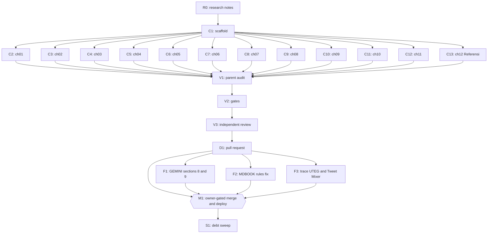

# Plan: Dawnbook book "Memahami Algoritma X untuk Pembaca" (source: Notion export zip)

Status: Complete
Session: dawnbook-mengatur-bacaan-x
Branch: 2026-10-12-dawnbook-mengatur-bacaan-x/dawnbook-mengatur-bacaan-x
Worktree: /home/belajarcarabelajar/Proyek/dawnbook-wt/dawnbook-mengatur-bacaan-x
Skill: ~/vivera/Super Ultra Code Plan Implementation.md (first file in the fallback chain)
Author: Iwan Kurniawan <iwan@belajarcarabelajar.com>, no co-author trailer (GEMINI.md section 18)

## Checklist

- [x] Extract: source zip unpacked into an isolated directory, main Markdown read in full, assets listed. Evidence: `unzip -q` exit 0 into /tmp/dawnbook-src-x.LrYF (6 files: 1 md 676 lines read lines 1-676, 3 HTML widgets text-extracted, repo-evidence.json, the-algorithm-main.zip); inner zip `sha256sum` = 92fa7db2...548d05, equal to repo-evidence.json; extracted to /tmp/dawnbook-algo2023.Y7R0 (read-only reference).
- [x] Profile: active project profile recorded (book scaffold, build and check commands, prior new-book plan). Evidence: see `## Active Project Profile` below (sources: books/_template, books/psikologi-di-balik-keputusan-finansial-kita, MDBOOK_SYSTEM_RULES.md Phase A-E, package.json scripts, data/subject-labels.json 164 labels, release-dates.json).
- [x] Research (R0): every external claim the book will make verified with TinyFish or the local repo copy, synthesized in the research notes file. Evidence: 4 researcher reports (help.x.com 10/10 pages fetched; GitHub links 12/13 resolve, blog post replaced by Wayback copy; xai-org/x-algorithm primary sources; local copy C1-C14) plus parent re-checks (param.rs weights synced 2026-10-08, README Final Score and 48-hour filter, FeedbackFatigueScorer 0.2/140 days/4 increments, filter 14 days, file dates 7667 x 2025-09-04); notes at docs/code-plan/plans/research-memahami-algoritma-x-untuk-pembaca.md.
- [x] Intent (Gate 1): slug, title, description, chapter outline (10-12) approved by the owner. Evidence: AskUserQuestion 2026-10-12 answers: Intent = Approve and continue; 2026 repo = Add section + caveats; Title = Memahami Algoritma X untuk Pembaca; Subject = Teknologi.
- [x] Plan (Gate 2): batch manifest and runner validation, approved by the owner. Evidence: `bun ~/vivera/scripts/ultra-plan-runner.mjs <plan>` printed `Validation: OK`, exit 0, 20 tasks; AskUserQuestion 2026-10-12 answer: Approve and execute.
- [x] Scaffold (C1): books/<slug>/ created (book.toml from template, SUMMARY.md, icon.txt, theme/, src/content/), no stray files in src/, release-dates.json pinned. Evidence: `find books/memahami-algoritma-x-untuk-pembaca -type f` = book.toml, icon.txt, src/SUMMARY.md (12 entries), theme/{favicon.png,favicon.svg,head.hbs}; no src/introduction.md (template copied selectively because `rm` is denied by the security policy); `diff` vs template shows only title/description/subject_label/authors/language; `jq -e` on release-dates.json returns 1791811292367; `git diff --stat` = release-dates.json 2+/1-.
- [x] Author (C2-C13): each chapter written by its own subagent within the byte budget. Evidence: 12 subagents (chef x4, nappy x4, hoggy x4) each returned one file with self-check outputs; sizes 6125-7846 B (Referensi 7001 B), all inside budget; no subagent ran git (`git status --porcelain` shows only permitted paths).
- [x] Audit (V1): parent line-by-line read of every chapter (kamu, 0 em dash, 0 emoji, 0 colon headings, distinct closers, LaTeX rules). Evidence: parent Read of all 12 files end to end; 12 targeted fixes (ch03 Cr Mixer wording, ch04 15 outputs + like advice, ch07 formula is the code's own line (verified at FeedbackFatigueScorer.scala:136-137), ch08 comma splice, ch09 removed source-document meta paragraph, ch10 run-on, ch12 outputs + languages, ch04/ch05 heading case normalized to Title Case by 10 single edits); `python3 -I /tmp/dawnbook-audit/audit.py books/memahami-algoritma-x-untuk-pembaca` exit 0, PROBLEMS none, first sentences 137-158 chars; detector proven on a planted fixture (4 violations found, exit 1); `uniq -d` on all headings empty.
- [x] References: Referensi chapter with verified deep links only. Evidence: 27 unique URLs across all chapters, each found verbatim in the research notes source table (ok=27 missing=0); blog post cited via Wayback copy because the live URL returns 404.
- [x] Gates (V2): check-heading-colons, check-repeated-headings, bun run build exit 0 with 0 errors. Evidence (second run, after the meta fixes): `bun run check:headings` exit 0 (0 violations, 57 books); `bun run scripts/check-repeated-headings.ts` exit 0 (0 repeated); `bun run build` exit 0, `Successfully built: memahami-algoritma-x-untuk-pembaca`, sitemap 788 URLs, `SEO Validation passed! All rules (R1-R7)`; 0 warnings besides the pre-existing optional `mdbook-dawnbook` preprocessor notice (57, one per book, environment); `bun run scripts/sync-template.ts` exit 0 with no diff outside the new book; build regenerated functions/lib/built-stats.ts (+12 chapters, Iwan Kurniawan 46 -> 47 books).
- [x] Meta: every page meta description satisfies GEMINI.md section 8. Evidence: 13 built pages checked (index uses the book.toml description, 142 chars; chapters 137-154 chars, complete sentences, no space before punctuation, BAD_COUNT 0). The SERP extractor caps at 155 (scripts/inject-gating.ts:48 `formatSerpDescription(text, maxLen = 155)`), so ch01 and ch08 openers were trimmed from 158 to 151 and 153 chars; rebuilt output shows both as full sentences.
- [x] Review (V3): independent reviewer audit of the diff, findings resolved. Evidence: reviewer verdict `correct` (0 P0, 0 P1, 2 P3); both P3 fixed (ch12 config-scope claim, em dash character in this plan) plus 3 non-blocking items (experiments nuance in ch03/ch05/ch09, ch03 48-hour attribution, ch04 heading); re-run after fixes: audit exit 0, check:headings exit 0, check-repeated-headings exit 0, `bun run build` exit 0 with SEO R1-R7 passed and manifest books[0] = memahami-algoritma-x-untuk-pembaca; report at docs/code-plan/artifacts/2026-10-12-dawnbook-memahami-algoritma-x-review-report.md.
- [x] Deliver (D1): commit on the session branch, PR opened with --body-file, registered in pr-registry. Evidence: commit 70a7c6c (author and committer Iwan Kurniawan <iwan@belajarcarabelajar.com>, no trailer, 24 files staged by explicit path); `git push -u origin <branch>` new branch; `gh pr create --body-file` -> https://github.com/belajarcarabelajar/dawnbook/pull/140; `pr-registry pr dawnbook-mengatur-bacaan-x --number 140` recorded, state open; `gh pr view 140` state OPEN, mergeable MERGEABLE, +1556/-3.
- [x] Follow-up F1: GEMINI.md sections 8 and 9 updated, symlinks intact. Evidence: `git diff --stat -- GEMINI.md` 3 insertions (155-char opener cap in section 8 citing inject-gating.ts:48; measured backslash-stripping rule in section 9); `readlink CLAUDE.md` and `readlink AGENTS.md` = GEMINI.md; audit exit 0; `bun run check:headings` exit 0; `bun run scripts/check-repeated-headings.ts` exit 0; `bun run build` exit 0 with SEO R1-R7 passed and manifest books[0] = memahami-algoritma-x-untuk-pembaca (fresh run after all three follow-ups).
- [x] Follow-up F2: MDBOOK_SYSTEM_RULES.md stale statements corrected. Evidence: 9 lines changed, each marked (corrected 2026-10-12): Phase B gate now `mathjax-support = false`; Phase D gate only check-media-support.ts; Phase E steps match scripts/build.ts and scripts/builder/mdbook-runner.ts:40-45 (sync-template, check-media, .build-tmp; no latex check, no admin SPA, no _redirects); parent re-read build.ts imports to confirm; one pre-existing em dash on the touched line rewritten as U+2014; audit exit 0; `bun run check:headings` exit 0; `bun run scripts/check-repeated-headings.ts` exit 0; `bun run build` exit 0 with SEO R1-R7 passed and manifest books[0] = memahami-algoritma-x-untuk-pembaca (fresh run after all three follow-ups).
- [x] Follow-up F3: UTEG and Tweet Mixer traced in research notes and chapter 3. Evidence: research notes cite the root README (S1) table (search index ~50% in-network, tweet-mixer out-of-network coordination layer, UTEG on GraphJet) and correction 2 now scopes the Cr Mixer rule to the Home Mixer README; chapter 3 names Tweet Mixer and the two facts, 7910 B; audit exit 0; `bun run check:headings` exit 0; `bun run scripts/check-repeated-headings.ts` exit 0; `bun run build` exit 0 with SEO R1-R7 passed and manifest books[0] = memahami-algoritma-x-untuk-pembaca (fresh run after all three follow-ups).
- [ ] (post-plan, owner decision 2026-10-12) Merge and deploy (M1): owner-approved merge, deploy, D1 seed, GSC reindex with evidence
- [x] Sweep (S1): debt sweep, learning ledger, graphify sync, plan closeout decision. Evidence: 10 debts found, 4 closed by F1-F3 (commit ec3302b), 6 deferred with `defer:` lines in the backlog; learning ledger docs/code-plan/artifacts/2026-10-12-dawnbook-memahami-algoritma-x-learning-ledger.md (5 KEEP rules, written to project memory); Close plan gate answered Mark Complete. Graphify sync runs after this commit (post-plan, recorded in the merge evidence).

## 1. Intent and Scope

- Goal: a 12-page Dawnbook book (11 chapters + Referensi) by Iwan Kurniawan that turns the Notion guide into a reader-facing explanation of how X recommends posts and how a reader can curate what they read.
- Slug `memahami-algoritma-x-untuk-pembaca` (derived from the approved title, same convention as every existing book; the intent draft said `mengatur-bacaan-di-x` before the owner picked this title). Title `Memahami Algoritma X untuk Pembaca`. Subject label `Teknologi`. Icon 🧭.
- Description (142 chars): "Panduan memahami algoritma rekomendasi X dari sisi pembaca, dari sinyal yang kamu kirim sampai kontrol untuk menata bacaan yang lebih berguna."
- Owner decision: the newer repository `xai-org/x-algorithm` (2026) gets its own section in chapter 3, and every number taken from `twitter/the-algorithm` is labelled as that older reference implementation.
- Non-goals: no interactive embeds (the 3 Notion HTML widgets become static text and tables), no edits to any other book, no shared template or CSS change.
- Acceptance criteria:
  - AC-1: 12 entries in SUMMARY.md equal 12 files in src/content, first file starts with `01`, each chapter's first heading equals its SUMMARY title. Check: parent audit command in V1.
  - AC-2: 0 em dash, 0 emoji (outside icon.txt), 0 "Anda", 0 colon headings, no repeated closer. Check: V1 scans plus `bun run check:headings` and `bun run scripts/check-repeated-headings.ts` exit 0.
  - AC-3: `bun run build` exit 0 with the SEO validation passing and the new slug in manifest.json.
  - AC-4: every fact traces to the research notes; every Referensi entry is a deep link that resolved on 2026-10-12.

## 2. Visual Implementation Map

## 2b. Affected Surfaces

| Task | Surface it can break | Evidence command |
|---|---|---|
| C1 | Hub card (title, icon, chapter count, PUEBI timestamp) and manifest.json | `bun run build`, then `jq '.books[0]' output/manifest.json` |
| C1 | D1 `books` row and subject label after deploy | `bun run scripts/migrate-to-d1.ts` output |
| C1 | release-dates.json read by scripts/build.ts | `git diff release-dates.json` shows one added key |
| C2-C13 | mdBook build of this book, SEO meta extraction, heading gates shared by all books | `bun run build`, `bun run check:headings` |
| V2 | Build gate for every book (a failing new book blocks deploy for all) | `bun run build` exit code |
| M1 | Production site, D1, GSC sitemap | post-deploy `curl -sI` on the new book URL, migrate output, GSC PUT response |

## 3. Batch Manifest

Every chunk has exactly one owner and writes exactly one file. Subagents write only inside the worktree and never run git or gh.

| Chunk | Owner | Target file (under books/memahami-algoritma-x-untuk-pembaca/) | Expected output | Verification |
|---|---|---|---|---|
| R0 | parent | docs/code-plan/plans/research-memahami-algoritma-x-untuk-pembaca.md | synthesized facts with source and date | parent read |
| C1 | parent | book.toml, icon.txt, theme/, src/SUMMARY.md, release-dates.json | scaffold, 12 SUMMARY entries | `ls`, `jq` on release-dates |
| C2 | chef | src/content/01_tentukan-apa-yang-ingin-kamu-baca.md | ch01, 6-8 KB | `wc -c`, parent read |
| C3 | nappy | src/content/02_jalur-baca-selain-for-you.md | ch02, 6-8 KB | `wc -c`, parent read |
| C4 | hoggy | src/content/03_perjalanan-post-menuju-for-you.md | ch03 incl. 2026 section, 7-9 KB | `wc -c`, parent read |
| C5 | chef | src/content/04_sinyal-saat-kamu-membaca.md | ch04, 6-8.5 KB | `wc -c`, parent read |
| C6 | nappy | src/content/05_cara-sistem-menebak-minat.md | ch05 with 2 display formulas, 6-8 KB | `wc -c`, parent read |
| C7 | hoggy | src/content/06_skor-rekomendasi-bukan-ukuran-manfaat.md | ch06 with 1-2 formulas and 2026 weights, 6-8.5 KB | `wc -c`, parent read |
| C8 | chef | src/content/07_not-interested-mute-dan-unfollow.md | ch07 with m(t) formula, 6-8.5 KB | `wc -c`, parent read |
| C9 | nappy | src/content/08_menata-ulang-pengaturan-akun.md | ch08 steps A-G, 6-8.5 KB | `wc -c`, parent read |
| C10 | hoggy | src/content/09_memilih-tindakan-saat-membaca.md | ch09, 6-8 KB | `wc -c`, parent read |
| C11 | chef | src/content/10_evaluasi-satu-minggu.md | ch10 with proportion formula, 6-8 KB | `wc -c`, parent read |
| C12 | nappy | src/content/11_rencana-bacaan-pribadi.md | ch11 closing + template, 6-8.5 KB | `wc -c`, parent read |
| C13 | hoggy | src/content/12_referensi.md | verified deep links only, 3-8 KB | `wc -c`, parent read |

Per-chunk contract (sent in full in each dispatch prompt): worktree path, one target file, chapter title (must equal SUMMARY entry), assigned opener device, assigned closing section title, assigned bridge form, the research notes path and the exact source line range to read, byte budget with mandatory `wc -c` self-trim, and the house rules (kamu not Anda, 0 emoji, 0 em dash, no colon in any heading or bold sub-title, scaffold-label cap, LaTeX rules with `
` display math and `\text{\%}`, decimal comma, first sentence clean for meta description, no git).

### Opener, closer, and bridge assignments (GEMINI.md sections 21 and 24)

| Ch | Opener device | Closing section title | Bridge form |
|---|---|---|---|
| 01 | scenario: opening X for tech news, ending in a quarrel | Intisari | a question the next chapter answers |
| 02 | rhetorical question about the default tab | Ringkasan | names the next chapter's object (a single post) |
| 03 | following one post through a kitchen-like pipeline | Benang Merah | contrast: system side done, now your side |
| 04 | paradox: sending a signal without liking anything | Poin Penting | "signals become an estimate" image |
| 05 | everyday comparison: a librarian guessing taste | Inti Pembahasan | from estimate to score |
| 06 | case: the post that held you longest | Yang Perlu Kamu Ingat | tools in your hand |
| 07 | scenario: an author you hid keeps coming back | Kesimpulan Bab | from knowing to doing |
| 08 | practical hook: one evening of setup | Poin Kunci | from settings to moment-by-moment choices |
| 09 | dilemma mid-scroll | Recap | how to know it worked |
| 10 | experiment framing: a one-week self-test | Gagasan Utama | from numbers back to habit |
| 11 | reflective: text is not automatically healthier | Penutup | none (final chapter) |
| 12 | short orientation sentence | (no closer) | none |

## 4. Tasks

### Task R0
Write the research notes from the four researcher reports and parent verification, keeping source URL and access date for each fact. Done when the file exists and the parent has read it end to end.

### Task C1
Copy books/_template to books/memahami-algoritma-x-untuk-pembaca, delete src/introduction.md, set book.toml title, authors, language = "id", description, subject_label = "Teknologi" (only the book.toml of this new book; GEMINI.md section 1 forbids editing other books), write icon.txt, SUMMARY.md with 12 entries, add `release-dates.json` key with the current epoch milliseconds.

### Task C2
One subagent writes `src/content/01_tentukan-apa-yang-ingin-kamu-baca.md` per the manifest row and the assignment table. The parent reads the returned file line by line before V1.

### Task C3
One subagent writes `src/content/02_jalur-baca-selain-for-you.md` per the manifest row and the assignment table. The parent reads the returned file line by line before V1.

### Task C4
One subagent writes `src/content/03_perjalanan-post-menuju-for-you.md` per the manifest row and the assignment table. The parent reads the returned file line by line before V1.

### Task C5
One subagent writes `src/content/04_sinyal-saat-kamu-membaca.md` per the manifest row and the assignment table. The parent reads the returned file line by line before V1.

### Task C6
One subagent writes `src/content/05_cara-sistem-menebak-minat.md` per the manifest row and the assignment table. The parent reads the returned file line by line before V1.

### Task C7
One subagent writes `src/content/06_skor-rekomendasi-bukan-ukuran-manfaat.md` per the manifest row and the assignment table. The parent reads the returned file line by line before V1.

### Task C8
One subagent writes `src/content/07_not-interested-mute-dan-unfollow.md` per the manifest row and the assignment table. The parent reads the returned file line by line before V1.

### Task C9
One subagent writes `src/content/08_menata-ulang-pengaturan-akun.md` per the manifest row and the assignment table. The parent reads the returned file line by line before V1.

### Task C10
One subagent writes `src/content/09_memilih-tindakan-saat-membaca.md` per the manifest row and the assignment table. The parent reads the returned file line by line before V1.

### Task C11
One subagent writes `src/content/10_evaluasi-satu-minggu.md` per the manifest row and the assignment table. The parent reads the returned file line by line before V1.

### Task C12
One subagent writes `src/content/11_rencana-bacaan-pribadi.md` per the manifest row and the assignment table. The parent reads the returned file line by line before V1.

### Task C13
One subagent writes `src/content/12_referensi.md` per the manifest row and the assignment table. The parent reads the returned file line by line before V1.

### Task V1
Parent audit: line-by-line read of every chapter, plus scans for em dash (U+2014), emoji, `\bAnda\b`, colon headings, duplicated `## ` headings, SUMMARY vs disk, first-heading vs SUMMARY title, display math wrapped in `
`, `%` inside math written as `\text{\%}`.

### Task V2
Gates: `bun run check:headings`, `bun run scripts/check-repeated-headings.ts`, `bun run build` (all exit 0, SEO validation passed).

### Task V3
Independent reviewer (staid) audits the diff and the facts against the research notes; report saved as the review-report artifact.

### Task D1
Commit as Iwan Kurniawan without a co-author trailer, push the session branch, open the PR with `--body-file`, register the PR number.

### Task F1
Follow-up selected in the debt sweep. Add to GEMINI.md section 9 the measured mdBook 0.5.4 rule (backslash before ASCII punctuation is stripped inside `$$` even with the `
` wrapper; avoid those macros and `cases`), and to section 8 the 155-character extractor cap. AC-F1: both notes present, symlinks CLAUDE.md and AGENTS.md still point to GEMINI.md, no em dash.

### Task F2
Follow-up. Correct the stale statements in MDBOOK_SYSTEM_RULES.md (admin SPA build step and directory that no longer exist; the `mathjax-support = true` success gate that contradicts books/_template/book.toml). AC-F2: statements match scripts/build.ts and the template.

### Task F3
Follow-up. Add the root README candidate-source facts (search index ~50% in-network, tweet-mixer as out-of-network coordination layer, UTEG built on GraphJet) to the research notes and name Tweet Mixer in chapter 3. AC-F3: audit, heading gates, and build stay green.

### Task M1
Owner-gated merge, then deploy (GEMINI.md section 19), D1 seed, GSC reindex using the OAuth path recorded in docs/code-plan/artifacts/2026-10-06-dawnbook-psikologi-merge-evidence.md.

### Task S1
Debt sweep, learning ledger, graphify sync, plan closeout decision.

## Active Project Profile

Snapshot taken 2026-10-12 at origin/main 7b8d41a.

- Repository root: /home/belajarcarabelajar/Proyek/dawnbook (session worktree above). Runtime Bun, mdBook in ~/.cargo/bin.
- Target scope: new directory `books/<slug>/` plus one `release-dates.json` entry. Auto-generated files that the build may touch (for example built-stats) are reviewed in the diff audit.
- Book layout (verified on books/psikologi-di-balik-keputusan-finansial-kita): `book.toml` (copy of books/_template/book.toml with title, authors, language = "id", description, `[preprocessor.dawnbook] subject_label`), `icon.txt` (one emoji), `theme/` copied from template, `src/SUMMARY.md` (`- [Title](content/NN_slug.md)`), `src/content/NN_kebab.md`, no `src/introduction.md`.
- Chapters open with `##` (H2). Display math uses `
` + `$$` blocks with blank lines (GEMINI.md sections 9 and 16); MathJax is loaded by theme/head.hbs.
- Subject label must be one of data/subject-labels.json (candidates: Teknologi, Komunikasi, Produktivitas, Informatika, AI).
- Commands: `bun run scripts/sync-template.ts`, `bun run check:headings`, `bun run scripts/check-repeated-headings.ts`, `bun run build` (runs latex and media guards, heading gate, SEO validation). Deploy per GEMINI.md section 19, then `bun run scripts/migrate-to-d1.ts`, then GSC reindex per docs/code-plan/artifacts/2026-10-06-dawnbook-psikologi-merge-evidence.md.
- Registry and plan tools live in ~/vivera/scripts (pr-registry.mjs, ultra-plan-runner.mjs, plan-closeout.mjs, plan-issue-sync.mjs).
- Unknowns: none blocking.

## Assumptions

- TDD: owner approved the documentation-only waiver on 2026-10-12 (AskUserQuestion `TDD waiver` = Waive for this change). Verification method: V1 audit, V2 gates, V3 review.
- Math probe (mdbook v0.5.4, /tmp/mathprobe): inside `$$` blocks wrapped in `
`, Markdown still strips the backslash of backslash+punctuation (`\,` became `,`, `\\` became `\`); `\text{\%}` became `\text{%}` (house rule relies on this). Chapters avoid backslash+punctuation macros and `cases`.

- Slug follows the approved title (`memahami-algoritma-x-untuk-pembaca`); the session branch keeps its registry-derived name.

## Follow-up Backlog

Debt sweep 2026-10-12: 10 debts found (9 plus 1 from the re-pass), 4 closed by F1-F3, 6 deferred.

- [ ] L1 Optional `mdbook-dawnbook` preprocessor is not installed locally; every book prints a WARN during `bun run build` (57 lines). `defer: environment setup, when the preprocessor output is needed or the warning hides a real one`
- [ ] L2 Cross-book LaTeX audit: about 11 chapter files contain `\,` or `\\` near math, which mdBook 0.5.4 renders without the backslash. Fix manually per GEMINI.md section 9. `defer: one session per affected book, before the next math-heavy book ships`
- [ ] L3 Structural content check across books (SUMMARY entries equal files, first heading equals SUMMARY title, opener at most 155 chars) as a repo script. `defer: new gate session, when a book next ships with a truncated meta or mismatched heading`
- [ ] L4 Weights table in chapter 6 is a snapshot of param.rs synced 2026-10-08; xai-org/x-algorithm updates nearly daily. `defer: content refresh, when param.rs weights change or on 2027-01-12`
- [ ] L6 MDBOOK_SYSTEM_RULES.md still references `books/shared-header-v3.css` and `books/shared-script-v3.js` (lines near 115, 153, 320, 468, 734-896); only the unversioned files exist (found by the sweep re-pass). `defer: rules-doc session, next time MDBOOK_SYSTEM_RULES.md is edited`
- [ ] L5 Scratch directories in /tmp from this session (source extract, 2025 repo copy, probes, audit script) cannot be deleted by the agent because `rm` is denied. `defer: owner action, any time`

## Closeout status

- Decision: Mark Complete (owner, `Close plan` gate, 2026-10-12), before the merge of PR #140.
- Readiness: `bun ~/vivera/scripts/plan-closeout.mjs --readiness docs/code-plan/plans/2026-10-12-dawnbook-mengatur-bacaan-x.md` exit 3, verdict `NEEDS-HUMAN`, open NOW follow-ups 0. All 23 tasks are `UNPROVEN` because every task uses the `skip_if: "false"` sentinel (content work has no machine probe); the evidence for each task is in the checklist above.
- Post-plan operations by owner decision: M1 (merge PR #140, deploy, D1 seed, GSC reindex) and the graphify sync. Their evidence goes to docs/code-plan/artifacts/2026-10-12-dawnbook-memahami-algoritma-x-merge-evidence.md.
