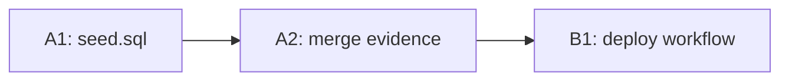

# Plan: follow-ups after PR #140 (Memahami Algoritma X untuk Pembaca)

Status: Complete (owner selected these follow-ups in the debt sweep of session dawnbook-mengatur-bacaan-x, 2026-10-12)

## Checklist

- [x] A1: regenerated db/seed.sql from the 2026-10-12 D1 seed committed on session A's branch, byte-identical to the seeder output. Evidence: sha256 main checkout = worktree = f0ae9cfac7d06215...; main checkout restored with `git checkout -- db/seed.sql` after the copy (status clean).
- [x] A2: merge evidence of PR #140 committed; parent plan M1 ticked with evidence; two post-merge debts recorded in the parent backlog. Evidence: evidence file moved into the worktree; parent plan M1 `[x]` with pointer; backlog L8 and L9 added.
- [x] A-verify: bun test 0 fail and bun run build exit 0 on session A's branch. Evidence: `bun install --frozen-lockfile` exit 0; `bun test` 427 pass 0 fail on two consecutive runs (a first run showed 1 unidentified failure that did not reproduce; recorded in the PR body); `bun run check:headings` exit 0; `bun run build` exit 0, SEO R1-R7 passed; runner `Validation: OK`.
- [x] A-deliver: PR opened with --body-file, registered, merged after the owner's merge gate. Evidence: PR #141 (commit 64fbbb2), remote test pass, owner chose Merge; `gh pr merge 141 --merge --match-head-commit 64fbbb2` returned HTTP 504 but `gh pr view` shows MERGED 2026-10-12T14:17:30Z as fe685b1; post-merge on main: tree identical to 64fbbb2, `bun test` 427 pass 0 fail; registry state merged (--allow-open-plan, non-final session).
- [x] B1: .github/workflows/deploy.yml no longer uses the unresolvable cloudflare/pages-action and deploys with the same command as scripts/deploy-website.sh. Evidence: deploy step now `cloudflare/wrangler-action@v4` with `command: pages deploy output --project-name=dawnbook --branch=main --commit-dirty=true` (scripts/deploy-website.sh:34 runs the same flags); 3 lines changed.
- [x] B-verify: workflow YAML parses, the replacement action version exists upstream, required secret names exist. Evidence: `Bun.YAML.parse` exit 0, 6 steps; `gh api repos/cloudflare/wrangler-action/git/ref/tags/v4` -> 953926a2e218 (latest release v4.1.3, 2026-09-24); `gh api repos/cloudflare/pages-action` -> 404; `gh secret list` shows CLOUDFLARE_API_TOKEN and CLOUDFLARE_ACCOUNT_ID; README of wrangler-action (fetched 2026-10-12) documents `pages deploy` via `command` and reuse of an installed wrangler (package.json pins ^4.120.0).
- [ ] (post-plan, owner decision 2026-10-12) B-deliver: PR opened, registered, merged after the owner's merge gate; first Deploy Dawnbook run on main observed

## Visual Implementation Map

## Tasks

### Task A1
Copy db/seed.sql from the main checkout (written by `bun run scripts/migrate-to-d1.ts` on 2026-10-12) into session A's worktree; verify sha256 equality; then restore the main checkout's copy so it can fast-forward.

### Task A2
Move the merge evidence file into the worktree, tick M1 in the parent plan with a pointer to it, and add the two post-merge debts (plan issue mapping for dawnbook, broken deploy workflow) to the parent backlog with the sessions that address them.

### Task B1
Replace the `cloudflare/pages-action@v1` step with the official Wrangler action running `pages deploy output --project-name=dawnbook --branch=main --commit-dirty=true`, matching scripts/deploy-website.sh. Verify inputs against the action's own documentation before editing.

## Closeout status

- Decision: Mark Complete (owner, `Close plan` gate, 2026-10-12), before the merge of session B's PR.
- Readiness: `bun ~/vivera/scripts/plan-closeout.mjs --readiness docs/code-plan/plans/2026-10-12-dawnbook-x-book-followups.md` exit 3, verdict `NEEDS-HUMAN`, open NOW follow-ups 0; A1, A2, B1 are `UNPROVEN` only because they use the `skip_if: "false"` sentinel. Evidence per item is in the checklist.
- Post-plan by owner decision: B-deliver (merge of session B and the first Deploy Dawnbook run on main). Its result is reported in the session close, not recorded here.
