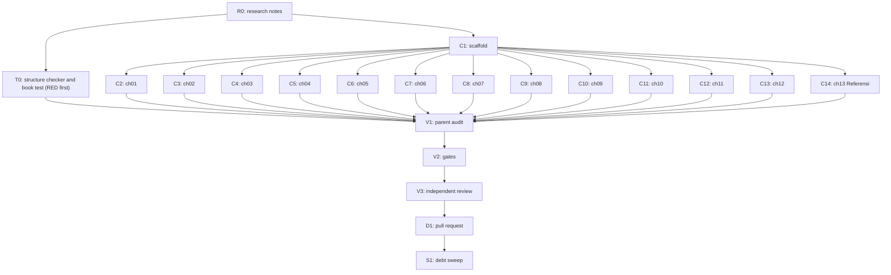

# Plan: Dawnbook book on Japan's global cultural promotion through manga and anime

Status: Approved
Session: dawnbook-soft-power-manga-anime
Branch: 2026-10-15-dawnbook-soft-power-manga-anime/dawnbook-soft-power-manga-anime
Worktree: /home/belajarcarabelajar/Proyek/dawnbook-wt/dawnbook-soft-power-manga-anime
Skill: ~/vivera/Super Ultra Code Plan Implementation.md (first file in the fallback chain)
Author: Iwan Kurniawan <iwan@belajarcarabelajar.com>, no co-author trailer (GEMINI.md section 18)
Classification: Bounded (new book through the existing book flow; plan file required because chunks are subagent-owned)

## Checklist

- [x] Claim: session slot claimed and worktree created beside the repository. Evidence: `bun ~/vivera/scripts/pr-registry.mjs claim --plan 2026-10-15-dawnbook-soft-power-manga-anime --session dawnbook-soft-power-manga-anime` exit 0; `git worktree add` at origin/main 24648ce exit 0; `pr-registry state ... active` exit 0.
- [x] Profile: active project profile recorded (book scaffold, commands, prior new-book plan 2026-10-12-dawnbook-mengatur-bacaan-x). Evidence: see `## Active Project Profile` below (sources read: books/_template listing, books/memahami-algoritma-x-untuk-pembaca book.toml, SUMMARY.md, ch01 and ch12, data/subject-labels.json, release-dates.json tail, package.json scripts; `mdbook --version` = v0.5.4, `bun --version` = 1.4.3).
- [x] Research (R0): research from zero with TinyFish, every claim the book will make sourced with URL and access date, synthesized in docs/code-plan/plans/research-soft-power-jepang-lewat-manga-dan-anime.md. Evidence: 7 researcher reports (sets A-G, 19-20 tool calls each) plus a gap wave of 2 (W1-W8 closed: Infinity Castle 106,3 billion yen, Akira dates, Astro Boy syndication, Dragon Ball and Naruto counts, JNTO 517.651 Indonesian visitors 2024, Rastati DOI, Anime Tourism Association 2016, AJA PDF); notes file 30 KB with 70-row source table and a `Not read:` line; parent read end to end.
- [x] Intent (Gate 1): slug, title, description, subject label, 12-chapter outline approved by the owner. Evidence: AskUserQuestion 2026-10-15 answers: Intent = Approve and continue; Title = Soft Power Jepang (Soft Power Jepang Lewat Manga dan Anime); Subject = Anime; Pages = 12 bab + Referensi.
- [x] Plan (Gate 2): ultra-plan/v1 frontmatter and batch manifest written, runner prints `Validation: OK`, owner approves. Evidence: `bun ~/vivera/scripts/ultra-plan-runner.mjs <plan>` exit 0, `Validation: OK`, tasks=20 (21 after T0 was added, re-validated exit 0); AskUserQuestion 2026-10-15: Plan = Approve and execute; TDD waiver = Keep test-first (so T0 was added).
- [x] Test RED (T0): book test written before any chapter and fails for the right reason. Evidence: `bun test tests/scripts/check-book-structure.test.ts tests/books/soft-power-jepang-lewat-manga-dan-anime.test.ts` exit 1, `0 pass 2 fail`, both `Cannot find module '../../scripts/check-book-structure'`; after the checker landed the book test still fails `0 pass 3 fail` (book absent), exit 1.
- [x] Checker GREEN (T0): scripts/check-book-structure.ts passes its unit tests and a known-good book. Evidence: `bun test tests/scripts/check-book-structure.test.ts` exit 0, `14 pass 0 fail`; `bun run scripts/check-book-structure.ts memahami-algoritma-x-untuk-pembaca` exit 0, `12 chapters, 0 problems` (known positive); the same CLI on psikologi-di-balik-keputusan-finansial-kita reports 4 truncated openers (pre-existing, recorded for the sweep).
- [x] Scaffold (C1): books/<slug>/ created (book.toml, icon.txt, theme/, src/SUMMARY.md with 13 entries), no stray files in src/, release-dates.json pinned. Evidence: `find books/soft-power-jepang-lewat-manga-dan-anime -type f` = book.toml, icon.txt, src/SUMMARY.md, theme/{favicon.png,favicon.svg,head.hbs}; `diff books/_template/book.toml` shows only language, title, description, subject_label; `jq -e` on release-dates.json returns 1792067974092; `git diff --stat` = release-dates.json 2+/1-.
- [x] Author (C2-C14): 13 chapter files (12 content + Referensi), one subagent each, inside the byte budget. Evidence: 13 subagents (chef x5, nappy x4, hoggy x4) each returned one file with self-check output; sizes after V1 edits 5.970-7.550 B for chapters, Referensi 11.974 B; `git status --porcelain` showed only permitted paths; no subagent ran git. Book test went RED to GREEN: `bun test tests/books/soft-power-jepang-lewat-manga-dan-anime.test.ts` 0 pass 3 fail before, 3 pass after.
- [x] Audit (V1): parent line-by-line read of every chapter plus scans (kamu, 0 em dash, 0 emoji, 0 colon headings, distinct closers, openers at most 155 chars, LaTeX rules). Evidence: parent Read of all 13 files end to end; 27 single edits: ch02 Osamu Tezuka named and his March 1963 US trip (E1 updated from the researcher report), ch03 de-duplicated against ch02 and one unsourced clause removed, Pokémon spelling unified (ch02, ch03, ch13), ch04 meta sentence removed, ch05 'duta pertama' contradiction with ch02 fixed, ch07 tone and italics, ch08 Crunchyroll and dubbing duplicates with ch05 trimmed plus Miyazaki credited (C7 updated from oscars.org report), ch09 two unsourced clauses softened, ch10 two generalisations softened, ch11 superlative and source-strength meta removed, ch12 heading matched to JFTC, ch13 four fixes; `bun run scripts/check-book-structure.ts soft-power-jepang-lewat-manga-dan-anime` exit 0, `13 chapters, 0 problems`; `rg -n 'U+2014|U+2013|\bAnda\b|：'` exit 1 (no hits); colon-heading rg exit 1; `uniq -d` on all headings empty; every content chapter uses kamu (1-5 lines each); no LaTeX in the book.
- [x] References: Referensi chapter with verified deep links only, every URL present in the research notes. Evidence: 71 entries = 71 rows of research notes section 9; book test `every URL in the book comes from the research notes source table` passes (0 URLs outside the table); 2008 and 2009 MOFA pages cited via Internet Archive copies (live pages 404).
- [x] Gates (V2): `bun run check:headings`, `bun run scripts/check-repeated-headings.ts`, `bun run build` exit 0 with SEO validation passed. Evidence: first build exit 0 but the built index.html meta was truncated (book.toml description 156 chars > 155 cap); fixed test-first (new checker test RED 15 pass 1 fail, GREEN after the book.toml check; book test RED on the 156-char description, GREEN after shortening to 154); second run: check:headings exit 0 (0 violations, 58 books), check-repeated-headings exit 0, `bun run build` exit 0 with `Successfully built: soft-power-jepang-lewat-manga-dan-anime` and `SEO Validation passed! All rules (R1-R7)`, warnings only the 58 pre-existing optional `mdbook-dawnbook` notices; built meta: index 154 chars untruncated, chapters 98-143 chars all complete sentences; full `bun test` exit 0, 446 pass 0 fail (459 tests, 52 files); build regenerated functions/lib/built-stats.ts (Iwan Kurniawan 47 -> 48 books).
- [x] Review (V3): independent reviewer audit, findings resolved, report saved as an artifact. Evidence: 3 parallel staid reviewers (code: correct, 3 P2; chapters 01-06: not correct, 2 P1; chapters 07-13: correct, 13 P2); both P1 fixed (ch05 scanlation paragraph removed, Leonard claim scoped to 1976-1993) plus all P2/P3 text fixes; checker hardened test-first by a chef subagent (31 unit tests, mutation-checked) and parent-audited (read in full, em dash detector escaped as \u2014); re-run: focused tests exit 0 (40 pass, 0 fail), check-book-structure exit 0 (13 chapters, 0 problems), check:headings exit 0, check-repeated-headings exit 0, `bun run build` exit 0 with SEO R1-R7 passed, full `bun test` exit 0 (461 pass, 0 fail, 474 tests), built meta 98-154 chars none truncated; report at docs/code-plan/artifacts/2026-10-15-dawnbook-soft-power-manga-anime-review-report.md.
- [ ] Deliver (D1): commit on the session branch, PR opened with --body-file, registered in pr-registry.
- [ ] Sweep (S1): debt sweep, learning ledger, graphify sync, plan closeout decision.

## Active Project Profile

Snapshot taken 2026-10-15 at origin/main 24648ce.

- Repository root: /home/belajarcarabelajar/Proyek/dawnbook (session worktree above). Runtime Bun 1.4.3, mdBook v0.5.4 in ~/.cargo/bin.
- Target scope: new directory `books/<slug>/` plus one `release-dates.json` entry. Files the build regenerates (for example functions/lib/built-stats.ts) are reviewed in the diff audit.
- Book layout (verified on books/memahami-algoritma-x-untuk-pembaca): `book.toml` (copy of books/_template/book.toml with title, authors, language = "id", description, `[preprocessor.dawnbook] subject_label`), `icon.txt` (one emoji), `theme/` copied from the template, `src/SUMMARY.md` (`- [Title](content/NN_slug.md)`), `src/content/NN_kebab.md`, no `src/introduction.md`. Scaffold by `mkdir` plus `cp -r books/_template/theme` because `rm` is denied (project memory).
- Chapters open with `##` (H2) equal to the SUMMARY title; sub-sections use `###`. Display math (if any) uses `
` + `$$` with blank lines; no backslash before ASCII punctuation inside math.
- Subject label must be one of data/subject-labels.json (relevant candidates: Anime, Manga, HI, Komunikasi).
- Commands: `bun run scripts/sync-template.ts`, `bun run check:headings`, `bun run scripts/check-repeated-headings.ts`, `bun run build` (heading gate, media guard, SEO validation). Deploy per GEMINI.md section 19, then `bun run scripts/migrate-to-d1.ts`, then GSC reindex by the OAuth path in docs/code-plan/artifacts/2026-10-06-dawnbook-psikologi-merge-evidence.md.
- Chapter-page meta description is the first sentence capped at 155 characters (scripts/inject-gating.ts `formatSerpDescription(text, maxLen = 155)`), so every opener is at most 155 characters.
- Registry and plan tools: ~/vivera/scripts (pr-registry.mjs, ultra-plan-runner.mjs, plan-closeout.mjs, plan-mark-done.mjs, plan-issue-sync.mjs).
- Unknowns: none blocking.

## 1. Intent and Scope

- Goal: a 13-page Dawnbook book (12 content chapters + Referensi) by Iwan Kurniawan, researched from zero, explaining how Japan promoted its culture globally through manga and anime, including the costs and limits of that success.
- Slug `soft-power-jepang-lewat-manga-dan-anime`. Title `Soft Power Jepang Lewat Manga dan Anime`. Subject label `Anime`. Icon 🎌. Language `id`.
- Description (154 chars, shortened from 156 after V2 showed the root meta truncated at the 155 cap): "Telusuri cara Jepang membawa budayanya ke dunia lewat manga dan anime, dari Astro Boy dan Cool Japan sampai streaming, wisata, dan sisi gelap industrinya."
- Owner decisions (AskUserQuestion, 2026-10-15): Intent = Approve and continue; Title = Soft Power Jepang; Subject = Anime; Pages = 12 chapters + Referensi.
- Non-goals: no edits to any other book, no shared template, CSS, or script change.
- Acceptance criteria:
  - AC-1: 13 entries in SUMMARY.md equal 13 files in src/content; each chapter's first heading equals its SUMMARY title. Check: V1 audit.
  - AC-2: 0 em dash, 0 emoji (outside icon.txt), 0 "Anda", 0 colon headings, no closer title repeated, every opener (first sentence) at most 155 characters. Check: V1 scans plus `bun run check:headings` and `bun run scripts/check-repeated-headings.ts` exit 0.
  - AC-3: `bun run build` exit 0 with SEO validation passed and the new slug in output/manifest.json.
  - AC-4: every fact traces to the research notes (H or M items only); every URL in the book appears in research notes section 9.

## 2. Visual Implementation Map

## 2b. Affected Surfaces

| Task | Surface it can break | Evidence command |
|---|---|---|
| C1 | Hub card (title, icon, chapter count, PUEBI timestamp) and manifest.json | `bun run build`, then `jq` on output/manifest.json |
| C1 | D1 `books` row and subject label after deploy | `bun run scripts/migrate-to-d1.ts` output (post-merge, owner-gated) |
| C1 | release-dates.json read by scripts/build.ts | `git diff release-dates.json` shows one added key |
| C2-C14 | mdBook build of this book, SEO meta extraction, heading gates shared by all books | `bun run build`, `bun run check:headings` |
| V2 | Build gate for every book (a failing new book blocks deploy for all) | `bun run build` exit code |

## 3. Batch Manifest

Every chunk has exactly one owner and writes exactly one file. Subagents write only inside the worktree and never run git or gh. Paths below are under books/soft-power-jepang-lewat-manga-dan-anime/src/content/.

| Chunk | Owner | Target file | Chapter title (= SUMMARY entry) | Research notes items | Budget | Verification |
|---|---|---|---|---|---|---|
| C2 | chef | 01_dari-kekalahan-perang-menuju-kekuatan-budaya.md | Dari Kekalahan Perang Menuju Kekuatan Budaya | A1, A2, A3, A8 (intro), C1/W8, B5 | 6-8 KB | `wc -c`, parent read |
| C3 | nappy | 02_astro-boy-dan-lahirnya-anime-televisi.md | Astro Boy dan Lahirnya Anime Televisi | E1, W3, E2 | 6-8 KB | `wc -c`, parent read |
| C4 | hoggy | 03_media-mix-dan-komite-produksi.md | Media Mix dan Komite Produksi | E2, E3, E5 (franchise) | 6-8 KB | `wc -c`, parent read |
| C5 | chef | 04_akira-pokemon-dan-gelombang-pertama-ke-barat.md | Akira, Pokémon, dan Gelombang Pertama ke Barat | W2, E5, W4 (Dragon Ball, Naruto), D6 | 6-8 KB | `wc -c`, parent read |
| C6 | nappy | 05_penggemar-sebagai-duta-tak-resmi.md | Penggemar sebagai Duta Tak Resmi | E7, D2, C5 (dub), F4 (fan events) | 6-8 KB | `wc -c`, parent read |
| C7 | hoggy | 06_diplomasi-pop-kementerian-luar-negeri.md | Diplomasi Pop Kementerian Luar Negeri | A4, A5, A6, A7, A8 | 6-8 KB | `wc -c`, parent read |
| C8 | chef | 07_cool-japan-dan-uang-negara.md | Cool Japan dan Uang Negara | B1, B2, B3, B4, B6, B7 | 6-8.5 KB | `wc -c`, parent read |
| C9 | nappy | 08_saat-pasar-luar-negeri-melampaui-domestik.md | Saat Pasar Luar Negeri Melampaui Pasar Domestik | W8, C1, C2, C3, C4, C5, C6, W1, C7 | 6-8.5 KB | `wc -c`, parent read |
| C10 | hoggy | 09_manga-digital-dan-perang-melawan-pembajakan.md | Manga Digital dan Perang Melawan Pembajakan | D1-D7 | 6-8.5 KB | `wc -c`, parent read |
| C11 | chef | 10_dari-layar-ke-perjalanan.md | Dari Layar ke Perjalanan | W7, G4, G5, W5, G6, B7 | 6-8 KB | `wc -c`, parent read |
| C12 | nappy | 11_doraemon-elex-dan-penggemar-indonesia.md | Doraemon, Elex, dan Penggemar Indonesia | F1, F2, F3, F4, W5, F6/W6, F7 | 6-8.5 KB | `wc -c`, parent read |
| C13 | hoggy | 12_harga-di-balik-kesuksesan.md | Harga di Balik Kesuksesan | G1, G2, G3, G7, G8, B3, D7, A8 | 6-8.5 KB | `wc -c`, parent read |
| C14 | chef | 13_referensi.md | Referensi | research notes section 9 (all IDs actually used) | 3-12 KB | `wc -c`, parent read |

Per-chunk contract (sent in full in each dispatch prompt, per templates/subagent-contract-template.md fields: scope, inputs, permitted file, expected output, verification, review checkpoint): worktree path, one target file, chapter title, assigned opener device, closing section title, bridge form, research notes path with the item IDs to use, byte budget with mandatory `wc -c` self-trim (3-attempt cap, GEMINI.md section 20), and the house rules (kamu not Anda, 0 emoji, 0 em dash, no colon in any heading or bold sub-title, scaffold-label cap, connector cap, first sentence at most 155 characters, decimal comma and dot thousands for Indonesian numbers, no LaTeX needed, no git, no files outside the target).

### Opener, closer, and bridge assignments (GEMINI.md sections 21 and 24)

| Ch | Opener device | Closing section title | Bridge form |
|---|---|---|---|
| 01 | paradox: a country that lost a war and later won hearts through cartoons | Intisari | a question the next chapter answers |
| 02 | scene: a family TV set on New Year's Day 1963 | Ringkasan | names the next chapter's object (the business model) |
| 03 | everyday comparison: a chocolate sticker that sells a story | Benang Merah | from the home market to the world |
| 04 | data point: a cartoon film at number one in the US box office | Poin Penting | from official channels to fans |
| 05 | rhetorical question about who translated anime before the companies did | Inti Pembahasan | the state notices what fans built |
| 06 | quote-free scene: a robot cat receiving a letter of assignment at a ministry | Yang Perlu Kamu Ingat | from diplomacy to money |
| 07 | contrast: a fund meant to profit that kept losing | Kesimpulan Bab | from policy to the market numbers |
| 08 | numbers: overseas earnings passing home earnings | Poin Kunci | from screens to pages |
| 09 | dilemma: free chapters versus pirate sites | Recap | from pages to places |
| 10 | scenario: a railway crossing that became a photo spot | Gagasan Utama | close to home, Indonesia |
| 11 | memory: Sunday morning at 08.00 WIB | Key Takeaways | turn to the costs |
| 12 | reflective question about who pays for a hit | Penutup | none (final content chapter) |
| 13 | short orientation sentence | (no closer) | none |

## 4. Tasks

### Task R0
Write the research notes from the researcher reports and the gap wave, keeping source URL and access date for each fact. Done when the file exists and the parent has read it end to end.

### Task T0
Test-first (owner chose Keep test-first on 2026-10-15). Seams: (1) `checkBookStructure(bookDir)` in scripts/check-book-structure.ts catches SUMMARY vs disk drift, first heading vs SUMMARY title, stray src/*.md, em dash, emoji, Anda, openers that `formatSerpDescription(lead, 155)` would truncate, and section headings repeated in two or more chapters; it misses content quality and factual accuracy (V1 and V3 cover those). (2) tests/books/soft-power-jepang-lewat-manga-dan-anime.test.ts asserts 13 chapters, 0 problems, byte budget, and that every URL is in the research notes source table; RED until C2-C14 land.

### Task C1
`mkdir -p books/soft-power-jepang-lewat-manga-dan-anime/src/content`, `cp -r books/_template/theme` into it, write book.toml (template copy with title, authors, language = "id", description, subject_label = "Anime"), icon.txt, SUMMARY.md with 13 entries, and add the `release-dates.json` key with the current epoch milliseconds. Only the new book's book.toml is written (GEMINI.md section 1).

### Task C2
One subagent writes the file named in manifest row C2 per the assignment table. The parent reads the returned file line by line before V1.

### Task C3
One subagent writes the file named in manifest row C3 per the assignment table. The parent reads the returned file line by line before V1.

### Task C4
One subagent writes the file named in manifest row C4 per the assignment table. The parent reads the returned file line by line before V1.

### Task C5
One subagent writes the file named in manifest row C5 per the assignment table. The parent reads the returned file line by line before V1.

### Task C6
One subagent writes the file named in manifest row C6 per the assignment table. The parent reads the returned file line by line before V1.

### Task C7
One subagent writes the file named in manifest row C7 per the assignment table. The parent reads the returned file line by line before V1.

### Task C8
One subagent writes the file named in manifest row C8 per the assignment table. The parent reads the returned file line by line before V1.

### Task C9
One subagent writes the file named in manifest row C9 per the assignment table. The parent reads the returned file line by line before V1.

### Task C10
One subagent writes the file named in manifest row C10 per the assignment table. The parent reads the returned file line by line before V1.

### Task C11
One subagent writes the file named in manifest row C11 per the assignment table. The parent reads the returned file line by line before V1.

### Task C12
One subagent writes the file named in manifest row C12 per the assignment table. The parent reads the returned file line by line before V1.

### Task C13
One subagent writes the file named in manifest row C13 per the assignment table. The parent reads the returned file line by line before V1.

### Task C14
One subagent writes the file named in manifest row C14 per the assignment table. The parent reads the returned file line by line before V1.

### Task V1
Parent audit: line-by-line read of every chapter, plus scans for em dash (U+2014), emoji, `\bAnda\b`, colon headings, duplicated `## ` and `### ` headings, SUMMARY vs disk, first heading vs SUMMARY title, opener length, and every URL checked against research notes section 9.

### Task V2
Gates: `bun run check:headings`, `bun run scripts/check-repeated-headings.ts`, `bun run build` (all exit 0, SEO validation passed); meta descriptions checked on the built pages.

### Task V3
Independent reviewer (staid) audits the diff and the facts against the research notes; report saved as the review-report artifact.

### Task D1
Commit as Iwan Kurniawan without a co-author trailer, push the session branch, open the PR with `--body-file`, register the PR number.

### Task S1
Debt sweep, learning ledger, graphify sync, plan closeout decision.

## Assumptions

- No LaTeX is needed in this book (no formulas in the outline); if a chapter adds one, the GEMINI.md section 9 rules apply.
- Yen amounts are written in Indonesian style ("3,84 triliun yen"), USD as "1,175 miliar dolar AS".
- 2025 JNTO figures are estimates as of 21 Jan 2026 and are labelled as such.
- The Cool Japan Fund dissolution is reported as a government decision per sources (Mainichi 21 Aug 2026), not as completed.
