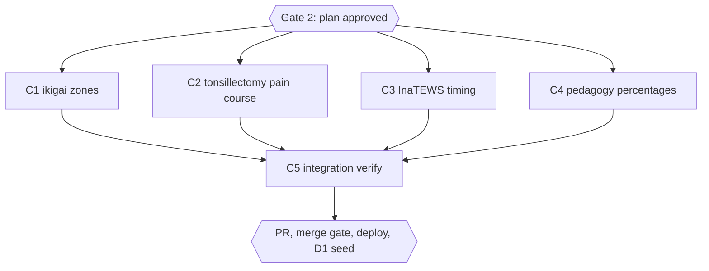

# Diagram follow-ups: contradictory chapter text, D1 seed, merge evidence

## Session checklist

- [x] S1 Research: the four contradictions (FU1-FU4 of the parent plan) read line by line and checked against primary sources with TinyFish, each with a proposed correct text and source. Evidence: Q1-Q4 reports with sources fetched 2026-10-16 (summary under "Research findings"); parent re-read one quoted line per book (ikigai 08:49, tonsilektomi 08:48, EWS 04:33, pedagogy 05:19), all match
- [x] S2 Plan: tasks written, runner prints `Validation: OK`, plan approved through the question tool. Evidence: runner `Validation: OK`; `Plan` gate approved 2026-10-16
- [x] S3 Execute: each chapter fix applied line by line, parent diff audit per chunk. Evidence: C1 `65b5071`, C2 `8ac278c`, C3 `58c36bf`, C4 `794cb4d`; parent word-diff audit of all 12 files; five one-phrase leftovers reported by the chunks fixed inline by the parent (pedagogy 05:11 "sebagian besar", ikigai 02:30 and 02:63, EWS 03:99 and 07:9)
- [x] S4 Verify: heading, diagram and book gates, `bun run build`, `bun test` exit 0 with 0 failures. Evidence: `bun run check:headings` exit 0 (0 violations, 58 books); `check-book-structure.ts` identical to the baseline for all four books; `bun run build` exit 0 (diagram gate 0, SEO passed); `bun test` 658 pass, 13 skip, 0 fail after `bun install --frozen-lockfile` (the first run failed 87 tests only because the fresh worktree had no node_modules)
- [x] S5 Deliver: PR #150 (chapter fixes, merge commit `0300e07`, merged 2026-10-15 22:49Z) and PR #151 (seed and chapter openers, merged 23:05Z) are on `main`. Verified 2026-10-19: C1–C4 commits `65b5071`, `8ac278c`, `58c36bf`, `794cb4d` are ancestors of `origin/main`
- [x] S6 After deploy: resolved without a production write, verified 2026-10-19. `dawnbook-db` (58 rows, all `published`, `updated_at` 2026-10-16T01:58:59Z, none empty) has `content_md` identical to `origin/main` for 58 of 58 books after the script's `.trim()`; titles and `subject_label` match `book.toml`; `books/` on `origin/main` has no commits after 2026-10-16T02:00Z. `migrate-to-d1.ts` was not run: it would only rewrite identical content and first sets `content_md = ''`, which is non-atomic. Regenerating `db/seed.sql` from `origin/main` equals the committed file except timestamps, so no seed PR is needed. The branch's WIP commit `65736a2` stays unmerged (stale, do not merge)
- [x] S7 Sweep (closed 2026-10-19): plan closeout written here; graphify sync NOT completed, by owner decision 2026-10-19: `graphify update .` refused to overwrite (new graph 10,628 nodes versus 18,273 saved). A `--force` run was tried and reverted: it dropped 7,916 `.md` document nodes, which only the LLM `/graphify --update` can regenerate. The graph stays at the 2026-10-16 state (18,273 nodes). Migration `scripts/migrate-to-d1.ts` closed as a no-op, not run, by owner decision 2026-10-19. No learning ledger exists for this plan. Debt carried forward: (1) graphify sync, owner decision; (2) the Chrome cache deletion from the parent session, still with the owner because `rm-tmp-guard` blocks it; (3) WIP commit `65736a2` remains on `origin/2026-10-16-dawnbook-diagram-followups/dawnbook-diagram-followups`, do not merge

## Research manifest (read-only, budget 25 tool calls each)

| Chunk | Owner | Book and lines | Output |
|---|---|---|---|
| Q1 | timid | `menemukan-tujuan-hidup-ikigai` ch02 headings 17/35/48, ch03:17-23, ch08:47-53 | correct zone definitions with source, exact line edits |
| Q2 | aqua | `tonsilektomi` ch10:7-24 vs ch08:48-49 | correct pain-peak timeline with source, exact line edits |
| Q3 | timid | `sistem-peringatan-dini-early-warning-system` ch04:33-42 vs ch07:9-23 | correct InaTEWS timing chain with source, exact line edits |
| Q4 | aqua | `sistem-pengendalian-topik-dalam-wacana-pedagogi-di-sekolah-dasar` ch05:15-19 | consistent percentages with source, exact line edits |

## Status

- Status: Approved (`Plan` gate answered "Setujui dan eksekusi" on 2026-10-16)
- Approved scope: the four open items listed at the end of the parent session (contradictions FU1-FU4, D1 seed, merge evidence commit, Chrome cache); owner instruction 2026-10-16: "lakukan yang terbaik sisanya". The Chrome cache deletion is blocked by the owner's `rm-tmp-guard` hook and was handed back to the owner.
- Completed: claim (exit 0), worktree from `origin/main` at `9229357`, state `active`, parent merge evidence copied in
- Current: closed 2026-10-19. S1–S7 done; S6 verified as a no-op (see S6); debt carried forward in S7

## Visual Map

## Global Constraints

- Every edit is a line-level Edit after reading the chapter in full; no scripts touch book content (GEMINI.md section 16).
- Indonesian text, "kamu" never "Anda", no em dash, no emoji, no colon in any heading (section 24), chapter openers untouched (section 8).
- Every changed fact matches a primary source fetched on 2026-10-16 and listed in the research notes below; new references carry a verified deep link or DOI (section 15).
- `check-book-structure.ts <slug>` must report no new problem beyond the baseline recorded below.

## Research findings (Q1-Q4, sources fetched 2026-10-16)

- **Q1 ikigai.** Chapter 03 is correct and matches Marc Winn's 2014 diagram (archived post https://web.archive.org/web/20141207231700/http://theviewinside.me/what-is-your-ikigai/), which Garcia and Miralles reproduce (Government of Japan, https://www.japan.go.jp/kizuna/2022/03/ikigai_japanese_secret_to_a_joyful_life.html): Passion = love + skill, Mission = love + world needs, Profession = skill + paid, Vocation = world needs + paid. Chapter 08 swaps two pairings (L49, L53); chapter 02 attaches zone names to single pillars (headings L5, L17, L35, L48 and L61).
- **Q2 tonsillectomy.** Pain lasts 7 to 10 days on average (AAO-HNS guideline, Mitchell 2019, doi 10.1177/0194599818801757); young children often hurt most in days 1 to 3 (Warnock and Lander 1998; Lavy 1997, doi 10.1016/S0165-5876(97)00107-9), while teenagers and adults often peak around days 3 to 7 as the eschar separates (NHS Bedfordshire adult leaflet; Medikondu 2025, doi 10.3390/children12121619). Chapter 10 L13 and chapter 08 L48-49 each state only one half.
- **Q3 InaTEWS.** BMKG's 2012 manual issues four messages: the first within 5 minutes, updates, and the end message at the earliest 2 hours after the first; no four-hour chain exists. Chapter 04 L33 ("rantai komando empat jam"), L36 (5 minutes for analysis alone) and L44 (total including dissemination under 5 minutes) are wrong; chapter 03 L70 reads the 5-minute issue target as a minimum lead time; the reference link at chapter 13 L39 is dead (404) and has a verified replacement.
- **Q4 pedagogy.** Marliana (2017, AKSIS 1(1), https://journal.unj.ac.id/unj/index.php/aksis/article/view/3281) prints 28% answered directly, 31% not directly, and 72% as 100 minus 28; the 72% contradicts the 31%. The fix removes the 72% total row and states the 31% versus 28% comparison that holds under either reading; the reference entry's pages (58-74) should be 80-103 and its DOI link returns 404.

Baseline `check-book-structure.ts` problems before any edit: ikigai 3 (openers of 03, 07, 08), tonsilektomi 4 (openers of 02, 13, 14; heading "kesimpulan" twice), EWS 5 (openers of 01, 02, 07, 08, 09), pedagogy 5 (openers of 03, 07, 09, 12; heading "pertanyaan refleksi" twice).

## Tasks

### Task C1: Ikigai zone definitions consistent with chapter 03

- [ ] Step 1: apply the Q1 edits to chapter 02 (drop the zone names from the four pillar headings and from L61) and chapter 08 (L49 Mission, L53 Profession); add Winn (2014) and a deep link for Garcia and Miralles to chapter 12
- [ ] Step 2: Run | cmd: `bun run check:headings` | expect: exit 0 | retry: 0

### Task C2: Tonsillectomy pain course by age group

- [ ] Step 1: apply the Q2 edits to chapter 08 L48-49 (also fixes the typo "menyaikkan") and chapter 10 L13, L17; add Lavy (1997) and Medikondu (2025) to chapter 14 and renumber
- [ ] Step 2: Run | cmd: `bun run check:headings` | expect: exit 0 | retry: 0

### Task C3: InaTEWS timing chain

- [ ] Step 1: apply the Q3 edits to chapter 04 L33, L36, L44, chapter 07 L9, L21 and chapter 03 L70; replace the dead manual link at chapter 13 L39
- [ ] Step 2: Run | cmd: `bun run check:headings` | expect: exit 0 | retry: 0

### Task C4: Pedagogy percentages

- [ ] Step 1: delete the 72% total row at chapter 05 L19 and rewrite the two L21 sentences; correct the page range and link of the Marliana entry at chapter 12 L49
- [ ] Step 2: Run | cmd: `bun run check:headings` | expect: exit 0 | retry: 0

### Task C5: Integration verify

- [ ] Step 1: Run | cmd: `bun run build` | expect: exit 0 | retry: 0
- [ ] Step 2: Run | cmd: `bun test` | expect: exit 0 | retry: 1

## After the merge (S6)

The merge deploys through CI. Then, with `~/cloudflare/.env` sourced: `bun run scripts/migrate-to-d1.ts` (refreshes `content_md` for every book, including the two diagram pilots and the four fixed books, and regenerates `db/seed.sql`), a live check of one fixed public chapter, and a seed PR that commits `db/seed.sql`, this session's merge evidence and the parent session's merge evidence (already copied into this worktree).
