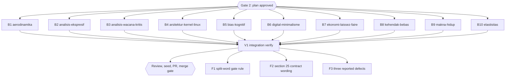

# Diagram retrofit RF1 (inventory group g1, 10 books)

## Session checklist

- [x] S1 Plan: tasks B1-B10 and V1 written, runner `Validation: OK`, `Plan` gate approved. Evidence: runner `Validation: OK`; `Plan` gate approved 2026-10-16; baseline `check-book-structure.ts` problem counts 3, 3, 5, 6, 10, 2, 4, 6, 4, 8 (books in task order), saved per book under `/tmp/rf1-base-<slug>.txt`
- [x] S2 Execute: one subagent per book adds 0-3 grounded diagrams per chapter from `g1.md`, renders them, gate exit 0; parent diff audit and commit per book. Evidence: 10 subagents (chef, nappy, hoggy) dispatched in one message; parent read every inserted block against its source lines and committed one book per commit (`c579ad7`, `167d018`, `c3ec4ed`, `f891a31`, `cdfea6a`, `6a5047e`, `d2efb6c`, `4675354`, `e19de10`, `b013535`); 27 diagrams in 26 chapters, see Execution record; label fix `cc5ec8b`
- [x] S3 Review: independent grounding review of every diagram against its chapter lines; findings fixed. Evidence: three `staid` reviewers (standards books 1-5, standards books 6-10, spec axis), each verdict `correct`, 0 P0/P1/P2; the P3 findings are fixed in `e145754` (two source hedges restored, one decision label, four varied intro sentences); report `docs/code-plan/artifacts/2026-10-16-dawnbook-diagrams-retrofit-rf1-review.md`
- [x] S4 Verify: `bun run build`, `bun test`, `bun run check:diagrams`, `check-book-structure.ts` for the ten books (no new problem beyond baseline; command form: `bun run scripts/check-book-structure.ts <slug> | diff docs/code-plan/artifacts/2026-10-16-dawnbook-diagrams-retrofit-rf1/structure-baseline/<slug>.txt -`, empty diff expected, the script itself exits 1 on the pre-existing problems). Evidence first run on tree `cc5ec8b`, rerun on the final content tree `e145754` with the same results (build exit 0, 658 pass, 13 skip, 0 fail, 27 inline diagrams, the reworded labels present in the built page): `bun run build` exit 0 ("SEO Validation passed", "Premium Hub site generated successfully"); `bun test` 658 pass, 13 skip, 0 fail, exit 0; `bun run check:diagrams` "0 diagram violations, 0 orphaned SVGs"; `check-book-structure.ts` output byte-identical to the baseline for all ten books (3, 3, 5, 6, 10, 2, 4, 6, 4, 8); `bun run check:headings` 0 violations; build output `output/books/<slug>/content/*.html` holds 27 `class="dawnbook-diagram"` (equal to the 27 source blocks), 0 `language-mermaid` fences, 0 `foreignObject`, and no `diagrams/` folder
- [x] S5 Deliver: D1 seed rerun and `db/seed.sql` committed; PR from body file, registered; `Merge` gate. Progress: seed run twice (after the review fixes and after F3), each exit 0, D1 mermaid block counts equal the source (27); PR #153 opened with `--body-file` and registered (`pr-registry pr ... --number 153`, state `open`); the `Merge` gate was answered "Merge after CI green" and PR #153 merged as `bf8a9a4`; evidence `docs/code-plan/artifacts/2026-10-16-dawnbook-diagrams-retrofit-rf1-merge-evidence.md`
- [x] S6 Close: readiness and `Close plan` gate before the merge; after the merge issue sync, publish, registry `merged`, graphify sync. Evidence: `docs/code-plan/artifacts/2026-10-16-dawnbook-diagrams-retrofit-rf1-merge-evidence.md` (issue #154 created and closed, registry `merged`, graphify sync CURRENT)

## Visual Map

## Global Constraints

- GEMINI.md section 25 governs every diagram (allowed types, accTitle/accDescr in Indonesian, grounding, placement, width at most 1000 px, at most 3 per chapter, never required, no repeated scaffolding shape).
- Candidates come from `g1.md`; the book subagent may skip a weak candidate and must report any it rejects. ASCII-art diagrams named in `g1.md` are converted and the ASCII version deleted.
- Each dispatch carries the section 25 contract paragraph verbatim and requires, for every node and number, the exact source sentence (lesson from the follow-up session).
- Chapter text outside the inserted block and its one introducing sentence stays byte-identical, except a deleted ASCII-art fence that the diagram replaces.

### Task B1: aerodinamika-dan-desain-airfoil

- [x] Step 1: Run | cmd: `bun run scripts/check-diagrams.ts --book aerodinamika-dan-desain-airfoil` | expect: exit 0 | retry: 0
- [x] Step 2: Run | cmd: `bun run scripts/render-diagrams.ts --book aerodinamika-dan-desain-airfoil --check` | expect: exit 0 | retry: 0

### Task B2: analisis-ekspresif-9-summers-10-autumns

- [x] Step 1: Run | cmd: `bun run scripts/check-diagrams.ts --book analisis-ekspresif-9-summers-10-autumns` | expect: exit 0 | retry: 0
- [x] Step 2: Run | cmd: `bun run scripts/render-diagrams.ts --book analisis-ekspresif-9-summers-10-autumns --check` | expect: exit 0 | retry: 0

### Task B3: analisis-wacana-kritis-awk-dalam-kriminologi

- [x] Step 1: Run | cmd: `bun run scripts/check-diagrams.ts --book analisis-wacana-kritis-awk-dalam-kriminologi` | expect: exit 0 | retry: 0
- [x] Step 2: Run | cmd: `bun run scripts/render-diagrams.ts --book analisis-wacana-kritis-awk-dalam-kriminologi --check` | expect: exit 0 | retry: 0

### Task B4: arsitektur-kernel-linux

- [x] Step 1: Run | cmd: `bun run scripts/check-diagrams.ts --book arsitektur-kernel-linux` | expect: exit 0 | retry: 0
- [x] Step 2: Run | cmd: `bun run scripts/render-diagrams.ts --book arsitektur-kernel-linux --check` | expect: exit 0 | retry: 0

### Task B5: bias-kognitif

- [x] Step 1: Run | cmd: `bun run scripts/check-diagrams.ts --book bias-kognitif` | expect: exit 0 | retry: 0
- [x] Step 2: Run | cmd: `bun run scripts/render-diagrams.ts --book bias-kognitif --check` | expect: exit 0 | retry: 0

### Task B6: digital-minimalisme

- [x] Step 1: Run | cmd: `bun run scripts/check-diagrams.ts --book digital-minimalisme` | expect: exit 0 | retry: 0
- [x] Step 2: Run | cmd: `bun run scripts/render-diagrams.ts --book digital-minimalisme --check` | expect: exit 0 | retry: 0

### Task B7: ekonomi-laissez-faire

- [x] Step 1: Run | cmd: `bun run scripts/check-diagrams.ts --book ekonomi-laissez-faire` | expect: exit 0 | retry: 0
- [x] Step 2: Run | cmd: `bun run scripts/render-diagrams.ts --book ekonomi-laissez-faire --check` | expect: exit 0 | retry: 0

### Task B8: eksistensialisme-dan-kehendak-bebas

- [x] Step 1: Run | cmd: `bun run scripts/check-diagrams.ts --book eksistensialisme-dan-kehendak-bebas` | expect: exit 0 | retry: 0
- [x] Step 2: Run | cmd: `bun run scripts/render-diagrams.ts --book eksistensialisme-dan-kehendak-bebas --check` | expect: exit 0 | retry: 0

### Task B9: eksistensialisme-dan-makna-hidup

- [x] Step 1: Run | cmd: `bun run scripts/check-diagrams.ts --book eksistensialisme-dan-makna-hidup` | expect: exit 0 | retry: 0
- [x] Step 2: Run | cmd: `bun run scripts/render-diagrams.ts --book eksistensialisme-dan-makna-hidup --check` | expect: exit 0 | retry: 0

### Task B10: elastisitas-harga-permintaan-dan-penawaran

- [x] Step 1: Run | cmd: `bun run scripts/check-diagrams.ts --book elastisitas-harga-permintaan-dan-penawaran` | expect: exit 0 | retry: 0
- [x] Step 2: Run | cmd: `bun run scripts/render-diagrams.ts --book elastisitas-harga-permintaan-dan-penawaran --check` | expect: exit 0 | retry: 0

### Task V1: Integration verify

- [x] Step 1: Run | cmd: `bun run build` | expect: exit 0 | retry: 0
- [x] Step 2: Run | cmd: `bun test` | expect: exit 0 | retry: 1

## Follow-up tasks (debt sweep, owner selected all three on 2026-10-16)

Acceptance: F1 a cached SVG whose label row splits a source word fails `check:diagrams` with rule `split-word`, an unsplit label and a normal break at a space pass, and the real books stay at 0 violations. F2 the section 25 contract paragraph tells authors to keep hedges and examples, vary the intro sentence within a book, and reword a label `split-word` reports. F3 the three defects reported by B4, B5 and B6 are fixed line by line, with no new structural problem.

### Task F1: split-word gate rule

- [x] Step 1: Run | cmd: `bun test tests/scripts/check-diagrams.test.ts` | expect: exit 0 | retry: 0
- [x] Step 2: Run | cmd: `bun run check:diagrams` | expect: exit 0 | retry: 0

### Task F2: section 25 contract wording

- [x] Step 1: Run | cmd: `bun run check:headings` | expect: exit 0 | retry: 0

### Task F3: three reported defects

- [x] Step 1: Run | cmd: structure diff for the three books against the committed baseline | expect: exit 0 | retry: 0

### Follow-up evidence

- F1 (`e8c840a`, chef): RED `bun test tests/scripts/check-diagrams.test.ts` exit 1, 73 pass, 4 fail (`Expected ["split-word"]`, `Received []`); GREEN 77 pass, 0 fail. Regression proof: the new checker run with `--root` on an archive of the pre-fix tree `b013535` reports exactly the seven diagrams and eight words of the parent finding below, and not the normal break "Loncatan Iman" / "= Solusi"; on the current tree it reports 0 violations.
- F2 (`05f817e`, nappy): the section 25 contract paragraph gains three sentences (hedges and examples kept, intro sentence varied within a book, reword what `split-word` reports) and the Width bullet names `split-word`; `AGENTS.md` and `CLAUDE.md` are still symlinks to `GEMINI.md`; em dash count unchanged.
- F3 (`1f2972e`, hoggy plus two parent punctuation fixes in the same files): kernel ch12 display math uses single backslashes inside `
` and the typo reads "tumpang tindih di dalam"; bias-kognitif ch07 math is `\text{Biaya Masa Depan}` with no escaped underscore; digital-minimalisme ch02 "atau"; bias ch07 line 23 gains its full stop and digital-minimalisme ch02 line 59 loses the space before a comma. The built pages show the formulas with single backslashes and no `<em>`; structure output equals the baseline for the three books.
- Integration after F1-F3 (tree `e8c840a`): `bun run build` exit 0; `bun test` 665 pass, 13 skip, 0 fail; `check:diagrams` 0 violations; `check:headings` 0 violations. D1 seed rerun exit 0 (58 books, 0 failure lines); `cf d1 query` finds "tumpang tindih di dalam RAM" and "Biaya Masa Depan" in D1; `db/seed.sql` regenerated.

### Backlog (LATER)

- `split-word` reads only `text-outer-tspan` rows, so sequence, timeline, pie and xychart text is not checked. `defer: a retrofit that adds a long-label sequence or timeline, or a reported split in one`
- `split-word` skips a cut piece that ends in punctuation ("/media/usb/" then "data.txt"). `defer: the first such split seen in review`
- The `split-word` message hardcodes 110 px (the detection itself does not depend on it). `defer: any change to flowchart.wrappingWidth in render-config.json`
- analisis-wacana-kritis ch05 and ch07 write arrow chains as display math that could become diagrams. `defer: a later retrofit of that book`
- Existing opener and structure problems of the ten books (the committed baselines). `defer: a content-hygiene session per GEMINI.md sections 8 and 21`

## Execution record

| Task | Book | Diagrams (chapter: type) | Skipped candidate and reason |
|---|---|---|---|
| B1 | aerodinamika-dan-desain-airfoil | ch01 lift stages (flowchart TD, Bernoulli and Newton branches meet), ch09 flow separation (flowchart TD, two subgraphs), ch12 validation flow (flowchart TD, replaces the ASCII-art fence) | none |
| B2 | analisis-ekspresif-9-summers-10-autumns | ch04 mixed plot (flowchart LR loop), ch12 family milestones 1969, 1976, 1980 (timeline), ch13 motivation chain (flowchart TD) | none; the ch12 timeline the inventory called weak has three dated events in the text |
| B3 | analisis-wacana-kritis-awk-dalam-kriminologi | ch04 Fairclough's three dimensions (flowchart TD, nested subgraphs, no edges), ch08 moral panic stages (flowchart LR) | none |
| B4 | arsitektur-kernel-linux | ch05 system call (sequenceDiagram), ch08 write() path (flowchart TD, three subgraphs), ch12 boot order (flowchart TD) | ch03 process states: the text describes five states but states no transition |
| B5 | bias-kognitif | ch06 Dunning-Kruger stages (flowchart TD), ch07 sunk cost decision (flowchart TD), ch12 five-step debiasing (flowchart TD with a side branch) | none |
| B6 | digital-minimalisme | ch02 hook cycle (flowchart TD), ch04 declutter decision flow (flowchart TD) | ch04 week timeline: repeats the 30-day step already in the flowchart |
| B7 | ekonomi-laissez-faire | ch03 price signal (flowchart TD), ch07 Matthew effect (flowchart TD), ch09 recession responses (flowchart TD, two subgraphs) | none |
| B8 | eksistensialisme-dan-kehendak-bebas | ch04 responses to the absurd (flowchart TD), ch08 three metamorphoses (flowchart TD) | ch10 three stages: no transition stated, and a chain would repeat the ch08 shape |
| B9 | eksistensialisme-dan-makna-hidup | ch02 Kierkegaard stages (flowchart LR), ch02 roots of existentialism (flowchart TD, replaces the ASCII tree; root label moved to accTitle), ch03 Camus responses (flowchart LR) | none |
| B10 | elastisitas-harga-permintaan-dan-penawaran | ch04 elasticity classes (flowchart LR decision), ch06 TR curve regions (flowchart LR), ch08 supply analysis flow (flowchart TD) | ch09 supply table: same five-class shape as the ch04 demand diagram |

Parent finding during the diff audit: `scripts/diagrams/render-config.json` sets `flowchart.wrappingWidth` to 110, and Mermaid breaks a word wider than that into character chunks on separate lines. A scratch scan of every cached SVG against the source labels found eight such splits in seven diagrams ("menyeimbangk/an", "menguntungka/n,", "/media/usb/dat/a.txt", "pengetahuann/ya", "menggunakan/nya?", a lone "?", a lone ",", "Pemberontaka/n"); the pilots `nudge-theory` and `iklan-digital-dan-penargetan-algoritma` had none. Commit `cc5ec8b` rewords nine labels for those eight splits (the ninth, "Adverse pressure gradient", keeps the aerodinamika ch09 pair parallel; meaning kept, accDescr unchanged) and prunes the stale SVGs; the rescan finds 0 splits. The commit subject says "eight labels"; nine is the correct count. The gate now detects this (`split-word`, task F1).

## Closeout record

- Runner: `bun ~/vivera/scripts/ultra-plan-runner.mjs <plan> --execute > runner.log` exit 0 on tree `eb52574`: B1-B10, V1, F2, F3 `PASSED`; F1 `SKIPPED-IDEMPOTENT` (its `split-word` test passes). `plan-mark-done.mjs --from runner.log`: 14 considered, 14 ticked, 0 not ticked.
- Readiness: `bun ~/vivera/scripts/plan-closeout.mjs --readiness <plan>` on 2026-10-16, verdict `NEEDS-HUMAN` (exit 3): open NOW follow-ups 0, open step boxes 0; B1-B10, V1, F2 and F3 `UNPROVEN` (the `"false"` sentinel), F1 `DONE`; other open boxes 2 (S5 and S6, which close with the merge evidence).
- `Close plan` gate: the owner chose "Mark Complete" on that evidence (2026-10-16).
- S5 and S6 close after the merge: the `Merge` gate answer, the post-merge deploy check, `plan-issue-sync.mjs`, the mirror publish, registry `merged` and the graphify sync go into `docs/code-plan/artifacts/2026-10-16-dawnbook-diagrams-retrofit-rf1-merge-evidence.md`, committed by the next session, as in the earlier diagram sessions.

## Status

- Status: Complete (`Close plan` gate, 2026-10-16)
- Resume: PR #153 waits for the `Merge` gate; after the merge only the steps in the Closeout record remain.
