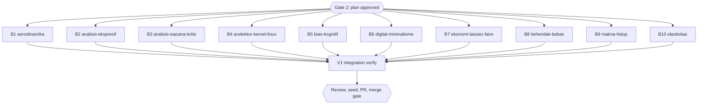

# Diagram retrofit RF1 (inventory group g1, 10 books)

## Session checklist

- [x] S1 Plan: tasks B1-B10 and V1 written, runner `Validation: OK`, `Plan` gate approved. Evidence: runner `Validation: OK`; `Plan` gate approved 2026-10-16; baseline `check-book-structure.ts` problem counts 3, 3, 5, 6, 10, 2, 4, 6, 4, 8 (books in task order), saved per book under `/tmp/rf1-base-<slug>.txt`
- [ ] S2 Execute: one subagent per book adds 0-3 grounded diagrams per chapter from `g1.md`, renders them, gate exit 0; parent diff audit and commit per book
- [ ] S3 Review: independent grounding review of every diagram against its chapter lines; findings fixed
- [ ] S4 Verify: `bun run build`, `bun test`, `bun run check:diagrams`, `check-book-structure.ts` for the ten books (no new problem beyond baseline)
- [ ] S5 Deliver: D1 seed rerun and `db/seed.sql` committed; PR from body file, registered; `Merge` gate
- [ ] S6 Close: readiness and `Close plan` gate before the merge; after the merge issue sync, publish, registry `merged`, graphify sync

## Visual Map

## Global Constraints

- GEMINI.md section 25 governs every diagram (allowed types, accTitle/accDescr in Indonesian, grounding, placement, width at most 1000 px, at most 3 per chapter, never required, no repeated scaffolding shape).
- Candidates come from `g1.md`; the book subagent may skip a weak candidate and must report any it rejects. ASCII-art diagrams named in `g1.md` are converted and the ASCII version deleted.
- Each dispatch carries the section 25 contract paragraph verbatim and requires, for every node and number, the exact source sentence (lesson from the follow-up session).
- Chapter text outside the inserted block and its one introducing sentence stays byte-identical, except a deleted ASCII-art fence that the diagram replaces.

### Task B1: aerodinamika-dan-desain-airfoil

- [ ] Step 1: Run | cmd: `bun run scripts/check-diagrams.ts --book aerodinamika-dan-desain-airfoil` | expect: exit 0 | retry: 0
- [ ] Step 2: Run | cmd: `bun run scripts/render-diagrams.ts --book aerodinamika-dan-desain-airfoil --check` | expect: exit 0 | retry: 0

### Task B2: analisis-ekspresif-9-summers-10-autumns

- [ ] Step 1: Run | cmd: `bun run scripts/check-diagrams.ts --book analisis-ekspresif-9-summers-10-autumns` | expect: exit 0 | retry: 0
- [ ] Step 2: Run | cmd: `bun run scripts/render-diagrams.ts --book analisis-ekspresif-9-summers-10-autumns --check` | expect: exit 0 | retry: 0

### Task B3: analisis-wacana-kritis-awk-dalam-kriminologi

- [ ] Step 1: Run | cmd: `bun run scripts/check-diagrams.ts --book analisis-wacana-kritis-awk-dalam-kriminologi` | expect: exit 0 | retry: 0
- [ ] Step 2: Run | cmd: `bun run scripts/render-diagrams.ts --book analisis-wacana-kritis-awk-dalam-kriminologi --check` | expect: exit 0 | retry: 0

### Task B4: arsitektur-kernel-linux

- [ ] Step 1: Run | cmd: `bun run scripts/check-diagrams.ts --book arsitektur-kernel-linux` | expect: exit 0 | retry: 0
- [ ] Step 2: Run | cmd: `bun run scripts/render-diagrams.ts --book arsitektur-kernel-linux --check` | expect: exit 0 | retry: 0

### Task B5: bias-kognitif

- [ ] Step 1: Run | cmd: `bun run scripts/check-diagrams.ts --book bias-kognitif` | expect: exit 0 | retry: 0
- [ ] Step 2: Run | cmd: `bun run scripts/render-diagrams.ts --book bias-kognitif --check` | expect: exit 0 | retry: 0

### Task B6: digital-minimalisme

- [ ] Step 1: Run | cmd: `bun run scripts/check-diagrams.ts --book digital-minimalisme` | expect: exit 0 | retry: 0
- [ ] Step 2: Run | cmd: `bun run scripts/render-diagrams.ts --book digital-minimalisme --check` | expect: exit 0 | retry: 0

### Task B7: ekonomi-laissez-faire

- [ ] Step 1: Run | cmd: `bun run scripts/check-diagrams.ts --book ekonomi-laissez-faire` | expect: exit 0 | retry: 0
- [ ] Step 2: Run | cmd: `bun run scripts/render-diagrams.ts --book ekonomi-laissez-faire --check` | expect: exit 0 | retry: 0

### Task B8: eksistensialisme-dan-kehendak-bebas

- [ ] Step 1: Run | cmd: `bun run scripts/check-diagrams.ts --book eksistensialisme-dan-kehendak-bebas` | expect: exit 0 | retry: 0
- [ ] Step 2: Run | cmd: `bun run scripts/render-diagrams.ts --book eksistensialisme-dan-kehendak-bebas --check` | expect: exit 0 | retry: 0

### Task B9: eksistensialisme-dan-makna-hidup

- [ ] Step 1: Run | cmd: `bun run scripts/check-diagrams.ts --book eksistensialisme-dan-makna-hidup` | expect: exit 0 | retry: 0
- [ ] Step 2: Run | cmd: `bun run scripts/render-diagrams.ts --book eksistensialisme-dan-makna-hidup --check` | expect: exit 0 | retry: 0

### Task B10: elastisitas-harga-permintaan-dan-penawaran

- [ ] Step 1: Run | cmd: `bun run scripts/check-diagrams.ts --book elastisitas-harga-permintaan-dan-penawaran` | expect: exit 0 | retry: 0
- [ ] Step 2: Run | cmd: `bun run scripts/render-diagrams.ts --book elastisitas-harga-permintaan-dan-penawaran --check` | expect: exit 0 | retry: 0

### Task V1: Integration verify

- [ ] Step 1: Run | cmd: `bun run build` | expect: exit 0 | retry: 0
- [ ] Step 2: Run | cmd: `bun test` | expect: exit 0 | retry: 1

## Status

- Status: Approved (`Plan` gate answered "Setujui dan eksekusi" on 2026-10-16)
- Resume: worktree above, `bun install` done; next is the `Plan` gate, then dispatch B1-B10.
