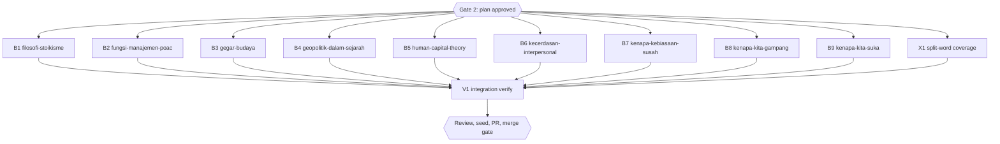

# Diagram retrofit RF2 (inventory group g2, 9 books)

## Session checklist

- [x] S0 Carry-over from RF1: commit `docs/code-plan/artifacts/2026-10-16-dawnbook-diagrams-retrofit-rf1-merge-evidence.md` and tick S5 and S6 of the RF1 plan with a pointer to it. Evidence: commit after `d7e8317` adds the evidence file and ticks RF1 S5 and S6
- [x] S1 Plan: tasks written, runner `Validation: OK`, `Plan` gate approved; structure baselines committed under `docs/code-plan/artifacts/2026-10-16-dawnbook-diagrams-retrofit-rf2/structure-baseline/`. Evidence: runner `Validation: OK`; `Plan` gate answered "Approve all five" for RF2-RF6 on 2026-10-16; baseline problem counts in book order 0, 6, 5, 3, 16, 6, 1, 1, 0
- [x] S2 Execute: one subagent per task adds 0-3 grounded diagrams per chapter from `g2.md`, renders them, gate exit 0; parent diff audit (every block against its source lines, intro sentences listed per book) and one commit per book. Evidence: ten subagents (9 books, X1 in an isolated /tmp worktree) dispatched in one message; parent audited every block against its source lines and listed intro sentences per book; commits cd7b2a1, f4e7d9e, 0105b6d (books), 0f54713 (X1); parent fixes: human-capital ch07 Solow arrow turned into two attributes (in f4e7d9e), X1 standalone-hyphen false positive guarded with a RED-first test (in 0f54713); 23 diagrams in 22 chapters, see Execution record
- [x] S3 Review: two standards reviewers (grounding) and one spec reviewer; findings fixed. Evidence: two standards reviewers (books 1-5, 6-9) and one spec reviewer, each verdict `correct`, no P0-P2; fixed: filosofi ch07 edge keeps "dan harus bereaksi" (1b0c14f), split-word message names the flowchart width as such (301b039); recorded without change: see Review notes
- [x] S4 Verify: `bun run build`, `bun test`, `bun run check:diagrams`, structure output equal to the baseline for every book. Evidence: tree 0105b6d+0f54713: `bun run build` exit 0; `bun test` 674 pass, 13 skip, 0 fail; `check:diagrams` 0 violations; 23 inline diagrams equal 23 source blocks; structure output equal to the baseline for all nine books; after 1b0c14f and 301b039 `bun test tests/scripts/check-diagrams.test.ts` 86 pass and `check:diagrams` 0 violations
- [ ] S5 Deliver: D1 seed rerun and `db/seed.sql` committed; PR from body file, registered; `Merge` gate
- [ ] S6 Close: readiness and `Close plan` gate before the merge; after the merge issue sync, publish, registry `merged`, graphify sync

## Visual Map

## Global Constraints

- GEMINI.md section 25 governs every diagram, and its dispatch contract paragraph is pasted verbatim into every dispatch (allowed types, accTitle and accDescr in Indonesian, grounding with hedges and examples kept, placement after the paragraph with an intro sentence that differs from the book's other intros, width at most 1000 px, at most 3 per chapter, never required, no repeated scaffolding shape, `split-word` reworded).
- Candidates come from `g2.md`; a subagent may skip a weak candidate and reports why. ASCII-art diagrams named in `g2.md` are converted and the ASCII version deleted.
- Each dispatch requires, for every node and number, the exact source line, and gives a tool-call budget.
- Chapter text outside the inserted block and its one introducing sentence stays byte-identical, except a deleted ASCII-art fence that the diagram replaces.
- Structure check command: `bun run scripts/check-book-structure.ts <slug> | diff docs/code-plan/artifacts/2026-10-16-dawnbook-diagrams-retrofit-rf2/structure-baseline/<slug>.txt -` (empty diff; the script itself exits 1 on pre-existing problems).
- The branch is never pushed before the session runs; at its start it is rebased onto the current `origin/main` (no force push needed), and its D1 seed runs from that tree.

### Task B1: filosofi-stoikisme

- [x] Step 1: Run | cmd: `bun run scripts/check-diagrams.ts --book filosofi-stoikisme` | expect: exit 0 | retry: 0
- [x] Step 2: Run | cmd: `bun run scripts/render-diagrams.ts --book filosofi-stoikisme --check` | expect: exit 0 | retry: 0
- [x] Step 3: Run | cmd: structure output of filosofi-stoikisme equals `docs/code-plan/artifacts/2026-10-16-dawnbook-diagrams-retrofit-rf2/structure-baseline/filosofi-stoikisme.txt` | expect: exit 0 | retry: 0

### Task B2: fungsi-manajemen-poac

- [x] Step 1: Run | cmd: `bun run scripts/check-diagrams.ts --book fungsi-manajemen-poac` | expect: exit 0 | retry: 0
- [x] Step 2: Run | cmd: `bun run scripts/render-diagrams.ts --book fungsi-manajemen-poac --check` | expect: exit 0 | retry: 0
- [x] Step 3: Run | cmd: structure output of fungsi-manajemen-poac equals `docs/code-plan/artifacts/2026-10-16-dawnbook-diagrams-retrofit-rf2/structure-baseline/fungsi-manajemen-poac.txt` | expect: exit 0 | retry: 0

### Task B3: gegar-budaya

- [x] Step 1: Run | cmd: `bun run scripts/check-diagrams.ts --book gegar-budaya` | expect: exit 0 | retry: 0
- [x] Step 2: Run | cmd: `bun run scripts/render-diagrams.ts --book gegar-budaya --check` | expect: exit 0 | retry: 0
- [x] Step 3: Run | cmd: structure output of gegar-budaya equals `docs/code-plan/artifacts/2026-10-16-dawnbook-diagrams-retrofit-rf2/structure-baseline/gegar-budaya.txt` | expect: exit 0 | retry: 0

### Task B4: geopolitik-dalam-sejarah-piala-dunia

- [x] Step 1: Run | cmd: `bun run scripts/check-diagrams.ts --book geopolitik-dalam-sejarah-piala-dunia` | expect: exit 0 | retry: 0
- [x] Step 2: Run | cmd: `bun run scripts/render-diagrams.ts --book geopolitik-dalam-sejarah-piala-dunia --check` | expect: exit 0 | retry: 0
- [x] Step 3: Run | cmd: structure output of geopolitik-dalam-sejarah-piala-dunia equals `docs/code-plan/artifacts/2026-10-16-dawnbook-diagrams-retrofit-rf2/structure-baseline/geopolitik-dalam-sejarah-piala-dunia.txt` | expect: exit 0 | retry: 0

### Task B5: human-capital-theory

- [x] Step 1: Run | cmd: `bun run scripts/check-diagrams.ts --book human-capital-theory` | expect: exit 0 | retry: 0
- [x] Step 2: Run | cmd: `bun run scripts/render-diagrams.ts --book human-capital-theory --check` | expect: exit 0 | retry: 0
- [x] Step 3: Run | cmd: structure output of human-capital-theory equals `docs/code-plan/artifacts/2026-10-16-dawnbook-diagrams-retrofit-rf2/structure-baseline/human-capital-theory.txt` | expect: exit 0 | retry: 0

### Task B6: kecerdasan-interpersonal

- [x] Step 1: Run | cmd: `bun run scripts/check-diagrams.ts --book kecerdasan-interpersonal` | expect: exit 0 | retry: 0
- [x] Step 2: Run | cmd: `bun run scripts/render-diagrams.ts --book kecerdasan-interpersonal --check` | expect: exit 0 | retry: 0
- [x] Step 3: Run | cmd: structure output of kecerdasan-interpersonal equals `docs/code-plan/artifacts/2026-10-16-dawnbook-diagrams-retrofit-rf2/structure-baseline/kecerdasan-interpersonal.txt` | expect: exit 0 | retry: 0

### Task B7: kenapa-kebiasaan-susah-diubah

- [x] Step 1: Run | cmd: `bun run scripts/check-diagrams.ts --book kenapa-kebiasaan-susah-diubah` | expect: exit 0 | retry: 0
- [x] Step 2: Run | cmd: `bun run scripts/render-diagrams.ts --book kenapa-kebiasaan-susah-diubah --check` | expect: exit 0 | retry: 0
- [x] Step 3: Run | cmd: structure output of kenapa-kebiasaan-susah-diubah equals `docs/code-plan/artifacts/2026-10-16-dawnbook-diagrams-retrofit-rf2/structure-baseline/kenapa-kebiasaan-susah-diubah.txt` | expect: exit 0 | retry: 0

### Task B8: kenapa-kita-gampang-percaya-hoax

- [x] Step 1: Run | cmd: `bun run scripts/check-diagrams.ts --book kenapa-kita-gampang-percaya-hoax` | expect: exit 0 | retry: 0
- [x] Step 2: Run | cmd: `bun run scripts/render-diagrams.ts --book kenapa-kita-gampang-percaya-hoax --check` | expect: exit 0 | retry: 0
- [x] Step 3: Run | cmd: structure output of kenapa-kita-gampang-percaya-hoax equals `docs/code-plan/artifacts/2026-10-16-dawnbook-diagrams-retrofit-rf2/structure-baseline/kenapa-kita-gampang-percaya-hoax.txt` | expect: exit 0 | retry: 0

### Task B9: kenapa-kita-suka-menunda-nunda

- [x] Step 1: Run | cmd: `bun run scripts/check-diagrams.ts --book kenapa-kita-suka-menunda-nunda` | expect: exit 0 | retry: 0
- [x] Step 2: Run | cmd: `bun run scripts/render-diagrams.ts --book kenapa-kita-suka-menunda-nunda --check` | expect: exit 0 | retry: 0
- [x] Step 3: Run | cmd: structure output of kenapa-kita-suka-menunda-nunda equals `docs/code-plan/artifacts/2026-10-16-dawnbook-diagrams-retrofit-rf2/structure-baseline/kenapa-kita-suka-menunda-nunda.txt` | expect: exit 0 | retry: 0

### Task X1: split-word coverage (RF1 backlog)

Acceptance: `split-word` also checks label text that sequence diagrams and timelines wrap into several lines, reports a cut piece that ends in punctuation ("/media/usb/" then "data.txt"), and reads the wrap width for its message from `scripts/diagrams/render-config.json` instead of a constant; test first, the real books stay at 0 violations.

- [x] Step 1: Run | cmd: `bun test tests/scripts/check-diagrams.test.ts` | expect: exit 0 | retry: 0
- [x] Step 2: Run | cmd: `bun run check:diagrams` | expect: exit 0 | retry: 0

### Task V1: Integration verify

- [x] Step 1: Run | cmd: `bun run build` | expect: exit 0 | retry: 0
- [x] Step 2: Run | cmd: `bun test` | expect: exit 0 | retry: 1

## Execution record

| Task | Book | Diagrams | Skipped |
|---|---|---|---|
| B1 | filosofi-stoikisme | ch02 timeline of three periods, ch07 impression-assent-emotion, ch08 four practice steps | ch07 2x2 of passions (rejected in g2) |
| B2 | fungsi-manajemen-poac | ch03 seven decision steps, ch08 control steps with the exception decision, ch10 feedback loop | none |
| B3 | gegar-budaya | ch10 W-curve (U-curve node, three return stages) | ch12 "Proses Transformasi": a 3-item list that would repeat the ch10 chain shape |
| B4 | geopolitik-dalam-sejarah-piala-dunia | ch04 pie of the 16 slots of 1966, ch05 chronology 1961-1992 (flowchart, a timeline was 1340 px), ch12 timeline of three eras | none |
| B5 | human-capital-theory | ch03 bar chart of the table incomes, ch07 Solow vs endogenous (ASCII converted), ch07 multiplier chain (ASCII converted) | none |
| B6 | kecerdasan-interpersonal | ch06 IBR steps, ch10 Clark's four levels, ch12 three stages with practical steps | none |
| B7 | kenapa-kebiasaan-susah-diubah | ch02 habit loop, ch10 golden rule, ch10 four replacement steps | none |
| B8 | kenapa-kita-gampang-percaya-hoax | ch02 five spreading stages, ch05 repetition loop | none |
| B9 | kenapa-kita-suka-menunda-nunda | ch02 consequence of the equation, ch05 avoidance loop (caveat kept) | none |
| X1 | scripts/check-diagrams.ts | split-word reads sequence and timeline lines, punctuation-ended pieces, the configured width; 86 tests | none |

Review notes kept without change: kecerdasan-interpersonal ch12 says "Tahap konteks" because "Kontekstualisasi" is wider than the 110 px wrap (accDescr keeps the term); human-capital-theory ch07 line 121 colon became a full stop because it introduced the deleted ASCII fence; human-capital-theory ch03 uses one bar series because xychart shows no legend; kecerdasan-interpersonal ch06 and ch10 are both chains, each following its own numbered list.

## Closeout record

- Runner `--execute` exit 0 on `6b01c41`: B1-B9, X1, V1 PASSED; `plan-mark-done`: 11 of 11 ticked.
- Readiness `plan-closeout.mjs --readiness` 2026-10-16: `NEEDS-HUMAN` (exit 3), open NOW 0, open step boxes 0, 11 tasks UNPROVEN by the `"false"` sentinel, other open boxes S5 and S6.
- `Close plan` gate: owner chose "Mark Complete". Debt sweep: owner selected the LaTeX audit and the blockquote sub-title detector; both run as tasks of the RF4 session.

## Status

- Status: Complete (`Close plan` gate, 2026-10-16)
- Resume: PR #155 waits for the `Merge` gate; S5 and S6 close with the merge evidence in the next session's PR.
