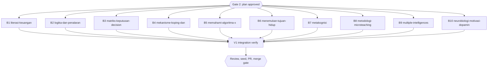

# Diagram retrofit RF3 (inventory group g3, 10 books)

## Session checklist

- [x] S1 Plan: tasks written, runner `Validation: OK`, `Plan` gate approved; structure baselines committed under `docs/code-plan/artifacts/2026-10-16-dawnbook-diagrams-retrofit-rf3/structure-baseline/`. Evidence: runner `Validation: OK`; `Plan` gate answered "Approve all five" for RF2-RF6 on 2026-10-16; baseline problem counts in book order 0, 2, 7, 4, 0, 0, 3, 16, 5, 8
- [x] S2 Execute: one subagent per task adds 0-3 grounded diagrams per chapter from `g3.md`, renders them, gate exit 0; parent diff audit (every block against its source lines, intro sentences listed per book) and one commit per book. Evidence: ten subagents dispatched in one message; parent audited every block against its source lines and listed intro sentences per book; commits 52695d8, 3b4e37c, 2d828b9 (after the rebase onto 741ea78); 23 diagrams; skips: metakognisi ch10 cycle (same shape as ch03), multiple-intelligences 1983/1995 timeline (weak), neurobiologi-motivasi-dopamin ch05 RPE decision (table covers it) and ch11 tyrosine chain (display math already draws it); reported, not drawn: neurobiologi ch02:58 says a weaker PFC raises the numerator while ch02:55 has PFC as the denominator
- [x] S3 Review: two standards reviewers (grounding) and one spec reviewer; findings fixed. Evidence: two standards reviewers and one spec reviewer, each `correct`, no P0-P2; fixed in 8adc36e: literasi-keuangan ch06 levels drawn as ordered categories (ranges in the nodes, no movement claim), mekanisme-koping ch06 intro without the unstated contrast; kept: logika ch06 root-intermediate-direct chain (role names under the Rantai Kausalitas heading), microteaching ch01 four steps without a return edge (the text states none)
- [x] S4 Verify: `bun run build`, `bun test`, `bun run check:diagrams`, structure output equal to the baseline for every book. Evidence: tree 8adc36e+3817b45: `bun run build` exit 0; `bun test` 674 pass, 13 skip, 0 fail; `check:diagrams` 0 violations (including the extended split-word rule); 23 inline diagrams equal 23 source blocks; structure output equal to the baseline for all ten books
- [ ] S5 Deliver: D1 seed rerun and `db/seed.sql` committed; PR from body file, registered; `Merge` gate
- [ ] S6 Close: readiness and `Close plan` gate before the merge; after the merge issue sync, publish, registry `merged`, graphify sync

## Visual Map

## Global Constraints

- GEMINI.md section 25 governs every diagram, and its dispatch contract paragraph is pasted verbatim into every dispatch (allowed types, accTitle and accDescr in Indonesian, grounding with hedges and examples kept, placement after the paragraph with an intro sentence that differs from the book's other intros, width at most 1000 px, at most 3 per chapter, never required, no repeated scaffolding shape, `split-word` reworded).
- Candidates come from `g3.md`; a subagent may skip a weak candidate and reports why. ASCII-art diagrams named in `g3.md` are converted and the ASCII version deleted.
- Each dispatch requires, for every node and number, the exact source line, and gives a tool-call budget.
- Chapter text outside the inserted block and its one introducing sentence stays byte-identical, except a deleted ASCII-art fence that the diagram replaces.
- Structure check command: `bun run scripts/check-book-structure.ts <slug> | diff docs/code-plan/artifacts/2026-10-16-dawnbook-diagrams-retrofit-rf3/structure-baseline/<slug>.txt -` (empty diff; the script itself exits 1 on pre-existing problems).
- The branch is never pushed before the session runs; at its start it is rebased onto the current `origin/main` (no force push needed), and its D1 seed runs from that tree.
- `menemukan-tujuan-hidup-ikigai`: the inventory line "BLOCKED: the chapters define the zones differently" is superseded. FU1 was resolved in commit 65b5071 (chapters 02, 03 and 08 now use the Winn 2014 zone definitions), so the subagent re-reads those chapters and draws only what they now state.

### Task B1: literasi-keuangan

- [ ] Step 1: Run | cmd: `bun run scripts/check-diagrams.ts --book literasi-keuangan` | expect: exit 0 | retry: 0
- [ ] Step 2: Run | cmd: `bun run scripts/render-diagrams.ts --book literasi-keuangan --check` | expect: exit 0 | retry: 0
- [ ] Step 3: Run | cmd: structure output of literasi-keuangan equals `docs/code-plan/artifacts/2026-10-16-dawnbook-diagrams-retrofit-rf3/structure-baseline/literasi-keuangan.txt` | expect: exit 0 | retry: 0

### Task B2: logika-dan-penalaran-kritis

- [ ] Step 1: Run | cmd: `bun run scripts/check-diagrams.ts --book logika-dan-penalaran-kritis` | expect: exit 0 | retry: 0
- [ ] Step 2: Run | cmd: `bun run scripts/render-diagrams.ts --book logika-dan-penalaran-kritis --check` | expect: exit 0 | retry: 0
- [ ] Step 3: Run | cmd: structure output of logika-dan-penalaran-kritis equals `docs/code-plan/artifacts/2026-10-16-dawnbook-diagrams-retrofit-rf3/structure-baseline/logika-dan-penalaran-kritis.txt` | expect: exit 0 | retry: 0

### Task B3: matriks-keputusan-decision-matrix

- [ ] Step 1: Run | cmd: `bun run scripts/check-diagrams.ts --book matriks-keputusan-decision-matrix` | expect: exit 0 | retry: 0
- [ ] Step 2: Run | cmd: `bun run scripts/render-diagrams.ts --book matriks-keputusan-decision-matrix --check` | expect: exit 0 | retry: 0
- [ ] Step 3: Run | cmd: structure output of matriks-keputusan-decision-matrix equals `docs/code-plan/artifacts/2026-10-16-dawnbook-diagrams-retrofit-rf3/structure-baseline/matriks-keputusan-decision-matrix.txt` | expect: exit 0 | retry: 0

### Task B4: mekanisme-koping-dan-manajemen-stres

- [ ] Step 1: Run | cmd: `bun run scripts/check-diagrams.ts --book mekanisme-koping-dan-manajemen-stres` | expect: exit 0 | retry: 0
- [ ] Step 2: Run | cmd: `bun run scripts/render-diagrams.ts --book mekanisme-koping-dan-manajemen-stres --check` | expect: exit 0 | retry: 0
- [ ] Step 3: Run | cmd: structure output of mekanisme-koping-dan-manajemen-stres equals `docs/code-plan/artifacts/2026-10-16-dawnbook-diagrams-retrofit-rf3/structure-baseline/mekanisme-koping-dan-manajemen-stres.txt` | expect: exit 0 | retry: 0

### Task B5: memahami-algoritma-x-untuk-pembaca

- [ ] Step 1: Run | cmd: `bun run scripts/check-diagrams.ts --book memahami-algoritma-x-untuk-pembaca` | expect: exit 0 | retry: 0
- [ ] Step 2: Run | cmd: `bun run scripts/render-diagrams.ts --book memahami-algoritma-x-untuk-pembaca --check` | expect: exit 0 | retry: 0
- [ ] Step 3: Run | cmd: structure output of memahami-algoritma-x-untuk-pembaca equals `docs/code-plan/artifacts/2026-10-16-dawnbook-diagrams-retrofit-rf3/structure-baseline/memahami-algoritma-x-untuk-pembaca.txt` | expect: exit 0 | retry: 0

### Task B6: menemukan-tujuan-hidup-ikigai

- [ ] Step 1: Run | cmd: `bun run scripts/check-diagrams.ts --book menemukan-tujuan-hidup-ikigai` | expect: exit 0 | retry: 0
- [ ] Step 2: Run | cmd: `bun run scripts/render-diagrams.ts --book menemukan-tujuan-hidup-ikigai --check` | expect: exit 0 | retry: 0
- [ ] Step 3: Run | cmd: structure output of menemukan-tujuan-hidup-ikigai equals `docs/code-plan/artifacts/2026-10-16-dawnbook-diagrams-retrofit-rf3/structure-baseline/menemukan-tujuan-hidup-ikigai.txt` | expect: exit 0 | retry: 0

### Task B7: metakognisi

- [ ] Step 1: Run | cmd: `bun run scripts/check-diagrams.ts --book metakognisi` | expect: exit 0 | retry: 0
- [ ] Step 2: Run | cmd: `bun run scripts/render-diagrams.ts --book metakognisi --check` | expect: exit 0 | retry: 0
- [ ] Step 3: Run | cmd: structure output of metakognisi equals `docs/code-plan/artifacts/2026-10-16-dawnbook-diagrams-retrofit-rf3/structure-baseline/metakognisi.txt` | expect: exit 0 | retry: 0

### Task B8: metodologi-microteaching

- [ ] Step 1: Run | cmd: `bun run scripts/check-diagrams.ts --book metodologi-microteaching` | expect: exit 0 | retry: 0
- [ ] Step 2: Run | cmd: `bun run scripts/render-diagrams.ts --book metodologi-microteaching --check` | expect: exit 0 | retry: 0
- [ ] Step 3: Run | cmd: structure output of metodologi-microteaching equals `docs/code-plan/artifacts/2026-10-16-dawnbook-diagrams-retrofit-rf3/structure-baseline/metodologi-microteaching.txt` | expect: exit 0 | retry: 0

### Task B9: multiple-intelligences

- [ ] Step 1: Run | cmd: `bun run scripts/check-diagrams.ts --book multiple-intelligences` | expect: exit 0 | retry: 0
- [ ] Step 2: Run | cmd: `bun run scripts/render-diagrams.ts --book multiple-intelligences --check` | expect: exit 0 | retry: 0
- [ ] Step 3: Run | cmd: structure output of multiple-intelligences equals `docs/code-plan/artifacts/2026-10-16-dawnbook-diagrams-retrofit-rf3/structure-baseline/multiple-intelligences.txt` | expect: exit 0 | retry: 0

### Task B10: neurobiologi-motivasi-dopamin

- [ ] Step 1: Run | cmd: `bun run scripts/check-diagrams.ts --book neurobiologi-motivasi-dopamin` | expect: exit 0 | retry: 0
- [ ] Step 2: Run | cmd: `bun run scripts/render-diagrams.ts --book neurobiologi-motivasi-dopamin --check` | expect: exit 0 | retry: 0
- [ ] Step 3: Run | cmd: structure output of neurobiologi-motivasi-dopamin equals `docs/code-plan/artifacts/2026-10-16-dawnbook-diagrams-retrofit-rf3/structure-baseline/neurobiologi-motivasi-dopamin.txt` | expect: exit 0 | retry: 0

### Task V1: Integration verify

- [ ] Step 1: Run | cmd: `bun run build` | expect: exit 0 | retry: 0
- [ ] Step 2: Run | cmd: `bun test` | expect: exit 0 | retry: 1

## Execution record

| Task | Book | Diagrams |
|---|---|---|
| B1 | literasi-keuangan | ch03 budget pie, ch06 collectibility levels, ch07 risk steps and strategies |
| B2 | logika-dan-penalaran-kritis | ch06 causal chain, ch06 vicious circle, ch09 PDCA with the Act branch |
| B3 | matriks-keputusan-decision-matrix | ch06 weights pie, ch08 calculation loop, ch12 vendor score bars |
| B4 | mekanisme-koping-dan-manajemen-stres | ch04 4-7-8 cycle, ch06 thought-feeling-behaviour triangle, ch06 ABCDE |
| B5 | memahami-algoritma-x-untuk-pembaca | ch03 For You pipeline, ch07 SeeFewer line chart |
| B6 | menemukan-tujuan-hidup-ikigai | ch03 zone map (FU1 definitions) |
| B7 | metakognisi | ch03 planning-monitoring-evaluation cycle, ch06 mind map (ASCII converted) |
| B8 | metodologi-microteaching | ch01 timeline, ch01 four steps, ch03 noise decision |
| B9 | multiple-intelligences | ch07 emotion decision, ch11 five entry points |
| B10 | neurobiologi-motivasi-dopamin | ch04 downregulation line chart |

## Status

- Status: Verification (S2-S4 done)
- Resume: D1 seed done from this tree; next the PR, Close plan and Merge gates.
