# Diagram retrofit RF4 (inventory group g4, 9 books)

## Session checklist

- [x] S1 Plan: tasks written, runner `Validation: OK`, `Plan` gate approved; structure baselines committed under `docs/code-plan/artifacts/2026-10-16-dawnbook-diagrams-retrofit-rf4/structure-baseline/`. Evidence: runner `Validation: OK`; `Plan` gate answered "Approve all five" for RF2-RF6 on 2026-10-16; baseline problem counts in book order 5, 6, 5, 7, 3, 0, 7, 4, 0
- [x] S0 Carry-over from RF3: commit the RF3 merge evidence, tick RF3 S5 and S6, and reopen the RF3 `Close plan` question. Evidence: commit 49cf822 adds the RF3 merge evidence and ticks RF3 S5 and S6; the RF3 Close plan question is reopened together with this PR's gates
- [x] S2 Execute: one subagent per task adds 0-3 grounded diagrams per chapter from `g4.md`, renders them, gate exit 0; parent diff audit (every block against its source lines, intro sentences listed per book) and one commit per book. Evidence: thirteen subagents (ten book tasks, Y1, Y2, Y3 in an isolated /tmp worktree) dispatched in one message; parent audited every block and LaTeX edit; commits 6447cdc, f817718, 8c637b5, 7b2b869 (books), 42e0f19 (Y1), df22003 (Y2, plus a parent 
 wrapper on dopamin ch02), b340af2 (Y3 guard test); 33 diagrams; skips: piaget ch12 and pembelajaran-multidisiplin ch02 (repeat their tables), neuroplastisitas ch12 fallback (three others used); Y3 found the detector already correct (the cited lines are inline lead-ins), so only a guard test was added
- [x] S3 Review: two standards reviewers (grounding) and one spec reviewer; findings fixed. Evidence: three standards reviewers (books A, books B plus LaTeX, psikologi-bencana) and one spec reviewer, each `correct`; fixed in 852e174: neuroplastisitas ch09 branches keep only stated links, peluruhan-beta ch11 carbon-14 ends as nitrogen instead of returning to the atmosphere, "sekitar" on the ch09 bar axis, pembelajaran-multidisiplin ch08 diagram moved after the steps it summarizes; kept: neuroplastisitas ch04/ch05 (different chain styles), the Y3 next-line test (matches the detector's line-based semantics)
- [x] S4 Verify: `bun run build`, `bun test`, `bun run check:diagrams`, structure output equal to the baseline for every book. Evidence: tree 852e174: `bun run build` exit 0; `bun test` 675 pass, 13 skip, 0 fail; `check:diagrams` 0 violations; 33 inline diagrams equal 33 source blocks, 0 raw mermaid fences; structure output equal to the baselines (RF4 books against RF4, Y books against RF2 and RF3)
- [ ] S5 Deliver: D1 seed rerun and `db/seed.sql` committed; PR from body file, registered; `Merge` gate
- [ ] S6 Close: readiness and `Close plan` gate before the merge; after the merge issue sync, publish, registry `merged`, graphify sync

## Visual Map

```mermaid
flowchart TD
    accTitle: Task graph for diagram retrofit RF4
    accDescr: After plan approval the book tasks run in parallel, one subagent each, and an integration check closes the graph before review, seed and the pull request.
    G2{{"Gate 2: plan approved"}}
    G2 --> B1["B1 neurobiologi-sistem-vestibular"]
    G2 --> B2["B2 neuroplastisitas-dalam-belajar"]
    G2 --> B3["B3 pejorasi-dan-ameliorasi"]
    G2 --> B4["B4 peluruhan-beta"]
    G2 --> B5["B5 pembelajaran-multidisiplin"]
    G2 --> B6["B6 pengaruh-uang-terhadap"]
    G2 --> B7["B7 piaget"]
    G2 --> B8["B8 psikologi-bencana ch03 ch05 ch06 ch10"]
    G2 --> B9["B9 psikologi-bencana ch09 ch11 ch12"]
    G2 --> B10["B10 psikologi-di-balik"]
    B1 --> V1["V1 integration verify"]
    B2 --> V1["V1 integration verify"]
    B3 --> V1["V1 integration verify"]
    B4 --> V1["V1 integration verify"]
    B5 --> V1["V1 integration verify"]
    B6 --> V1["V1 integration verify"]
    B7 --> V1["V1 integration verify"]
    B8 --> V1["V1 integration verify"]
    B9 --> V1["V1 integration verify"]
    B10 --> V1["V1 integration verify"]
    G2 --> Y1["Y1 LaTeX audit part 1"]
    G2 --> Y2["Y2 LaTeX audit part 2 and dopamin ch02"]
    G2 --> Y3["Y3 blockquote sub-title detector"]
    Y1 --> V1
    Y2 --> V1
    Y3 --> V1
    V1 --> PR{{"Review, seed, PR, merge gate"}}
```

## Global Constraints

- GEMINI.md section 25 governs every diagram, and its dispatch contract paragraph is pasted verbatim into every dispatch (allowed types, accTitle and accDescr in Indonesian, grounding with hedges and examples kept, placement after the paragraph with an intro sentence that differs from the book's other intros, width at most 1000 px, at most 3 per chapter, never required, no repeated scaffolding shape, `split-word` reworded).
- Candidates come from `g4.md`; a subagent may skip a weak candidate and reports why. ASCII-art diagrams named in `g4.md` are converted and the ASCII version deleted.
- Each dispatch requires, for every node and number, the exact source line, and gives a tool-call budget.
- Chapter text outside the inserted block and its one introducing sentence stays byte-identical, except a deleted ASCII-art fence that the diagram replaces.
- Structure check command: `bun run scripts/check-book-structure.ts <slug> | diff docs/code-plan/artifacts/2026-10-16-dawnbook-diagrams-retrofit-rf4/structure-baseline/<slug>.txt -` (empty diff; the script itself exits 1 on pre-existing problems).
- The branch is never pushed before the session runs; at its start it is rebased onto the current `origin/main` (no force push needed), and its D1 seed runs from that tree.
- `psikologi-bencana-dan-manajemen-panik` is split by chapter between two subagents (B8: 03, 05, 06, 10; B9: 09, 11, 12). Every ASCII-art block the inventory names in those chapters is converted and deleted, at most 3 diagrams per chapter; the text scripts at 07:40-44, 07:66-83 and 07:103-118 stay. Neither subagent runs `--prune`.
- Save More Tomorrow (3.5% to 13.6%) is already charted in `nudge-theory`; it is not charted again here.

### Task B1: neurobiologi-sistem-vestibular

- [x] Step 1: Run | cmd: `bun run scripts/check-diagrams.ts --book neurobiologi-sistem-vestibular` | expect: exit 0 | retry: 0
- [x] Step 2: Run | cmd: `bun run scripts/render-diagrams.ts --book neurobiologi-sistem-vestibular --check` | expect: exit 0 | retry: 0
- [x] Step 3: Run | cmd: structure output of neurobiologi-sistem-vestibular equals `docs/code-plan/artifacts/2026-10-16-dawnbook-diagrams-retrofit-rf4/structure-baseline/neurobiologi-sistem-vestibular.txt` | expect: exit 0 | retry: 0

### Task B2: neuroplastisitas-dalam-belajar

- [x] Step 1: Run | cmd: `bun run scripts/check-diagrams.ts --book neuroplastisitas-dalam-belajar` | expect: exit 0 | retry: 0
- [x] Step 2: Run | cmd: `bun run scripts/render-diagrams.ts --book neuroplastisitas-dalam-belajar --check` | expect: exit 0 | retry: 0
- [x] Step 3: Run | cmd: structure output of neuroplastisitas-dalam-belajar equals `docs/code-plan/artifacts/2026-10-16-dawnbook-diagrams-retrofit-rf4/structure-baseline/neuroplastisitas-dalam-belajar.txt` | expect: exit 0 | retry: 0

### Task B3: pejorasi-dan-ameliorasi

- [x] Step 1: Run | cmd: `bun run scripts/check-diagrams.ts --book pejorasi-dan-ameliorasi` | expect: exit 0 | retry: 0
- [x] Step 2: Run | cmd: `bun run scripts/render-diagrams.ts --book pejorasi-dan-ameliorasi --check` | expect: exit 0 | retry: 0
- [x] Step 3: Run | cmd: structure output of pejorasi-dan-ameliorasi equals `docs/code-plan/artifacts/2026-10-16-dawnbook-diagrams-retrofit-rf4/structure-baseline/pejorasi-dan-ameliorasi.txt` | expect: exit 0 | retry: 0

### Task B4: peluruhan-beta

- [x] Step 1: Run | cmd: `bun run scripts/check-diagrams.ts --book peluruhan-beta` | expect: exit 0 | retry: 0
- [x] Step 2: Run | cmd: `bun run scripts/render-diagrams.ts --book peluruhan-beta --check` | expect: exit 0 | retry: 0
- [x] Step 3: Run | cmd: structure output of peluruhan-beta equals `docs/code-plan/artifacts/2026-10-16-dawnbook-diagrams-retrofit-rf4/structure-baseline/peluruhan-beta.txt` | expect: exit 0 | retry: 0

### Task B5: pembelajaran-multidisiplin

- [x] Step 1: Run | cmd: `bun run scripts/check-diagrams.ts --book pembelajaran-multidisiplin` | expect: exit 0 | retry: 0
- [x] Step 2: Run | cmd: `bun run scripts/render-diagrams.ts --book pembelajaran-multidisiplin --check` | expect: exit 0 | retry: 0
- [x] Step 3: Run | cmd: structure output of pembelajaran-multidisiplin equals `docs/code-plan/artifacts/2026-10-16-dawnbook-diagrams-retrofit-rf4/structure-baseline/pembelajaran-multidisiplin.txt` | expect: exit 0 | retry: 0

### Task B6: pengaruh-uang-terhadap-kebahagiaan

- [x] Step 1: Run | cmd: `bun run scripts/check-diagrams.ts --book pengaruh-uang-terhadap-kebahagiaan` | expect: exit 0 | retry: 0
- [x] Step 2: Run | cmd: `bun run scripts/render-diagrams.ts --book pengaruh-uang-terhadap-kebahagiaan --check` | expect: exit 0 | retry: 0
- [x] Step 3: Run | cmd: structure output of pengaruh-uang-terhadap-kebahagiaan equals `docs/code-plan/artifacts/2026-10-16-dawnbook-diagrams-retrofit-rf4/structure-baseline/pengaruh-uang-terhadap-kebahagiaan.txt` | expect: exit 0 | retry: 0

### Task B7: piaget

- [x] Step 1: Run | cmd: `bun run scripts/check-diagrams.ts --book piaget` | expect: exit 0 | retry: 0
- [x] Step 2: Run | cmd: `bun run scripts/render-diagrams.ts --book piaget --check` | expect: exit 0 | retry: 0
- [x] Step 3: Run | cmd: structure output of piaget equals `docs/code-plan/artifacts/2026-10-16-dawnbook-diagrams-retrofit-rf4/structure-baseline/piaget.txt` | expect: exit 0 | retry: 0

### Task B8: psikologi-bencana-dan-manajemen-panik (chapters 03, 05, 06 and 10 only)

- [x] Step 1: Run | cmd: `bun run scripts/check-diagrams.ts --book psikologi-bencana-dan-manajemen-panik` | expect: exit 0 | retry: 0
- [x] Step 2: Run | cmd: `bun run scripts/render-diagrams.ts --book psikologi-bencana-dan-manajemen-panik --check` | expect: exit 0 | retry: 0
- [x] Step 3: Run | cmd: structure output of psikologi-bencana-dan-manajemen-panik equals `docs/code-plan/artifacts/2026-10-16-dawnbook-diagrams-retrofit-rf4/structure-baseline/psikologi-bencana-dan-manajemen-panik.txt` | expect: exit 0 | retry: 0

### Task B9: psikologi-bencana-dan-manajemen-panik (chapters 09, 11 and 12 only)

- [x] Step 1: Run | cmd: `bun run scripts/check-diagrams.ts --book psikologi-bencana-dan-manajemen-panik` | expect: exit 0 | retry: 0
- [x] Step 2: Run | cmd: `bun run scripts/render-diagrams.ts --book psikologi-bencana-dan-manajemen-panik --check` | expect: exit 0 | retry: 0
- [x] Step 3: Run | cmd: structure output of psikologi-bencana-dan-manajemen-panik equals `docs/code-plan/artifacts/2026-10-16-dawnbook-diagrams-retrofit-rf4/structure-baseline/psikologi-bencana-dan-manajemen-panik.txt` | expect: exit 0 | retry: 0

### Task B10: psikologi-di-balik-keputusan-finansial-kita

- [x] Step 1: Run | cmd: `bun run scripts/check-diagrams.ts --book psikologi-di-balik-keputusan-finansial-kita` | expect: exit 0 | retry: 0
- [x] Step 2: Run | cmd: `bun run scripts/render-diagrams.ts --book psikologi-di-balik-keputusan-finansial-kita --check` | expect: exit 0 | retry: 0
- [x] Step 3: Run | cmd: structure output of psikologi-di-balik-keputusan-finansial-kita equals `docs/code-plan/artifacts/2026-10-16-dawnbook-diagrams-retrofit-rf4/structure-baseline/psikologi-di-balik-keputusan-finansial-kita.txt` | expect: exit 0 | retry: 0

### Task Y1: LaTeX audit part 1 (RF2 debt sweep)

Acceptance: every display or inline formula in the named chapters follows GEMINI.md section 9 (single backslashes, no blank line inside `$`, display math in `
`, no escaped punctuation), read and edited line by line; the built pages show the formulas with single backslashes and no `<em>`; structure unchanged.

- [x] Step 1: Run | cmd: structure output of the three books equals the RF2 baselines | expect: exit 0 | retry: 0

### Task Y2: LaTeX audit part 2 and the dopamin ch02 sentence (RF2 and RF3 debt sweeps)

Acceptance: as Y1 for kecerdasan-interpersonal ch05 and ch10 and logika-dan-penalaran-kritis ch06 and ch09; neurobiologi-motivasi-dopamin ch02:58 is reworded so the sentence agrees with the formula at ch02:55 (PFC in the denominator).

- [x] Step 1: Run | cmd: structure output of the three books equals the RF2 and RF3 baselines | expect: exit 0 | retry: 0

### Task Y3: blockquote sub-title detector (RF2 debt sweep)

Acceptance: `check-heading-colons.ts` reports a bold sub-title with a colon inside a blockquote (`> **Analogi: X**`), test first; every violation it then finds is rewritten by the GEMINI.md section 24 rules, or listed for the owner when there are more than ten.

- [x] Step 1: Run | cmd: `bun test tests/scripts/check-heading-colons.test.ts` | expect: exit 0 | retry: 0
- [x] Step 2: Run | cmd: `bun run check:headings` | expect: exit 0 | retry: 0

### Task V1: Integration verify

- [x] Step 1: Run | cmd: `bun run build` | expect: exit 0 | retry: 0
- [x] Step 2: Run | cmd: `bun test` | expect: exit 0 | retry: 1

## Execution record

| Task | Book | Diagrams |
|---|---|---|
| B1 | neurobiologi-sistem-vestibular | ch05 transduction steps, ch08 VOR pathway, ch10 cortical projection |
| B2 | neuroplastisitas-dalam-belajar | ch04 Hebbian chain, ch05 neurogenesis stages, ch09 two mindset responses |
| B3 | pejorasi-dan-ameliorasi | ch02 amelioration phases, ch09 word plus context, ch10 "canggih" timeline |
| B4 | peluruhan-beta | ch02 decay decision, ch10 half-life line chart, ch11 carbon-14 path |
| B5 | pembelajaran-multidisiplin | ch01 era timeline, ch08 four design steps |
| B6 | pengaruh-uang-terhadap-kebahagiaan | ch04 three studies timeline, ch05 Easterlin mechanisms |
| B7 | piaget | ch04 equilibration |
| B8-B9 | psikologi-bencana-dan-manajemen-panik | 14 diagrams; eleven ASCII-art fences converted, plus the 10-80-10 pie, the OODA loop and the phase timeline |
| B10 | psikologi-di-balik-keputusan-finansial-kita | ch09 and ch11 bar charts (one study each) |
| Y1 | geopolitik, fungsi-manajemen-poac, kenapa-kita-gampang-percaya-hoax | LaTeX escaping and display wrappers |
| Y2 | kecerdasan-interpersonal, logika-dan-penalaran-kritis, neurobiologi-motivasi-dopamin | LaTeX escaping; dopamin ch02 sentence agrees with its formula |
| Y3 | tests/scripts/check-heading-colons.test.ts | guard test; inline-lead-in form "**Label: X** text" (about 48 lines) left for an owner decision under section 24 |

## Closeout status

- Readiness 2026-10-16: `NEEDS-HUMAN` (exit 3); open NOW 0, open step boxes 0; all 14 tasks PASSED in the runner but carry the `"false"` sentinel; S5 and S6 open until the merge.
- `Close plan` gate: owner chose "Keep it open". Reopen after the merge evidence of #158 is recorded.
- Debt sweep: owner selected the content slips batch, the book inconsistencies and the section 24 lead-in rule; they run as tasks of the RF5 session.

## Status

- Status: Verification (S0, S2-S4 done)
- Resume: PR #158 open; Close plan reopens in the RF5 PR.
