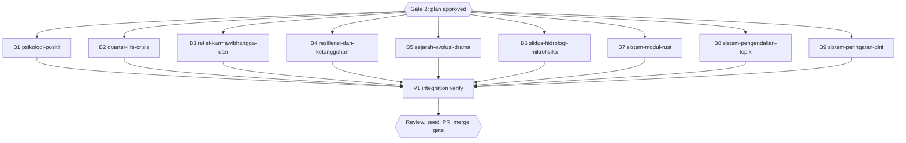

# Diagram retrofit RF5 (inventory group g5, 9 books)

## Session checklist

- [x] S1 Plan: tasks written, runner `Validation: OK`, `Plan` gate approved; structure baselines committed under `docs/code-plan/artifacts/2026-10-16-dawnbook-diagrams-retrofit-rf5/structure-baseline/`. Evidence: runner `Validation: OK`; `Plan` gate answered "Approve all five" for RF2-RF6 on 2026-10-16; baseline problem counts in book order 6, 6, 8, 3, 5, 11, 8, 0, 0
- [ ] S2 Execute: one subagent per task adds 0-3 grounded diagrams per chapter from `g5.md`, renders them, gate exit 0; parent diff audit (every block against its source lines, intro sentences listed per book) and one commit per book
- [ ] S3 Review: two standards reviewers (grounding) and one spec reviewer; findings fixed
- [ ] S4 Verify: `bun run build`, `bun test`, `bun run check:diagrams`, structure output equal to the baseline for every book
- [ ] S5 Deliver: D1 seed rerun and `db/seed.sql` committed; PR from body file, registered; `Merge` gate
- [ ] S6 Close: readiness and `Close plan` gate before the merge; after the merge issue sync, publish, registry `merged`, graphify sync

## Visual Map

## Global Constraints

- GEMINI.md section 25 governs every diagram, and its dispatch contract paragraph is pasted verbatim into every dispatch (allowed types, accTitle and accDescr in Indonesian, grounding with hedges and examples kept, placement after the paragraph with an intro sentence that differs from the book's other intros, width at most 1000 px, at most 3 per chapter, never required, no repeated scaffolding shape, `split-word` reworded).
- Candidates come from `g5.md`; a subagent may skip a weak candidate and reports why. ASCII-art diagrams named in `g5.md` are converted and the ASCII version deleted.
- Each dispatch requires, for every node and number, the exact source line, and gives a tool-call budget.
- Chapter text outside the inserted block and its one introducing sentence stays byte-identical, except a deleted ASCII-art fence that the diagram replaces.
- Structure check command: `bun run scripts/check-book-structure.ts <slug> | diff docs/code-plan/artifacts/2026-10-16-dawnbook-diagrams-retrofit-rf5/structure-baseline/<slug>.txt -` (empty diff; the script itself exits 1 on pre-existing problems).
- The branch is never pushed before the session runs; at its start it is rebased onto the current `origin/main` (no force push needed), and its D1 seed runs from that tree.
- FU3 (EWS command chain, commit 58c36bf) and FU4 (pedagogy percentages, commit 794cb4d) are resolved; the EWS chapter 04 chain and the pedagogy chart are drawn from the corrected text only. The EWS chapter 12 "Target Sendai" header and the unsourced "4 menit rata-rata" are not drawn (open debt from the follow-up session).

### Task B1: psikologi-positif

- [ ] Step 1: Run | cmd: `bun run scripts/check-diagrams.ts --book psikologi-positif` | expect: exit 0 | retry: 0
- [ ] Step 2: Run | cmd: `bun run scripts/render-diagrams.ts --book psikologi-positif --check` | expect: exit 0 | retry: 0
- [ ] Step 3: Run | cmd: structure output of psikologi-positif equals `docs/code-plan/artifacts/2026-10-16-dawnbook-diagrams-retrofit-rf5/structure-baseline/psikologi-positif.txt` | expect: exit 0 | retry: 0

### Task B2: quarter-life-crisis

- [ ] Step 1: Run | cmd: `bun run scripts/check-diagrams.ts --book quarter-life-crisis` | expect: exit 0 | retry: 0
- [ ] Step 2: Run | cmd: `bun run scripts/render-diagrams.ts --book quarter-life-crisis --check` | expect: exit 0 | retry: 0
- [ ] Step 3: Run | cmd: structure output of quarter-life-crisis equals `docs/code-plan/artifacts/2026-10-16-dawnbook-diagrams-retrofit-rf5/structure-baseline/quarter-life-crisis.txt` | expect: exit 0 | retry: 0

### Task B3: relief-karmawibhangga-dan-hukum-sebab-akibat

- [ ] Step 1: Run | cmd: `bun run scripts/check-diagrams.ts --book relief-karmawibhangga-dan-hukum-sebab-akibat` | expect: exit 0 | retry: 0
- [ ] Step 2: Run | cmd: `bun run scripts/render-diagrams.ts --book relief-karmawibhangga-dan-hukum-sebab-akibat --check` | expect: exit 0 | retry: 0
- [ ] Step 3: Run | cmd: structure output of relief-karmawibhangga-dan-hukum-sebab-akibat equals `docs/code-plan/artifacts/2026-10-16-dawnbook-diagrams-retrofit-rf5/structure-baseline/relief-karmawibhangga-dan-hukum-sebab-akibat.txt` | expect: exit 0 | retry: 0

### Task B4: resiliensi-dan-ketangguhan

- [ ] Step 1: Run | cmd: `bun run scripts/check-diagrams.ts --book resiliensi-dan-ketangguhan` | expect: exit 0 | retry: 0
- [ ] Step 2: Run | cmd: `bun run scripts/render-diagrams.ts --book resiliensi-dan-ketangguhan --check` | expect: exit 0 | retry: 0
- [ ] Step 3: Run | cmd: structure output of resiliensi-dan-ketangguhan equals `docs/code-plan/artifacts/2026-10-16-dawnbook-diagrams-retrofit-rf5/structure-baseline/resiliensi-dan-ketangguhan.txt` | expect: exit 0 | retry: 0

### Task B5: sejarah-evolusi-drama-korea

- [ ] Step 1: Run | cmd: `bun run scripts/check-diagrams.ts --book sejarah-evolusi-drama-korea` | expect: exit 0 | retry: 0
- [ ] Step 2: Run | cmd: `bun run scripts/render-diagrams.ts --book sejarah-evolusi-drama-korea --check` | expect: exit 0 | retry: 0
- [ ] Step 3: Run | cmd: structure output of sejarah-evolusi-drama-korea equals `docs/code-plan/artifacts/2026-10-16-dawnbook-diagrams-retrofit-rf5/structure-baseline/sejarah-evolusi-drama-korea.txt` | expect: exit 0 | retry: 0

### Task B6: siklus-hidrologi-mikrofisika-awan

- [ ] Step 1: Run | cmd: `bun run scripts/check-diagrams.ts --book siklus-hidrologi-mikrofisika-awan` | expect: exit 0 | retry: 0
- [ ] Step 2: Run | cmd: `bun run scripts/render-diagrams.ts --book siklus-hidrologi-mikrofisika-awan --check` | expect: exit 0 | retry: 0
- [ ] Step 3: Run | cmd: structure output of siklus-hidrologi-mikrofisika-awan equals `docs/code-plan/artifacts/2026-10-16-dawnbook-diagrams-retrofit-rf5/structure-baseline/siklus-hidrologi-mikrofisika-awan.txt` | expect: exit 0 | retry: 0

### Task B7: sistem-modul-rust

- [ ] Step 1: Run | cmd: `bun run scripts/check-diagrams.ts --book sistem-modul-rust` | expect: exit 0 | retry: 0
- [ ] Step 2: Run | cmd: `bun run scripts/render-diagrams.ts --book sistem-modul-rust --check` | expect: exit 0 | retry: 0
- [ ] Step 3: Run | cmd: structure output of sistem-modul-rust equals `docs/code-plan/artifacts/2026-10-16-dawnbook-diagrams-retrofit-rf5/structure-baseline/sistem-modul-rust.txt` | expect: exit 0 | retry: 0

### Task B8: sistem-pengendalian-topik-dalam-wacana-pedagogi-di-sekolah-dasar

- [ ] Step 1: Run | cmd: `bun run scripts/check-diagrams.ts --book sistem-pengendalian-topik-dalam-wacana-pedagogi-di-sekolah-dasar` | expect: exit 0 | retry: 0
- [ ] Step 2: Run | cmd: `bun run scripts/render-diagrams.ts --book sistem-pengendalian-topik-dalam-wacana-pedagogi-di-sekolah-dasar --check` | expect: exit 0 | retry: 0
- [ ] Step 3: Run | cmd: structure output of sistem-pengendalian-topik-dalam-wacana-pedagogi-di-sekolah-dasar equals `docs/code-plan/artifacts/2026-10-16-dawnbook-diagrams-retrofit-rf5/structure-baseline/sistem-pengendalian-topik-dalam-wacana-pedagogi-di-sekolah-dasar.txt` | expect: exit 0 | retry: 0

### Task B9: sistem-peringatan-dini-early-warning-system

- [ ] Step 1: Run | cmd: `bun run scripts/check-diagrams.ts --book sistem-peringatan-dini-early-warning-system` | expect: exit 0 | retry: 0
- [ ] Step 2: Run | cmd: `bun run scripts/render-diagrams.ts --book sistem-peringatan-dini-early-warning-system --check` | expect: exit 0 | retry: 0
- [ ] Step 3: Run | cmd: structure output of sistem-peringatan-dini-early-warning-system equals `docs/code-plan/artifacts/2026-10-16-dawnbook-diagrams-retrofit-rf5/structure-baseline/sistem-peringatan-dini-early-warning-system.txt` | expect: exit 0 | retry: 0

### Task V1: Integration verify

- [ ] Step 1: Run | cmd: `bun run build` | expect: exit 0 | retry: 0
- [ ] Step 2: Run | cmd: `bun test` | expect: exit 0 | retry: 1

## Status

- Status: Approved (`Plan` gate, 2026-10-16, together with the other retrofit plans)
- Resume: worktree above; the `Plan` gate decides whether the session runs.
