# Diagram retrofit RF6 (inventory group g6, 9 books)

## Session checklist

- [x] S0 Carry-over from RF5: commit the RF5 merge evidence and tick RF5 S5 and S6. Evidence: this commit
- [x] S1 Plan: tasks written, runner `Validation: OK`, `Plan` gate approved; structure baselines committed under `docs/code-plan/artifacts/2026-10-16-dawnbook-diagrams-retrofit-rf6/structure-baseline/`. Evidence: runner `Validation: OK`; `Plan` gate answered "Approve all five" for RF2-RF6 on 2026-10-16; baseline problem counts in book order 0, 5, 15, 4, 1, 3, 3, 0, 3
- [x] S2 Execute: one subagent per task adds 0-3 grounded diagrams per chapter from `g6.md`, renders them, gate exit 0; parent diff audit (every block against its source lines, intro sentences listed per book) and one commit per book. Evidence: eleven subagents in one message (nine books, W1 in an isolated /tmp worktree, W2); parent audited every block and edit; commits e8fb821 (five books in one commit, a deviation from one commit per book recorded here), 6fec0ec, 091bae5, 3676a09, 21bb8cc (books), 85fbb6b (W1), 975da39 (W2); 23 diagrams; teori-gaya-kelekatan ch10 quadrant chart is an added candidate outside g6 (both axes and all four quadrants are named in ch10:49-64); skips recorded in the review report
- [x] S3 Review: two standards reviewers (grounding) and one spec reviewer; findings fixed. Evidence: two standards reviewers and one spec reviewer, each `correct`; fixed: EWS ch12 states BMKG timing as delivered time, marks the 2025 figure and scopes the illustrative note (015fbcc), game tree equilibrium path drawn with thick arrows (470e60f); kept: Erikson TD chain and Maslow BT chain (each follows its own text; the book's third diagram is a triangle)
- [x] S4 Verify: `bun run build`, `bun test`, `bun run check:diagrams`, structure output equal to the baseline for every book. Evidence: tree 470e60f: `bun run build` exit 0; `bun test` 685 pass, 13 skip, 0 fail; `check:diagrams` 0 violations; `check:headings` 0; 23 inline diagrams equal 23 source blocks; structure output equal to the baselines; W1 end-to-end: on the real lead-in rewrite commit 2889e6f the old guard rejects 48 lines, the new guard only the 2 lines of a genuine body edit
- [x] S5 Deliver: D1 seed rerun and `db/seed.sql` committed; PR from body file, registered; `Merge` gate. Evidence: `docs/code-plan/artifacts/2026-10-16-dawnbook-diagrams-retrofit-rf6-merge-evidence.md`
- [x] S6 Close: readiness and `Close plan` gate before the merge; after the merge issue sync, publish, registry `merged`, graphify sync. Evidence: `docs/code-plan/artifacts/2026-10-16-dawnbook-diagrams-retrofit-rf6-merge-evidence.md` (graphify rebuilt and synced, CURRENT)

## Visual Map

```mermaid
flowchart TD
    accTitle: Task graph for diagram retrofit RF6
    accDescr: After plan approval the book tasks run in parallel, one subagent each, and an integration check closes the graph before review, seed and the pull request.
    G2{{"Gate 2: plan approved"}}
    G2 --> B1["B1 soft-power-jepang"]
    G2 --> B2["B2 state-of-flow"]
    G2 --> B3["B3 strategi-manajemen-kelas"]
    G2 --> B4["B4 struktur-pasar-dan"]
    G2 --> B5["B5 teori-gaya-kelekatan"]
    G2 --> B6["B6 teori-permainan-game"]
    G2 --> B7["B7 teori-teori-kepribadian"]
    G2 --> B8["B8 tonsilektomi"]
    G2 --> B9["B9 virtue-ethics-aristoteles"]
    B1 --> V1["V1 integration verify"]
    B2 --> V1["V1 integration verify"]
    B3 --> V1["V1 integration verify"]
    B4 --> V1["V1 integration verify"]
    B5 --> V1["V1 integration verify"]
    B6 --> V1["V1 integration verify"]
    B7 --> V1["V1 integration verify"]
    B8 --> V1["V1 integration verify"]
    B9 --> V1["V1 integration verify"]
    G2 --> W1["W1 diff-guard lead-ins"]
    G2 --> W2["W2 EWS Target Sendai header"]
    W1 --> V1
    W2 --> V1
    G2 --> Q1["Q1 consistency pass"]
    G2 --> Q2["Q2 EWS realita values"]
    Q1 --> V1
    Q2 --> V1
    V1 --> PR{{"Review, seed, PR, merge gate"}}
```

## Global Constraints

- GEMINI.md section 25 governs every diagram, and its dispatch contract paragraph is pasted verbatim into every dispatch (allowed types, accTitle and accDescr in Indonesian, grounding with hedges and examples kept, placement after the paragraph with an intro sentence that differs from the book's other intros, width at most 1000 px, at most 3 per chapter, never required, no repeated scaffolding shape, `split-word` reworded).
- Candidates come from `g6.md`; a subagent may skip a weak candidate and reports why. ASCII-art diagrams named in `g6.md` are converted and the ASCII version deleted.
- Each dispatch requires, for every node and number, the exact source line, and gives a tool-call budget.
- Chapter text outside the inserted block and its one introducing sentence stays byte-identical, except a deleted ASCII-art fence that the diagram replaces.
- Structure check command: `bun run scripts/check-book-structure.ts <slug> | diff docs/code-plan/artifacts/2026-10-16-dawnbook-diagrams-retrofit-rf6/structure-baseline/<slug>.txt -` (empty diff; the script itself exits 1 on pre-existing problems).
- The branch is never pushed before the session runs; at its start it is rebased onto the current `origin/main` (no force push needed), and its D1 seed runs from that tree.
- `tonsilektomi`: FU2 was resolved in commit 8ac278c; a pain timeline uses only the per-source statements now in chapters 08 and 10, never a merged curve.

### Task B1: soft-power-jepang-lewat-manga-dan-anime

- [x] Step 1: Run | cmd: `bun run scripts/check-diagrams.ts --book soft-power-jepang-lewat-manga-dan-anime` | expect: exit 0 | retry: 0
- [x] Step 2: Run | cmd: `bun run scripts/render-diagrams.ts --book soft-power-jepang-lewat-manga-dan-anime --check` | expect: exit 0 | retry: 0
- [x] Step 3: Run | cmd: structure output of soft-power-jepang-lewat-manga-dan-anime equals `docs/code-plan/artifacts/2026-10-16-dawnbook-diagrams-retrofit-rf6/structure-baseline/soft-power-jepang-lewat-manga-dan-anime.txt` | expect: exit 0 | retry: 0

### Task B2: state-of-flow

- [x] Step 1: Run | cmd: `bun run scripts/check-diagrams.ts --book state-of-flow` | expect: exit 0 | retry: 0
- [x] Step 2: Run | cmd: `bun run scripts/render-diagrams.ts --book state-of-flow --check` | expect: exit 0 | retry: 0
- [x] Step 3: Run | cmd: structure output of state-of-flow equals `docs/code-plan/artifacts/2026-10-16-dawnbook-diagrams-retrofit-rf6/structure-baseline/state-of-flow.txt` | expect: exit 0 | retry: 0

### Task B3: strategi-manajemen-kelas-proaktif

- [x] Step 1: Run | cmd: `bun run scripts/check-diagrams.ts --book strategi-manajemen-kelas-proaktif` | expect: exit 0 | retry: 0
- [x] Step 2: Run | cmd: `bun run scripts/render-diagrams.ts --book strategi-manajemen-kelas-proaktif --check` | expect: exit 0 | retry: 0
- [x] Step 3: Run | cmd: structure output of strategi-manajemen-kelas-proaktif equals `docs/code-plan/artifacts/2026-10-16-dawnbook-diagrams-retrofit-rf6/structure-baseline/strategi-manajemen-kelas-proaktif.txt` | expect: exit 0 | retry: 0

### Task B4: struktur-pasar-dan-persaingan

- [x] Step 1: Run | cmd: `bun run scripts/check-diagrams.ts --book struktur-pasar-dan-persaingan` | expect: exit 0 | retry: 0
- [x] Step 2: Run | cmd: `bun run scripts/render-diagrams.ts --book struktur-pasar-dan-persaingan --check` | expect: exit 0 | retry: 0
- [x] Step 3: Run | cmd: structure output of struktur-pasar-dan-persaingan equals `docs/code-plan/artifacts/2026-10-16-dawnbook-diagrams-retrofit-rf6/structure-baseline/struktur-pasar-dan-persaingan.txt` | expect: exit 0 | retry: 0

### Task B5: teori-gaya-kelekatan

- [x] Step 1: Run | cmd: `bun run scripts/check-diagrams.ts --book teori-gaya-kelekatan` | expect: exit 0 | retry: 0
- [x] Step 2: Run | cmd: `bun run scripts/render-diagrams.ts --book teori-gaya-kelekatan --check` | expect: exit 0 | retry: 0
- [x] Step 3: Run | cmd: structure output of teori-gaya-kelekatan equals `docs/code-plan/artifacts/2026-10-16-dawnbook-diagrams-retrofit-rf6/structure-baseline/teori-gaya-kelekatan.txt` | expect: exit 0 | retry: 0

### Task B6: teori-permainan-game-theory

- [x] Step 1: Run | cmd: `bun run scripts/check-diagrams.ts --book teori-permainan-game-theory` | expect: exit 0 | retry: 0
- [x] Step 2: Run | cmd: `bun run scripts/render-diagrams.ts --book teori-permainan-game-theory --check` | expect: exit 0 | retry: 0
- [x] Step 3: Run | cmd: structure output of teori-permainan-game-theory equals `docs/code-plan/artifacts/2026-10-16-dawnbook-diagrams-retrofit-rf6/structure-baseline/teori-permainan-game-theory.txt` | expect: exit 0 | retry: 0

### Task B7: teori-teori-kepribadian

- [x] Step 1: Run | cmd: `bun run scripts/check-diagrams.ts --book teori-teori-kepribadian` | expect: exit 0 | retry: 0
- [x] Step 2: Run | cmd: `bun run scripts/render-diagrams.ts --book teori-teori-kepribadian --check` | expect: exit 0 | retry: 0
- [x] Step 3: Run | cmd: structure output of teori-teori-kepribadian equals `docs/code-plan/artifacts/2026-10-16-dawnbook-diagrams-retrofit-rf6/structure-baseline/teori-teori-kepribadian.txt` | expect: exit 0 | retry: 0

### Task B8: tonsilektomi

- [x] Step 1: Run | cmd: `bun run scripts/check-diagrams.ts --book tonsilektomi` | expect: exit 0 | retry: 0
- [x] Step 2: Run | cmd: `bun run scripts/render-diagrams.ts --book tonsilektomi --check` | expect: exit 0 | retry: 0
- [x] Step 3: Run | cmd: structure output of tonsilektomi equals `docs/code-plan/artifacts/2026-10-16-dawnbook-diagrams-retrofit-rf6/structure-baseline/tonsilektomi.txt` | expect: exit 0 | retry: 0

### Task B9: virtue-ethics-aristoteles

- [x] Step 1: Run | cmd: `bun run scripts/check-diagrams.ts --book virtue-ethics-aristoteles` | expect: exit 0 | retry: 0
- [x] Step 2: Run | cmd: `bun run scripts/render-diagrams.ts --book virtue-ethics-aristoteles --check` | expect: exit 0 | retry: 0
- [x] Step 3: Run | cmd: structure output of virtue-ethics-aristoteles equals `docs/code-plan/artifacts/2026-10-16-dawnbook-diagrams-retrofit-rf6/structure-baseline/virtue-ethics-aristoteles.txt` | expect: exit 0 | retry: 0

### Task W1: diff-guard accepts lead-in rewrites (RF5 debt sweep)

Acceptance: `check-heading-colons.ts --diff-guard` accepts a changed bold lead-in line when only the bold part changed and the body text after it is identical, and still rejects any other body change; test first.

- [x] Step 1: Run | cmd: `bun test tests/scripts/check-heading-colons.test.ts` | expect: exit 0 | retry: 0

### Task W2: EWS Target Sendai header (RF5 debt sweep)

Acceptance: the ch12 column header names the real source of its values after a source check against the Sendai Framework and BMKG documents; values unchanged unless a source says otherwise.

- [x] Step 1: Run | cmd: structure output of the EWS book equals its RF5 baseline | expect: exit 0 | retry: 0

### Task Q1: content consistency pass (RF6 debt sweep)

Acceptance: teori-permainan ch03 names the incumbent's options one way, matching ch09; tonsilektomi ch11's summary table states its pain row consistently with ch08 and ch10 (per source, with hedges); tonsilektomi ch06 step durations and the stated total agree or are hedged; every change cites the chapter's own sources.

- [x] Step 1: Run | cmd: structure output of the two books equals the RF6 baselines | expect: exit 0 | retry: 0

### Task Q2: EWS realita values (RF6 debt sweep)

Acceptance: EWS ch12 Realita values 0.98, 0.35 and 0.72 are either sourced (BMKG or peer-reviewed reports, quoted) or clearly labelled as illustrative.

- [x] Step 1: Run | cmd: structure output of the EWS book equals its RF5 baseline | expect: exit 0 | retry: 0

### Task V1: Integration verify

- [x] Step 1: Run | cmd: `bun run build` | expect: exit 0 | retry: 0
- [x] Step 2: Run | cmd: `bun test` | expect: exit 0 | retry: 1

## Execution record

| Task | Result |
|---|---|
| B1 soft-power-jepang | ch06 pop-diplomacy timeline, ch09 Manga-mura chronology; ch08 bar chart skipped (three outlets) |
| B2 state-of-flow | ch04 four neuro stages, ch06 eight-state quadrant chart; ch09 box breathing skipped |
| B3 strategi-manajemen-kelas | ch04 task-done decision, ch09 restorative steps, ch11 reflection cycle |
| B4 struktur-pasar | ch03 entry and exit adjustment, ch08 Tit-for-Tat states |
| B5 teori-gaya-kelekatan | ch02 Strange Situation sequence, ch07 pursuer-distancer loop, ch10 attachment quadrants (added candidate) |
| B6 teori-permainan | ch09 entry game tree, ch10 Tit-for-Tat and Grim Trigger; ch03 skipped (same game, self-contradicting labels) |
| B7 teori-kepribadian | ch02 Erikson stages, ch03 Maslow levels, ch04 reciprocal determinism |
| B8 tonsilektomi | ch10 recovery phases (no pain curve), ch11 dehydration loop; ch06 skipped (durations mismatch the total) |
| B9 virtue-ethics | ch05 habituation, ch06 golden-mean spectra, ch07 phronesis cycle |
| W1 | `--diff-guard` accepts bold-only lead-in rewrites; 87 tests |
| W2 | EWS ch12 "Target kinerja" with an illustrative note; BMKG 2025 timing sourced; Referensi entry added |

## Follow-up evidence

- Q1 (`a55cf11`, `8130f23`): game-theory ch03 uses the ch09 option names (Bertarung, Akomodasi, Tetap Keluar); tonsilektomi ch11 pain row points to the per-source course in ch08 and cites Lavy 1997, Mitchell 2019 and the Bedfordshire NHS leaflet, all in Referensi; ch06 drops the contradicted 45-60 minute total and calls the step durations rough estimates.
- Q2 (`64be945`): no source states the EWS ch12 POD and FAR figures (BMKG releases, the IDRIP article, Lauterjung 2017 checked), so the column and heading say "Ilustrasi kondisi" and a sentence says only the BMKG timing is sourced.
- Review of Q1 and Q2: `correct`; its two P3 findings fixed in `8130f23`. After the fixes: `bun run build` exit 0, `bun test` 685 pass, 0 fail, `check:diagrams` 0, D1 seed rerun exit 0 with 0 failure lines.

## Closeout status

- Readiness 2026-10-16: `NEEDS-HUMAN` (exit 3); open NOW 0, open step boxes 0; all tasks PASSED in the runner but carry the `"false"` sentinel; S5 and S6 open until the merge.
- `Close plan` gate: owner chose "Keep it open" for RF6 and again for RF3 and RF4.

## Status

- Status: Verification (S0, S2-S4 done)
- Resume: PR #161 waits for the `Merge` gate; this is the last retrofit session, so its merge evidence stays as an untracked file in the main checkout for the next session to commit.
