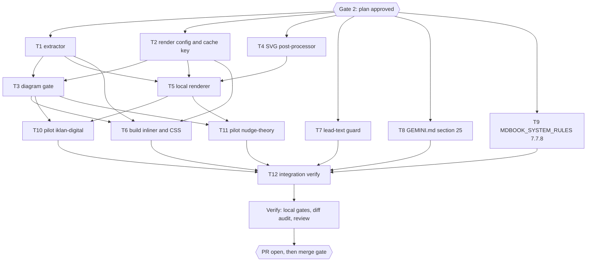

# Build-time Mermaid diagrams for every Dawnbook

> For agentic workers: REQUIRED EXECUTION METHOD is delegated task execution (subagent fan-out per the batch manifest below). Steps use checkbox syntax. Subagents never run git or gh.

## Session checklist

- [x] S1 Explore: active profile recorded (build pipeline, `dawnbook` preprocessor, deploy path, CI, existing checks) with the commands that proved each fact. Evidence: R1 and R3 reports synthesized into `research-mermaid-diagrams.md`; parent re-read `scripts/builder/mdbook-runner.ts:6-24,70` and `.github/workflows/deploy.yml` (exit 0)
- [x] S2 Research: Mermaid CLI, Mermaid theming/accessibility, and mdBook preprocessor facts read from primary sources with TinyFish, cited with date. Evidence: R2 and R4 reports with URLs dated 2026-10-16; parent reproduced `mmdc` exit 1 without `-p` and exit 0 with `-p` (32,173 bytes), and found `<p>` labels in the SVG; inventory g1-g6 written (356 lines, em-dash (U+2014) scan with `rg -c` exit 1 = none)
- [x] S3 Spike: one sample diagram rendered locally with `mmdc` to light and dark SVG, render time and file size measured. Evidence: `docs/code-plan/spikes/2026-10-16-mermaid-render/report.md`; parent viewed 3 screenshots (light 1280, coal 1280, coal 375 scroll), re-ran `bun test` in `p3-integration/` (11 pass, 0 fail, exit 0), re-rendered `p2-types/08-xychart-bar.mmd` (exit 0, `aria-roledescription="xychart"`) and `90-syntax-error.mmd` (exit 1, no SVG written)
- [x] S4 Design: design sections shown in chat and approved through the question tool. Evidence: `Section` 1, 2, 3 and `Spec` approved 2026-10-16 (approval log below); spec and glossary committed in `d382d96`
- [x] S5 Plan: task frontmatter written, `ultra-plan-runner.mjs` prints `Validation: OK`, Mermaid map matches `depends_on`. Evidence: `bun scripts/ultra-plan-runner.mjs <plan>` exit 0, `Validation: OK`, one expected warning (T9 NEEDS-AGENT), Error Ledger empty
- [x] S6 Gate 2: plan approved through the question tool. Evidence: `Plan` gate answered "Setujui dan eksekusi" on 2026-10-16; status set to Approved
- [ ] S7 Execute: chunks dispatched per batch manifest, each chunk past the parent diff audit gate
- [ ] S8 Verify: tests, `bun run build`, heading and content gates run locally with exit codes, 0 failures
- [ ] S9 Deliver: commit on the session branch, PR body file per template, PR opened and registered
- [ ] S10 Sweep: session-close debt sweep, learning ledger, plan closeout decision, graphify sync

## Approval log

| Gate | Answer | Date |
|---|---|---|
| `Intent` | Approve: A tooling (build-time Mermaid to inline SVG), B rules for authoring subagents, C retrofit of existing books | 2026-10-16 |
| `Probe` | Run the spike (3 diagrams, light and dark theme, 375 px and 1280 px) | 2026-10-16 |
| `SVG cache` (clarifying) | Commit the rendered SVG cache; CI never renders | 2026-10-16 |
| `Rollout` (clarifying) | One tooling PR (this session), then 6 retrofit PRs of about 10 books each | 2026-10-16 |
| `Section` 1, 2, 3 | Approve render pipeline, authoring rule, retrofit and rollout | 2026-10-16 |
| `Spec` | Approve `docs/code-plan/specs/2026-10-16-mermaid-diagrams-design.md` | 2026-10-16 |
| `Plan` | Approve and execute (T1-T12, 3 waves) | 2026-10-16 |

## Overview

**Goal:** chapters can carry Mermaid diagrams that are rendered once on the author's machine, committed as a per-book SVG cache, and inlined into the page at build time, with a rule and a gate that keep every diagram grounded in its chapter; two pilot books prove it end to end, and six later sessions retrofit the remaining 56 books.

**Architecture:** a pure extractor finds diagram blocks; a local renderer (Mermaid CLI JS API, one shared Chromium) turns cache misses into SVG through a locked config and a theme stylesheet built on mdBook CSS variables, then post-processes the SVG (single line, accessibility metadata, width rule); the build copies each book to `.build-tmp`, runs the diagram gate, and swaps each block for the cached inline SVG, failing on a cache miss so CI never needs a browser.

**Tech Stack:** Bun 1.4.3, TypeScript, mdBook 0.5.4 locally (CI pins 0.5.3), `@mermaid-js/mermaid-cli` 12.0.0 (bundled mermaid 12.1.0, puppeteer 25.13.0), Chromium 153 at `/usr/bin/chromium`.

**Active Project Profile:** repository `/home/belajarcarabelajar/Proyek/dawnbook`, session worktree `/home/belajarcarabelajar/Proyek/dawnbook-wt/dawnbook-mermaid-diagrams` on branch `2026-10-16-dawnbook-mermaid-diagrams/dawnbook-mermaid-diagrams` from `origin/main` at `60debfd`. Configuration sources: `package.json`, `scripts/build.ts`, `scripts/builder/mdbook-runner.ts`, `books/_template/book.toml`, `.github/workflows/deploy.yml`, `.github/workflows/test.yml`, `GEMINI.md`, `MDBOOK_SYSTEM_RULES.md`.

**Project Commands:** `bun test <path>` (targeted), `bun test` (suite), `bun run build` (full build with gates; needs `PATH=$HOME/.cargo/bin:$PATH` for mdBook), `bun run check:headings`, new `bun run check:diagrams`, new `bun run diagrams:render`. No lint or typecheck script exists in `package.json`.

**Protected Boundaries:** never edit a book's `book.toml` (GEMINI.md section 1); CLAUDE.md and AGENTS.md stay symlinks to GEMINI.md; chapter content is edited line by line by agents, never by batch scripts (sections 9 and 16); no emoji, no em dash, no "Anda" in book output; no `\,` `\\` `\{` in math; chapter openers stay under 155 characters.

**Spec:** `docs/code-plan/specs/2026-10-16-mermaid-diagrams-design.md`

**Scope:** tasks T1 to T12 below: extractor, render config and cache key, gate, SVG post-processor, local renderer, build inliner with CSS, lead-text guard, GEMINI.md section 25, MDBOOK_SYSTEM_RULES.md rule 7.7.8 and AuthoringAgent line, two pilot books, integration verification. The retrofit of the other 56 books is planned in the roadmap section and runs as six later sessions.

**Non-Goals:** mindmap diagrams; client-side Mermaid; loading the Epilogue web font for diagrams; light/dark SVG pairs; fixing the four contradictory-text candidates in this session; retrofitting books beyond the two pilots in this session.

## Visual Map



Edge convention: `A --> B` means B depends on A. Every task edge above equals the `depends_on` entries in the frontmatter.

## Reasoning Lenses

- **Intent and scope:** tooling, rule and pilot in this PR; retrofit in six later PRs (approved `Rollout`).
- **Investigative:** facts in `research-mermaid-diagrams.md`; behaviour in the spike report.
- **Computational:** cache key = first 12 hex of sha256 over normalized source, render config bytes, theme CSS bytes and the pinned CLI version; id = `dbd-<key>`; width rule from the SVG `viewBox`.
- **Systems and contract:** source contract and output contract in the spec; the inliner fails closed on a cache miss.
- **Critical:** silent failures found in the spike (comma-decimal xychart data, dropped timeline accessibility, `{{#...}}` processing) each get a gate rule or a post-process step.
- **Behavioural:** every module has a seam test; the pilots are verified by gate, build and screenshots.
- **Security:** inline SVG keeps paid diagrams behind the gate; `securityLevel: strict`; Chromium runs locally only, on our own text.
- **Compatibility:** no change to `book.toml`; build output gains inline SVG only where a diagram block exists, so the other 56 books build byte-identical HTML.
- **Operations:** merge to main deploys through CI; D1 seed refresh for the two pilot books follows the existing post-deploy routine.
- **Performance:** one shared browser, about 0.3 to 0.7 s per diagram, only on cache misses; build time adds a file read per diagram.
- **Accessibility:** `accTitle`/`accDescr` mandatory, injected for timeline; minimum scale 0.75 with horizontal scroll at 375 px.
- **Reproducibility:** pinned CLI version in `package.json`, mermaid pinned by `bun.lock`, byte-identical repeat renders measured in the spike.

## Acceptance Criteria

- [ ] AC-1: a chapter with a valid diagram block builds to HTML that holds one inline `<svg>` inside `<div class="dawnbook-diagram">`, with no `<foreignObject>` and no `<p>` inside the SVG.
- [ ] AC-2: a diagram block with no cached SVG makes `bun run build` exit 1 and name the book, file, line and `bun run diagrams:render`.
- [ ] AC-3: `bun run check:diagrams` exits 1 for each rule in the source contract (type, accTitle, accDescr, double brace, emoji, em dash, Anda, dollar sign, xychart quoting and decimals, first block, duplicate, more than 3 per chapter, cache miss) and 0 on a clean tree.
- [ ] AC-4: the same source and config render to byte-identical SVG twice; a timeline SVG carries `<title>`, `<desc>`, `aria-labelledby` and `aria-describedby`.
- [ ] AC-5: `extractLeadText` ignores text inside an inline SVG.
- [ ] AC-6: the two pilot books carry grounded diagrams (2 to 3 each), pass `check:diagrams`, and render correctly in light and coal at 375 px and 1280 px (screenshots viewed by the parent).
- [ ] AC-7: GEMINI.md section 25 holds the authoring rule and a dispatch clause; MDBOOK_SYSTEM_RULES.md rule 7.7.8 and the AuthoringAgent spec point to it; CLAUDE.md and AGENTS.md are still symlinks.
- [ ] AC-8: `bun run build` and `bun test` exit 0 with 0 failures in the worktree.

## Traceability

| Criterion | Task | Check | Evidence |
|---|---|---|---|
| AC-1 | T1, T6 | `bun test tests/scripts/diagrams-inline.test.ts`; built pilot HTML | test output; `rg -c '<svg' output/books/nudge-theory/content/12_*.html` |
| AC-2 | T6 | inline test case for a cache miss | test output |
| AC-3 | T3 | `bun test tests/scripts/check-diagrams.test.ts` | test output |
| AC-4 | T4, T5 | postprocess test; renderer test (skips without a browser) | test output |
| AC-5 | T7 | `bun test tests/scripts/inject-gating-svg.test.ts` | test output |
| AC-6 | T10, T11, T12 | `check:diagrams --book`; screenshots | gate exit code; PNG paths viewed by the parent |
| AC-7 | T8, T9 | `test -L CLAUDE.md`, `test -L AGENTS.md`; parent review | exit codes; diff |
| AC-8 | T12 | `bun run build`, `bun test` | exit codes, fail lines |

## Global Constraints

- Code identifiers and code comments in English; Indonesian only in book content and `accTitle`/`accDescr`.
- Bun only (`bun test`, `bun run`, `bun add`); never npm, npx or node for project code.
- No em dash and no emoji in any file this session writes; no "Anda" in book content.
- Locked render config (exact): `{"theme":"base","look":"classic","layout":"dagre","htmlLabels":false,"securityLevel":"strict","fontFamily":"Epilogue, sans-serif","flowchart":{"htmlLabels":false,"useMaxWidth":true,"wrappingWidth":200}}`.
- Theme CSS (exact rules) as in `docs/code-plan/spikes/2026-10-16-mermaid-render/p1-theme/mdbook-vars.css`.
- Allowed diagram types: `flowchart`, `graph`, `sequenceDiagram`, `stateDiagram-v2`, `pie`, `quadrantChart`, `xychart`, `xychart-beta`, `timeline`. Refused: everything else, including `mindmap`.
- At most 3 diagram blocks per chapter.
- Cache folder: `books/<slug>/diagrams/<key>.svg`, outside `src/`.
- Chromium path: `PUPPETEER_EXECUTABLE_PATH` when set, else `/usr/bin/chromium`.
- Subagents never run git or gh; the parent stages by explicit path.

## Tasks

### Task T1: Diagram block extractor

**Files:**
- Create: `scripts/diagrams/extract.ts`, `tests/scripts/diagrams-extract.test.ts`

**Interfaces:**
- Produces:
  ```ts
  export interface DiagramBlock { source: string; info: string; startLine: number; endLine: number; indent: string }
  export function findDiagramBlocks(markdown: string): DiagramBlock[]
  export function replaceDiagramBlocks(markdown: string, toHtml: (block: DiagramBlock) => string): string
  ```
  `startLine` and `endLine` are 1-based lines of the opening and closing fence; `source` is the block body with the fence indentation removed; `info` is the full info string.

**Preconditions:** spike prototype exists at `docs/code-plan/spikes/2026-10-16-mermaid-render/p3-integration/replace-mermaid-fences.ts` (else `E_PRECOND_UPSTREAM`).

**Behavior & Acceptance:** CommonMark fences of 3 or more backticks or tildes, up to 3 spaces of indent, or deeper inside a list item; info string starting with `mermaid`; blockquoted and unclosed fences and other languages left alone; `replaceDiagramBlocks` keeps the fence indentation, joins the replacement onto one line and surrounds it with blank lines (AC-1).

**Edge Cases & Failure Behavior:** a mermaid example nested inside a longer markdown fence is not a block; CRLF input is handled; tabs are out of scope (`defer: tabs in fence indentation, first chapter that indents a fence with a tab`).

**Deliberate Shortcuts & Deferrals:** the list-item check looks at the nearest less-indented line only, as in the spike (`defer: one-line list context, a fence the gate misreads inside a nested list`).

**Test Data & Determinism:** pure string fixtures inside the test file.

- [ ] Step 1: port the spike tests into `tests/scripts/diagrams-extract.test.ts` against the new interface, plus a `startLine`/`endLine` case and a CRLF case
- [ ] Step 2: Run, verify fail | cmd: `bun test tests/scripts/diagrams-extract.test.ts` | expect: exit 1 | retry: 0
- [ ] Step 3: implement `scripts/diagrams/extract.ts`
- [ ] Step 4: Run, verify pass | cmd: `bun test tests/scripts/diagrams-extract.test.ts` | expect: exit 0, 0 failures | retry: 0
- [ ] Step 5: parent commits `scripts/diagrams/extract.ts tests/scripts/diagrams-extract.test.ts`

### Task T2: Render config and cache key

**Files:**
- Create: `scripts/diagrams/render-config.json`, `scripts/diagrams/theme.css`, `scripts/diagrams/cache.ts`, `tests/scripts/diagrams-cache.test.ts`

**Interfaces:**
- Produces:
  ```ts
  export function normalizeSource(source: string): string
  export function diagramKey(source: string, root?: string): string   // 12 lowercase hex chars
  export function diagramId(key: string): string                       // "dbd-" + key
  export function cachePath(bookDir: string, key: string): string      // <bookDir>/diagrams/<key>.svg
  export function loadRenderConfig(root?: string): { config: Record<string, unknown>; css: string; cliVersion: string }
  ```
  `root` defaults to the repository root (`process.cwd()`); `cliVersion` is the exact `devDependencies["@mermaid-js/mermaid-cli"]` string from `<root>/package.json`.

**Behavior & Acceptance:** `render-config.json` holds the locked config from Global Constraints; `theme.css` holds the spike rules; the key changes when the source, the config bytes, the CSS bytes or the CLI version change, and does not change for trailing whitespace or CRLF; `loadRenderConfig` throws a clear error when the devDependency is missing or not an exact version.

**Edge Cases:** an empty source is a valid key input (the gate rejects it separately).

**Test Data & Determinism:** temp roots from `fs.mkdtempSync` holding a fixture `package.json` and copies of the two config files.

- [ ] Step 1: write `tests/scripts/diagrams-cache.test.ts` (key stability, key sensitivity, id prefix, cache path, missing devDependency error)
- [ ] Step 2: Run, verify fail | cmd: `bun test tests/scripts/diagrams-cache.test.ts` | expect: exit 1 | retry: 0
- [ ] Step 3: write the two config files and `scripts/diagrams/cache.ts`
- [ ] Step 4: Run, verify pass | cmd: `bun test tests/scripts/diagrams-cache.test.ts` | expect: exit 0 | retry: 0
- [ ] Step 5: parent commits the four files

### Task T3: Diagram gate

**Files:**
- Create: `scripts/check-diagrams.ts`, `tests/scripts/check-diagrams.test.ts`

**Interfaces:**
- Consumes: `findDiagramBlocks` (T1), `diagramKey`, `cachePath` (T2)
- Produces:
  ```ts
  export interface DiagramViolation { book: string; file: string; line: number; rule: string; message: string }
  export function checkDiagrams(root: string, opts?: { book?: string }): { violations: DiagramViolation[]; orphans: string[] }
  ```
  CLI: `bun run scripts/check-diagrams.ts [--root <dir>] [--book <slug>]`, exit 1 when `violations` is non-empty; orphans are printed as warnings and do not fail.

**Behavior & Acceptance (AC-3), one rule id each:** `type-not-allowed` (first keyword outside the allow-list), `missing-acc-title`, `missing-acc-descr`, `double-brace` (`{{`), `emoji`, `em-dash`, `anda` (word `Anda`), `dollar` (`$`), `xychart-unquoted` (title, axis titles and categories must be double-quoted), `xychart-decimal` (a digit, comma, digit sequence inside a `bar [...]` or `line [...]` array), `xychart-count` (series length differs from category count), `first-block` (no paragraph between the chapter H1 and the block), `duplicate` (same key twice in one chapter), `too-many` (more than 3 blocks in one chapter), `cache-miss` (no `<key>.svg`). Scans `books/<slug>/src/**/*.md` for every folder with a `book.toml`, skipping `_template`.

**Edge Cases:** a book with no `diagrams/` folder and no blocks passes; a `diagrams/` file not referenced by any block is an orphan.

**Test Data & Determinism:** one temp book tree per rule, built with `fs.mkdtempSync`, following `tests/scripts/check-repeated-headings.test.ts`.

- [ ] Step 1: write one failing test per rule plus a clean-tree test and an orphan test
- [ ] Step 2: Run, verify fail | cmd: `bun test tests/scripts/check-diagrams.test.ts` | expect: exit 1 | retry: 0
- [ ] Step 3: implement `scripts/check-diagrams.ts`
- [ ] Step 4: Run, verify pass | cmd: `bun test tests/scripts/check-diagrams.test.ts` | expect: exit 0 | retry: 0
- [ ] Step 5: parent commits the two files

### Task T4: SVG post-processor

**Files:**
- Create: `scripts/diagrams/postprocess.ts`, `tests/scripts/diagrams-postprocess.test.ts`

**Interfaces:**
- Produces:
  ```ts
  export interface AccText { title: string; descr: string }
  export function readAccText(source: string): AccText | null
  export function finalizeSvg(svg: string, opts: { id: string; acc: AccText }): string
  ```

**Behavior & Acceptance (AC-4):** `readAccText` reads `accTitle:` and single-line `accDescr:` (and the `accDescr { ... }` block form); `finalizeSvg` returns one line with no `\n`, adds `<title id="<id>-title">` and `<desc id="<id>-desc">` plus `aria-labelledby`/`aria-describedby` on the root `<svg>` when missing (timeline), escapes `<`, `>` and `&` in that text, replaces the root `style` with `width:100%;max-width:<w>px;min-width:<round(0.75*w)>px;height:auto;background-color:transparent` from the `viewBox` width `w`, and throws on `aria-roledescription="error"` or a `{{` in the output.

**Edge Cases:** an SVG that already has `<title>`/`<desc>` keeps them unchanged; an SVG without `viewBox` throws.

**Test Data & Determinism:** small hand-written SVG strings plus one SVG copied from the spike output shape (strings only, no browser).

- [ ] Step 1: write failing tests (single line, injection, no double injection, width rule, error marker, missing viewBox)
- [ ] Step 2: Run, verify fail | cmd: `bun test tests/scripts/diagrams-postprocess.test.ts` | expect: exit 1 | retry: 0
- [ ] Step 3: implement `scripts/diagrams/postprocess.ts`
- [ ] Step 4: Run, verify pass | cmd: `bun test tests/scripts/diagrams-postprocess.test.ts` | expect: exit 0 | retry: 0
- [ ] Step 5: parent commits the two files

### Task T5: Local renderer

**Files:**
- Create: `scripts/render-diagrams.ts`, `tests/scripts/render-diagrams.test.ts`
- Modify: `package.json` (devDependency `@mermaid-js/mermaid-cli` pinned exactly to `12.0.0`; scripts `diagrams:render` = `bun run scripts/render-diagrams.ts`, `check:diagrams` = `bun run scripts/check-diagrams.ts`), `bun.lock`

**Interfaces:**
- Consumes: `findDiagramBlocks` (T1), `diagramKey`, `diagramId`, `cachePath`, `loadRenderConfig` (T2), `readAccText`, `finalizeSvg` (T4)
- Produces: CLI `bun run scripts/render-diagrams.ts [--root <dir>] [--book <slug>] [--check] [--prune] [--force]`; exported `renderBooks(root: string, opts): Promise<{ rendered: number; cached: number; orphans: string[] }>`

**Behavior & Acceptance:** collects every block, renders only cache misses (all with `--force`) through `renderMermaid(browser, source, "svg", { mermaidConfig, myCSS, backgroundColor: "transparent", fontEmbed: false, svgId })` from the pinned package with one shared puppeteer browser (`executablePath` from `PUPPETEER_EXECUTABLE_PATH`, else `/usr/bin/chromium`); passes each result through `finalizeSvg`; writes `<book>/diagrams/<key>.svg`; never launches a browser when nothing is missing; `--check` renders nothing and exits 1 on any miss; `--prune` deletes orphans; a render error exits 1 naming book, file and line. Verify the exact option names against `node_modules/@mermaid-js/mermaid-cli/src/index.js` before use.

**Edge Cases:** `bun add` must not download a browser (Bun skips the puppeteer postinstall); if Chromium refuses to start without `--no-sandbox`, report it to the parent instead of adding the flag.

**Test Data & Determinism:** the test builds a temp book with one flowchart and one timeline, renders twice and asserts byte-identical output, no `<foreignObject>`, injected timeline `<title>`; it uses `test.skipIf(!existsSync(executablePath))` so CI without Chromium skips it.

- [ ] Step 1: `bun add -d -E @mermaid-js/mermaid-cli@12.0.0` and add the two scripts to `package.json`
- [ ] Step 2: write `tests/scripts/render-diagrams.test.ts`; Run, verify fail | cmd: `bun test tests/scripts/render-diagrams.test.ts` | expect: exit 1 | retry: 0
- [ ] Step 3: implement `scripts/render-diagrams.ts`
- [ ] Step 4: Run, verify pass | cmd: `bun test tests/scripts/render-diagrams.test.ts` | expect: exit 0 | retry: 1
- [ ] Step 5: Run | cmd: `bun run diagrams:render` | expect: exit 0, `rendered 0` before the pilots | retry: 0
- [ ] Step 6: parent commits the four files

### Task T6: Build inliner and diagram CSS

**Files:**
- Create: `scripts/diagrams/inline.ts`, `tests/scripts/diagrams-inline.test.ts`
- Modify: `scripts/builder/mdbook-runner.ts` (call the gate after `check-media-support.ts`; call the inliner after `prepareBookForMdbook`), `books/shared-header.css` (append the diagram rules)

**Interfaces:**
- Consumes: `replaceDiagramBlocks` (T1), `diagramKey`, `cachePath` (T2), `checkDiagrams` CLI (T3)
- Produces: `export function inlineDiagramsInBook(tmpBookDir: string, srcBookDir: string): { replaced: number }`

**Behavior & Acceptance (AC-1, AC-2):** every `.md` under `<tmpBookDir>/src` gets each block replaced by `<div class="dawnbook-diagram">` + the cached SVG from `<srcBookDir>/diagrams/<key>.svg`; a miss throws an error naming book, file, line and `bun run diagrams:render`, and the build exits 1; books with no blocks are untouched. CSS appended to `books/shared-header.css`:
```css
.dawnbook-diagram { margin: 1.5rem 0; overflow-x: auto; -webkit-overflow-scrolling: touch; }
.dawnbook-diagram svg { display: block; margin: 0 auto; height: auto; }
```

**Edge Cases:** the source tree is never written; a block inside a list item keeps its indentation.

**Test Data & Determinism:** temp source and tmp book dirs with a fixture cache SVG; `tests/scripts/build.test.ts` must stay green.

- [ ] Step 1: write failing tests (replacement, miss error text, untouched book, list indentation, source untouched)
- [ ] Step 2: Run, verify fail | cmd: `bun test tests/scripts/diagrams-inline.test.ts` | expect: exit 1 | retry: 0
- [ ] Step 3: implement `scripts/diagrams/inline.ts`, wire `mdbook-runner.ts`, append the CSS
- [ ] Step 4: Run, verify pass | cmd: `bun test tests/scripts/diagrams-inline.test.ts` | expect: exit 0 | retry: 0
- [ ] Step 5: Run | cmd: `bun test tests/scripts/build.test.ts` | expect: exit 0 | retry: 1
- [ ] Step 6: parent commits the four files

### Task T7: Lead-text guard

**Files:**
- Modify: `scripts/inject-gating.ts` (`extractLeadText`, lines 87-112)
- Create: `tests/scripts/inject-gating-svg.test.ts`

**Behavior & Acceptance (AC-5):** `extractLeadText` removes `<svg ...>...</svg>` before collecting `<p>` elements, so a `<p>` inside an SVG never reaches the meta description; existing behaviour is unchanged.

- [ ] Step 1: write a failing test with an htmlLabels-style SVG holding `<p>` labels before a short lead paragraph
- [ ] Step 2: Run, verify fail | cmd: `bun test tests/scripts/inject-gating-svg.test.ts` | expect: exit 1 | retry: 0
- [ ] Step 3: implement the guard
- [ ] Step 4: Run, verify pass | cmd: `bun test tests/scripts/inject-gating-svg.test.ts` | expect: exit 0 | retry: 0
- [ ] Step 5: Run | cmd: `bun test tests/scripts/inject-gating-utils.test.ts` | expect: exit 0 | retry: 0
- [ ] Step 6: parent commits the two files

### Task T8: GEMINI.md section 25 (authoring rule)

**Files:** Modify: `GEMINI.md` (append section 25 after section 24, before the closing `---` block; edit the real file, never the symlinks)

**Behavior & Acceptance (AC-7):** section 25 "Mermaid Diagrams (Build-Time SVG)" states, in the file's existing style:
- when a diagram helps (multi-step process, cycle, decision, chronology with dates in the text, numbers already in the text, a 2x2 the text describes, ASCII-art diagrams, which must be converted);
- grounding: no node, edge, label or number that the same chapter does not state; one source per chart; no causal arrow the text does not state;
- placement: after the paragraph it illustrates, introduced by a prose sentence, never the first block of a chapter; at most 3 per chapter; no diagram is required in any chapter, and the same diagram shape must not repeat across chapters as scaffolding (section 21);
- syntax: allowed types, mandatory `accTitle`/`accDescr` in Indonesian, quoting rules for flowchart and xychart labels, dot decimals in xychart data, no `{{`, no straight quotes inside labels (use curly quotes), no emoji, em dash, "Anda" or `$`;
- workflow: write the block, run `bun run diagrams:render`, commit `books/<slug>/diagrams/`, run `bun run check:diagrams`; the build fails on a cache miss;
- a "Dispatch requirement" clause (modelled on section 24) with a ready-to-paste contract paragraph for authoring subagents;
- revert instruction for the section.

**Verification:** `test -L CLAUDE.md` and `test -L AGENTS.md` exit 0 after the edit; parent reads the diff.

- [ ] Step 1: draft and append section 25
- [ ] Step 2: Run | cmd: `test -L CLAUDE.md` | expect: exit 0 | retry: 0
- [ ] Step 3: Run | cmd: `test -L AGENTS.md` | expect: exit 0 | retry: 0
- [ ] Step 4: parent commits `GEMINI.md`

### Task T9: MDBOOK_SYSTEM_RULES.md rule 7.7.8 and AuthoringAgent spec

**Files:** Modify: `MDBOOK_SYSTEM_RULES.md` (rule 7.7.8 at lines 824-830: one bullet for Mermaid diagrams pointing to GEMINI.md section 25; AuthoringAgent spec at lines 300-312: one line requiring the section 25 dispatch clause in every authoring prompt)

**Behavior & Acceptance (AC-7):** two additions only; no other rule text changes; NEEDS-AGENT task verified by the parent reading the diff.

- [ ] Step 1: add the two lines
- [ ] Step 2: parent reads `git diff -- MDBOOK_SYSTEM_RULES.md` and commits

### Task T10: Pilot book `iklan-digital-dan-penargetan-algoritma`

**Files:** Modify chapters `07_ekosistem-adtech-dan-iklan-programatik.md` (lines 15-36, RTB, `sequenceDiagram`), `05_teknologi-pelacakan-dan-jejak-digital.md` (lines 20-33, pixel tracking, `sequenceDiagram`), `01_pengantar-era-periklanan-digital.md` (lines 17-40, history, `timeline`); create `books/iklan-digital-dan-penargetan-algoritma/diagrams/` through `bun run diagrams:render --book iklan-digital-dan-penargetan-algoritma`.

**Behavior & Acceptance (AC-6):** each diagram is grounded in the cited lines (candidates in `docs/code-plan/artifacts/2026-10-16-mermaid-inventory/g2.md`), placed after the paragraph it illustrates with an introducing sentence, follows GEMINI.md section 25; the chapter is read line by line before and after the edit; no other line changes.

- [ ] Step 1: read the three chapters line by line, write the diagrams
- [ ] Step 2: Run | cmd: `bun run scripts/render-diagrams.ts --book iklan-digital-dan-penargetan-algoritma` | expect: exit 0 | retry: 0
- [ ] Step 3: Run | cmd: `bun run scripts/check-diagrams.ts --book iklan-digital-dan-penargetan-algoritma` | expect: exit 0 | retry: 0
- [ ] Step 4: parent audits the diff against the source lines, commits the chapters and the cache

### Task T11: Pilot book `nudge-theory`

**Files:** Modify chapters `12_metodologi-merancang-nudge-basic-framework.md` (lines 7-68, BASIC, `flowchart LR`, linear), `11_studi-kasus-kesehatan-keuangan-dan-lingkungan.md` (lines 11-17, opt-in vs opt-out, `xychart` bar from chapter 11 figures only), `02_dual-process-theory-sistem-1-dan-sistem-2.md` (lines 51-55, System 1 and 2, `flowchart LR`); create `books/nudge-theory/diagrams/`.

**Behavior & Acceptance (AC-6):** as T10, candidates in `docs/code-plan/artifacts/2026-10-16-mermaid-inventory/g4.md`; the xychart uses only the chapter 11 numbers (never mixed with chapter 04's figures).

- [ ] Step 1: read the three chapters line by line, write the diagrams
- [ ] Step 2: Run | cmd: `bun run scripts/render-diagrams.ts --book nudge-theory` | expect: exit 0 | retry: 0
- [ ] Step 3: Run | cmd: `bun run scripts/check-diagrams.ts --book nudge-theory` | expect: exit 0 | retry: 0
- [ ] Step 4: parent audits the diff against the source lines, commits the chapters and the cache

### Task T12: Integration verification (parent)

**Behavior & Acceptance (AC-1, AC-6, AC-8):** in the worktree with `PATH=$HOME/.cargo/bin:$PATH`: `bun run check:diagrams`, `bun run build`, `bun test` all exit 0 with 0 failures (fail lines captured with `rg '^\(fail\)|^ +[0-9]+ (pass|fail)'`); the built pilot chapters hold inline SVG with no `<foreignObject>`; screenshots of one diagram per pilot book in light and coal at 375 px and 1280 px, taken with the spike's puppeteer script, are viewed by the parent; the other 56 books' HTML is byte-identical to a build of `origin/main` apart from `shared-header.css`.

- [ ] Step 1: Run | cmd: `bun run check:diagrams` | expect: exit 0 | retry: 0
- [ ] Step 2: Run | cmd: `bun run build` | expect: exit 0 | retry: 0
- [ ] Step 3: Run | cmd: `bun test` | expect: exit 0, 0 failures | retry: 1
- [ ] Step 4: screenshots viewed; evidence recorded below

## Batch manifest (written before dispatch)

| Wave | Chunk | Owner | Permitted files | Verification |
|---|---|---|---|---|
| 1 | T1 | chef | `scripts/diagrams/extract.ts`, `tests/scripts/diagrams-extract.test.ts` | `bun test tests/scripts/diagrams-extract.test.ts` |
| 1 | T2 | nappy | `scripts/diagrams/render-config.json`, `scripts/diagrams/theme.css`, `scripts/diagrams/cache.ts`, `tests/scripts/diagrams-cache.test.ts` | `bun test tests/scripts/diagrams-cache.test.ts` |
| 1 | T4 | hoggy | `scripts/diagrams/postprocess.ts`, `tests/scripts/diagrams-postprocess.test.ts` | `bun test tests/scripts/diagrams-postprocess.test.ts` |
| 1 | T7 | chef | `scripts/inject-gating.ts`, `tests/scripts/inject-gating-svg.test.ts` | `bun test tests/scripts/inject-gating-svg.test.ts tests/scripts/inject-gating-utils.test.ts` |
| 1 | T8 | nappy | `GEMINI.md` | `test -L CLAUDE.md && test -L AGENTS.md`; parent diff read |
| 1 | T9 | hoggy | `MDBOOK_SYSTEM_RULES.md` | parent diff read |
| 2 | T3 | chef | `scripts/check-diagrams.ts`, `tests/scripts/check-diagrams.test.ts` | `bun test tests/scripts/check-diagrams.test.ts` |
| 2 | T5 | nappy | `scripts/render-diagrams.ts`, `tests/scripts/render-diagrams.test.ts`, `package.json`, `bun.lock` | `bun test tests/scripts/render-diagrams.test.ts`; `bun run diagrams:render` |
| 3 | T6 | hoggy | `scripts/diagrams/inline.ts`, `tests/scripts/diagrams-inline.test.ts`, `scripts/builder/mdbook-runner.ts`, `books/shared-header.css` | `bun test tests/scripts/diagrams-inline.test.ts tests/scripts/build.test.ts` |
| 3 | T10 | chef | three `iklan-digital-dan-penargetan-algoritma` chapters, its `diagrams/` | `check-diagrams --book`, `render-diagrams --book --check` |
| 3 | T11 | nappy | three `nudge-theory` chapters, its `diagrams/` | `check-diagrams --book`, `render-diagrams --book --check` |
| 4 | T12 | parent | none | build, test, screenshots |

Fan-out: 11 subagent chunks across 3 waves (frontier dispatch: a wave starts when every chunk it depends on is integrated). Chunk boundary check: every chunk has one owner, no two chunks write the same file, every task is covered. Review: an independent `staid` audit of the full diff before the PR.

## Retrofit roadmap (six later sessions, one PR each)

Each session claims its own slot (`pr-registry claim --plan 2026-10-16-dawnbook-mermaid-diagrams --session dawnbook-diagrams-retrofit-<n> --depends-on dawnbook-mermaid-diagrams`), writes its own short plan, and dispatches one subagent per book with the GEMINI.md section 25 dispatch clause pasted into the prompt, the book's candidate lines from the inventory file, and a hard cap of 3 diagrams per chapter. Each book subagent reads every candidate chapter line by line before and after the edit, renders, and runs `check:diagrams --book`. A `staid` reviewer checks every diagram against its source lines (no new fact, number or causal arrow) before the PR. Candidates of type `mindmap` become `flowchart`; candidates marked weak, optional or rejected in the inventory are skipped unless the book would otherwise get none.

| Session | Inventory | Books |
|---|---|---|
| RF1 | `g1.md` | aerodinamika-dan-desain-airfoil, analisis-ekspresif-9-summers-10-autumns, analisis-wacana-kritis-awk-dalam-kriminologi, arsitektur-kernel-linux, bias-kognitif, digital-minimalisme, ekonomi-laissez-faire, eksistensialisme-dan-kehendak-bebas, eksistensialisme-dan-makna-hidup, elastisitas-harga-permintaan-dan-penawaran |
| RF2 | `g2.md` | filosofi-stoikisme, fungsi-manajemen-poac, gegar-budaya, geopolitik-dalam-sejarah-piala-dunia, human-capital-theory, kecerdasan-interpersonal, kenapa-kebiasaan-susah-diubah, kenapa-kita-gampang-percaya-hoax, kenapa-kita-suka-menunda-nunda |
| RF3 | `g3.md` | literasi-keuangan, logika-dan-penalaran-kritis, matriks-keputusan-decision-matrix, mekanisme-koping-dan-manajemen-stres, memahami-algoritma-x-untuk-pembaca, menemukan-tujuan-hidup-ikigai (after FU1), metakognisi, metodologi-microteaching, multiple-intelligences, neurobiologi-motivasi-dopamin |
| RF4 | `g4.md` | neurobiologi-sistem-vestibular, neuroplastisitas-dalam-belajar, pejorasi-dan-ameliorasi, peluruhan-beta, pembelajaran-multidisiplin, pengaruh-uang-terhadap-kebahagiaan, piaget, psikologi-bencana-dan-manajemen-panik, psikologi-di-balik-keputusan-finansial-kita |
| RF5 | `g5.md` | psikologi-positif, quarter-life-crisis, relief-karmawibhangga-dan-hukum-sebab-akibat, resiliensi-dan-ketangguhan, sejarah-evolusi-drama-korea, siklus-hidrologi-mikrofisika-awan, sistem-modul-rust, sistem-pengendalian-topik-dalam-wacana-pedagogi-di-sekolah-dasar (pie candidate after FU4), sistem-peringatan-dini-early-warning-system (ch04 chain after FU3) |
| RF6 | `g6.md` | soft-power-jepang-lewat-manga-dan-anime, state-of-flow, strategi-manajemen-kelas-proaktif, struktur-pasar-dan-persaingan, teori-gaya-kelekatan, teori-permainan-game-theory, teori-teori-kepribadian, tonsilektomi (timeline after FU2), virtue-ethics-aristoteles |

The two pilot books (`iklan-digital-dan-penargetan-algoritma` from g2, `nudge-theory` from g4) are done in this session. Every retrofit PR follows the same merge routine as this one: local build and tests, merge gate, CI deploy, D1 seed refresh for the touched books.

## Follow-up backlog

- FU1: reconcile the ikigai zone definitions between chapters 02, 03 and 08 of `menemukan-tujuan-hidup-ikigai`. `defer: owner decides which definition is correct, before RF3 starts`
- FU2: reconcile the pain-peak days between `tonsilektomi` 10:11 and 08:48-49. `defer: owner decides the medically correct timeline, before RF6 starts`
- FU3: reconcile the command-chain timing in `sistem-peringatan-dini-early-warning-system` 04:33-42 with 07:21. `defer: owner decision, before RF5 starts`
- FU4: fix the percentages in `sistem-pengendalian-topik-dalam-wacana-pedagogi-di-sekolah-dasar` 05:15-19. `defer: source check, before RF5 starts`
- FU5: math backslash and blank-line defects found by the inventory (`nudge-theory` 04:42-45, `arsitektur-kernel-linux` 01:49, `geopolitik-dalam-sejarah-piala-dunia` 01:58-60, `kecerdasan-interpersonal` 05:58-67, `state-of-flow` 11:41-43). `defer: manual LaTeX audit session per GEMINI.md section 9, next content-hygiene session`
- FU6: content slips found by the inventory (`metakognisi` 07:79-80 example bug, `neurobiologi-motivasi-dopamin` 02:58 numerator vs denominator, `strategi-manajemen-kelas-proaktif` 05:84-99 broken table and 04:45-58 fence labelled `json`). `defer: content-hygiene session, or the retrofit session that touches the book`
- FU7: GEMINI.md section 9 item 1 still describes the `$ ... $` pre-pass removed on 2026-07-31. `defer: next GEMINI.md edit outside section 25`
- FU8: `[preprocessor.dawnbook]` has no binary and prints one warning per book per build. `defer: a build-hygiene session; needs owner choice between shipping a no-op preprocessor and moving subject_label`
- FU9: CI pins mdBook 0.5.3 while local is 0.5.4. `defer: next CI workflow edit`
- FU10: `detect-emojis.ts` clean mode rewrites lines inside code fences, including diagram blocks. `defer: first emoji-clean run on a book with diagrams`
- FU11: `searchindex-*.js` is a public asset that holds gated chapter text. `defer: security review of gating, owner decision`
- FU12: `inject-gating.ts:398` swallows errors with `.catch(console.error)`, so a failed injection does not fail the build. `defer: next inject-gating change`
- FU13: pre-existing em dash in `docs/code-plan/specs/2026-09-28-dawnbook-kenapa-kita-gampang-percaya-hoax.md`. `defer: next docs hygiene pass`
- FU14: the global `mmdc` cannot start (pinned Chromium 155 missing); the project renderer uses `/usr/bin/chromium` instead. `defer: machine setup note in ~/AGENTS.md, owner approval needed for a global file`

## Status

- Status: Approved
- Approved scope: intent A, B, C; sections 1-3; spec (2026-10-16)
- Completed: claim, worktree, research, inventory, spike, spec (`d382d96`); the research wave (R1-R10) and spike (P1-P3) manifests written before their dispatch are in this file as of `d382d96`
- Current: S7 Execute, wave 1
- Next: wave 2 (T3, T5)
- Blockers: none
