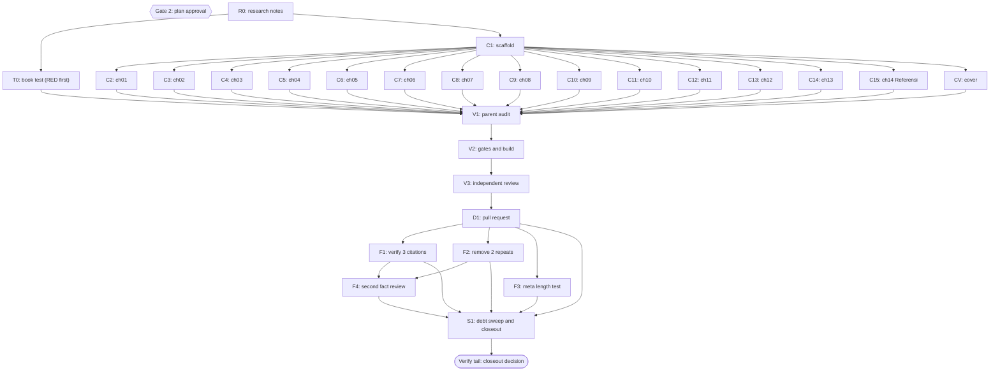

# Plan: Dawnbook book of life lessons from Harvest Moon Back to Nature

Status: InProgress
Session: dawnbook-harvest-moon
Branch: 2026-10-23-dawnbook-harvest-moon/dawnbook-harvest-moon
Worktree: /home/belajarcarabelajar/Proyek/dawnbook-wt/dawnbook-harvest-moon
Skill: ~/.claude/skills/super-ultra-code-plan/SKILL.md, loaded through the Skill tool (the harness resolves the skill by name, so the first fallback path ~/vivera/Super Ultra Code Plan Implementation.md was not read)
Author: Iwan Kurniawan <iwan@belajarcarabelajar.com>, no co-author trailer (GEMINI.md section 18)
Classification: Bounded. The book goes through the existing new-book flow (same shape as plan 2026-10-19-dawnbook-menolak-perasaan). A plan file is required because subagents own the chunks.
Source: owner-supplied OCR text of the Prima strategy guide (~/Unduhan, not committed), plus web sources read with TinyFish.

## Checklist

- [x] Claim: session slot claimed and worktree created beside the repository. Evidence: `bun ~/vivera/scripts/pr-registry.mjs claim --plan 2026-10-23-dawnbook-harvest-moon --session dawnbook-harvest-moon --repo <root> --worktree` exit 0 (worktree at origin/main 94058ed); `bun install --frozen-lockfile` exit 0; `pr-registry state dawnbook-harvest-moon active` exit 0.
- [x] Intent (Gate 1): title, grounding, subject label and the 13 + Referensi outline approved. Evidence: AskUserQuestion 2026-10-23: Title = Pelajaran Hidup Harvest Moon (title "Pelajaran Hidup dari Harvest Moon Back to Nature"); Grounding = Game + light research; Subject = Self-Help; Intent = Approve outline.
- [x] Research (R0): game facts from the guide and lesson sources from the web, synthesized in docs/code-plan/plans/research-dawnbook-harvest-moon.md with a section 9 source table. Evidence: 7 researcher reports (sets A, B, C from the guide, 26 to 31 tool calls each; L1 to L4 from TinyFish, 17 to 25 calls each), kept verbatim with renamed IDs; 31 source rows (`rg -c '^\| S[0-9]+ \|'` = 31); 14 DOIs return responseCode 1 from the doi.org handle API; 15 other URLs return HTTP 200 to curl, 3 are bot-walled for curl and were read through TinyFish; 0 em dashes in the notes.
- [x] Plan (Gate 2): this file validates (`Validation: OK`), published at Draft, owner approves. Evidence: `bun ~/vivera/scripts/ultra-plan-runner.mjs <plan>` exit 0, `Validation: OK`, 23 tasks, Error Ledger empty; `bun scripts/validate-skill.mjs` exit 0; `plan-sync.mjs --project dawnbook` publish exit 0, issue-sync exit 0 (issue #183); AskUserQuestion 2026-10-23: Plan = Approve and execute.
- [x] Test RED (T0): book test written before any chapter and fails because the book is absent. Evidence: chef wrote tests/books/pelajaran-hidup-dari-harvest-moon-back-to-nature.test.ts (pure ASCII, reuses check-book-structure and tests/helpers/book-test); parent read the file and re-ran `bun test tests/books/pelajaran-hidup-dari-harvest-moon-back-to-nature.test.ts` exit 1, 4 pass 4 fail; the 4 fails are the book-dependent tests (14 SUMMARY entries missing on disk, 0 files, 0 URLs, 0 files for the guide scan); fixture tests pass, including the 12-word positive control and the 11-word negative control.
- [x] Scaffold (C1): books/<slug>/ with book.toml, icon.txt, theme/, src/SUMMARY.md (14 entries), release-dates.json key. Evidence: nappy report plus parent read: book.toml differs from the template only in language, title, description (149 chars), subject_label Self-Help (authors already Iwan Kurniawan in the template); `diff -r` theme exit 0; SUMMARY.md 14 entries; icon.txt bytes f0 9f 8c be 0a; `git diff release-dates.json` adds one key plus a comma; src/content empty.
- [x] Author (C2-C15): 14 chapter files (13 content + Referensi), one subagent each, inside the byte budget. Evidence: 14 subagents (chef x5, nappy x5, hoggy x4) each returned one file with self-check output; sizes 6.042-7.724 B for chapters, Referensi 7.279 B (`wc -c`, 99.267 B total); no subagent ran git; book test RED to GREEN: exit 1 (4 pass 4 fail) before, `bun test tests/books/pelajaran-hidup-dari-harvest-moon-back-to-nature.test.ts` exit 0 (8 pass, 0 fail) after, guide-overlap scan included (guide present).
- [x] Cover (CV): cover.svg passes `bun run check:covers --book <slug>`, preview cards read by the parent. Evidence: hoggy wrote cover.svg (4.601 B, farm at dawn: harvest moon, red barn, chicken, 3x3 sprout plot, stump, stones, shipping bin; no text, characters or logos); RED first (`check:covers` exit 1, missing-cover) then exit 0 (0 cover violations); `bun run og:preview` exit 0, 15 cards; parent Read index.png and the longest-title card (chapter 12): subject on-topic, balanced next to the black panel, 4-line title inside the panel.
- [x] Audit (V1): parent line-by-line read of every chapter plus scans; diagrams rendered. Evidence: parent Read all 14 files end to end against the notes; 23 single-sentence edits: two researcher first names not in the notes removed (ch09 Holt-Lunstad, ch12 Whillans), 11 'game' to 'gim' for consistency, ch02 'akan tetap sehat' hedged to the guide's 'seharusnya' and 'dua angka' to 'dua ukuran' (the guide shows no exact meter), ch04 winter 'tidak punya benih sendiri' (guide: no seeds indigenous to winter), ch05 one direct 'kamu' address added (0 before), ch13 the 10 Power Berries scoped to the whole game, ch14 six titles corrected to the real page titles (5 read with curl, AMA read with TinyFish fetch_content). Scans: 0 em or en dash, 0 Anda, 0 duplicate headings, 0 leftover 'game', Julianne or Ashley (`rg` exit 1); `bun run diagrams:render --book <slug>` and `--prune`: rendered 0, cached 3, orphans 0, pruned 0 (ch02, ch04, ch11); `bun run scripts/check-book-structure.ts <slug>` exit 0, 14 chapters, 0 problems; no LaTeX in the book.
- [x] Gates (V2): every run[] step exit 0, SEO validation passed. Evidence (final run after the review fixes): `bun test tests/books/pelajaran-hidup-dari-harvest-moon-back-to-nature.test.ts tests/scripts/check-book-structure.test.ts tests/serp-description.test.ts` exit 0 (57 pass, 0 fail); `bun run scripts/check-book-structure.ts <slug>` exit 0 (14 chapters, 0 problems); `bun run check:headings` exit 0 (0 violations, 60 books); `bun run scripts/check-repeated-headings.ts` exit 0; `bun run check:diagrams` exit 0 (0 violations, 0 orphans); `bun run check:covers --book <slug>` exit 0; `bun run build` exit 0 with `Successfully built: pelajaran-hidup-dari-harvest-moon-back-to-nature`, `Inlined 3 diagram(s)`, `SEO Validation passed! All rules (R1-R7)`; output/manifest.json lists the slug with 14 chapters; built metas 112-149 chars, all complete sentences (three openers lengthened from 83, 79 and 92 chars to meet the 110-160 SERP range, GEMINI.md section 8); every page has its own /og/ card; build regenerated functions/lib/built-stats.ts (chapter total +14, Iwan Kurniawan 48 to 49 books).
- [x] Review (V3): independent reviewers, findings resolved, report saved. Evidence: 3 parallel staid reviewers (ch01-07: not correct, 1 P1; ch08-14: not correct, 5 P1; test, scaffold, cover, notes: not correct, 1 P1 copyrighted guide text in the public notes); notes P1 fixed test-first (new 16-word public-docs case RED exit 1 with 2.650 runs, GREEN exit 0 after moving sets A, B, C to ~/.config/dawnbook/private-notes/, mode 600); chapter P1 and P2 fixed by 4 fixer subagents on disjoint chapter groups (chef, nappy, hoggy, chef) under one fix contract with a parent term table; parent audited every changed line against the pre-fix copies; diagrams re-rendered (2 stale SVGs pruned); `bun ~/vivera/scripts/check-copy-rules.mjs --diff origin/main` exit 0 (merge-base 94058ed2); report at docs/code-plan/artifacts/2026-10-23-dawnbook-harvest-moon-review-report.md.
- [x] Deliver (D1): commit as Iwan Kurniawan, PR opened through pr-registry. Evidence: commit 1e8561f (author Iwan Kurniawan <iwan@belajarcarabelajar.com>, no trailer, attribution scan exit 1, 31 files staged by explicit path = 31 in `git show --name-only HEAD`, `git status --porcelain` empty after); `pr-registry state dawnbook-harvest-moon verified` exit 0; `pr-registry open ... --body-file` exit 0 -> https://github.com/belajarcarabelajar/dawnbook/pull/184 recorded; body says Refs #183.
- [x] Follow-up F1 (N1): verify SHED 50 and 68 percent figures, the Harvard Gazette date and the Rodriguez initials; fix ch05, ch14 or the notes; book test exit 0. Evidence: chef fetched the Fed press release (only 63 percent stated; 2013 and 2021 figures dropped from ch05), Gazette page metadata (published 2017-04-11, author Liz Mineo; parent changed the entry to Mineo, L.), Crossref (Monica L. Rodriguez, unchanged); notes L2-2c and L3-2b updated; book test exit 0 (9 pass at the time), structure checker exit 0.
- [x] Follow-up F2 (N2): ch09 late-arrival rule and ch08 brush price become back-references to bab 3 and bab 7; structure checker and book test exit 0. Evidence: nappy replaced the ch09 rule and its recap bullet with references to bab 3 (`rg 'satu jam'` in ch09 exit 1); the brush price stays in ch08 because ch07 never stated it (the first-round P3 was wrong); book test exit 0, structure checker exit 0.
- [x] Follow-up F3 (N4): test-first case that every chapter meta (formatSerpDescription of the first paragraph) is 110 to 155 characters; RED shown, then GREEN. Evidence: hoggy reused extractLeadText, formatSerpDescription and escapeHtml from scripts/inject-gating.ts; RED on a scratch copy with a shortened ch01 opener (`DAWNBOOK_HM_BOOK=<copy> bun test ... -t 'every chapter meta description'` exit 1, length 88 reported); GREEN `bun test tests/books/pelajaran-hidup-dari-harvest-moon-back-to-nature.test.ts` exit 0 (11 pass); parent refactor to reuse metaOutOfRange, still exit 0.
- [x] Follow-up F4 (N3): second independent fact review of the lines changed after review V3 and by F1, F2; P1 and P2 fixed; gates re-run. Evidence: staid verdict correct (all nine first-round P1 resolved, 0 new P1, 3 P2, 12 P3; resumed once after a 429 session limit); parent applied 18 one-sentence edits by assert-checked replacement (inline: mechanical edits and the subagent session limit had just been hit, A16), skipped one P3 with reason; focused tests exit 0 (59 pass, 0 fail), structure, headings, repeated headings, diagrams and covers exit 0; review report section 'Follow-up round'.
- [ ] Sweep (S1): debt sweep, learning ledger, graphify sync, closeout decision.

## Active Project Profile

Snapshot taken 2026-10-23 at origin/main 94058ed.

- Repository root: /home/belajarcarabelajar/Proyek/dawnbook (session worktree above). Runtime Bun 1.4.4, mdBook v0.5.4 in ~/.cargo/bin.
- Target scope: new directory `books/pelajaran-hidup-dari-harvest-moon-back-to-nature/`, one `release-dates.json` entry, one book test, the research notes and session artifacts. Files the build regenerates (functions/lib/built-stats.ts) are reviewed in the diff audit.
- Book layout (verified on books/saat-dia-suka-tapi-kamu-tidak): `book.toml` (template copy with title, authors, language = "id", description, subject_label), `icon.txt`, `theme/` copied from the template, `src/SUMMARY.md`, `src/content/NN_kebab.md`, `cover.svg` (GEMINI.md section 27, required since 2026-10-21). Scaffold by `mkdir` plus `cp -r books/_template/theme` (project memory: rm is denied).
- Chapters open with `##` equal to the SUMMARY title; sub-sections use `###`. No LaTeX.
- Subject label `Self-Help` exists in data/subject-labels.json.
- Gates: `scripts/check-book-structure.ts`, `bun run check:headings`, `bun run scripts/check-repeated-headings.ts`, `bun run diagrams:render` then `bun run check:diagrams`, `bun run check:covers`, `bun run build`. Copy rules: `bun ~/vivera/scripts/check-copy-rules.mjs --diff origin/main`.
- Deploy (post-merge, owner-gated): GEMINI.md section 19 (deploy-website.sh also posts the Telegram announcement, section 28), then `bun run scripts/migrate-to-d1.ts`, then GSC reindex by the OAuth path in docs/code-plan/artifacts/2026-10-06-dawnbook-psikologi-merge-evidence.md.
- Unknowns: none blocking.

## 1. Intent and Scope

- Goal: a 14-page Dawnbook book (13 content chapters + Referensi) by Iwan Kurniawan. Each chapter pairs one mechanic of Harvest Moon: Back to Nature (PlayStation, 1999) with one life lesson, the game facts drawn from the official Prima guide and the lesson backed by 1 to 3 verified sources.
- Slug `pelajaran-hidup-dari-harvest-moon-back-to-nature`. Title `Pelajaran Hidup dari Harvest Moon Back to Nature` (no colon, GEMINI.md section 24). Subject label `Self-Help`. Icon: one sheaf-of-rice emoji in icon.txt. Language `id`.
- Description (149 chars): "Tiga belas pelajaran hidup dari Harvest Moon Back to Nature, dari stamina, musim tanam, dan investasi ternak sampai merawat hubungan dengan tetangga."
- Owner decisions (AskUserQuestion, 2026-10-23): title, grounding (game + light research), subject label (Self-Help), outline. The owner left the chapter count to the agent within 12 to 15: 14 pages.
- Non-goals: no edits to any other book, template, CSS, or script; no copied guide text beyond one short attributed quote per chapter.
- Acceptance criteria:
  - AC-1: 14 entries in SUMMARY.md equal 14 files in src/content; each chapter's first heading equals its SUMMARY title. Check: `bun run scripts/check-book-structure.ts <slug>` exit 0.
  - AC-2: 0 em dash, 0 emoji outside icon.txt, 0 "Anda", 0 colon headings, no closer title repeated, every opener at most 155 characters. Check: the structure checker, `bun run check:headings`, `bun run scripts/check-repeated-headings.ts`.
  - AC-3: no chapter shares 12 or more consecutive words with the guide's OCR text. Check: book test copyright case (skipped with a warning when the local guide text is absent).
  - AC-4: every URL in the book appears in research notes section 9, and every fact traces to an H or M item. Check: book test allowlist case plus V1 and V3 reads.
  - AC-5: cover passes `bun run check:covers --book <slug>`; `bun run build` exit 0 with SEO validation passed and the slug in output/manifest.json; `bun run check:diagrams` exit 0.

## 2. Visual Implementation Map

Gate 2 sits between R0 and T0 in time: no task after R0 starts before the owner approves this plan.

## 2b. Affected Surfaces

| Task | Surface it can break | Evidence command |
|---|---|---|
| C1 | Hub card (title, icon, chapter count, PUEBI timestamp) and manifest.json | `bun run build`, then `jq` on output/manifest.json |
| C1 | D1 `books` row and subject label after deploy | `bun run scripts/migrate-to-d1.ts` (post-merge, owner-gated) |
| C1 | release-dates.json read by scripts/build.ts | `git diff release-dates.json` shows one added key |
| C2-C15 | mdBook build, SEO meta extraction, heading and diagram gates shared by all books | `bun run build`, `bun run check:headings`, `bun run check:diagrams` |
| CV | Share cards of every page of this book; the build fails without a valid cover | `bun run check:covers --book <slug>`, `bun run og:preview <slug>` |
| V2 | Build gate for every book (a failing new book blocks deploy for all) | `bun run build` exit code |

## 3. Batch Manifest

Each chunk has one owner and writes one file (C1 writes its scaffold set). Subagents write only inside the worktree and never run git or gh. Chapter paths are under books/pelajaran-hidup-dari-harvest-moon-back-to-nature/src/content/. The parent renders Mermaid cache files under books/<slug>/diagrams/ after the chapters land, so no two agents write that folder.

| Chunk | Owner | Target file | Chapter title (= SUMMARY entry) | Notes items (section 7) | Budget | Verification |
|---|---|---|---|---|---|---|
| T0 | chef | tests/books/pelajaran-hidup-dari-harvest-moon-back-to-nature.test.ts | (book test) | sections 8, 9 | n/a | `bun test <file>` exit 1 for the right reason (book absent) |
| C1 | nappy | book.toml, icon.txt, theme/, src/SUMMARY.md, release-dates.json | (scaffold) | n/a | n/a | `find`, `diff` against template, `jq` |
| C2 | chef | 01_ladang-warisan-yang-penuh-batu.md | Ladang Warisan yang Penuh Batu | A1, L4-1a/b/c, L1-1a/b | 6-8.5 KB | `wc -c`, parent read |
| C3 | nappy | 02_stamina-bukan-sumber-daya-tak-terbatas.md | Stamina Bukan Sumber Daya Tak Terbatas | A2, L1-2a/b/c | 6-8.5 KB | `wc -c`, parent read |
| C4 | hoggy | 03_urutan-kerja-yang-menghemat-waktu.md | Urutan Kerja yang Menghemat Waktu | A3, L1-3a/b | 6-8.5 KB | `wc -c`, parent read |
| C5 | chef | 04_benih-yang-sesuai-dengan-musimnya.md | Benih yang Sesuai dengan Musimnya | A4, L2-1a/b | 6-8.5 KB | `wc -c`, parent read |
| C6 | nappy | 05_rezeki-kecil-saat-menunggu-panen.md | Rezeki Kecil Saat Menunggu Panen | A5, L2-2b/c | 6-8.5 KB | `wc -c`, parent read |
| C7 | hoggy | 06_tiga-hari-tanpa-cangkul.md | Tiga Hari Tanpa Cangkul | B-1 to B-34, L2-3a | 6-8.5 KB | `wc -c`, parent read |
| C8 | chef | 07_ayam-dulu-sapi-kemudian.md | Ayam Dulu, Sapi Kemudian | B-35 to B-63, L2-4a/b/c | 6-8.5 KB | `wc -c`, parent read |
| C9 | nappy | 08_sapaan-dan-sikat-setiap-hari.md | Sapaan dan Sikat Setiap Hari | B-64 to B-94, L3-1 | 6-8.5 KB | `wc -c`, parent read |
| C10 | hoggy | 09_festival-yang-sayang-dilewatkan.md | Festival yang Sayang Dilewatkan | C-1 to C-29, L3-2, L3-2b | 6-8.5 KB | `wc -c`, parent read |
| C11 | chef | 10_setiap-orang-di-desa-punya-cerita.md | Setiap Orang di Desa Punya Cerita | C-30 to C-64, L3-3 | 6-8.5 KB | `wc -c`, parent read |
| C12 | nappy | 11_hati-yang-berubah-warna-perlahan.md | Hati yang Berubah Warna Perlahan | C-65 to C-81, L3-4 | 6-8.5 KB | `wc -c`, parent read |
| C13 | hoggy | 12_menyerahkan-pekerjaan-kepada-harvest-sprites.md | Menyerahkan Pekerjaan kepada Harvest Sprites | C-82 to C-98, L4-2a/b | 6-8.5 KB | `wc -c`, parent read |
| C14 | chef | 13_tambang-yang-tidak-bisa-didaki-kembali.md | Tambang yang Tidak Bisa Didaki Kembali | B-95 to B-121, L4-3a/b | 6-8.5 KB | `wc -c`, parent read |
| C15 | nappy | 14_referensi.md | Referensi | section 9 rows mapped to the items above | 4-10 KB | `wc -c`, book test allowlist |
| CV | hoggy | cover.svg | (cover) | book.toml, SUMMARY.md | under 40 KB | `bun run check:covers --book <slug>`, `bun run og:preview <slug>` |

Fan-out: T0 and C1 run as one batch of 2. C2-C15 and CV run as one batch of 15 after C1 is integrated (the 15-in-flight cap). C15 builds the Referensi from the manifest item IDs and section 9, not from the other chapters.

Per-chunk contract (sent in full in each dispatch prompt; fields of templates/subagent-contract-template.md: scope, inputs, permitted file, expected output, verification, review checkpoint): worktree path, one target file, chapter title, the notes sections and item IDs to use, assigned opener device, closing section title, bridge form, one owner chapter per fact (others refer back with "di bab N"), no causal links, generalisations or superlatives the notes do not support, the game-as-lens rule (never claim a study is about the game), the copyright rule (paraphrase, at most one English guide quote of 11 words or fewer), byte budget with a mandatory `wc -c` self-trim (3-attempt cap, GEMINI.md section 20), the house rules (kamu not Anda, 0 emoji, 0 em dash, no colon in any heading or bold sub-title, scaffold-label and connector caps from section 24, first sentence at most 155 characters, decimal comma and dot thousands, no LaTeX), the Mermaid contract paragraph of GEMINI.md section 25 for C3, C5 and C12 only (where the notes list ordered stages), the cover contract paragraph of section 27 for CV, no git, no files outside the target.

### Opener, closer and bridge assignments (GEMINI.md sections 21 and 24)

| Ch | Opener device | Closing section title | Bridge to the next chapter |
|---|---|---|---|
| 01 | data point: the game's Japan release in December 1999 and its premise | Intisari | a question: how long can one person work in a day |
| 02 | scene: the farmer pauses, wipes his brow, then bends over gasping | Ringkasan | from energy to the hours of the day |
| 03 | paradox: time as both enemy and ally | Benang Merah | to the calendar of seasons |
| 04 | contrast: a crop one day from harvest that dies when the season turns | Poin Penting | what to do while the crops grow |
| 05 | scene: a morning walk picking wild plants that grow back each day | Inti Pembahasan | from small income to spending it on better tools |
| 06 | rhetorical question: why hand over your only hoe for three days | Yang Perlu Kamu Ingat | from tools to animals |
| 07 | numbers: 1.500 G against 6.000 G | Kesimpulan Bab | from buying animals to caring for them |
| 08 | everyday comparison: greeting a pet each morning | Poin Kunci | from the barn to the village square |
| 09 | scene: villagers each tossing one food into a giant pot | Recap | from the crowd to individual stories |
| 10 | character sketch: a quiet newcomer lodging at the inn | Gagasan Utama | from neighbours to one special person |
| 11 | colour image: a small heart that moves from black toward red | Key Takeaways | from being cared for to letting others help |
| 12 | paradox: helpers who first spend the day sunning themselves | Catatan Akhir Bab | from shared work to choices with no way back |
| 13 | rhetorical question: what if you could never climb back up | Penutup | none (final content chapter) |
| 14 | short orientation sentence | (no closer) | none |

## 4. Tasks

### Task R0
Write the research notes from the seven researcher reports, keeping source URL and access date for each item. Done (see Checklist).

### Task T0
Test-first. Seams: `checkBookStructure(bookDir)` and `extractUrls` from scripts/check-book-structure.ts, `contentFiles`, `sourceTableSection`, `sourceTableUrls` from tests/helpers/book-test.ts (all existing). New cases: 14 chapters with 0 problems and `14_referensi.md` last; byte budget (content 5.500 to 9.000 B, Referensi 3.000 to 10.500 B); the section 9 table has 31 data rows (`^\| S[0-9]+ \|`) with 31 distinct URLs; every URL and link target in the book comes from that table; a shared-run detector that flags 12 or more consecutive normalized words shared with the guide text, with a positive control on a fixture and a negative control on a 11-word run; the guide text path is `DAWNBOOK_HM_GUIDE` or `~/Unduhan/Full text of _Harvest Moon Back To Nature Strategy Guide Official eBook in PDF Format_.md`, and the real-book scan is skipped with a warning when the file is absent. RED until C2-C15 land.

### Task C1
`mkdir -p books/<slug>/src/content`, `cp -r books/_template/theme books/<slug>/theme`, write book.toml (template copy with authors = ["Iwan Kurniawan"], language = "id", title, description, subject_label = "Self-Help"), icon.txt, SUMMARY.md with 14 entries in the manifest order, and add the `release-dates.json` key with the current epoch milliseconds. Only the new book's book.toml is written (GEMINI.md section 1).

### Task C2
One subagent writes the file named in manifest row C2 per the assignment table.

### Task C3
One subagent writes the file named in manifest row C3 per the assignment table. Optional Mermaid flowchart of the fatigue warning stages (A2-3).

### Task C4
One subagent writes the file named in manifest row C4 per the assignment table.

### Task C5
One subagent writes the file named in manifest row C5 per the assignment table. Optional Mermaid diagram of the season turn (A4-2 to A4-5).

### Task C6
One subagent writes the file named in manifest row C6 per the assignment table.

### Task C7
One subagent writes the file named in manifest row C7 per the assignment table.

### Task C8
One subagent writes the file named in manifest row C8 per the assignment table.

### Task C9
One subagent writes the file named in manifest row C9 per the assignment table.

### Task C10
One subagent writes the file named in manifest row C10 per the assignment table.

### Task C11
One subagent writes the file named in manifest row C11 per the assignment table.

### Task C12
One subagent writes the file named in manifest row C12 per the assignment table. Optional Mermaid flowchart of the heart colour order (C-67).

### Task C13
One subagent writes the file named in manifest row C13 per the assignment table.

### Task C14
One subagent writes the file named in manifest row C14 per the assignment table.

### Task C15
One subagent writes the Referensi from the section 9 rows mapped to the manifest item IDs, every entry a markdown link.

### Task CV
One subagent writes cover.svg by the GEMINI.md section 27 contract, runs the cover gate until exit 0 and `og:preview`, and reads the index card and the longest-title chapter card. The parent reads the same two cards before V1 closes.

### Task V1
Parent audit: line-by-line read of every chapter against the notes, plus scans for em dash, emoji, `\bAnda\b`, colon headings, duplicated headings, SUMMARY vs disk, opener length, guide-text runs, and URLs against section 9. Render any Mermaid block with `bun run diagrams:render --book <slug>`.

### Task V2
Gates: the run list in the frontmatter (all exit 0, SEO validation passed); built meta descriptions checked.

### Task V3
Independent reviewers (staid, three in parallel: chapters 01-07, chapters 08-14, test plus scaffold plus cover) audit the diff and the facts against the notes; report saved as the review-report artifact; findings fixed and gates re-run.

### Task D1
Commit as Iwan Kurniawan <iwan@belajarcarabelajar.com> with no trailer, files staged by explicit path, push the session branch through `pr-registry open --body-file`, PR body says `Refs #<issue>`.

### Task F1
Follow-up N1 (owner selected 2026-10-23): verify three citation details with TinyFish and Crossref and correct the chapter, the Referensi or the notes to what the primary page shows.

### Task F2
Follow-up N2: replace two restated facts with back-references to their owner chapters (notes section 7).

### Task F3
Follow-up N4: test-first meta-length case in the book test.

### Task F4
Follow-up N3: a staid reviewer reads every line changed since the first review against the notes; findings fixed by the parent or an implementer; gates re-run.

### Task S1
Debt sweep, learning ledger, graphify update and sync, plan closeout decision.

## Assumptions

- The OCR guide text stays outside the repository (copyrighted); the notes carry line numbers and short quotes only.
- "Light research" means 1 to 3 sources per chapter, read at the level recorded in the notes; no new research during authoring.
- Diagrams are optional and limited to chapters 02, 04 and 11.

## Risks and rollback

- Copied guide wording: mitigated by the paraphrase rule and the 12-word shared-run test. Rollback: rewrite the flagged sentence.
- A lesson stretched beyond its source (for example Hall's friendship hours used as proof about romance): mitigated by the caveats in the notes, the parent audit and the reviewers.
- Rollback of the whole change: close the PR; nothing outside the new book, the test, release-dates.json and docs is touched before merge.

## Follow-up Backlog

- N1 to N4: selected by the owner in the debt sweep (AskUserQuestion 2026-10-23) and closed as F1 to F4 above.
- L1 Deploy, D1 seed, GSC sitemap resubmission and the Telegram announcement after the merge of PR #184. `defer: owner-gated production deploy, after PR #184 merges`
- L2 The copyright scan runs only where the guide's OCR text exists locally (CI is off and the text cannot be committed). `defer: needs a private CI secret store, if the repository gains one`
- L3 Plans 2026-10-16-dawnbook-diagrams-retrofit-rf3, rf4, rf6 still at Verification (`plan-closeout.mjs --audit`; already listed as L3 in plan 2026-10-19-dawnbook-menolak-perasaan). `defer: separate closeout session, next dawnbook session`
- L4 The guide-overlap detector catches only verbatim English runs, not close translations. `defer: reviewer reads cover it, until a book is found with a translated passage`
- L5 (re-pass, from F3) The meta-length case renders markdown with `Bun.markdown`, which has no type declaration in the repository; a chapter that opens with a list, table or raw HTML could render differently from mdBook. `defer: only this book's test uses it, when the helper moves to tests/helpers or a typecheck script is added`

## Closeout status

Decision (AskUserQuestion 2026-10-23, Close plan): Keep it open.
- Verdict: `bun ~/vivera/scripts/plan-closeout.mjs --readiness docs/code-plan/plans/2026-10-23-dawnbook-harvest-moon.md` exit 3, NEEDS-HUMAN: 0 open NOW follow-ups, 0 open step boxes, every task UNPROVEN because its `skip_if` is the `false` sentinel (evidence is in the checklist above, not machine-checkable); `ultra-plan-runner --execute` exit 0 with V2 PASSED and an empty Error Ledger.
- What remains: the merge of PR #184, then the owner-gated deploy, D1 seed and GSC reindex (backlog L1).
- Reopen trigger: after PR #184 merges and the live book index returns 200 with its meta equal to the book.toml description, mark this plan Complete in the next dawnbook session's PR.
