# Plan: attribution fixes after the 2026-10-24 audit

Status: Approved (implementation and debt-sweep follow-ups done; X1 open)
Author: Iwan Kurniawan <iwan@belajarcarabelajar.com>, no trailer. Books by Kania Salsabila (D1, G1) are committed with her identity and the trailer `Co-authored-by: Iwan Kurniawan <iwan@belajarcarabelajar.com>` (GEMINI.md section 18); the identity is read from each book's `book.toml`.
Trigger: owner request 2026-10-24 after the Raymond Chin Bridgeplay/NotProton controversy; read-only audit of code, books and history in the same session. Owner answers: "Tedi Rahmat" in the init commit was a placeholder name; the Notion guide behind the Algoritma X book is the owner's own writing; fixes B to G approved.

## Checklist

- [x] Audit (2026-10-24, `main` bac39b07): three read-only researchers (code and assets, book content, history) plus parent re-checks. Verified: favicon is Twemoji 1f305 (`scripts/generate-favicons.py:17`), CC-BY 4.0 per github.com/jdecked/twemoji, no credit anywhere; Harvest Moon Referensi links an archive.org scan of the Prima guide (`14_referensi.md:7`); Marliana book chapter 3 says "Penelitian ini dilaksanakan pada tiga sekolah dasar" (`03_*.md:25`); 6 books have no Referensi; 9 Summers book has 36 page-cited quotes, 1608 words.
- [x] Design gate: owner approves this plan. Evidence: AskUserQuestion 2026-10-24, header `Design` = Approve (40-word and 600-word quote budget and the 3-PR split accepted as written); `ultra-plan-runner.mjs` Validation: OK, exit 0.
- [x] N1 (PR A, #206): notices and credits. Evidence: `bun test tests/scripts/attribution.test.ts` exit 1 (6 fail) before, exit 0 after; head a9c56202: `bun test tests/scripts/ tests/books/` exit 0, 610 pass, 0 fail; `bun run build` exit 0. Review: correct (one P3 applied: scope names covers and diagrams).
- [x] C1, D1, G1 (PR B, #207): three book fixes, one subagent each. Evidence: book tests RED first (Harvest Moon 2 fail, topic-control 2 then 1 fail, 9 Summers 1608 words); head a460ad94: `bun test tests/scripts/ tests/books/` exit 0, 612 pass, 0 fail, 2 skip; `bun run build` exit 0. Review: not correct, fix round, verifier correct (its P3 fixed in a460ad94). Article PDF checked for every Marliana credit; the AKSIS page states no CC licence.
- [x] R0 then F1-F6 then R1 (PR C): guard RED, six Referensi chapters, guard GREEN. Evidence: `bun test tests/books/referensi-presence.test.ts` exit 1 listing the six books (5eb1f086), exit 0 after; head 6b1cffe0: `bun test tests/scripts/ tests/books/` exit 0, 605 pass, 0 fail; `bun run build` exit 0; copy rules clean. Review: not correct (entries without chapter ties, overclaiming intros, a login-walled link, archive.org lending copies), fix round, verifier correct.
- [x] Debt sweep (owner selected all seven items, AskUserQuestion 2026-10-24; Close plan = Keep it open). Follow-ups, each test-first, each RED then GREEN:
  - [x] U1 (PR C): `tests/books/referensi-links.test.ts` RED with 11 links in 5 books; 8 lending links replaced by publisher or catalogue pages, Krom's dead item replaced, Piaget 1958 marked as a reprint (59550eb8, fcc1de71). Green only with PR B on the base (Harvest Moon link); combined A+B+C gate exit 0.
  - [x] U2a (PR C): literasi-keuangan Maxwell and knife quotes removed, SLIK, BI inflation, IASC, Komdigi, Coretax and SNLIK corrected against fetched official pages (988cd6ce); review round: IASC loss total given its period, unsourced mode ranking dropped (e5b21dda). Book test 11 pass.
  - [x] U2b (PR C): digital-minimalisme "you are the product" credited to Andrew Lewis (2010), two lines de-quoted (5f878eba).
  - [x] U2c (PR C): Seneca Letter 31.6 quoted faithfully (b82de7e2).
  - [x] U2d (PR C): metakognisi weak correlation per Ohtani and Hisasaka (2018), two lines de-quoted, "terbukti" softened (99778849).
  - [x] U2e (PR C): Maguire (2000) reported as a volume difference, 25,000 streets dropped (1efab106).
  - [x] U3a (PR B): scan URLs removed from the public research notes (cb98c200); "pengorbanan" dropped (1c8b8bb7).
  - [x] U3b (PR B): Contoh 4.14 speakers, 70-80% cited to Hattie (2012) via Gewertz (2019), chapter 6 tables per the article (69756da0).
  - Reviews: PR B follow-ups "correct", no findings; PR C follow-ups "correct" with two P2 (Komdigi source verified as supporting CekRekening.id; IASC loss fixed in e5b21dda).
  - Combined gate (A, B, C merged in a scratch worktree at fc4f4bdb): `bun test tests/scripts/ tests/books/` exit 0, 655 pass, 0 fail; `bun run build` exit 0.
- [x] X1: three PRs; merge asked alone per PR; deploy, D1 seed and GSC reindex asked separately. Evidence 2026-10-25: #206 merged 06b8fc63, #207 merged 33dbe23f, #208 merged b02d9e17 (each on its own Merge question, `--match-head-commit`, later PRs synced with `git merge origin/main`, no force push); `bun test tests/scripts/ tests/books/` on main b02d9e17 exit 0, 657 pass, 0 fail; `deploy-website.sh` exit 0 (https://03fe5b70.dawnbook.pages.dev; About credit and the six Referensi URLs checked live); `migrate-to-d1.ts` exit 0 ("All seeds applied successfully", db/seed.sql restored); GSC sitemap PUT 204, errors 0.

## Visual Implementation Map

```mermaid
flowchart TD
    accTitle: Attribution fixes in three pull requests
    accDescr: After the design gate, the notices task forms pull request A, three book fixes run in parallel for pull request B, and a failing guard test is followed by six Referensi chapters in parallel and a passing guard for pull request C; all three end in delivery with merge and deploy asked separately.
    Gate{{"Design gate"}} --> N1["N1: notices and credits"]
    Gate --> C1["C1: Harvest Moon and Algoritma X"]
    Gate --> D1["D1: Marliana framing"]
    Gate --> G1["G1: quote budget 9 Summers"]
    Gate --> R0["R0: Referensi guard RED"]
    R0 --> F1["F1: digital-minimalisme"]
    R0 --> F2["F2: filosofi-stoikisme"]
    R0 --> F3["F3: literasi-keuangan"]
    R0 --> F4["F4: metakognisi"]
    R0 --> F5["F5: neuroplastisitas"]
    R0 --> F6["F6: piaget"]
    F1 --> R1["R1: guard GREEN"]
    F2 --> R1
    F3 --> R1
    F4 --> R1
    F5 --> R1
    F6 --> R1
    N1 --> X1["X1: PR A, B, C; merge and deploy asked"]
    C1 --> X1
    D1 --> X1
    G1 --> X1
    R1 --> X1
    Sweep{{"Debt sweep"}} --> U1["U1: lending links"]
    Sweep --> U2a["U2a: literasi"]
    Sweep --> U2b["U2b: digital"]
    Sweep --> U2c["U2c: stoikisme"]
    Sweep --> U2d["U2d: metakognisi"]
    Sweep --> U2e["U2e: neuro"]
    Sweep --> U3a["U3a: notes, wording"]
    Sweep --> U3b["U3b: Marliana facts"]
```

## Tasks

### Task N1 (PR A)
Test first: `tests/scripts/attribution.test.ts` asserts (1) `THIRD-PARTY-NOTICES.md` names Twemoji, CC-BY 4.0 and the licence URL; (2) `package.json` `license` is `MIT`; (3) README has a credits section linking `THIRD-PARTY-NOTICES.md`; (4) `LICENSE-CONTENT` starts with a scope header and still contains the unmodified CC BY-SA 4.0 text; (5) the generated About page HTML contains the Twemoji credit in both i18n files.
Then:
- `THIRD-PARTY-NOTICES.md` in the shape of `~/vivera/THIRD-PARTY-NOTICES.md`: Twemoji 1f305 (favicon, PWA icons, book favicons; Copyright Twitter, Inc and other contributors; CC-BY 4.0; changes: rasterised to PNG sizes), mdBook (MPL-2.0, the build output it ships), MathJax 2.7.9 (Apache-2.0, CDN), Syne and Epilogue (SIL OFL 1.1, Google Fonts on the hub, rendered outlines in share cards), each with an upstream URL and the date its licence was checked.
- README: a "Lisensi dan kredit" section: code MIT, book text CC BY-SA 4.0 with the exceptions, link to the notices file, and one line that "Tedi Rahmat" in the earliest commits was a placeholder author name, replaced by the real author.
- `LICENSE-CONTENT`: a short scope header above the untouched licence text: the licence covers the book text written for Dawnbook; quotations from other works, the works they come from, and third-party trademarks (game, product and organisation names) stay with their owners and are not licensed by this file.
- About page: one sentence after "The Dawn Motif" body: sunrise icon from Twemoji, CC-BY 4.0, with links; id and en strings.
- `package.json`: `"license": "MIT"`.

### Task C1 (PR B)
Harvest Moon: the first Referensi entry keeps authors, year, title, publisher and ISBN and drops the archive.org scan link and the sentence about the scan; a short unofficial-work note goes in the Referensi intro (the book is a fan work, not affiliated with or endorsed by the game's publishers; game names are their trademarks). The book test gains a case: no `archive.org` link in the book. Algoritma X: one sentence in the Referensi intro that the book expands the author's own notes on how X ranks posts. No chapter body changes, no new facts.

### Task D1 (PR B)
The book stays. Every passage that presents Marliana's fieldwork as the book's own ("Penelitian ini", "temuan utama" of the monograph) is reworded to report Marliana (2017) by name, with the full citation and its link where the book first introduces the study (chapter 1 or the methodology chapter). The book test (new file) fails on main: it requires "Marliana" in the first chapter and the methodology chapter, and no "Penelitian ini" outside a sentence naming Marliana. Facts are kept, never added; the reviewer checks voice (section 29). The parent checks the AKSIS journal licence page and records it in the PR body.

### Task G1 (PR B)
Literary analysis needs quotations, so they stay as evidence but short. Budget: each page-cited quote at most 40 words, total at most 600 words (main: 36 quotes, 1608 words). Longer quotes become paraphrase with the page number kept ("Hlm."). The new book test measures with the same rule as the baseline (text in quotation marks followed within 60 characters by "Hlm") and fails on main. No new interpretation is added.

### Task R0
PR C. `tests/books/referensi-presence.test.ts`: every book (slug not starting with `_`) has a last SUMMARY chapter whose file name contains `referensi` and that holds at least one link. RED on main with exactly these 6 books.

### Task F1
digital-minimalisme, contract below (F1 to F6 share it).

### Task F2
filosofi-stoikisme.

### Task F3
literasi-keuangan.

### Task F4
metakognisi.

### Task F5
neuroplastisitas-dalam-belajar.

### Task F6
piaget.

Shared contract, one subagent per book: a level-2 `## Referensi` chapter and its SUMMARY entry. The six books were written without recorded sources, so the chapter must not claim the book was built from them; its intro says the list gathers sources for the people, theories and figures the chapters name. Each entry is found and checked with a web search (section 15: real deep link or DOI, no homepages), and covers only what the chapters actually name (for example Newport for digital minimalism, Flavell for metacognition, a named translation for each Seneca or Epictetus quote). If a chapter quotes a work whose translation cannot be identified, the subagent reports it instead of guessing. No chapter body changes.

### Task R1
The guard passes over all books.

### Task U1
Debt sweep (owner selected 2026-10-24). Test first: `tests/books/referensi-links.test.ts` fails on any `archive.org/details/` link in a Referensi chapter unless its item is in an allowlist of public-domain works. Then replace lending-copy links of in-copyright books in aerodinamika-dan-desain-airfoil, eksistensialisme-dan-kehendak-bebas, relief-karmawibhangga-dan-hukum-sebab-akibat and pejorasi-dan-ameliorasi with publisher or catalogue pages; label the Piaget 1958 entry as a reprint.

### Task U2a
literasi-keuangan: correct or de-attribute the "John C. Maxwell" quote (03:11) and the unattributed quote at 05:42; update outdated or wrong facts (Coretax replacing DJP Online e-Filing and the 1770 forms, SLIK is not a blacklist, BI inflation target, Anti-Scam Centre figures, Komdigi) against fetched official pages, each cited in Referensi. A book test pins every fixed error (RED first).

### Task U2b
digital-minimalisme: unsourced quotes at 02:11, 02:99, 05:13: attribute to a verified source or stop presenting them as quotes. Book test RED first.

### Task U2c
filosofi-stoikisme: the Seneca line at 05:16 has no matching passage: find it in a translation or stop attributing it. Book test RED first.

### Task U2d
metakognisi: unsourced quotes at 07:7 and 10:9; "korelasi kuat" at 05:37 softened to what the meta-analysis reports. Book test RED first.

### Task U2e
neuroplastisitas-dalam-belajar: 05:85 reads Maguire (2000) as new neurons; the study measured hippocampal volume. Book test RED first.

### Task U3a
PR B branch, inline: remove the archive.org scan URL from the public research notes (keep the honest statement of what was read); drop "pengorbanan" at 9 Summers 12:17, which the novel does not say. Tests extended RED first.

### Task U3b
PR B branch: fix the speaker swap at 08:42-45 per PDF Contoh 4.14; source or drop the 70-80% figure in chapter 2 and the unsourced table cells in chapter 6. Book test extended RED first.

### Task X1
Three branches through `pr-registry.mjs claim --repo /home/belajarcarabelajar/Proyek/dawnbook`. Each PR: book checks for the touched books, `bun test tests/scripts/ tests/books/`, `bun run build`. Merge asked alone per PR. Deploy, the Phase F D1 seed (`content_md` changes in B and C) and the GSC reindex asked separately.

## Assumptions and risks

- Quote budget (G1) 40 words per quote, 600 total: my judgment; the Design gate can revise it.
- The LICENSE-CONTENT scope header changes what the repository claims, not what it owns; it narrows the claim, so it is safe to ship before any further review.
- Referensi entries for books written without sources can only support, not prove, where the text came from; the intro wording says so.
- Kania-authored books (D1, G1): her identity plus the Iwan trailer; the vivera copy-rules checker flags that trailer, which is required by section 18 (said in the PR body).
- History stays public: the archive.org link and the Twemoji-without-credit state remain in old commits; this plan fixes the current tree only.
- File size: `scripts/builder/template-engine.ts` is 57,975 bytes (over the 20,000-byte default) and `LICENSE-CONTENT` 18,375 bytes before this plan. N1 adds one sentence to each; splitting either file is out of scope, so this line is the size-raise note for both.
- Rollback: revert the PR; each task is its own commit.

## Remote branches (recorded 2026-10-25)

The three merged PR branches still exist on `origin`; they were not deleted. Recorded with `git ls-remote --heads origin '2026-10-24-dawnbook-attribution-fixes/*'`:

| Branch | Head | PR | State |
|---|---|---|---|
| `2026-10-24-dawnbook-attribution-fixes/attribution-notices` | a9c562023ced | #206 | merged as 06b8fc63 |
| `2026-10-24-dawnbook-attribution-fixes/attribution-book-fixes` | f8a0c8659f3f | #207 | merged as 33dbe23f |
| `2026-10-24-dawnbook-attribution-fixes/attribution-referensi` | f3460750fb83 | #208 | merged as b02d9e17 |
| `2026-10-24-dawnbook-attribution-fixes/attribution-closeout` | (this PR) | | open |

Deleting them is the owner's call (`git push origin --delete <branch>`); every commit is already in `main`, so deletion loses nothing. Local worktrees of the first three were removed on 2026-10-25.

## Backlog (re-pass, 2026-10-24)

Found while executing the follow-ups; not done in this session (the sweep has one round). Each is LATER.

- LATER `defer: unsourced figures in digital-minimalisme, until a fact-check pass on that book` 05 "10 poin IQ", 02:46 "90% sampah", 02:62 red as danger, 08:13 and 09:27 "23 menit" (often credited to Gloria Mark, unverified).
- LATER `defer: unsourced figures in neuroplastisitas-dalam-belajar, until a fact-check pass` 01:74, 02:46, 07:79, 10:36-39, 10:74, 11:61, 11:89, 12:49 ("NIH", "20x"), 13:64.
- LATER `defer: unsourced finance details in literasi-keuangan, until a fact-check pass` 04:79 reksa dana Rp10.000, 06:78-83 and 06:96 US-style credit score factors, 07:124 TLO 75%, 11:96 Kring Pajak, 11:104 ten-year retention, 10:77-79 contact numbers.
- LATER `defer: piaget internal conflict, until a fact-check pass` object permanence 8-9 months (11:15) vs 8-12 months (5:63); 1:9, 1:10, 1:16 biography claims; 11:74 working memory 3-4 items (Cowan 2001 likely).
- LATER `defer: metakognisi and filosofi-stoikisme small claims` metakognisi 05:37 next sentence ("sering mencetak prestasi yang lebih baik") next to a weak correlation; Feynman technique and Eisenhower matrix without sources; stoikisme 02:92 CBT link, 10:68.
- LATER `defer: topic-control book, owner decision` 06:68 "Nah / Jadi" function differs from the article (nah opens a topic); 08:38 "diskusi bebas" not in the article.
- LATER `defer: guard strength, when the next Referensi pass runs` `referensi-presence.test.ts` passes with a single link; consider a link in every list item.
- LATER `defer: same-class audit of the other 54 books, owner decision` unsourced or misattributed quotations were found in 4 of the 6 books checked; the remaining books were not checked.
- LATER `defer: owner policy decision` a one-line AI-assistance disclosure (history audit: "AI" author label removed in cea19025, 9 PR bodies mention a generator).

### Backlog verification (2026-10-25, main b02d9e17)

All nine items re-checked. Items 1 to 7 and 9 still hold on main (line numbers updated where they moved: literasi-keuangan Kring Pajak 11:92, document retention 11:100; topic-control "Nah / Jadi" 06:70; piaget conflict 11:15 vs 05:63 confirmed). Item 8, the quotation audit of the other 54 books, is done read-only: about 45 quotations verified, 15 misattributed, 15 altered, 17 unverified, 5 lifted without credit. Gravest: a sentence presented as UU 24/2007 that the law does not contain (sistem-peringatan-dini 04:13); "we are what we repeatedly do" credited to Aristotle five times (virtue-ethics); Frankl, Einstein, Augustine and Roosevelt misattributions; an invented 1934 fascist "quote" (geopolitik 02:23); a commercial blog passage translated into a blockquote without credit (pembelajaran-multidisiplin 10:49). Full table: `docs/code-plan/artifacts/2026-10-25-dawnbook-quote-audit.md`.

## Closeout status

- 2026-10-24: `bun ~/vivera/scripts/plan-closeout.mjs --readiness` = NEEDS-HUMAN (exit 3): 0 open step boxes, every task UNPROVEN (no `skip_if`), X1 open. Owner decision (Close plan gate): keep it open. Reopen the question after PRs #206, #207 and #208 are merged in that order and the deploy, D1 seed and reindex decisions are made.
- 2026-10-25, after merges, deploy, D1 seed and reindex: readiness still NEEDS-HUMAN (exit 3): 0 open boxes, every task UNPROVEN. Owner decision (Close plan gate, second time): keep it open. Owner decision on the quotation audit: fix the findings in a new plan (`2026-10-25-dawnbook-quote-fixes`), which takes over backlog item 8; reopen this plan's closeout when that plan is approved.
