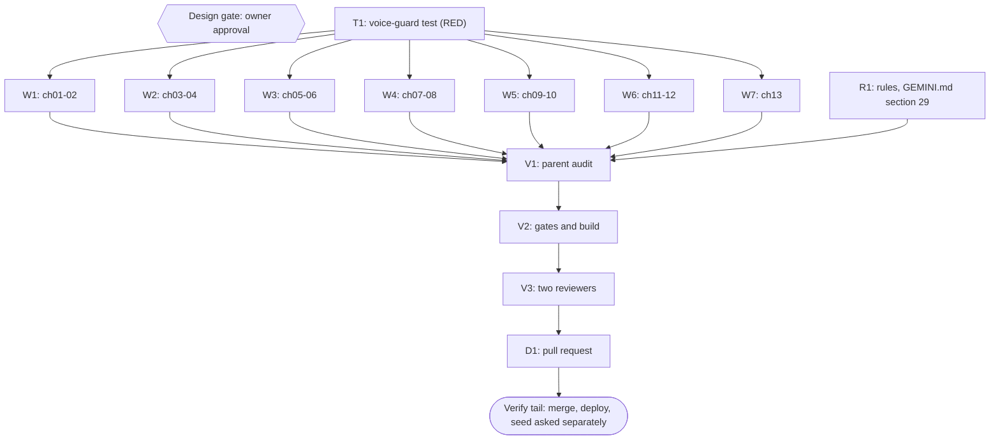

# Plan: rewrite the voice of the Harvest Moon book

Status: Approved
Session: dawnbook-harvest-moon-voice
Branch: 2026-10-24-dawnbook-harvest-moon-voice/dawnbook-harvest-moon-voice
Worktree: /home/belajarcarabelajar/Proyek/dawnbook-wt/dawnbook-harvest-moon-voice
Author: Iwan Kurniawan <iwan@belajarcarabelajar.com>, no trailer (GEMINI.md section 18)
Classification: Bounded. A prose rewrite of 13 existing chapters through the existing gates; no new facts, sources, scripts or layout. A plan file is required because subagents own the chunks.
Trigger: owner feedback 2026-10-24 on the live book (PR #184): the prose reads stiff and AI-like because the sources are served raw ("kayak nyajiin sashimi, harusnya dimasak dulu"). Voice chosen by the owner: "luwes tapi rapi".

## Checklist

- [x] Claim: session claimed, worktree at origin/main f2162b2, `bun install --frozen-lockfile` exit 0, state active.
- [x] Intent: owner named the problem (raw, stiff prose in most of the content) and the voice ("Luwes tapi rapi"). Evidence: AskUserQuestion 2026-10-24 and the owner's follow-up message.
- [x] Rules (R1): owner asked mid-session (2026-10-24) to write the rule down so it never happens again. Evidence: GEMINI.md section 29 'Cooked Prose, Not Raw Sources' with a dispatch contract paragraph (CLAUDE.md and AGENTS.md stay symlinks to it, `ls -l`), MDBOOK_SYSTEM_RULES.md Phase B step 10 points to it; project memory cook-the-sources points to section 29.
- [x] Plan (Design gate): this file validates and the owner approves. Evidence: `ultra-plan-runner` Validation: OK; `plan-sync --project dawnbook` publish exit 0, issue-sync exit 0 (issue #186); AskUserQuestion 2026-10-24: Design = Approve and start.
- [x] Test RED (T1): voice-guard case fails on the current chapters. Evidence: parent added VOICE_CAPS, voiceViolations, a fixture case (raw sample flagged with 4 named violations, cooked sample clean, chapter 01 allowance) and the real-book case; `bun test tests/books/pelajaran-hidup-dari-harvest-moon-back-to-nature.test.ts` exit 1, 12 pass 1 fail, all 13 content chapters listed as violating. Written inline: one file, one step.
- [x] Rewrite (W1-W7): 13 chapters rewritten by 7 subagents, facts kept, voice guard GREEN. Evidence: chef x3, nappy x2, hoggy x2 each rewrote their chapters under the voice contract (pre-rewrite copies kept in scratch); chapter sizes 5.633-6.443 B (83.342 B total for 14 files); voice guard GREEN, `bun test tests/books/pelajaran-hidup-dari-harvest-moon-back-to-nature.test.ts` exit 0 (13 pass, 0 fail) after RED exit 1; scaffold counts across chapters 01-13 before/after: 'Panduan' as a sentence subject 50 to 0, 'Menurut panduan' 27 to 0, 'Kalau dipikir-pikir' 14 to 0, 'mirip dengan' 16 to 0, 'tokoh kita' 51 to 1 (inside a Mermaid accDescr), 'panduan resmi Prima' 24 to 7; Mermaid blocks byte-identical (writers' diffs exit 0); links only removed (AMA in ch01, Econlib in ch06), none added.
- [x] Audit (V1): parent reads every chapter against its pre-rewrite copy. Evidence: parent Read all 13 chapters end to end; 11 single-sentence edits restoring hedges and terms the rewrite had loosened (ch01 'Gim ini mengajarkan' to the guide's advice, 'di samping rumah' to 'tidak jauh dari rumah'; ch02 'seharusnya tetap sehat', 'tampaknya' for Van Dongen's self-ratings, the remedy tied to any heeded warning; ch04 'bisa membuat panen mundur'; ch09 save-game advice without the invented benefit; ch10 'ia marah' instead of an embellished outburst; ch11 'Blue Feather' term in a heading and a sentence, the 'setahap demi setahap' claim removed again); book test exit 0 (13 pass) after the edits.
- [x] Gates (V2): run[] all exit 0. Evidence: `bun test <book test> tests/scripts/check-book-structure.test.ts tests/serp-description.test.ts` exit 0 (61 pass, 0 fail); `bun run scripts/check-book-structure.ts <slug>` exit 0 (14 chapters, 0 problems); `bun run check:headings` exit 0; `bun run scripts/check-repeated-headings.ts` exit 0; `bun run check:diagrams` exit 0; `bun run build` exit 0 with `Successfully built: pelajaran-hidup-dari-harvest-moon-back-to-nature` and SEO R1-R7 passed; chapter metas 113-155 chars.
- [x] Review (V3): two independent reviewers (facts kept, voice); findings fixed. Evidence: 2 staid reviewers, both 'not correct' (14 P1 in total, all facts or superlatives added by the rewrite); 3 fixer subagents on disjoint chapters restored the baseline and fixed the voice P2s; parent read every changed line against the pre-fix copies (no new fact); section 29 and the voice-guard test tightened by the parent, test RED (exit 1, 12 pass 1 fail) then GREEN; final gates: tests exit 0 (61 pass, 0 fail), structure, headings, repeated headings, diagrams exit 0, copy rules exit 0, build exit 0 with SEO R1-R7 passed; report docs/code-plan/artifacts/2026-10-24-dawnbook-harvest-moon-voice-review.md.
- [x] Deliver (D1): commit, PR; merge, deploy and the seed refresh in PR #185 are asked separately. Evidence: commit by Iwan Kurniawan (no trailer, attribution scan exit 1, 18 files staged = 18 committed); PR #187 opened through pr-registry, merged with --match-head-commit (owner approved) as 24331ff; post-merge book test exit 0 (13 pass) and structure checker exit 0 on main; deploy-website.sh exit 0 (deployment 4d30072f, no new-book announcement); migrate-to-d1.ts exit 0; live chapter 01 serves the rewritten text and no 'Menurut panduan'; db/seed.sql committed in PR #185.

## 1. Measured problem (main f2162b2, chapters 01-13)

| Pattern | Count |
|---|---|
| "Panduan ..." as a sentence subject (menyebut, mencatat, menyarankan, menulis, juga, bahkan) | 50 |
| "tokoh kita" | 51 |
| "Menurut panduan" | 27 |
| "panduan resmi Prima" | 24 |
| "mirip dengan" | 16 |
| "Kalau dipikir-pikir" | 14 |
| "tulis panduan" | 8 |

Every chapter also has the same shape: scene, guide facts, one study with stacked caveats, 4-5 recap bullets.

## 2. Visual Implementation Map

## 3. Voice contract (sent in full to every rewriter)

- The chapter is the author's own essay. Choose the two to four game details that carry the lesson, tell them in your own words as things that happen in the game, and leave the rest out. Dropping a fact is allowed; adding one is not.
- Sources: the Prima guide is named once in chapter 01 and in Referensi; elsewhere game facts are simply facts of the game. A study is named once (author and year, one link copied from the existing chapter) and turned into one or two sentences of insight with one compact hedge ("dalam percobaan itu", "pada pesertanya", "baru sebatas keterkaitan").
- No English quotes from the guide. Numbers only when they make the point.
- Banned connectors and scaffolds: "Kalau dipikir-pikir", "Menurut panduan", "Panduan (resmi Prima) menyebut/mencatat/menyarankan/menulis", "tulis panduan", "Perhatikan", "Di situlah letak", "Ada satu detail/catatan". "tokoh kita" at most twice per chapter (use "si petani", "kamu", or the action itself).
- Shape: vary paragraph length and openings; the closing section keeps its title but may be three tight bullets or a short paragraph; the bridge to the next chapter is one natural sentence.
- Kept as they are: the `##` chapter title, the closing section title, every Mermaid block (byte for byte), every link URL that remains, first sentence 110 to 155 characters (test), no em dash, no "Anda", no colon in headings, each chapter 5.500 to 9.000 bytes. `###` headings may be renamed to fit the new text (no colon, not repeated across chapters, at most one connector word per chapter).
- Facts: anything kept must match the current chapter (already reviewed twice) and the notes; hedged findings stay hedged, just compactly.

## 4. Tasks

### Task R1
Write the owner's rule as GEMINI.md section 29 with a dispatch paragraph, and point MDBOOK_SYSTEM_RULES.md Phase B to it. Done first, at the owner's request.

### Task T1
Add a voice-guard case to the book test: per content chapter, 0 "Kalau dipikir-pikir", 0 "Menurut panduan", 0 "tulis panduan", at most 1 "mirip dengan", at most 2 "tokoh kita", and at most 2 occurrences of the word "panduan" (chapter 01 at most 4). Fixture positive and negative controls; RED on the current chapters.

### Task W1
One subagent rewrites chapters 01 and 02 under the voice contract.

### Task W2
One subagent rewrites chapters 03 and 04.

### Task W3
One subagent rewrites chapters 05 and 06.

### Task W4
One subagent rewrites chapters 07 and 08.

### Task W5
One subagent rewrites chapters 09 and 10.

### Task W6
One subagent rewrites chapters 11 and 12.

### Task W7
One subagent rewrites chapter 13.

### Task V1
Parent reads every rewritten chapter against its pre-rewrite copy: no new fact, no changed number, hedges kept, the voice reads as the author's own.

### Task V2
Gates in run[] (Referensi and SUMMARY are unchanged, so the URL allowlist and meta-length cases keep guarding).

### Task V3
Two staid reviewers: (a) fact preservation, old versus new, chapters 01-07 and 08-13 split; (b) both also judge the voice against section 3. Findings fixed, gates re-run, report saved.

### Task D1
Commit as Iwan Kurniawan, PR with Refs to the plan issue. Merge, the production deploy and the D1 seed refresh (pushed to the open PR #185, whose seed would otherwise be stale) are each asked separately.

## Assumptions

- Fan-out is 7 rewriters (two chapters each) rather than 13, to stay under the subagent session limit hit earlier in this session (A16).
- Referensi (14) and SUMMARY.md are not touched.

## Follow-up Backlog

- V-N1 (owner selected 2026-10-24): plan a section 29 voice pass for the six pipeline-written books whose per-chapter scaffold score is highest (soft-power-jepang-lewat-manga-dan-anime 2.8, psikologi-di-balik-keputusan-finansial-kita 2.1, kenapa-kebiasaan-susah-diubah 2.0, pengaruh-uang-terhadap-kebahagiaan 1.6, kenapa-kita-suka-menunda-nunda 1.5, saat-dia-suka-tapi-kamu-tidak 1.3; median of all 60 books 0.25). Planned in docs/code-plan/plans/2026-10-24-dawnbook-voice-pass-six-books.md, Draft, awaiting approval.
- V-L1 A repository-wide voice check (scripts/check-voice.ts) as a build warning. `defer: the six books would fail it today, after the voice pass lands`

## Closeout status

Decision (AskUserQuestion 2026-10-24, Close plan): Keep it open.
- Verdict: `bun ~/vivera/scripts/plan-closeout.mjs --readiness docs/code-plan/plans/2026-10-24-dawnbook-harvest-moon-voice.md` exit 3, NEEDS-HUMAN: 0 open NOW follow-ups, 0 open step boxes, every task UNPROVEN because of the `false` sentinel.
- Done: PR #187 merged (24331ff), deployed (4d30072f), D1 seeded, live text checked.
- Reopen trigger: when the owner has read the live chapters and confirms the voice, mark this plan Complete in the next dawnbook PR.
