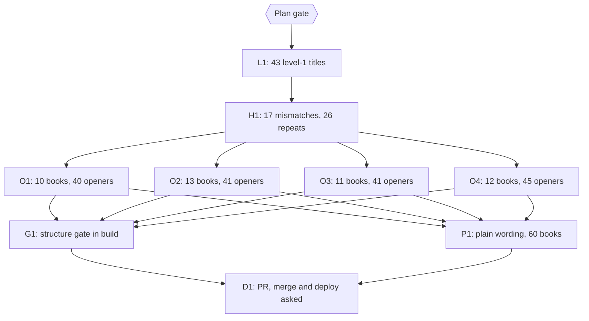

# Plan: make every book pass check-book-structure, then gate the build on it

Status: Approved
Author: Iwan Kurniawan <iwan@belajarcarabelajar.com>, no trailer; commits for books by Kania Salsabila carry her identity and the Iwan co-author trailer (GEMINI.md section 18).
Trigger: `bun run scripts/check-book-structure.ts <slug>` fails on `main` (7d1f7ee) for most books, so it cannot yet be a build gate.

## Checklist

- [x] Measure (2026-10-24, `main` 7d1f7ee): `checkBookStructure` over all 60 books in `books/` (slugs starting with `_` skipped), 764 chapters. 46 books fail, 14 pass. Problems by kind: truncated opener 167 (46 books), level-1 chapter title 43 (8 books), repeated heading 26 (16 books), first heading differs from SUMMARY title 17 (11 books). No em dash, emoji, "Anda", bad link, stray file, SUMMARY/disk or `book.toml` problems. Harness: `$HOME/.cache/tmp/dawnbook-voice-pass/measure-structure.ts`.
- [x] Measure opener lengths: first sentence of the 167 truncated openers is 153 to 284 characters (median 184): 72 at 156-180, 65 at 181-220, 27 at 221-300. Three at 153-154 characters still fail, because each holds straight double quotes: `escapeHtml` turns each into `&quot;`, the escaped meta passes 160, and `siteMeta` falls back to the 145-character cut. Harness: `opener-lengths.ts` in the same folder.
- [x] Plan gate: owner approves this plan. Evidence: AskUserQuestion 2026-10-24: Plan = Approve, start after the crutch-cap PR; Repeats = at most 1 chapter per section heading (pairs fail), as in GEMINI.md section 21.
- [x] L1: 43 level-1 chapter titles become level-2 (`#` to `##` on the first heading line only).
- [x] H1: 17 heading/SUMMARY mismatches and 26 repeated headings resolved, one subagent per book, judgement per case.
- [x] O1-O4: 167 openers whose first sentence survives the meta cut, one subagent per book.
- [x] G1: test-first, `check-book-structure` over all books in `bun run build` and as `bun run check:structure`.
- [x] P1: plain wording instead of inflated metaphors in all 60 books (owner request mid-session), one subagent per book, three reviewers; then the heading pass on all 60 books and the teori-gaya-kelekatan template fix.
- Evidence (2026-10-24, worktree HEAD 456c303, 285 commits, 723 files over origin/main): `bun run scripts/check-book-structure.ts --all` exit 0; `bun run check:voice` exit 0; `bun run scripts/check-heading-colons.ts` exit 0; `bun run scripts/check-repeated-headings.ts` exit 0; `bun run check:diagrams` exit 0; `bun test tests/scripts/ tests/books/` exit 0, 606 pass, 0 fail; `bun run build` exit 0. That build log had 6 mdBook "html parse error" warnings in 3 chapters (algoritma-x 07, human-capital 04, siklus-hidrologi 03), from stray `<` lines that also exist on origin/main.
- Evidence after the debt-sweep follow-ups (2026-10-24, worktree HEAD 9d423186, clean tree): the same seven commands all exit 0 (tests 606 pass, 0 fail), and the build log has 0 "parse error" lines.
- [x] D1: one PR; merge asked alone; deploy, D1 seed and GSC reindex asked separately.
  - Evidence 2026-10-24: PR #202 merged as 3a36aac0; `deploy-website.sh` exit 0 (1056 files, https://9d0b6458.dawnbook.pages.dev); `migrate-to-d1.ts` exit 0 ("All seeds applied successfully"); GSC sitemap PUT 204 at 2026-10-24T05:07:49Z; live logika chapter 1 meta and iklan-digital sidebar title checked.

## Measurement

| Kind | Problems | Books |
|---|---|---|
| Opener's first sentence would be truncated in the meta description | 167 | 46 |
| Chapter title must be a level-2 heading (##) | 43 | 8 |
| Heading repeated in two or more chapters | 26 | 16 |
| First heading differs from SUMMARY title | 17 | 11 |
| Books failing | 46 of 60 | |

Level-1 titles: human-capital-theory 12, metodologi-microteaching 14, strategi-manajemen-kelas-proaktif 12, and one each in analisis-wacana-kritis-awk-dalam-kriminologi, arsitektur-kernel-linux, bias-kognitif, metakognisi, psikologi-positif.

Heading/SUMMARY mismatches (17): arsitektur-kernel-linux 03 and 13, elastisitas-harga-permintaan-dan-penawaran 07, human-capital-theory 11, kecerdasan-interpersonal 10, neuroplastisitas-dalam-belajar 12, piaget 05, 06, 07, 08 and 11, quarter-life-crisis 06 and 09, sejarah-evolusi-drama-korea 06, siklus-hidrologi-mikrofisika-awan 04, sistem-modul-rust 02, state-of-flow 05. Two of them (neuroplastisitas-dalam-belajar 12 "1\. Memahami Anatomi Plateau", piaget 11 "1\. Mengapa Teori Piaget Tidak Selalu Akurat?") have no title heading at all: the first heading is a numbered section.

Repeated headings (26): "kesimpulan" in 10 books, "ringkasan konsep" 3, "ringkasan visual" 2, "ringkasan cepat" 2, plus "aplikasi di dunia nyata", "mengapa ini terjadi?", "skenario di tempat kerja", "praktik terbaik", "ringkasan praktik terbaik", "ringkasan perbandingan", "mengapa peluruhan beta terjadi?" and "2. persamaan reaksi nuklir".

## Waves

Opener waves balance about 42 openers each, alphabetical by slug; books are disjoint between waves.

- O1 (10 books, 40 openers): aerodinamika-dan-desain-airfoil 3, analisis-ekspresif-9-summers-10-autumns 3, analisis-wacana-kritis-awk-dalam-kriminologi 4, arsitektur-kernel-linux 3, bias-kognitif 6, digital-minimalisme 2, ekonomi-laissez-faire 3, eksistensialisme-dan-kehendak-bebas 6, eksistensialisme-dan-makna-hidup 3, elastisitas-harga-permintaan-dan-penawaran 7
- O2 (13 books, 41 openers): fungsi-manajemen-poac 6, gegar-budaya 5, geopolitik-dalam-sejarah-piala-dunia 2, human-capital-theory 3, iklan-digital-dan-penargetan-algoritma 1, kecerdasan-interpersonal 4, kenapa-kita-gampang-percaya-hoax 1, logika-dan-penalaran-kritis 2, matriks-keputusan-decision-matrix 6, mekanisme-koping-dan-manajemen-stres 3, metakognisi 2, metodologi-microteaching 1, multiple-intelligences 5
- O3 (11 books, 41 openers): neurobiologi-motivasi-dopamin 8, neurobiologi-sistem-vestibular 4, neuroplastisitas-dalam-belajar 5, nudge-theory 1, pejorasi-dan-ameliorasi 5, peluruhan-beta 3, pembelajaran-multidisiplin 2, piaget 2, psikologi-bencana-dan-manajemen-panik 4, psikologi-positif 3, quarter-life-crisis 4
- O4 (12 books, 45 openers): relief-karmawibhangga-dan-hukum-sebab-akibat 8, resiliensi-dan-ketangguhan 3, sejarah-evolusi-drama-korea 3, siklus-hidrologi-mikrofisika-awan 8, sistem-modul-rust 3, state-of-flow 4, strategi-manajemen-kelas-proaktif 3, struktur-pasar-dan-persaingan 4, teori-gaya-kelekatan 1, teori-permainan-game-theory 3, teori-teori-kepribadian 3, virtue-ethics-aristoteles 2

## Visual Implementation Map

## Tasks

### Task L1
One subagent, Edit tool per file (section 16 forbids batch scripts on book content, so no sed or loop rewrite even for this exact change). In each of the 43 flagged chapters, change only the first heading line from `# Title` to `## Title`; the title text is untouched, so it stays identical to its SUMMARY entry. Lower headings keep their level (house style already allows `##` sections under a `##` title, as in piaget). Evidence: `git diff --numstat` shows `1 1` for each of the 43 files and nothing else; the run[] check reports 8 books and no level-2 line.

### Task H1
One subagent per book (23 books, disjoint files), each reporting a before/after table for the parent to approve before the next wave starts.

- Mismatch: SUMMARY.md is the fixed side, because it already feeds the live `<title>`, the share card text (section 27) and the Telegram announcement (section 28). Set the chapter's first heading to the SUMMARY title verbatim (for example "Tahap Sensorimotor (Lahir - 2 Tahun)" becomes "Tahap Sensorimotor"). Where the first heading is a numbered section (neuroplastisitas-dalam-belajar 12, piaget 11), insert `## 
` above it and leave the section heading as it is. Never edit SUMMARY.md or `book.toml` (section 1).
- Repeated heading: rename one or both occurrences from the section's own content (sections 21 and 24): closers get distinct titles, topical pairs get their topic ("2. Persamaan Reaksi Nuklir" in the beta-minus and beta-plus chapters names the decay it shows). The dispatch prompt carries the section 24 rules (no colon, no dash or "dan" disguise, connector cap, scaffold-label cap) in its own text.
- Before renaming, `rg` the book for in-page links to the old heading anchor and update them in the same edit.

### Task O1
One subagent per book in wave O1. For every flagged chapter, rewrite only the opener's first sentence so that it survives the cut: split it into two sentences, or drop a clause, and never add a fact, number, name, cause, generalisation or superlative, or strengthen a hedge (section 29 rule 6). Aim for a first sentence of 110 to 155 characters (sections 8 and 24 of GEMINI.md; memory note "openers 110-155"), and at most about 145 when it holds straight quotes or `&`, which `escapeHtml` lengthens. The pass criterion is the checker itself, which uses `formatSerpDescription` and `escapeHtml` from `scripts/inject-gating.ts` exactly as the build does; raw `wc -c` is not the measure. Keep "kamu", no em dash, no emoji, no "Anda"; the chapter must stay under the check-voice caps. One reviewer reads the wave diff for meaning drift. The dispatch prompt carries the section 29 voice paragraph.

### Task O2
Same as O1 for wave O2.

### Task O3
Same as O1 for wave O3.

### Task O4
Same as O1 for wave O4.

### Task G1
Test-first, following the check-voice pattern (`runVoiceGate` in `scripts/build.ts`).
Seams: `runStructureGate(booksDir)` exported from `scripts/check-book-structure.ts` (catches any book with a problem, skips `_` slugs; misses nothing the per-book check finds), its `--all` CLI, the `check:structure` package script, and its call in `scripts/build.ts` before the mdBook builds (asserted by order in `tests/scripts/build.test.ts`, like the voice gate test).
RED: a fixture book with a level-1 title and one with a truncated opener make the gate fail; a clean fixture passes; an `_template`-style slug is skipped. Then implement, then run the whole run[] list. Add one line to GEMINI.md (section 8 or 24) naming the gate and its rule ids, with a revert line.

### Task P1
Added mid-session at the owner's request (2026-10-24): "\"tarian biologis\" hal2 semacam ini jelek dalam kepenulisan karena hiperbola seolah bukan ditulis manusia, cek yg serupa dan parafrasa dalam PR yg sama ini". One subagent per book, all 60 books, each reading every content chapter (Referensi skipped) and replacing decorative, inflated figures with plain wording: "tarian/simfoni/orkestra" for ordinary mechanisms, "keajaiban", "revolusioner", "mahakarya", "jantung dari", "bahan bakar", "pilar", "jembatan emas", "badai kehidupan", empty "sangat/luar biasa/krusial", and grand framing ("Selamat datang di jantung ..."). Literal uses (vortex "pusaran", weather "badai", the reliefs' "surga/neraka"), teaching analogies that carry the explanation, quotes, headings, tables, math, Mermaid and links stay. Rewriting never adds a fact or changes a hedge (section 29 rule 6); a replaced first sentence stays within 155 characters and never becomes a stock frame ("Bab ini membahas"). Guard: `hyperbole-guard.py` (only prose paragraphs change, paragraph count and links fixed, no em dash or "Anda"), plus `check-book-structure`, `check-voice` and the book test per book, then one commit per book with its author identity. Three read-only reviewers read every book's word-diff for added content, meaning drift and broken sentences.

Heading pass (owner answer 2026-10-24, Headings = "Fix in this PR"): one subagent per book, all 60 books, contract `heading-contract.md` in the session scratch dir. Only heading lines, bold-only sub-titles, table rows and SUMMARY entries change; a renamed chapter title changes in its file and SUMMARY together. Same rules as above plus section 24: no colon or disguised two-part title, at most 2 headings per book start with one generic label (Ringkasan, Analogi, Skenario, Studi Kasus, Kesimpulan, Aplikasi Dunia Nyata), no heading text in two chapters. Guard: `heading-guard.py` (only those line kinds change, line count, link targets and table cell count fixed), then `check-book-structure`, `check-heading-colons`, `check-repeated-headings`, `check-voice` and the book test before each per-book commit. File names stay (renaming would change live URLs).

Template fix (owner answer 2026-10-24, Repeat = "Rewrite in this PR"): teori-gaya-kelekatan carried the same "relasi bermakna" closing block (four pillars, Brené Brown quote, Kedalaman Relasi formula, action list) in all 12 chapters. It now stays only in chapter 12 (formula moved to a protected display block); chapters 04 and 09 got one tie-in sentence drawn from their own text, the rest end on their own closers.

Small fixes found on the way, one commit each: an English "or" in bias-kognitif 01, "Imans" spelled "Imanensi" in eksistensialisme-dan-makna-hidup 10, "dipertahaman" in pembelajaran-multidisiplin 02, and "Air Superdingin (Supercooled Water)" restored in siklus-hidrologi 08.

Follow-ups chosen by the owner at the debt sweep (2026-10-24, before merge), one commit per book:
- the 11 "Rangkuman & Pertanyaan Refleksi N" closers in sistem-pengendalian-topik now have distinct titles;
- body text that still echoed renamed titles was rewritten (neuroplastisitas 09 "Jembatan Sains"; iklan-digital 02-03 fuel image);
- elastisitas keeps the rubber-band analogy in chapter 01 only, and chapters 02, 04 and 07 refer back to it under their own headings;
- 20 jargon-heavy headings in eksistensialisme-dan-kehendak-bebas were reworded;
- `<` became `\lt` in the math of 3 chapters, which removed the 6 mdBook "html parse error" warnings;
- two italic taglines under drama headings in sejarah-evolusi-drama-korea 07 were dropped;
- "Selamat datang" frames were removed in 24 books (only a Rust string literal remains), and the 6 stock "Selamat! Kamu telah ..." lines were rewritten (only a quoted dialogue line remains).

### Task D1
One PR through pr-registry. Merge asked alone. Deploy, the Phase F D1 seed (`content_md` changed) and the GSC reindex (meta descriptions changed on 167 pages) are each asked separately.

## Assumptions and risks

- Repeated-heading threshold: `check-book-structure` flags a heading in 2 chapters, while `check-repeated-headings` (section 24) starts at 3 "so a coincidental pair does not break the build". Gating the build on this checker makes 2 the effective threshold. Question for the owner, options: (a) keep 2, matching section 21, and record it in GEMINI.md in G1; (b) gate the build only on the other rules and leave repeats at 3. The plan assumes (a); H1 is needed either way for the pairs that are non-topical closers.
- Opener rewrites change 167 meta descriptions; Google may rewrite snippets anyway. Reindex happens after deploy (D1).
- A split sentence can lose rhythm; the reviewer checks voice (section 29) as well as meaning. Facts may be dropped, never added.
- `leadText` only reads `
` paragraphs; if an opener is a list, quote or table, the meta draws from the next paragraph. Subagents edit the paragraph the checker reports, verified by re-running the checker, not by guessing.
- Books by Kania Salsabila need her commit identity and the Iwan trailer; the parent checks `git log --format=%an -- books/<slug>` per book before committing.
- Concurrency: L1, H1 and the waves touch the same files in some books (for example bias-kognitif in all three), so they run in sequence; within a wave, books are disjoint.
- Rollback: revert the PR; L1, H1, each wave and G1 are separate commits.

## Closeout status

- 2026-10-24: readiness `NEEDS-HUMAN` (exit 3); every task lacks a `skip_if` proof and the only open box is D1 (merge, deploy, D1 seed, GSC reindex).
- Owner decision 2026-10-24 (Close plan gate): keep it open. Reopen the question after PR #202 is merged, deployed with the D1 seed, and the GSC sitemap reindex has returned 204.
- 2026-10-24, after the deploy: `bun scripts/plan-closeout.mjs --readiness` still `NEEDS-HUMAN` (exit 3): 0 open step boxes, 0 open NOW follow-ups, every task `UNPROVEN` (no `skip_if` proof). The reopen trigger is met (merge 3a36aac0, deploy exit 0, D1 seed exit 0, GSC 204), and the owner asked to finish the plan, so it is marked `Complete` on that human evidence.
