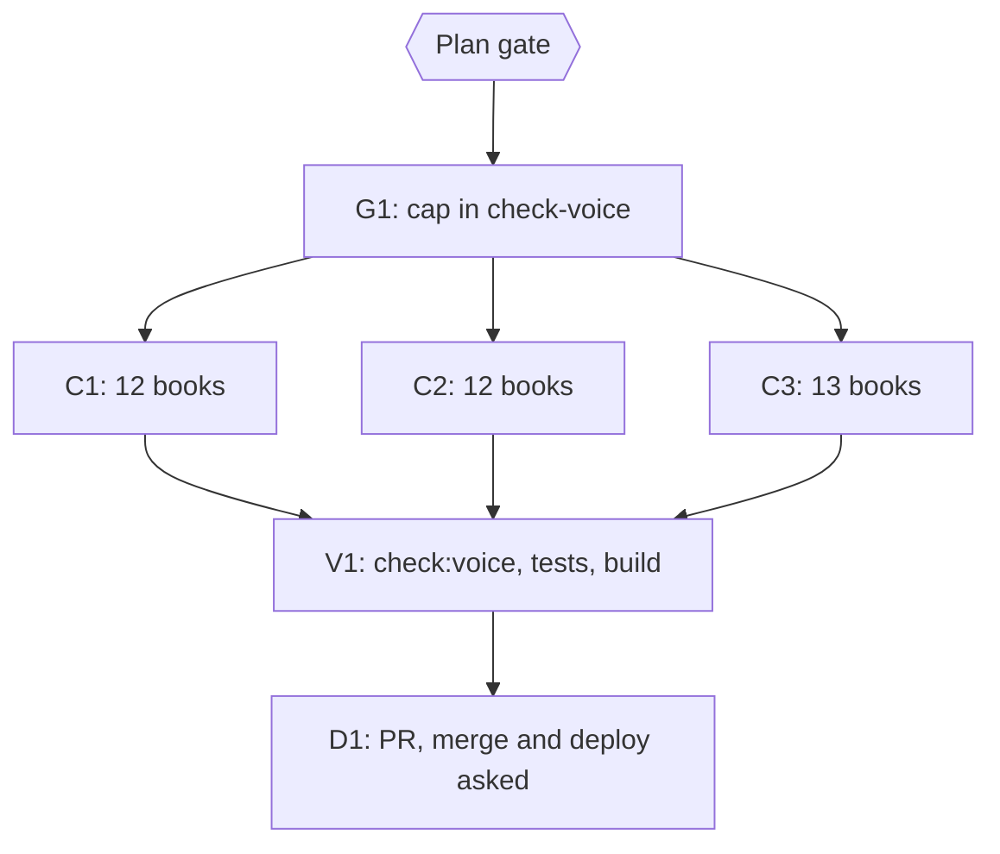

# Plan: crutch-word cap of 4 per chapter, and fixing the chapters over it

Status: Approved
Author: Iwan Kurniawan <iwan@belajarcarabelajar.com>, no trailer; commits for books by Kania Salsabila carry her identity and the Iwan co-author trailer (GEMINI.md section 18).
Trigger: owner follow-up choices on plan 2026-10-24-dawnbook-voice-scaffold-48-books (2026-10-24): "Crutch-word cap" with "Hard cap 4 + fix 116", and "Measure near-miss scaffolds".

## Checklist

- [x] Measure: crutch words tetap/pun/bahkan/justru per chapter over 711 chapters (fences and Referensi skipped). Raw count: 116 chapters over 4 in 41 books. Excluding indefinite compounds ("apa/siapa/mana/berapa/seberapa/kapan/bagaimana pun") and technical "X tetap" (biaya, aset, pegawai, karyawan, harga, bunga, titik, pengeluaran, pendapatan, penghasilan, gaji, tarif, kurs, sudut, kecepatan, laju, modal, kontrak): 85 chapters in 37 books.
- [x] Measure near-miss scaffolds (report 2026-10-24, 711 chapters): "Kalau/Jika diperhatikan" 1 hit; "Menuju ..." bridge headings 4; chapter announcements ("Pada bab ini", "Bab ini akan", "Dalam bab ini") 33 hits in 29 chapters, max 2 per chapter; "Bayangkan", "Mari kita", "Inilah/Itulah/Di sinilah", "Selain itu", "Sebagai contoh" are ordinary connectors (median 1 per chapter) and stay uncapped.
- [x] Plan gate: owner approves this plan. Evidence: AskUserQuestion 2026-10-24: Plan = Approve and start now; Near-miss = Yes, add all three.
- [x] G1: test-first, add to `scripts/check-voice.ts` a crutch-word cap of 4 per chapter with the two exclusions above, plus the near-miss caps if approved ("Kalau/Jika diperhatikan" 0, headings starting "Menuju " 0, chapter announcements at most 2). Evidence: 5 new tests RED, then exit 0; positive controls: without the fence rule or without the exclusions the same text gives "crutch words x5 (max 4)". After G1, `bun run check:voice` reports 85 crutch, 4 bridge-heading and 1 diperhatikan hits in 39 books (announcements 0).
- [x] C1-C3: one subagent per book; each cuts crutch words only where they are not idiomatic, never changing meaning or adding a fact; scope guard and check-voice per book; one reviewer per wave. Evidence 2026-10-24: 39 books, one subagent each in three waves; parent re-check per book (check-voice exit 0, crutch guard exit 0, structure output identical to its baseline) before its own commit; three reviewers, no P1, P2s applied in per-book review commits. Checker exclusions added on the way, test-first and mutation-proven: "pola pikir tetap", link targets.
- [x] V1: `bun run check:voice` exit 0 over all 60 books (the build gate), book tests and build exit 0. Evidence: `bun run check:voice` exit 0 (60 books, 0 problems); `bun test tests/books/ tests/scripts/check-voice.test.ts tests/scripts/build.test.ts` exit 0 (89 pass); `bun run build` exit 0 with the voice gate and SEO R1-R7.
- [x] D1: one PR; merge asked alone; deploy, D1 seed and GSC reindex asked separately. Evidence: PR #201 merged (owner answer "Merge"), then #199; deploy of `main` 9217304 on 2026-10-24 (owner answer "Deploy, seed, reindex"): `deploy-website.sh` exit 0, log shows "Checking chapter voice..." and "Deployment complete"; `migrate-to-d1.ts` exit 0 ("All seeds applied successfully", no error lines); GSC sitemap PUT HTTP 204, `lastSubmitted` 2026-10-24T03:52:15Z; live check of `/books/<slug>/content/01_*` for nudge-theory, neurobiologi-sistem-vestibular and pelajaran-hidup-dari-harvest-moon-back-to-nature found the new crutch-pass sentence on each page. Recorded in the next session's PR (structure fixes) because the evidence is post-merge.

## Waves

- C1 (12 books): pelajaran-hidup-dari-harvest-moon-back-to-nature, resiliensi-dan-ketangguhan, filosofi-stoikisme, teori-gaya-kelekatan, nudge-theory, eksistensialisme-dan-makna-hidup, sistem-peringatan-dini-early-warning-system, siklus-hidrologi-mikrofisika-awan, piaget, menemukan-tujuan-hidup-ikigai, gegar-budaya, aerodinamika-dan-desain-airfoil
- C2 (12 books): pengaruh-uang-terhadap-kebahagiaan, elastisitas-harga-permintaan-dan-penawaran, strategi-manajemen-kelas-proaktif, neurobiologi-sistem-vestibular, tonsilektomi, struktur-pasar-dan-persaingan, kenapa-kita-suka-menunda-nunda, bias-kognitif, quarter-life-crisis, neurobiologi-motivasi-dopamin, mekanisme-koping-dan-manajemen-stres, fungsi-manajemen-poac
- C3 (13 books): kenapa-kita-gampang-percaya-hoax, memahami-algoritma-x-untuk-pembaca, teori-permainan-game-theory, psikologi-di-balik-keputusan-finansial-kita, ekonomi-laissez-faire, peluruhan-beta, kenapa-kebiasaan-susah-diubah, state-of-flow, sistem-modul-rust, psikologi-positif, metakognisi, logika-dan-penalaran-kritis, arsitektur-kernel-linux

## Visual Implementation Map

## Tasks

### Task G1
Cap and exclusions in `scripts/check-voice.ts`, failing tests first; the build gate then fails until C1-C3 land, so all of it ships in one PR.

### Task C1
One subagent per book in wave 1; scope: only paragraphs holding a counted crutch word; reviewer reads the wave diff.

### Task C2
Same as C1 for wave 2.

### Task C3
Same as C1 for wave 3.

### Task V1
Gates in run[].

### Task D1
One PR through pr-registry; merge, deploy, D1 seed and GSC asked separately.

## Assumptions and risks

- The cap counts words, not meaning: a writer may cut a "pun" that carries emphasis. Reviewers check that no hedge or nuance is lost.
- Exclusions are a fixed list; a technical term missing from it shows up as a cap hit and is added to the list with a test, never rewritten.
- Rollback: revert the PR; the cap and the text changes are separate commits.
