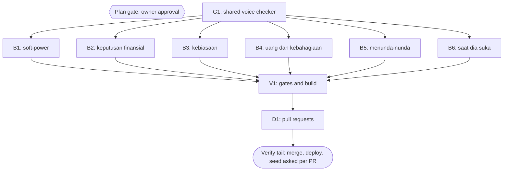

# Plan: section 29 voice pass for six pipeline-written books

Status: Draft (plan only; no book text changes until the owner approves)
Author: Iwan Kurniawan <iwan@belajarcarabelajar.com>, no trailer
Classification: Architectural by size (about 70 chapters in six books plus a shared checker), Bounded in kind (the same flow as plan 2026-10-24-dawnbook-harvest-moon-voice).
Trigger: the same-class sweep after the Harvest Moon voice fix (owner selected follow-up V-N1, 2026-10-24).

## Checklist

- [x] Measure: per-chapter scaffold score for all 60 books (patterns: "Kalau dipikir-pikir", "menurut studi/penelitian/riset/data/laporan/survei", a study or report as the subject of "menunjukkan/menemukan/mencatat/menyebut", "bab berikutnya", "Menariknya", "Perhatikan"). Evidence: one-off scan 2026-10-24, median 0.25 per chapter; the six books below score 1.3 to 2.8.
- [ ] Plan gate: owner approves this plan (one PR per book, or one PR for all six).
- [ ] G1: shared checker `scripts/check-voice.ts` with tests (RED first), caps from GEMINI.md section 29.
- [ ] B1-B6: one book per task; each fans out to chapter rewriters under the section 29 dispatch paragraph and the rewriting-never-adds rule, then a parent audit and two reviewers (facts old versus new, and voice).
- [ ] V1: gates and build.
- [ ] D1: PRs; merge, deploy and D1 seed asked separately per PR.

## 1. Books in scope

| Task | Book | Content chapters | Score per chapter | Dominant pattern |
|---|---|---|---|---|
| B1 | soft-power-jepang-lewat-manga-dan-anime | 12 | 2.8 | "menurut ..." 18, "bab berikutnya" 10 |
| B2 | psikologi-di-balik-keputusan-finansial-kita | 12 | 2.1 | "bab berikutnya" 16, "Perhatikan" 9 |
| B3 | kenapa-kebiasaan-susah-diubah | 11 | 2.0 | "bab berikutnya" 16 |
| B4 | pengaruh-uang-terhadap-kebahagiaan | 11 | 1.6 | "bab berikutnya" 10 |
| B5 | kenapa-kita-suka-menunda-nunda | 11 | 1.5 | "bab berikutnya" 11 |
| B6 | saat-dia-suka-tapi-kamu-tidak | 12 | 1.3 | mixed |

The scan counts surface scaffolds only. Each book is also read by the parent before its rewrite starts, and a book that already reads as the author's own essay gets a light pass (bridges and stock connectors only) instead of a full rewrite. That decision is recorded per book.

## 2. Visual Implementation Map

## 3. Tasks

### Task G1
Move the Harvest Moon book test's caps into `scripts/check-voice.ts` (CLI: one slug or all books, exit 1 on a violation, report counts per chapter) with `tests/scripts/check-voice.test.ts` (fixture positive and negative controls for every cap; RED before the script exists). The Harvest Moon test then imports it. Not wired into `bun run build` until every book passes (backlog V-L1 of plan 2026-10-24-dawnbook-harvest-moon-voice).

### Task B1
Voice pass for soft-power-jepang-lewat-manga-dan-anime: parent read, rewrite decision, chapter rewriters, parent audit against the pre-rewrite copy, two reviewers, `bun run scripts/check-voice.ts <slug>` exit 0, book test exit 0.

### Task B2
Same as B1 for psikologi-di-balik-keputusan-finansial-kita.

### Task B3
Same as B1 for kenapa-kebiasaan-susah-diubah.

### Task B4
Same as B1 for pengaruh-uang-terhadap-kebahagiaan.

### Task B5
Same as B1 for kenapa-kita-suka-menunda-nunda.

### Task B6
Same as B1 for saat-dia-suka-tapi-kamu-tidak (author Kania Salsabila: commits follow GEMINI.md section 18, Kania as author with the Iwan co-author trailer).

### Task V1
Gates in run[].

### Task D1
PRs through pr-registry; merge, deploy, D1 seed and GSC asked separately.

## Assumptions and risks

- Fan-out stays at about 7 subagents at a time; a subagent session limit was hit once on 2026-10-23.
- Rewrites may drop facts but never add them (GEMINI.md section 29 rule 6); the parent audit and reviewers compare old and new text.
- Rollback per book: revert that book's PR.
