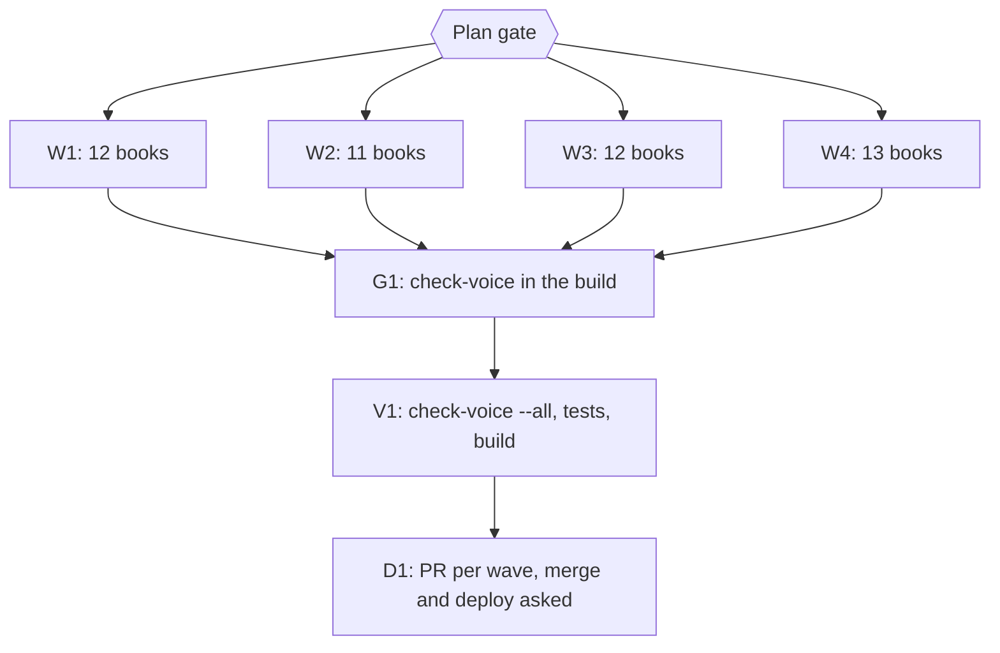

# Plan: scaffold-only voice pass for the 48 books that fail check-voice

Status: Approved
Author: Iwan Kurniawan <iwan@belajarcarabelajar.com>, no trailer; commits for the 8 books by Kania Salsabila carry her identity and the Iwan co-author trailer (GEMINI.md section 18).
Trigger: owner request 2026-10-24 ("48 dari 60 buku yang masih gagal perbaiki pakai subagents masing2"), after plan 2026-10-24-dawnbook-voice-pass-six-books.

## Checklist

- [x] Measure: `bun run scripts/check-voice.ts --all` on main b39e880 exits 1; 48 books, 141 chapters fail: stock connector 139 hits in 114 chapters, "bab berikutnya" 23 in 23, "mirip dengan" over the cap in 4. No hit sits in a Mermaid block or a heading.
- [x] Plan gate: owner approves this plan. Evidence: AskUserQuestion 2026-10-24: Plan = Approve and start now; PR grouping = One PR for all 48 (one commit per book); Build gate = Yes, add to build.
- [x] W1-W4: one subagent per book; each rewrites only the sentences that hold a flagged phrase (GEMINI.md section 29), never adds a fact; scope guard and check-voice exit 0 per book; one independent reviewer per wave. Evidence 2026-10-24: 48 subagents (one per book), every book re-checked by the parent (check-voice exit 0, scope guard exit 0, structure output identical to its main baseline) before its own commit; reviewers per wave: W1 4 P2, W2 correct, W3 1 P1 + 8 P2, W4 2 P2, all applied in per-book review commits. One verbatim transcript line keeps "perhatikan" with a voice-ok marker.
- [x] G1: `check:voice` script (`bun run scripts/check-voice.ts --all`) in package.json and as a step of `bun run build`, test-first, once all 60 books pass. Evidence: tests RED first (runVoiceGate, build order, check:voice script, voice-ok marker), then `bun test tests/scripts/check-voice.test.ts tests/scripts/build.test.ts` exit 0; `bun run build` prints "Checking chapter voice..." before the mdBook builds.
- [x] V1: `check-voice --all` exit 0 over all 60 books, book tests and build exit 0. Evidence: `bun run scripts/check-voice.ts --all` exit 0, 60 books with 0 problems; `bun test tests/books/ tests/scripts/check-voice.test.ts tests/scripts/build.test.ts` exit 0 (81 pass); `bun run build` exit 0 with SEO R1-R7 passed.
- [ ] D1: one PR for all 48 books (one commit per book), merge asked alone; one deploy, D1 seed and GSC reindex at the end, asked separately.

## 1. Scope (scaffold-only, not a light pass)

A subagent changes only paragraphs that contain a flagged phrase, and inside them only what is needed to remove the phrase: "Perhatikan"/"perhatikan(lah)" (any use), "Di situlah letak(nya)", "Menariknya", "Ada satu detail/catatan", "Kalau dipikir-pikir", "Menurut panduan", "tulis panduan", every "bab berikutnya" (also "bab-bab berikutnya"), and "mirip dengan" beyond one per chapter. A closing "bab berikutnya" bridge becomes one short sentence that does not announce the next chapter, or is deleted when the chapter already has another bridge. Facts, numbers, names, links, hedges, headings, Mermaid blocks and every other paragraph stay byte for byte. When the first sentence changes, the chapter meta description must stay 110 to 155 characters.

Mechanical guard (outside the repo, proven red and green on a fixture): `python3 -I ~/.cache/tmp/dawnbook-voice-pass/scope-guard.py <worktree> <slug>` exits 1 when an unflagged paragraph changes, a paragraph is inserted, the URL set or a Mermaid block changes, or a flagged phrase remains.

## 2. Waves

- W1 (12 books): analisis-wacana-kritis-awk-dalam-kriminologi, elastisitas-harga-permintaan-dan-penawaran, mekanisme-koping-dan-manajemen-stres, psikologi-positif, eksistensialisme-dan-makna-hidup, neuroplastisitas-dalam-belajar, arsitektur-kernel-linux, human-capital-theory, resiliensi-dan-ketangguhan, teori-permainan-game-theory, peluruhan-beta, virtue-ethics-aristoteles
- W2 (11 books): kenapa-kita-gampang-percaya-hoax, gegar-budaya, memahami-algoritma-x-untuk-pembaca, relief-karmawibhangga-dan-hukum-sebab-akibat, fungsi-manajemen-poac, nudge-theory, bias-kognitif, iklan-digital-dan-penargetan-algoritma, sejarah-evolusi-drama-korea, teori-teori-kepribadian, pembelajaran-multidisiplin
- W3 (12 books): analisis-ekspresif-9-summers-10-autumns, teori-gaya-kelekatan, menemukan-tujuan-hidup-ikigai, sistem-modul-rust, matriks-keputusan-decision-matrix, struktur-pasar-dan-persaingan, eksistensialisme-dan-kehendak-bebas, kecerdasan-interpersonal, siklus-hidrologi-mikrofisika-awan, ekonomi-laissez-faire, metodologi-microteaching, piaget
- W4 (13 books): psikologi-bencana-dan-manajemen-panik, sistem-pengendalian-topik-dalam-wacana-pedagogi-di-sekolah-dasar, logika-dan-penalaran-kritis, pejorasi-dan-ameliorasi, digital-minimalisme, multiple-intelligences, aerodinamika-dan-desain-airfoil, geopolitik-dalam-sejarah-piala-dunia, metakognisi, sistem-peringatan-dini-early-warning-system, literasi-keuangan, neurobiologi-motivasi-dopamin, tonsilektomi

## 3. Visual Implementation Map

## 4. Tasks

### Task W1
One subagent per book in wave 1, about 12 in flight; parent runs the scope guard and check-voice per book, then one reviewer reads the wave diff (old vs new sentences only).

### Task W2
Same as W1 for wave 2.

### Task W3
Same as W1 for wave 3.

### Task W4
Same as W1 for wave 4.

### Task G1
Add `check:voice` to package.json and a check-voice step to `scripts/build.ts`, with a failing test first, only after W1-W4 make all 60 books pass.

### Task V1
Gates in run[].

### Task D1
One PR for all 48 books through pr-registry, one commit per book; merge, deploy, D1 seed and GSC asked separately.

## Assumptions and risks

- The checker caps any use of "perhatikan", so a legitimate verb is also rewritten (to "cermati", "lihat", "amati"); this is accepted, it is the rule in section 29.
- Session limits: if a subagent dies with 429, dispatch stops (A16) and the rest is finished inline or after the reset.
- Rollback: each wave is its own PR and each book its own commit; revert the commit of a book.
