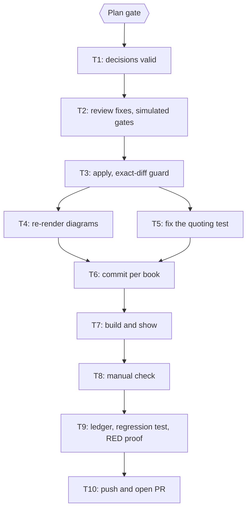

# Plan: apply the fixable findings of the 2026-10-24 batch audit

Status: Approved (Plan gate answered Approve and execute, 2026-10-25; Intent, Section and Spec gates earlier the same day)
Mode: test-later
Author: Iwan Kurniawan <iwan@belajarcarabelajar.com>, no trailer. Books whose `book.toml` names Kania Salsabila (psikologi-di-balik-keputusan-finansial-kita, kenapa-kebiasaan-susah-diubah, sistem-pengendalian-topik-dalam-wacana-pedagogi-di-sekolah-dasar and any other the file names) are committed with her identity and the `Co-authored-by: Iwan Kurniawan` trailer (GEMINI.md section 18).
Spec: `docs/code-plan/specs/2026-10-25-dawnbook-audit-fixes-design.md` (approved 2026-10-25).
Trigger: owner request 2026-10-25, "memperbaiki yang bisa diperbaiki berdasarkan hasil temuannya, mode cepat saja test diakhir".
Scope: the 4,170 findings of `docs/audits/2026-10-24-batch-naskah/`; 60 books; one stacked pull request (base: the audit archive branch of PR #212).
Non-Goals: merge, deploy, D1 seed (`db/seed.sql` embeds chapter text and stays stale until a deploy seeds it), Search Console, math fixes, code-fence edits, glossary-wide term choices, citation corrections that no record proves, new content. The DOI repair already has its own backlog entry in `2026-10-25-dawnbook-later-backlog.md`.

## Manual check

Filled at the `Manual check` gate: each note the owner makes about the shown chapters becomes `MC1`, `MC2`, ... in the owner's words, and `T9` writes one test per item.

## Checklist

- [x] T1: all 40 units have a valid decision file for every book. Evidence: `validate_all.py` exit 0, 60 books, 4,170 decisions, 3,728 edits, 0 problems (after the last unit, U38, reported).
- [ ] T2: reviewer problems resolved in the decision files (P1 and P2 fixed or the edit rejected), and the repository gates pass on the simulated tree. Evidence: reviewer reports, `sim_gates.sh` exit 0.
- [ ] T3: the same triage agents apply their decisions with the Edit tool; the exact-diff guard finds the worktree equal to the prediction. Evidence: `verify_applied.py` exit 0.
- [ ] T4: Mermaid text that changed is re-rendered; the diagram gate passes. Evidence: `check:diagrams` exit 0.
- [ ] T5: the neuroplastisitas test finds its renamed heading. Evidence: `bun test` exit 0.
- [ ] T6: one commit per book, author from `book.toml`; tree clean.
- [ ] T7: build and gates on the final tree; sample before and after pairs shown to the owner.
- [ ] T8: owner manual check; notes recorded as MC items.
- [ ] T9: ledger, regression test, RED proof against the base commit. Evidence: test exit 0 at HEAD and exit non-zero at the base.
- [ ] T10: branch pushed, one pull request opened; merge, deploy, seed and reindex asked separately.

## Visual Implementation Map

## Tasks

### Task T1
Fresh run of `validate_all.py`: every decision file complete (one line per finding), every edit's `old` unique, no rule break. Triage itself (40 read-only units, 4,170 decisions, 3,728 edits) is already done and recorded in the scratch decision files.

### Task T2
Independent reviewers read the flagged decisions (adapted language, facts with outside evidence, headings, citations, removed hedges, added numbers, diagram edits) as old and new pairs and report P1, P2 and P3 problems; each P1 and P2 is fixed in the decision file by editing the line or turning it into `reject` or `backlog`. Then `sim_gates.sh` applies all valid decisions to a scratch copy and runs `check-book-structure`, `check-voice`, `check-repeated-headings` and `check-heading-colons` on it.

### Task T3
The session worktree is `~/Proyek/dawnbook-wt/audit-fixes` (branch `2026-10-25-dawnbook-audit-fixes/audit-fixes`, on top of the audit archive branch). Each triage agent applies its own `apply` and `adapt` lines in file order with the Edit tool only (GEMINI.md section 16), in the worktree, nothing else. The parent never stages or commits during this task. `verify_applied.py` compares every file with the prediction and lists any unexpected change.

### Task T4
`bun run diagrams:render` renders only the diagrams whose text changed (local Chromium; check `free -m` first), `bun run check:diagrams` must exit 0. Orphaned SVGs are pruned only with the owner's say in the PR.

### Task T5
The test `tests/books/neuroplastisitas-dalam-belajar.test.ts` finds a section with `indexOf("### Studi Supir Taksi London")`; the decision that renames that heading ("Sopir") fails 3 of its 4 tests, so the string changes in this task, in the same commit series.

### Task T6
One commit per book, `books/<slug>/src` plus `books/<slug>/diagrams` where changed, author from the book's `authors`, message `content(books): apply the audit fixes to <slug>`. No co-author trailer except for Kania Salsabila's books.

### Task T7
`check:structure`, `check:headings`, `check:voice`, then `bun run build` on the final tree; a tracked file the build rewrites (`functions/lib/built-stats.ts`, `db/seed.sql`) is restored. The owner is shown ten to fifteen before and after pairs and the gate outputs, not only the commands.

### Task T8
`Manual check` gate (`sucp-tdd-debug` 4.2). Every note becomes an MC item in the owner's words; a wrong result loops back to T3 for the affected book.

### Task T9
Tests from the notes: the ledger (`ledger.jsonl`, one line per finding with its outcome, and `LEDGER.md` with counts and the backlog), the data-driven regression test (an applied `old` string must not come back), and the RED proof: the test runs in a detached scratch worktree at the base commit and must fail there, then pass at HEAD.

### Task T10
Push with an explicit refspec (the local branch tracks nothing), open one PR with base `2026-10-25-dawnbook-batch-audit-archive` (stacked on PR #212), record it with `pr-registry pr`. Merge is asked alone; deploy, D1 seed and Search Console reindex are asked separately.

## Backlog (LATER)

Decisions marked `backlog` in the ledger: glossary-wide choices (for example "namun" or "tetapi", "Sistem 2" or "System 2"), claims that need a source, formulas, code fences, and the observations in the session notes. The DOI findings that agents noticed outside the audit belong to the existing DOI-repair backlog entry.
