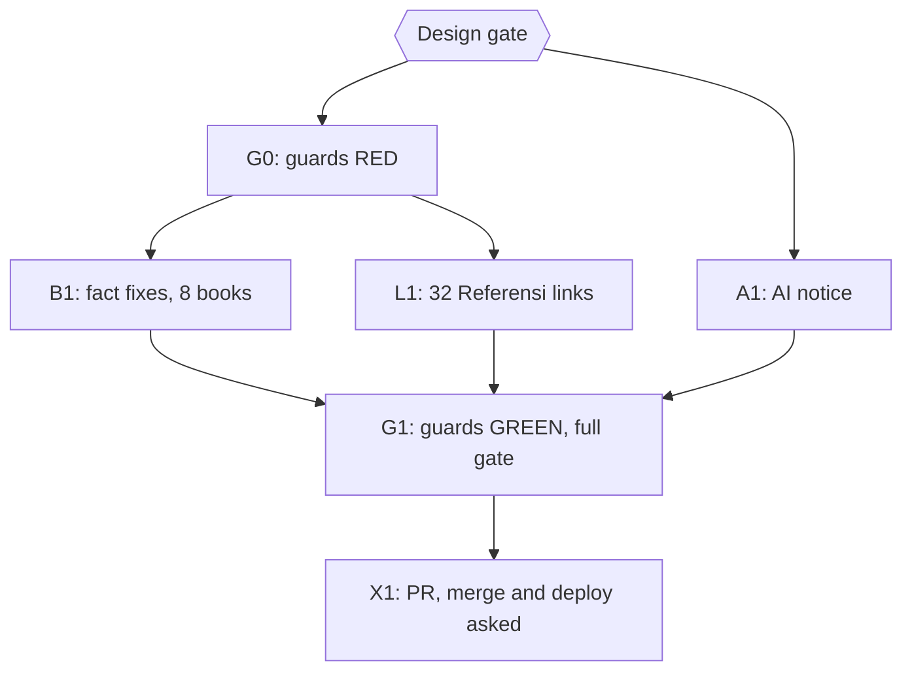

# Plan: close the LATER backlog of the attribution and quote audits

Status: Approved
Author: Iwan Kurniawan <iwan@belajarcarabelajar.com>, no trailer. sistem-pengendalian-topik-dalam-wacana-pedagogi-di-sekolah-dasar is by Kania Salsabila: committed with her identity and the `Co-authored-by: Iwan Kurniawan` trailer (GEMINI.md section 18).
Trigger: owner request 2026-10-25 to check the "UNESCO menekankan" line (sistem-peringatan-dini 10:58) and the eight remaining LATER items of `2026-10-24-dawnbook-attribution-fixes` (items 1-7 and 9). Read-only audit: `docs/code-plan/artifacts/2026-10-25-dawnbook-later-audit.md`.

## Checklist

- [x] Design gate. Evidence: AskUserQuestion 2026-10-25: `Design` = Approve; `Referensi` = link all 32 + guard; `AI notice` = one line on About page (and README).
- [ ] G0: guard rules RED on main.
- [ ] B1: fact fixes in 8 books, one subagent per book (inline for the two one-line books), one commit per book; independent review.
- [ ] L1: verified links for the 32 citations without one (7 books); no archive.org/details links.
- [ ] A1: AI-assistance notice on the About page and in the README.
- [ ] G1: guards GREEN; `bun test tests/scripts/ tests/books/` and `bun run build` exit 0.
- [ ] X1: one PR; merge asked alone; deploy, D1 seed and GSC reindex asked separately.

## Visual Implementation Map

## Tasks

### Task G0
Rules added to `known-misattributions.test.ts`: UNESCO with "umpan balik komunitas"; "23 menit" with recovering concentration or focus; "10 poin" IQ with context switching; an error ("kesalahan") paired with epinephrine release; object permanence at "8-9 bulan"; TLO "di atas 75"; "Nah / Jadi" as a summary marker. `referensi-presence.test.ts` gains a check that every citation item (a list item with a year in parentheses) in a Referensi chapter holds a link.

### Task B1
Contract: correct to what the verified source says, hedge, or drop; never add a fact, number, name, cause or superlative (GEMINI.md section 29); a source is named once only where its claim stays, and then listed in Referensi with a DOI or publisher/official link, never archive.org/details. Findings per line: the audit artifact.

### Task L1
Each of the 32 entries gets a verified publisher, DOI, ERIC or library-catalogue link to the exact edition cited; entries that cannot be verified are reported, not guessed.

### Task A1
One sentence on the About page (id and en) and in the README: the books are written with AI assistance and edited by the author.

### Task G1
Fresh run of the guards, the book checks, `bun test tests/scripts/ tests/books/` and `bun run build` on a clean tree.

### Task X1
One PR through `pr-registry open`; merge asked alone with `--match-head-commit`; deploy, D1 seed and GSC reindex asked separately.
