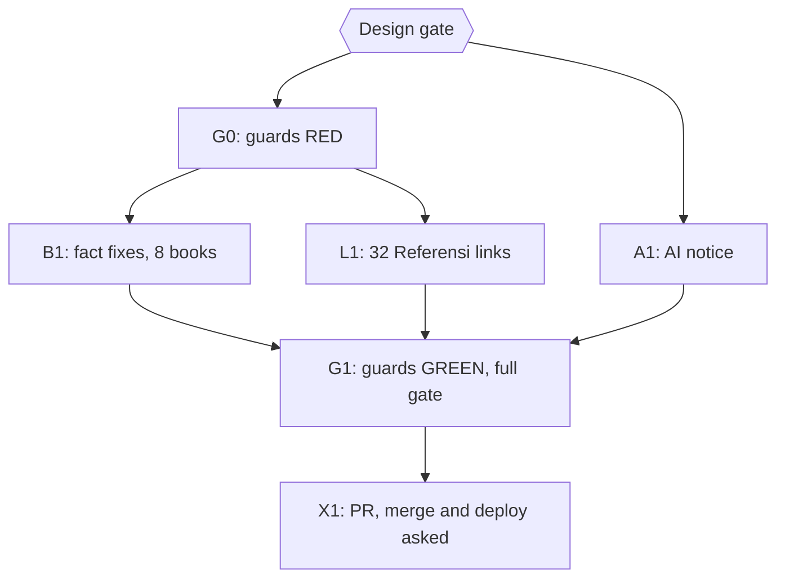

# Plan: close the LATER backlog of the attribution and quote audits

Status: Approved
Author: Iwan Kurniawan <iwan@belajarcarabelajar.com>, no trailer. sistem-pengendalian-topik-dalam-wacana-pedagogi-di-sekolah-dasar is by Kania Salsabila: committed with her identity and the `Co-authored-by: Iwan Kurniawan` trailer (GEMINI.md section 18).
Trigger: owner request 2026-10-25 to check the "UNESCO menekankan" line (sistem-peringatan-dini 10:58) and the eight remaining LATER items of `2026-10-24-dawnbook-attribution-fixes` (items 1-7 and 9). Read-only audit: `docs/code-plan/artifacts/2026-10-25-dawnbook-later-audit.md`.

## Checklist

- [x] Design gate. Evidence: AskUserQuestion 2026-10-25: `Design` = Approve; `Referensi` = link all 32 + guard; `AI notice` = one line on About page (and README).
- [x] G0: guard rules RED on main. Evidence: 4a5947a9, `bun test tests/books/known-misattributions.test.ts tests/books/referensi-presence.test.ts` exit 1 on main content: all seven new rules fire, 32 citation lines without a link; the 23-minute rule also caught state-of-flow 08:13 (owner: fix in this PR).
- [x] B1: fact fixes in 9 books (8 planned + state-of-flow), one commit per book. Review 1: not correct, 0 P1, 3 P2 (neuroplastisitas ch12 label and ch07 lead-in, stoikisme Ellis/Beck without Referensi) and P3 additions; fixed in de668811..912140bc (stoikisme line restored to main). Verifier: 1 P2 ('jauh lebih sulit'), 1 P3 ('sederhana'), fixed in d8e4b55b.
- [x] L1: 32 citations linked (publisher, DOI, ERIC, PMC or Library of Congress records); Flourish moved to the LoC record of the 2011 Free Press edition. Records exposed four citation errors in metodologi-microteaching, corrected to the record (Kyriacou 5th ed. 2018, Turney et al. Sydney Micro Skills, Saban & Coklar in TOJET 12(2), duplicate Ambili/Remesh 2013 removed, Remesh title). Aman (2005) has no online record and is marked as cited through Marliana (2017).
- [x] A1: AI-assistance notice on the About page and in the README (9ead107b), RED then GREEN in `tests/scripts/attribution.test.ts`. Owner follow-up 2026-10-25: the placeholder author name is removed from every tracked file and the README names Iwan Kurniawan as the author of the first books (2046b068); a test keeps the name out (mutation-checked: adding it turns the test red).
- [x] G1: guards GREEN. Evidence (HEAD e5b6da9a, clean tree): `bun test tests/scripts/ tests/books/` exit 0, 664 pass, 0 fail; `bun run build` exit 0, 0 parse errors; heading colons exit 0; copy rules flag only the one required Kania trailer (GEMINI.md section 18).
- [ ] X1: one PR; merge asked alone; deploy, D1 seed and GSC reindex asked separately.

## Visual Implementation Map

## Tasks

### Task G0
Rules added to `known-misattributions.test.ts`: UNESCO with "umpan balik komunitas"; "23 menit" with recovering concentration or focus; "10 poin" IQ with context switching; an error ("kesalahan") paired with epinephrine release; object permanence at "8-9 bulan"; TLO "di atas 75"; "Nah / Jadi" as a summary marker. `referensi-presence.test.ts` gains a check that every citation item (a list item with a year in parentheses) in a Referensi chapter holds a link.

### Task B1
Contract: correct to what the verified source says, hedge, or drop; never add a fact, number, name, cause or superlative (GEMINI.md section 29); a source is named once only where its claim stays, and then listed in Referensi with a DOI or publisher/official link, never archive.org/details. Findings per line: the audit artifact.

### Task L1
Each of the 32 entries gets a verified publisher, DOI, ERIC or library-catalogue link to the exact edition cited; entries that cannot be verified are reported, not guessed.

### Task A1
One sentence on the About page (id and en) and in the README: the books are written with AI assistance and edited by the author.

### Task G1
Fresh run of the guards, the book checks, `bun test tests/scripts/ tests/books/` and `bun run build` on a clean tree.

### Task X1
One PR through `pr-registry open`; merge asked alone with `--match-head-commit`; deploy, D1 seed and GSC reindex asked separately.

## Follow-ups (owner selected all three, 2026-10-25)

- [x] neuroplastisitas chapter 7: the brainstem releases norepinephrine, epinephrine comes from the adrenal glands; the unsourced 'without epinephrine the brain cannot change' claim is dropped (e88d1c3f).
- [x] Edition details: Dweck (2016) keeps the Ballantine updated-edition page (same ISBN as the updated edition) and van Lier (1996) keeps the DOI of the Routledge reissue of the same text; Gardner's Essential Howard Gardner on Mind corrected to Teachers College Press, 2024 (a3ed03e5).
- [x] 141 paragraph-style citations in 20 books: guard extended to APA paragraph lines (bac37c4b, RED on 141), seven link writers, one commit per book. Records exposed invented or wrong citations, fixed to the record: arsitektur-kernel-linux (six entries with no record or a DOI of another paper removed, none cited in a chapter; author lists of Wright et al. 2002, Price and Tucker 2004, Kashyap et al. 2017 and Edge 2014 corrected, 3606563c), analisis-ekspresif (pages, issues and a dead DOI corrected to Crossref, b61d2e4b), ekonomi-laissez-faire (Quesnay's unfounded publisher dropped, 833136ad).

## Backlog (LATER)

- `defer: DOI repair, new plan after this merge (owner decision 2026-10-25)` a Crossref and doi.org check of about 900 DOI links found about 63 unregistered DOIs and about a dozen that resolve to other works, across about 30 books: `docs/code-plan/artifacts/2026-10-25-dawnbook-doi-audit.md`.
- `defer: citation details, next Referensi pass` link writers reported year, edition or co-author differences between some citations and their records (for example Beck et al. 1979 cited as Beck alone, Pindyck 2018 vs the 2017 print, Lysgaard's title); text was kept as cited.

## Closeout status

- 2026-10-25, before the merge of PR #211: `bun ~/vivera/scripts/plan-closeout.mjs --readiness` = NEEDS-HUMAN (exit 3): every task step box ticked, every task UNPROVEN (no `skip_if`), X1 open. Owner decision (Close plan gate): keep it open. Reopen after the merge, deploy, D1 seed and GSC reindex; the status flip ships in the next session's PR together with the DOI-repair plan.
- Owner follow-up: the placeholder author name was also removed from the body of merged PR #206 (gh pr edit, 2026-10-25). Git history is left unchanged (rewriting `main` would need a force push).
