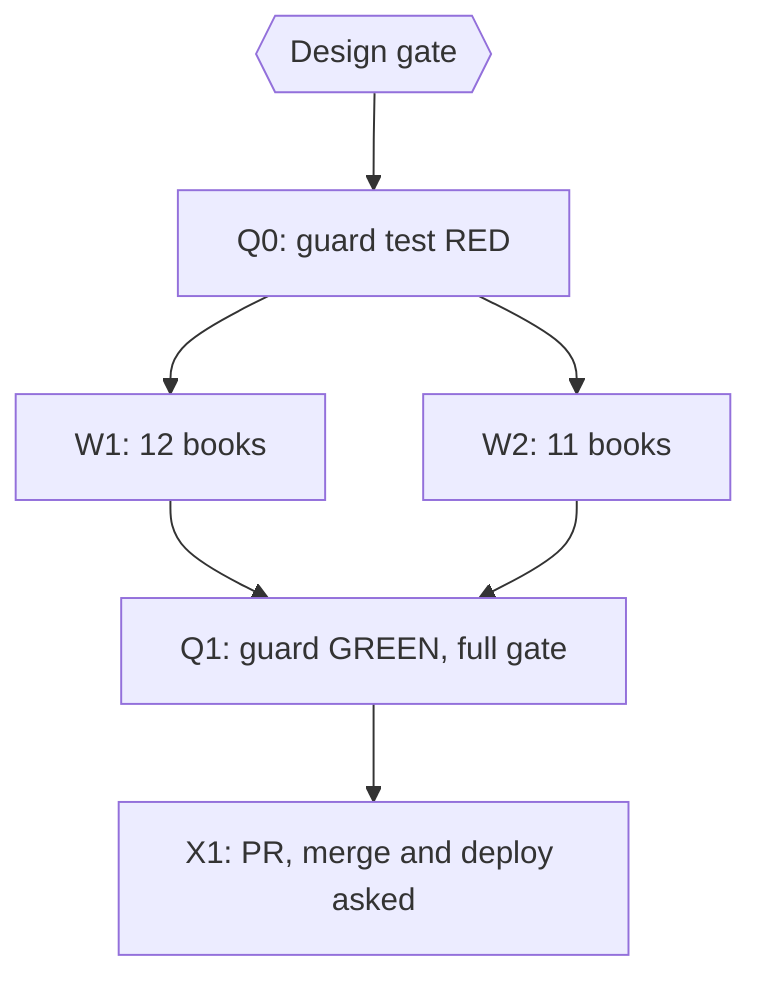

# Plan: fix the quotation-audit findings in 23 books

Status: Approved
Author: Iwan Kurniawan <iwan@belajarcarabelajar.com>, no trailer. Books by Kania Salsabila (teori-gaya-kelekatan, peluruhan-beta, relief-karmawibhangga-dan-hukum-sebab-akibat) are committed with her identity and the `Co-authored-by: Iwan Kurniawan` trailer (GEMINI.md section 18); identity read from each `book.toml`.
Trigger: owner decision 2026-10-25 after the read-only audit in `docs/code-plan/artifacts/2026-10-25-dawnbook-quote-audit.md` (15 misattributed, 15 altered, 17 unverified, 5 lifted). Takes over backlog item 8 of `2026-10-24-dawnbook-attribution-fixes`.

## Checklist

- [x] Design gate: owner approves this plan. Evidence: AskUserQuestion 2026-10-25, header `Design` = Approve; ultra-plan-runner Validation: OK.
- [x] Q0: guard test RED on main. Evidence: `bun test tests/books/known-misattributions.test.ts` exit 1, all 12 rules fire on main 97e90799 (window = paragraph plus the one before, after the per-paragraph version missed the Frankl line whose attribution sits in the intro paragraph).
- [x] W1: 12 books, one subagent per book; one reviewer for the wave. Evidence: one commit per book; reviewer verdict correct with 5 P3, fixed in 6 commits (4c48f473..99a236ff); two archive.org/details links the writers added (Kabat-Zinn 1994 lending copy, Durant DLI scan) were caught by `referensi-links.test.ts` in the full gate and replaced with publisher pages (4db47c3f, 2d3a55a9).
- [x] W2: 11 books, one subagent per book; one reviewer for the wave. Evidence: one commit per book (Kania's three with her identity and the Iwan trailer); reviewer verdict correct with 3 P3 (added descriptors), fixed in cbf5ef4e, f0ee080f, 69a1363d.
- [x] Q1: guard GREEN; book checks, `bun test tests/scripts/ tests/books/` and `bun run build` exit 0. Evidence (head 69a1363d, clean tree): `known-misattributions.test.ts` exit 0; `bun test tests/scripts/ tests/books/` exit 0, 658 pass, 0 fail; `bun run build` exit 0, 0 parse errors; `check-heading-colons` exit 0; copy rules flag only the four required Kania trailers.
- [x] Debt sweep (owner selected all three follow-ups; Close plan = keep it open): two guard rules added RED (d52544d1: EWS pillars credited to UNESCO, Antifragile without Taleb); sistem-peringatan-dini chapter 3 pillars credited to the UN/ISDR checklist and chapter 4 Pasal 5, 6, 8 and 46 described as the law states them (cc969f78); Taleb credited in resiliensi and, found by the guard, quarter-life-crisis (424384d7, 49732101); a writer renamed two headings to satisfy the two-paragraph window, so the headings were restored and the Taleb rule became chapter-scoped (62e95706, mutation-checked: masking Taleb turns it red); geopolitik Referensi intro and the Terry edition (f5df5727, bc8ae5be). Review of these commits: correct, 2 P3 (pillar names are the checklist's short heading forms, kept; Terry: Wikiquote gives the 6th ed. as 1971 p. 4, Open Library and later citations give 1972; the book cites 1972 without a page). Final gate on bc8ae5be: `bun test tests/scripts/ tests/books/` exit 0, 658 pass, 0 fail; `bun run build` exit 0, 0 parse errors; heading colons exit 0; copy rules flag only the four required Kania trailers.
- [ ] X1: one PR, one commit per book under the book's author; merge asked alone; deploy, D1 seed and GSC reindex asked separately.

## Visual Implementation Map

## Tasks

### Task Q0
`tests/books/known-misattributions.test.ts`, scanning every book's chapters by paragraph, fails when a paragraph pairs a known misattributed line with the wrong name, or when a known lifted or invented passage is present without its source. Initial rules, from the audit table: Durant's "Kita adalah apa yang kita kerjakan/lakukan berulang kali" with "Aristoteles" and without "Durant"; "stimulus dan respons ... ruang" with "Frankl"; "Ukuran kecerdasan adalah kemampuan untuk berubah" with "Einstein"; "Dunia adalah sebuah buku" with "Augustin"; "Neurons that fire together" with "Hebb" and without "Shatz"; Roosevelt with "hal yang benar"; Archilochus with "tingkat sistem"; "Checklist" with "UNESCO" in sistem-peringatan-dini; the phrase "wajib mengintegrasikan sistem peringatan dini" anywhere; the wēijī claim (krisis + bahaya + peluang + Mandarin/Cina/Tionghoa); the UltiDent passage "Kolaborasi interdisipliner telah membuka jalan" without "UltiDent". RED on main with the listed books. The rules apply to future books too.

### Task W1
Books: sistem-peringatan-dini-early-warning-system, virtue-ethics-aristoteles, resiliensi-dan-ketangguhan, gegar-budaya, mekanisme-koping-dan-manajemen-stres, quarter-life-crisis, aerodinamika-dan-desain-airfoil, psikologi-bencana-dan-manajemen-panik, neurobiologi-motivasi-dopamin, geopolitik-dalam-sejarah-piala-dunia, ekonomi-laissez-faire, psikologi-positif. Contract below.

### Task W2
Books: state-of-flow, eksistensialisme-dan-makna-hidup, eksistensialisme-dan-kehendak-bebas, menemukan-tujuan-hidup-ikigai, multiple-intelligences, teori-gaya-kelekatan, peluruhan-beta, fungsi-manajemen-poac, pembelajaran-multidisiplin, metodologi-microteaching, relief-karmawibhangga-dan-hukum-sebab-akibat. Contract below.

Shared contract, one subagent per book, items taken from the audit table rows for that book:
- MISATTRIBUTED: credit the real, verifiable origin (for example Will Durant for the Aristotle line, Carla Shatz for the Hebb phrase, UN/ISDR for the checklist) or, when no origin is verifiable, remove the attribution and either rewrite as the author's own sentence without quotation marks or delete it. A myth stated as fact (wēijī) is corrected or removed.
- ALTERED: either quote the original faithfully (verbatim translation, cuts marked with "...") or turn it into reported speech without quotation marks ("Sartre berpendapat bahwa ..."). Law text quotes the actual article (Pasal 33 UU 24/2007; PP 21/2008 Pasal 3 where the sentence comes from there).
- UNVERIFIED: stop presenting it as that person's words (same as the 2026-10-24 follow-ups).
- LIFTED: credit the source in the sentence and Referensi, or rewrite in the author's own words and drop the passage; a commercial blog is not cited as an authority.
- Every new source is fetched in the run and added to Referensi in the book's format. Facts may be dropped, never added (section 29); "kamu", no em dash, no heading colons, Edit tool only (section 16); a chapter's first sentence stays 110-155 characters if touched.
- Per book: `bun run scripts/check-book-structure.ts <slug>`, `bun run scripts/check-voice.ts <slug>` exit 0; report every edit before -> after with its source.

### Task Q1
Guard passes; full gate on the branch.

### Task X1
One PR, one commit per book with its author identity. Merge asked alone; deploy, D1 seed and GSC reindex asked separately (content_md changes in 23 books; meta descriptions only if a first sentence changed).

## Assumptions and risks

- The audit's UNVERIFIED class means "no source found"; a writer that finds a real source keeps the attribution and cites it.
- Guard rules are paragraph-level text matches; they catch the known cases, not new ones. Reviewers judge the rest.
- Lessons applied from `referensi-and-credit-fix-traps` memory: compare against the source before editing; paraphrases drop hedges and add intent, so each wave gets a reviewer and a fix round if needed.
- Rollback: revert the PR; each book is its own commit.

## Backlog (found while fixing, 2026-10-25)

Same class as the fixes, not done in this plan:
- sistem-peringatan-dini-early-warning-system chapter 03 still credits the four pillars to UNESCO in three places (heading "Empat Pilar UNESCO-ISDR", the paragraph under it, and a later mention); the guard misses them because "checklist" is absent.
- sistem-peringatan-dini-early-warning-system chapter 04: "Pasal 6 dan 46 menegaskan bahwa pencegahan termasuk peringatan dini adalah tanggung jawab pemerintah" overstates UU 24/2007 (Pasal 6 does not mention early warning; Pasal 46 does not assign responsibility).
- resiliensi-dan-ketangguhan chapter 12 uses "Antifragile" without crediting Nassim Taleb.
- geopolitik-dalam-sejarah-piala-dunia Referensi intro calls the list "literatur ilmiah"; it now includes Orwell's Tribune essay.
- Done in this PR: the three items above (EWS chapters 3 and 4, Taleb, geopolitik intro and Terry edition).
- Still open (LATER): sistem-peringatan-dini chapter 10 line 58 says "UNESCO menekankan bahwa sistem peringatan dini berpusat pada manusia" in a quote-style block; not checked.

## Closeout status

- 2026-10-25: readiness NEEDS-HUMAN (exit 3) before the PR; owner decision (Close plan gate): keep it open. Reopen after the PR is merged and the deploy, D1 seed and GSC reindex decisions are made.
