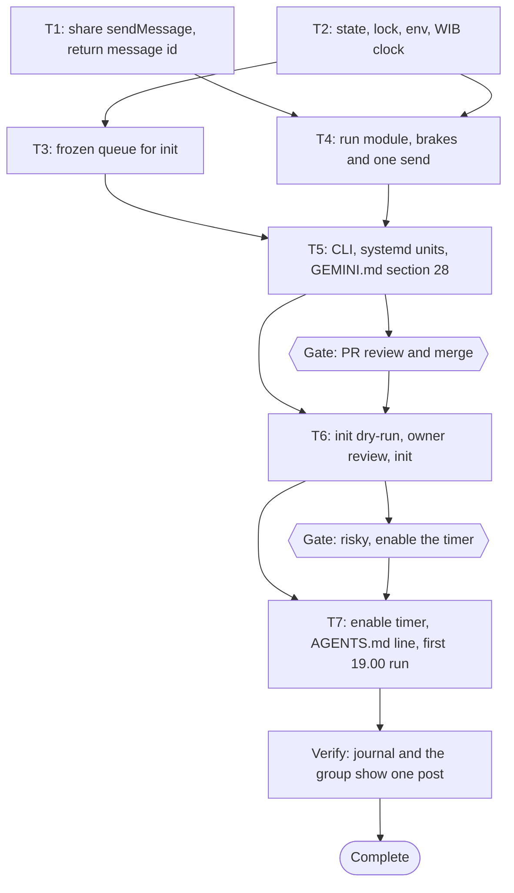

# Old-Book Telegram Broadcast Implementation Plan

> For agentic workers: REQUIRED EXECUTION METHOD: delegated task execution (recommended) or inline plan execution. Steps use checkbox syntax.

**Goal:** post each of the 59 old Dawnbook books to the Dawnbook Telegram group once, one per day at 19.00 WIB, from a laptop timer that stops itself on any doubt.

**Architecture:** a Bun command-line tool (`scripts/broadcast-old-books.ts`) over three small modules: `scripts/broadcast/state.ts` (state file, lock, env, WIB clock), `scripts/broadcast/queue.ts` (the frozen queue built at `init`), and `scripts/broadcast/run.ts` (one guarded send per run). The existing Telegram send of `scripts/announce-new-books.ts` is shared. A per-user systemd timer runs `run` at 19.00, 20.00 and 21.00 Asia/Jakarta.

**Tech Stack:** Bun 1.4.4, TypeScript run directly by Bun, `bun:test`, systemd user units, Telegram Bot API `sendMessage`.

**Active Project Profile:** repository `/home/belajarcarabelajar/Proyek/dawnbook` (public), session worktree `/mnt/belajarcarabelajar/dawnbook-wt/old-book-broadcast`, branch `2026-10-30-dawnbook-old-book-broadcast/old-book-broadcast` from `origin/main` `e2ee208b`. Sources read: `package.json` (scripts), `GEMINI.md` sections 18, 19, 28, `scripts/announce-new-books.ts`, `scripts/builder/metadata.ts:36-160`, `tests/scripts/announce-new-books.test.ts`, `functions/lib/gating.ts:17` (first chapter public). Gap: the repository has no TypeScript compiler or `typecheck` script (no `tsconfig.json`, no `typescript` package), so type errors are caught only where `bun test` executes the code; adding a compiler is out of scope.

**Project Commands:** `bun test <file>` (targeted, A12), `bun ~/vivera/scripts/check-copy-rules.mjs --diff origin/main` (A27), `systemd-analyze --user verify <unit>`, `bun ~/vivera/scripts/ultra-plan-runner.mjs <plan>`. No build or deploy is part of this plan.

**Protected Boundaries:** the new-book announcement keeps its behaviour and exit codes; `books/**`, `book.toml` files, the deploy script and the workflows are untouched; no credential value is written to the repository, the state file, a log or chat; the token and chat id stay in `~/cloudflare/.env` (GEMINI.md section 19).

**Spec:** `docs/code-plan/specs/2026-10-30-dawnbook-old-book-broadcast-design.md` (approved 2026-10-30).

**Scope:** the shared send function, the three modules, the CLI, two systemd unit templates, the GEMINI.md section 28 addendum, and the post-merge rollout (init, timer, one `~/AGENTS.md` line).

**Non-Goals:** posting with the laptop off; repeating the series; changing the message format; a TypeScript compiler; any change to the new-book announcement beyond sharing its send function.

**Visual Map:**



**Reasoning Lenses:** Intent and scope (spec user stories 1 to 14); Investigative (audit: 59 of 60 live books never posted, Telegram `SCHEDULE_BOT_NOT_ALLOWED`, cron slots full, Actions off); Computational and Temporal (the run decision is an ordered list of brakes over a small state machine: idle, in-flight, paused, done); Critical (failure modes listed under Risks); Security (credential read narrowly, redacted, never persisted); Operational (journal, desktop notification, `status`, kill switch, revert); Test-first (every brake has a test at the `runOnce` seam).

**Acceptance Criteria:**
- AC1: `init --dry-run` prints every queued message and writes nothing; `init` writes the state and refuses when a state exists.
- AC2: the queue holds the live books whose Hub date is before 2026-10-21 00.00 WIB, oldest first, ties by slug; a live slug with no `books/<slug>/book.toml`, an empty live manifest, or a book with no date makes `init` fail and write nothing.
- AC3: each message text equals `formatAnnouncement(readBookInfo(...))`, the new-book format.
- AC4: `run` sends nothing outside 19.00 to 21.59 Asia/Jakarta, whatever the system time zone.
- AC5: `run` sends at most one message per WIB date, counting a send recorded by `resume --sent`.
- AC6: `run` without a state exits 1 and notifies; it never initialises.
- AC7: a leftover in-flight send pauses the broadcast, notifies, and sends nothing.
- AC8: any Telegram failure pauses the broadcast with the token redacted, notifies, and is not retried.
- AC9: a link that does not answer HTTP 200 (no redirect followed) makes the run notify and exit 1 without changing the state.
- AC10: an exhausted queue notifies exactly once and sends nothing.
- AC11: without `TELEGRAM_BOT_TOKEN` or `DAWNBOOK_TELEGRAM_CHAT_ID` in the env file, `run` logs and exits 0; only those two keys are read.
- AC12: `resume` after a send attempt requires `--sent` or `--not-sent`; `--sent` records the book as sent, `--not-sent` keeps it next.
- AC13: the state file has mode 600 in a 700 folder, is replaced atomically, and never contains the token or chat id.
- AC14: a second concurrent `run` exits 0 without sending.
- AC15: the new-book announcement tests still pass after `sendMessage` is shared.

**Traceability:**

| AC | Task | Test or check | Evidence |
|---|---|---|---|
| AC1, AC2, AC3 | T3, T5 | `queue.test.ts`, `broadcast-old-books.test.ts` | `bun test` exit codes |
| AC4, AC5, AC6, AC7, AC8, AC9, AC10, AC11, AC14 | T4 | `run.test.ts` | `bun test` exit code |
| AC12 | T4, T5 | `run.test.ts` (`applyResume`), `broadcast-old-books.test.ts` | `bun test` exit code |
| AC13 | T2 | `state.test.ts` | `bun test` exit code |
| AC15 | T1 | `announce-new-books.test.ts` | `bun test` exit code |
| rollout | T6, T7 | owner review of 59 messages, `systemctl --user list-timers`, `journalctl --user -u dawnbook-broadcast` | outputs in the PR or the plan |

**Assumptions & Open Questions:**
- The owner's answers fixed every preference (location, cadence, order, format, catch-up, end). No open question remains.
- Assumption: the laptop's main checkout `~/Proyek/dawnbook` stays on `main`; the service runs the CLI from there. If the script is missing (another branch checked out), the service fails visibly in `systemctl --user --failed` and sends nothing.
- Assumption: `notify-send` reaches the Plasma session from a user service, as `agents-md-check.service` already does on this machine.

**Dependencies & Impact:** `sendMessage` gains `export` and returns the Telegram `message_id` (`number | null`); its only caller ignores the return value, so the announcer is unchanged (T1 impacts). `parseBookMetadata` reads `release-dates.json` from the current directory, so `init` must run from the repository root (the CLI checks `release-dates.json` exists in `cwd` and exits 2 otherwise). No migration, schema, or deploy change.

**Risks & Rollback:**
- Duplicate post after a crash mid-send: the in-flight record turns it into a pause the owner resolves with `resume --sent` or `--not-sent`.
- Late-night post after the laptop wakes: the window check inside the tool, independent of systemd catch-up.
- Burst after downtime: one send per run and one per WIB date.
- Dead link after a rename: HTTP 200 check before sending.
- Silent stop: failures exit 1 (visible in `systemctl --user --failed`) and notify; `status` shows progress.
- Rollback: `systemctl --user disable --now dawnbook-broadcast.timer`; remove the two units from `~/.config/systemd/user/`, `systemctl --user daemon-reload`; delete `~/.local/state/dawnbook-broadcast/`; revert the pull request; restore `~/AGENTS.md` from the tag written in T7.

**Security & Compatibility:** trust boundary is the Telegram API and the live site. The token is read from `~/cloudflare/.env` by key, kept in memory only, and redacted from every error (existing `redact`). The chat id is never logged or stored. The state file is private to the user. Compatibility: the announcer's exports only grow.

**Operations & Rollout:** after merge, T6 (init behind the owner's review of all messages) and T7 (enable the timer behind its own risk gate, add the `~/AGENTS.md` line, watch the first run). Observability: `journalctl --user -u dawnbook-broadcast`, `bun run scripts/broadcast-old-books.ts status`, desktop notifications on attention-needed exits and on completion.

**CI/Review Gate:** GitHub Actions are off (GEMINI.md section 19); the gate is the targeted `bun test` runs and `systemd-analyze` checks in T1 to T5, the copy-rules check, and the owner's PR review.

**Documentation:** GEMINI.md section 28 gains an "Old-book broadcast" part: what it posts, the brakes, `init`, `status`, `pause`, `resume`, kill switch, install commands, and revert. `~/AGENTS.md` gains one line pointing to it (T7).

**Definition of Done:** T1 to T5 green with exit codes recorded, PR merged by the owner, T6 state initialised after the owner approved the printed list, T7 timer enabled after the risk gate, first run seen in the journal and in the group, plan closed through the debt sweep.

**Plan Status & Version:** Approved, version 1.

**Reproducibility:** Bun 1.4.4; tests inject the clock, `fetch`, notifier, env file and a temporary state folder (`mkdtemp` under `os.tmpdir()`), so they need no network, no real `~/.local/state`, and no Telegram.

**Test Reliability:** deterministic: no real time, no network, no shared folder; every temporary folder is removed in `afterEach`.

**Privacy & Data Governance:** the only data stored are public book slugs, titles, links, timestamps and Telegram message ids, in a user-private file outside the public repository.

**Dependencies & Supply Chain:** no new package. `notify-send` (`/usr/bin/notify-send`), `systemd-analyze` and `systemctl` come from the installed system.

**UX States:** desktop notification texts (Indonesian, short): not initialised, paused with reason, link not reachable, finished. CLI `status` prints sent count, next title, and pause reason.

**Persistent State & Artifact Storage:** `~/.local/state/dawnbook-broadcast/state.json` (schema under T2), its temporary sibling during writes, and `run.lock` while a run holds the lock.

**Entity & Sourcing Verification:** Telegram `messages.sendMessage` error table fetched 2026-10-30 (`SCHEDULE_BOT_NOT_ALLOWED`); Bot API `sendMessage` returns `result.message_id` (already used shape `{ ok, result }` in the announcer tests).

**Verification:** `bun test tests/scripts/broadcast-old-books.test.ts tests/scripts/broadcast tests/scripts/announce-new-books.test.ts` exit 0; `systemd-analyze --user verify` exit 0 on both units; copy-rules exit 0; after rollout, `systemctl --user list-timers dawnbook-broadcast.timer` shows the next 19.00, 20.00 or 21.00 WIB trigger and the journal of the first run shows one send.

## Global Constraints

- Window: 19.00 to 21.59 Asia/Jakarta (`WINDOW_FIRST_HOUR = 19`, `WINDOW_LAST_HOUR = 21`); timer `OnCalendar=*-*-* 19,20,21:00:00 Asia/Jakarta`.
- Cutoff: `OLD_BOOK_CUTOFF_MS = Date.UTC(2026, 9, 20, 17, 0, 0)` (2026-10-21 00.00 WIB).
- Request timeout: 20 seconds for both the link check and the send.
- One Telegram send per run, no retry.
- Exit codes: 0 no action needed, 1 attention needed, 2 usage error.
- State folder default `~/.local/state/dawnbook-broadcast` (mode 700), file `state.json` (mode 600); env file default `~/cloudflare/.env`.
- Never `Anda`, no emoji, no em dash in any new text (copy rules).
- Fan-out: wave 1 T1 and T2 in parallel, wave 2 T3 and T4 in parallel, wave 3 T5; one implementer per task, disjoint files, the parent commits each task by explicit path.

### Task T1: Share the Telegram send

**Files:**
- Modify: `scripts/announce-new-books.ts:80-102`
- Modify: `tests/scripts/announce-new-books.test.ts` (one new `describe` block at the end)
- Test: `tests/scripts/announce-new-books.test.ts`

**Interfaces:**
- Consumes: nothing new.
- Produces: `export async function sendMessage(token: string, chatId: string, text: string, fetchImpl: typeof fetch): Promise<number | null>`, returning `body.result.message_id` when it is a number, else `null`. Errors keep the current redacted messages.

**Preconditions:** `bun --version` exits 0 (else `E_PRECOND_DEP`).

**Idempotency Check:** skip when the frontmatter `skip_if` exits 0.

**Behavior & Acceptance:** AC15; T4 can import the same send with the same timeout and redaction.

**Edge Cases & Failure Behavior:** a reply without `result.message_id` returns `null`, not an error; a non-ok reply still throws with the token redacted.

**Deliberate Shortcuts & Deferrals:** None.

**Dependencies & Risks:** the deploy step calls `main`, not `sendMessage`; the return value is ignored there.

**Review & Evidence:** the two `bun test` exit codes; `git diff` touches only the two files.

**Reasoning Output:** a widening of the return type is backward compatible for a caller that ignores it.

**Test Data & Determinism:** fake `fetch` replying `{ ok: true, result: { message_id: 42 } }` and `{ ok: false, description: "Bad Request: chat not found <token>" }`.

- [ ] Step 1: Write the failing tests `sendMessage returns the message id` (expects 42) and `sendMessage redacts the token on failure` in a new `describe("sendMessage")`.
- [ ] Step 2: Run: verify fail | cmd: `bun test tests/scripts/announce-new-books.test.ts -t 'sendMessage returns the message id'` | expect: exit 1 | retry: 0 | on_fail: n/a (failure is expected here)
- [ ] Step 3: Export `sendMessage` and return the message id.
- [ ] Step 4: Run: verify pass | cmd: `bun test tests/scripts/announce-new-books.test.ts` | expect: exit 0, 0 failures | retry: 1 | on_fail: mark T1 FAILED, halt T4 and T5
- [ ] Step 5: Commit (parent): `git add scripts/announce-new-books.ts tests/scripts/announce-new-books.test.ts && git commit -m "refactor(announce): share sendMessage and return the message id"`

### Task T2: State, lock, env and WIB clock

**Files:**
- Create: `scripts/broadcast/state.ts`
- Create: `tests/scripts/broadcast/state.test.ts`

**Interfaces:**
- Produces:
  ```ts
  export interface QueueItem { slug: string; text: string; url: string }
  export interface SentItem { slug: string; at: string; messageId: number | null }
  export interface Pause { reason: string; at: string; attempt: string | null }
  export interface BroadcastState {
    version: 1;
    createdAt: string;
    queue: QueueItem[];
    sent: SentItem[];
    inFlight: { slug: string; at: string } | null;
    paused: Pause | null;
    doneNotifiedAt: string | null;
  }
  export const DEFAULT_STATE_DIR: string;   // join(homedir(), ".local", "state", "dawnbook-broadcast")
  export const DEFAULT_ENV_FILE: string;    // join(homedir(), "cloudflare", ".env")
  export const STATE_FILE = "state.json";
  export const LOCK_FILE = "run.lock";
  export async function readState(dir: string): Promise<BroadcastState | null>;
  export async function writeState(dir: string, state: BroadcastState): Promise<void>;
  export function acquireLock(dir: string, pid?: number, isAlive?: (pid: number) => boolean): (() => void) | null;
  export async function readTelegramEnv(path: string): Promise<{ token?: string; chatId?: string }>;
  export function wibClock(nowMs: number): { date: string; hour: number };
  ```
- `readState`: `null` when the file is missing; throws on invalid JSON, `version !== 1`, or a missing array field.
- `writeState`: creates the folder with mode 700 if missing, writes `state.json.tmp` with mode 600, `fsync`, renames over `state.json`.
- `acquireLock`: creates `run.lock` with flag `wx` holding the pid and returns a release function that removes it; when the file exists and its pid is alive, returns `null`; when its pid is dead or unreadable, replaces it and returns a release function.
- `readTelegramEnv`: reads the file, accepts `KEY=value`, `export KEY=value`, and single or double quotes around the value, and returns only `TELEGRAM_BOT_TOKEN` (as `token`) and `DAWNBOOK_TELEGRAM_CHAT_ID` (as `chatId`); a missing file returns `{}`.
- `wibClock`: the date (`YYYY-MM-DD`) and hour (0 to 23) in `Asia/Jakarta` through `Intl.DateTimeFormat`, independent of `process.env.TZ`.

**Preconditions:** none beyond Bun.

**Behavior & Acceptance:** AC13, AC14 (lock half), AC11 (env half).

**Edge Cases & Failure Behavior:** a malformed state is an error, never treated as empty; a stale lock from a crashed run does not block forever.

**Deliberate Shortcuts & Deferrals:** the lock is a pid file, not `flock(2)`: `defer: two runs on one laptop (timer and a manual run), upgrade-trigger: the tool runs on a shared host or from several users`.

**Dependencies & Risks:** none.

**Review & Evidence:** `bun test tests/scripts/broadcast/state.test.ts` exit codes for RED and GREEN.

**Reasoning Output:** rename over the old file is atomic on one filesystem, so a crash leaves either the old or the new state.

**Test Data & Determinism:** temporary folders from `mkdtemp`; `wibClock` cases: `Date.UTC(2026, 9, 30, 11, 59)` gives `2026-10-30` hour 18, `Date.UTC(2026, 9, 30, 12, 0)` hour 19, `Date.UTC(2026, 9, 30, 16, 59)` hour 23, `Date.UTC(2026, 9, 30, 17, 0)` gives `2026-10-31` hour 0; run once with `process.env.TZ = "UTC"` and once with `"America/New_York"`. Mode checks with `stat(...).mode & 0o777`. A state containing a token-shaped string is not produced by any helper (asserted in T4).

- [ ] Step 1: Write the failing tests for each function above.
- [ ] Step 2: Run: verify fail | cmd: `bun test tests/scripts/broadcast/state.test.ts` | expect: exit 1 | retry: 0 | on_fail: n/a
- [ ] Step 3: Implement `scripts/broadcast/state.ts`.
- [ ] Step 4: Run: verify pass | cmd: `bun test tests/scripts/broadcast/state.test.ts` | expect: exit 0 | retry: 1 | on_fail: mark T2 FAILED, halt T3, T4, T5
- [ ] Step 5: Commit (parent): `git add scripts/broadcast/state.ts tests/scripts/broadcast/state.test.ts && git commit -m "feat(broadcast): add the state, lock, env and WIB clock helpers"`

### Task T3: Frozen queue

**Files:**
- Create: `scripts/broadcast/queue.ts`
- Create: `tests/scripts/broadcast/queue.test.ts`

**Interfaces:**
- Consumes: `QueueItem` from T2; `readBookInfo`, `formatAnnouncement` from `scripts/announce-new-books.ts`; `parseBookMetadata` from `scripts/builder/metadata.ts`.
- Produces:
  ```ts
  export const OLD_BOOK_CUTOFF_MS: number; // Date.UTC(2026, 9, 20, 17, 0, 0)
  export async function hubReleaseMs(rootDir: string, slug: string): Promise<number>; // parseBookMetadata(join(rootDir, "books", slug), slug).mtimeMs
  export async function buildQueue(opts: {
    rootDir: string;
    liveManifest: unknown;
    releaseMs: (slug: string) => Promise<number>;
  }): Promise<QueueItem[]>;
  ```
- `buildQueue`: takes `liveManifest.books` (throws when it is not a non-empty string array), throws naming the slug when `books/<slug>/book.toml` is missing or `releaseMs` returns 0 or less, drops slugs with `releaseMs >= OLD_BOOK_CUTOFF_MS`, sorts by `releaseMs` then slug, and maps each to `{ slug, text: formatAnnouncement(info), url: info.url }`.

**Preconditions:** T2 artifact `scripts/broadcast/state.ts` exists (else `E_PRECOND_UPSTREAM`).

**Behavior & Acceptance:** AC2, AC3.

**Edge Cases & Failure Behavior:** an empty or malformed live manifest throws, never yields an empty queue that would look finished.

**Deliberate Shortcuts & Deferrals:** None.

**Dependencies & Risks:** `parseBookMetadata` logs warnings for missing `icon.txt`; harmless in `init`.

**Review & Evidence:** RED and GREEN exit codes.

**Reasoning Output:** sort is O(n log n) over at most a few hundred books.

**Test Data & Determinism:** fixture books written like `writeBook` in `tests/scripts/announce-new-books.test.ts`; `releaseMs` injected as a map (`{ a: 3, b: 1, c: OLD_BOOK_CUTOFF_MS, d: 1 }` gives order `b, d, a` and drops `c`).

- [ ] Step 1: Write failing tests (order and ties, cutoff exclusion, text equals `formatAnnouncement`, empty manifest, missing book, zero date).
- [ ] Step 2: Run: verify fail | cmd: `bun test tests/scripts/broadcast/queue.test.ts` | expect: exit 1 | retry: 0 | on_fail: n/a
- [ ] Step 3: Implement `scripts/broadcast/queue.ts`.
- [ ] Step 4: Run: verify pass | cmd: `bun test tests/scripts/broadcast/queue.test.ts` | expect: exit 0 | retry: 1 | on_fail: mark T3 FAILED, halt T5
- [ ] Step 5: Commit (parent): `git add scripts/broadcast/queue.ts tests/scripts/broadcast/queue.test.ts && git commit -m "feat(broadcast): build the frozen old-book queue"`

### Task T4: One guarded run

**Files:**
- Create: `scripts/broadcast/run.ts`
- Create: `tests/scripts/broadcast/run.test.ts`

**Interfaces:**
- Consumes: everything from T2; `sendMessage` from T1.
- Produces:
  ```ts
  export const WINDOW_FIRST_HOUR = 19;
  export const WINDOW_LAST_HOUR = 21;
  export interface RunDeps {
    stateDir: string;
    envFile: string;
    now: () => number;
    fetch: typeof fetch;
    notify: (text: string) => void;
    log: (text: string) => void;
    dryRun?: boolean;
  }
  export async function runOnce(deps: RunDeps): Promise<number>;
  export function applyResume(state: BroadcastState, mode: "plain" | "sent" | "not-sent", nowIso: string): BroadcastState | string;
  export function describeStatus(state: BroadcastState): string;
  ```
- `runOnce` order (each line returns): lock busy, exit 0; no state, notify `Dawnbook broadcast belum di-init`, exit 1; paused, exit 0; `inFlight` set, write `paused = { reason: "status kirim tidak pasti", at, attempt: inFlight.slug }` and `inFlight = null`, notify, exit 1; hour outside 19 to 21, exit 0; a `sent` entry with `wibClock(at).date` equal to today, exit 0; no unsent queue item and `doneNotifiedAt` null, set it, notify `Semua buku lama sudah dikirim`, exit 0; no unsent item and already notified, exit 0; missing token or chat id, log, exit 0; GET the item url with `redirect: "manual"` and a 20-second timeout, not 200, notify, exit 1, state unchanged; dry run, log the text, exit 0, nothing written; write `inFlight`, call `sendMessage`, on success append `{ slug, at, messageId }` and clear `inFlight`, exit 0; on error write `paused = { reason: <redacted message>, at, attempt: slug }`, clear `inFlight`, notify, exit 1. The lock is released in `finally`. With `dryRun`, every branch logs what it would do instead: it never writes the state, never notifies, and never sends.
- `applyResume`: not paused, returns `"tidak sedang pause"`; `attempt` set and mode `plain`, returns `"pakai --sent atau --not-sent"`; `attempt` null and mode not `plain`, returns `"tidak ada percobaan kirim; pakai resume tanpa opsi"`; `sent` appends `{ slug: attempt, at: paused.at, messageId: null }`; every accepted mode clears `paused`.
- `describeStatus`: `Terkirim <n>/<total>`, the next text's first line or `selesai`, and the pause reason when paused.

**Preconditions:** T1 exports `sendMessage`; T2 module exists.

**Behavior & Acceptance:** AC4 to AC12, AC14.

**Edge Cases & Failure Behavior:** a Telegram timeout counts as an error (the message may have arrived), so it pauses; a link check failure never consumes the day.

**Deliberate Shortcuts & Deferrals:** None.

**Dependencies & Risks:** the send is the only outbound side effect; tests assert the fake `fetch` call list for every brake.

**Review & Evidence:** RED and GREEN exit codes; a test asserts the written state never contains the token string.

**Reasoning Output:** state machine idle, in-flight, paused, done; the in-flight write before the send is what turns a crash into a pause instead of a duplicate.

**Test Data & Determinism:** `now` fixed per case: 18.59 WIB (`Date.UTC(2026, 9, 30, 11, 59)`), 19.00, 21.59, 22.00 WIB; a second run at 20.00 after a send at 19.00; fake `fetch` routing link GETs to 200, 404 or 301 and Telegram POSTs to ok, `{ ok: false }`, or a thrown `AbortError`; env file fixtures with and without the keys; a held lock from a live pid.

- [ ] Step 1: Write failing tests, one per brake and per `applyResume` branch.
- [ ] Step 2: Run: verify fail | cmd: `bun test tests/scripts/broadcast/run.test.ts` | expect: exit 1 | retry: 0 | on_fail: n/a
- [ ] Step 3: Implement `scripts/broadcast/run.ts`.
- [ ] Step 4: Run: verify pass | cmd: `bun test tests/scripts/broadcast/run.test.ts` | expect: exit 0 | retry: 1 | on_fail: mark T4 FAILED, halt T5
- [ ] Step 5: Commit (parent): `git add scripts/broadcast/run.ts tests/scripts/broadcast/run.test.ts && git commit -m "feat(broadcast): send one old book per run behind the brakes"`

### Task T5: CLI, systemd units and docs

**Files:**
- Create: `scripts/broadcast-old-books.ts`
- Create: `tests/scripts/broadcast-old-books.test.ts`
- Create: `scripts/systemd/dawnbook-broadcast.service`
- Create: `scripts/systemd/dawnbook-broadcast.timer`
- Modify: `GEMINI.md` (section 28, new part before its **Revert** bullet)

**Interfaces:**
- Consumes: T2, T3, T4.
- Produces: `export async function main(argv: string[], deps?: Partial<{ rootDir: string; stateDir: string; envFile: string; now: () => number; fetch: typeof fetch; notify: (t: string) => void; log: (t: string) => void }>): Promise<number>` with commands:
  - `init [--dry-run] [--manifest <file>]`: reads the manifest file, or fetches `https://dawnbook.belajarcarabelajar.com/manifest.json` (20-second timeout); exits 2 when `release-dates.json` is not in `rootDir`; exits 1 when a state exists; prints `<n>. <text>` for every item; writes the state unless `--dry-run`.
  - `run [--dry-run]`: `runOnce`.
  - `status`: prints `describeStatus`, exits 0; no state prints `belum di-init`, exits 1.
  - `pause [--reason <text>]`: sets a pause with `attempt: null`; already paused exits 0 unchanged.
  - `resume [--sent | --not-sent]`: `applyResume`; a returned string is printed and exits 1.
  - anything else exits 2 with the usage text.
  - default `notify`: `Bun.spawnSync(["notify-send", "-u", "critical", "-a", "Dawnbook broadcast", "Dawnbook broadcast", text])`, errors ignored.
- Service unit: `Type=oneshot`, `WorkingDirectory=%h/Proyek/dawnbook`, `ExecStart=%h/.bun/bin/bun run scripts/broadcast-old-books.ts run`, `TimeoutStartSec=120`, header comment with purpose, install and revert commands.
- Timer unit: `OnCalendar=*-*-* 19,20,21:00:00 Asia/Jakarta`, `Persistent=true`, `AccuracySec=1min`, `Unit=dawnbook-broadcast.service`, `[Install] WantedBy=timers.target`, same header comment.
- GEMINI.md: an "Old-book broadcast (added 2026-10-30)" part: what and when, the frozen queue and cutoff, the brakes in one list, commands (`init --dry-run`, `init`, `status`, `pause`, `resume --sent|--not-sent`), install (`cp scripts/systemd/dawnbook-broadcast.* ~/.config/systemd/user/ && systemctl --user daemon-reload && systemctl --user enable --now dawnbook-broadcast.timer`), kill switch, and revert.

**Preconditions:** T3 and T4 modules exist.

**Behavior & Acceptance:** AC1, AC12 (CLI half), plus the units and docs.

**Edge Cases & Failure Behavior:** unknown flags exit 2; `init` never overwrites.

**Deliberate Shortcuts & Deferrals:** None.

**Dependencies & Risks:** GEMINI.md is the target of the `CLAUDE.md` and `AGENTS.md` symlinks: edit it in place with the Edit tool, which keeps the symlinks.

**Review & Evidence:** test exit codes, `systemd-analyze` exit codes, copy-rules exit code, `ls -l CLAUDE.md AGENTS.md` still shows symlinks.

**Reasoning Output:** the units are templates in the repository so the PR review covers them; installing them is a rollout step.

**Test Data & Determinism:** temporary root with `release-dates.json` and fixture books, a manifest file, injected deps; no network.

- [ ] Step 1: Write failing CLI tests (init dry-run writes nothing, init writes and refuses a second time, status with and without state, pause, resume flags, usage exit 2, missing `release-dates.json` exit 2).
- [ ] Step 2: Run: verify fail | cmd: `bun test tests/scripts/broadcast-old-books.test.ts` | expect: exit 1 | retry: 0 | on_fail: n/a
- [ ] Step 3: Implement the CLI, write both units, add the GEMINI.md part.
- [ ] Step 4: Run: verify pass | cmd: `bun test tests/scripts/broadcast-old-books.test.ts tests/scripts/broadcast tests/scripts/announce-new-books.test.ts` | expect: exit 0 | retry: 1 | on_fail: mark T5 FAILED
- [ ] Step 5: Run: units valid | cmd: `systemd-analyze --user verify scripts/systemd/dawnbook-broadcast.service scripts/systemd/dawnbook-broadcast.timer` | expect: exit 0 | retry: 0 | on_fail: fix the unit, rerun
- [ ] Step 6: Run: calendar | cmd: `systemd-analyze calendar --iterations=3 '*-*-* 19,20,21:00:00 Asia/Jakarta'` | expect: exit 0 | retry: 0 | on_fail: fix the expression
- [ ] Step 7: Run: copy rules | cmd: `bun ~/vivera/scripts/check-copy-rules.mjs --diff origin/main` | expect: exit 0 | retry: 0 | on_fail: fix the flagged lines
- [ ] Step 8: Commit (parent): `git add scripts/broadcast-old-books.ts tests/scripts/broadcast-old-books.test.ts scripts/systemd/dawnbook-broadcast.service scripts/systemd/dawnbook-broadcast.timer GEMINI.md && git commit -m "feat(broadcast): add the old-book broadcast CLI, systemd units and docs"`
- [ ] Step 9: Open the PR through the PR registry (`sucp-verify-deliver`), body linking this plan with `Refs #<issue>`.

### Task T6: Initialise the state (after merge)

**Files:** none in the repository; creates `~/.local/state/dawnbook-broadcast/state.json`.

**Preconditions:** the PR is merged and `~/Proyek/dawnbook` is on `main` at the merge commit (`git -C ~/Proyek/dawnbook log -1 --format=%H` equals the merge commit), else `E_PRECOND_UPSTREAM`.

**Behavior & Acceptance:** AC1 on the real catalogue; the owner sees and approves the full list (A38).

- [ ] Step 1: `cd ~/Proyek/dawnbook && bun run scripts/broadcast-old-books.ts init --dry-run`; show the full output in chat.
- [ ] Step 2: Ask the owner to approve the list (question tool, header `Daftar`).
- [ ] Step 3: `cd ~/Proyek/dawnbook && bun run scripts/broadcast-old-books.ts init`; then `bun run scripts/broadcast-old-books.ts status` exits 0 and shows `Terkirim 0/<n>`.
- [ ] Step 4: `stat -c '%a' ~/.local/state/dawnbook-broadcast ~/.local/state/dawnbook-broadcast/state.json` prints `700` and `600`.

### Task T7: Enable the timer and watch the first run (after merge)

**Files:** none in the repository; installs `~/.config/systemd/user/dawnbook-broadcast.{service,timer}` and edits `~/AGENTS.md`.

**Preconditions:** T6 `status` exits 0.

**Behavior & Acceptance:** the timer is active and the first evening run posts exactly one message.

- [ ] Step 1: Ask the risky gate (question tool, safe option first): enable `dawnbook-broadcast.timer`, which posts to the Dawnbook Telegram group from today 19.00 WIB.
- [ ] Step 2: `cp ~/Proyek/dawnbook/scripts/systemd/dawnbook-broadcast.service ~/Proyek/dawnbook/scripts/systemd/dawnbook-broadcast.timer ~/.config/systemd/user/`
- [ ] Step 3: `systemctl --user daemon-reload`
- [ ] Step 4: `systemctl --user enable --now dawnbook-broadcast.timer`
- [ ] Step 5: `systemctl --user list-timers dawnbook-broadcast.timer` shows the next trigger at 19.00, 20.00 or 21.00 WIB.
- [ ] Step 6: Commit and tag `~/AGENTS.md` in `~/.local/share/home-bak.git` (section 8.5, tag `AGENTS.md.bak-20261030-dawnbook-broadcast`), add one line to section 8 naming the timer, GEMINI.md section 28, the kill switch and the revert, then `python3 -I ~/.claude/hooks/agents-md-check.py` exits 0.
- [ ] Step 7: After the first trigger in the window: `journalctl --user -u dawnbook-broadcast --since today` shows one `sent` line, `status` shows `Terkirim 1/<n>`, and the owner confirms the post in the group.

## Approval

| Gate | Answer | Date |
|---|---|---|
| `Intent` | Locked | 2026-10-30 |
| `Spec` | Approve | 2026-10-30 |
| `Plan` | Approve | 2026-10-30 |
