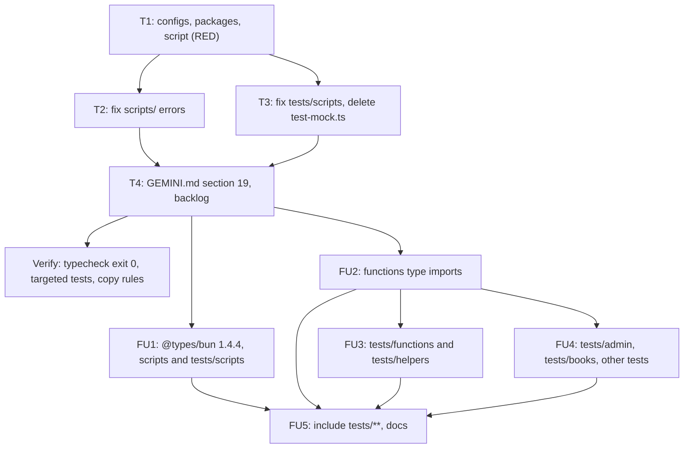

# Dawnbook Typecheck Implementation Plan

> For agentic workers: REQUIRED EXECUTION METHOD: delegated task execution (recommended) or inline plan execution. Steps use checkbox syntax.

**Goal:** `bun run typecheck` checks `scripts/`, `tests/scripts/` and `functions/` with `tsc --noEmit` in strict mode and exits 0.

**Architecture:** two configs because the two runtimes need different global types: the root `tsconfig.json` uses Bun's types for `scripts/` and `tests/scripts/`, and `functions/tsconfig.json` uses `@cloudflare/workers-types` for the Pages Functions. Loading both sets in one program makes `Response.json()` return `unknown` everywhere (66 extra errors measured), so they stay separate. `typecheck` runs both.

**Tech Stack:** TypeScript 5.9.3 (`tsc`), `@cloudflare/workers-types` 5.20261011.1, `@types/bun` 1.2.2 (kept: 1.4.4 raised the Bun-side count from 18 to 45 errors), Bun 1.4.4.

**Active Project Profile:** repository `/home/belajarcarabelajar/Proyek/dawnbook`, session worktree `/mnt/belajarcarabelajar/dawnbook-wt/typecheck` (branch `2026-10-30-dawnbook-typecheck/typecheck`, from `main` 1a9063f3). Before this plan the repository had no `tsconfig.json`, no `typescript` package and no `typecheck` script. Measured on 2026-10-30 with a scratch config outside the repository: `functions/` 0 errors with the Workers types; `scripts/` + `tests/scripts/` 18 errors in 7 files; other test folders 61 errors.

**Project Commands:** `bun run typecheck` (new), `bun test <file>` (targeted, A12), `bun ~/vivera/scripts/check-copy-rules.mjs --diff origin/main`.

**Protected Boundaries:** no runtime behaviour change except adding the missing `reason` field in `scripts/pr-integration-agent.ts`; `books/**` untouched; the worktree's `node_modules` is a symlink to the main checkout (`wt-new`), so the two new packages are installed into the main checkout's `node_modules` on the internal disk rather than installing a second copy on the external disk.

**Scope:** the two configs, the two devDependencies, the script, the fixes for every error the two configs report, the deletion of `tests/scripts/test-mock.ts`, one line in GEMINI.md section 19.

**Non-Goals:** `tests/functions/`, `tests/books/` and the other test folders (61 errors, they import Workers code into Bun tests and need their own typing approach); bumping `@types/bun`; adding `typecheck` to `bun run build`.

**Visual Map:**

**Reasoning Lenses:** Investigative (the measurements above); Computational (two programs, one per runtime); Critical (a type fix must not change behaviour; the one real bug is named); Test-first (the typecheck itself is the RED and GREEN signal, plus the targeted tests of every touched script).

**Acceptance Criteria:**
- AC1: `bun run typecheck` exits 0 and runs `tsc` on both configs.
- AC2: `bun run typecheck` exits non-zero when a type error is introduced in `scripts/` or `functions/` (checked with a scratch mutation, then reverted).
- AC3: targeted tests of the touched scripts still pass.
- AC4: `tests/scripts/test-mock.ts` is gone and nothing referenced it.
- AC5: GEMINI.md section 19 names `bun run typecheck` among the local checks before a merge.

**Traceability:** AC1, AC2: T1, T2, T3 (`bun run typecheck`, mutation). AC3: T2, T3 (`bun test` on the touched areas). AC4: T3 (`git ls-files`, `rg test-mock`). AC5: T4 (copy rules, diff).

**Assumptions & Open Questions:** owner decisions 2026-10-30: scope A (core first), delete `test-mock.ts`. The exact error list is re-measured by T1 after the real install; T2 and T3 fix what it reports in their folders.

**Dependencies & Impact:** two new devDependencies, pinned exact like the others. Main checkout `node_modules` gains them through the worktree symlink before the merge (harmless; its lockfile catches up at the merge).

**Risks & Rollback:** a type-only fix could hide a real bug behind `any`; prefer a typed shape or a narrow cast at the `res.json()` boundary. Rollback: revert the PR; `bun install` removes the two packages.

**Security & Compatibility:** no secrets involved; no runtime code path changes except the added field.

**Operations & Rollout:** none; GitHub Actions stay off (GEMINI.md section 19), so the check is local.

**CI/Review Gate:** `bun run typecheck` exit 0, targeted tests, copy rules, owner review of the PR.

**Documentation:** GEMINI.md section 19 (one line).

**Definition of Done:** AC1 to AC5 with exit codes, PR merged by the owner.

**Plan Status & Version:** InProgress, version 1 (follow-ups FU1 to FU5 chosen at the session-close sweep, 2026-10-30).

**Reproducibility:** `bun install --frozen-lockfile` then `bun run typecheck`.

**Test Reliability:** `tsc` is deterministic for a fixed lockfile.

**Privacy & Data Governance:** N/A, no data handled.

**Dependencies & Supply Chain:** `typescript` 5.9.3 (Apache-2.0) and `@cloudflare/workers-types` 5.20261011.1 (MIT or Apache-2.0, read from the installed `package.json` in T1), both type-only dev tools with no runtime dependency.

**UX States:** N/A.

**Persistent State & Artifact Storage:** N/A.

**Entity & Sourcing Verification:** versions read from installed packages on this machine (bcb, gmail-otp-telegram) on 2026-10-30.

**Verification:** `bun run typecheck` exit 0; mutation check exit non-zero; targeted tests exit 0; copy rules exit 0.

## Global Constraints

- Strict mode on both configs; no `// @ts-nocheck`, no file-wide disables.
- A `@ts-expect-error` is allowed only with a reason on the same line.
- Never install a second `node_modules` in the external-disk worktree.

### Task T1: Configs, packages, script

**Files:** Create `tsconfig.json`, `functions/tsconfig.json`; Modify `package.json`, `bun.lock`.

- [x] Step 1: `cd /mnt/belajarcarabelajar/dawnbook-wt/typecheck && bun add -d --exact typescript@5.9.3 @cloudflare/workers-types@5.20261011.1`
- [x] Step 2: Write `tsconfig.json` (target and lib ESNext plus DOM, `module` Preserve, `moduleResolution` bundler, `types: ["bun"]`, strict, `noEmit`, `skipLibCheck`, `allowImportingTsExtensions`, `resolveJsonModule`, `esModuleInterop`; include `scripts/**/*.ts`, `tests/scripts/**/*.ts`) and `functions/tsconfig.json` (same options with `types: ["@cloudflare/workers-types"]` and lib ESNext only; include `**/*.ts`).
- [x] Step 3: Add `"typecheck": "tsc -p tsconfig.json && tsc -p functions/tsconfig.json"` to `package.json`.
- [x] Step 4: Run: RED | cmd: `bun run typecheck` | expect: exit 1 with the errors listed in Task T2 and Task T3 | retry: 0 | on_fail: if it exits 0, the configs do not cover the measured files; fix the includes.
- [x] Step 5: Commit (parent) by explicit path.

### Task T2: Fix the scripts/ errors

**Files (measured):** `scripts/audit-full-gsc-index.ts` (8 `unknown` JSON results), `scripts/seo-request-reindex.ts` (4), `scripts/check-d1-rate-limit.ts` (1 implicit any), `scripts/og/cards.ts` (no declaration for `opentype.js`: add a minimal local declaration next to it), `scripts/pr-integration-agent.ts` (missing `reason` on the merged result: a real bug, add `reason: ""` as its other result objects do), plus whatever else T1's RED run reports under `scripts/` or `functions/`.

- [x] Step 1: Fix each error with the smallest typed change at its boundary (a declared shape for parsed JSON, a parameter type, a module declaration).
- [x] Step 2: Run: `bun test` on the touched scripts' existing tests | expect: exit 0.
- [x] Step 3: Run: `bun run typecheck` | expect: no error under `scripts/` or `functions/`.
- [x] Step 4: Commit (parent).

### Task T3: Fix tests/scripts and delete the dead file

**Files:** `tests/scripts/render-diagrams.test.ts` (`beforeAll(fn, 60_000)`: Bun 1.4.4 accepts the timeout, the pinned `@types/bun` 1.2.2 does not; keep the timeout with a reasoned `@ts-expect-error`), delete `tests/scripts/test-mock.ts`.

- [x] Step 1: Apply both changes.
- [x] Step 2: Run: `bun test tests/scripts/render-diagrams.test.ts` | expect: exit 0.
- [x] Step 3: Run: `rg -n test-mock --glob '!node_modules' .` | expect: no hit outside this plan.
- [x] Step 4: Commit (parent).

### Task T4: Docs and verification

- [x] Step 1: GEMINI.md section 19: add `bun run typecheck` to the local checks run before a merge.
- [x] Step 2: Mutation check: add a deliberate type error to a scratch copy step (for example `const n: number = "x";` appended to a file under `scripts/`), run `bun run typecheck` (expect non-zero), restore with `git checkout -- <file>`, run it again (expect 0).
- [x] Step 3: Run: `bun run typecheck` exit 0 and copy rules exit 0.
- [x] Step 4: Commit (parent), open the PR.

### Task FU1: @types/bun 1.4.4 (follow-up)

Measured after `bun add -d --exact @types/bun@1.4.4`: 11 errors in the current scope (8 `as typeof fetch` casts in `tests/scripts/`, 2 in the `fetch` default of `scripts/broadcast-old-books.ts`, the now-unused `@ts-expect-error` in `render-diagrams.test.ts`). Fix the casts at the mock boundary, use `deps.fetch ?? fetch` for the default, drop the directive.

### Task FU2: Type imports in functions/ (follow-up)

Bun tests import Pages Functions code, so the Bun program needs `PagesFunction`, `D1Database` and friends: add `import type` lines from `@cloudflare/workers-types` to each file under `functions/` that uses them (same pattern as T2); `functions/tsconfig.json` must stay at exit 0.

### Task FU3: tests/functions and tests/helpers (follow-up)

Type the `fetch` and env mocks (`as unknown as typeof fetch`, typed env objects) so both folders are clean; `bun test tests/functions` stays green.

### Task FU4: tests/admin, tests/books and the rest (follow-up)

Same patterns for the remaining test folders and root test files.

### Task FU5: Widen the root config (follow-up)

`tsconfig.json` includes `tests/**/*.ts`; GEMINI.md section 19 says `tests/` instead of `tests/scripts/`; `bun run typecheck` exit 0; mutation check repeated in a test file.

## Execution Notes

- **Real RED (T1, after the install):** `bun run typecheck` exit 2 with 9 errors, not the 18 of the scratch measurement: the scratch config had put the Workers types on its type roots, which produced the 12 `unknown` JSON errors. The 9: `D1Database` in `functions/lib/auth.ts` and `rate-limit.ts` (pulled into the Bun program by `scripts/gc-rate-limits.ts`, `scripts/check-d1-rate-limit.ts`, `scripts/lib/pr-safety.ts`), `opentype.js` without types, the missing `reason`, the hook timeout argument, and the two dead imports of `test-mock.ts`. `functions/tsconfig.json` alone exited 0.
- **Fixes:** type-only `import type { D1Database } from "@cloudflare/workers-types"` (its `index.ts` exports the class as a module, so no Workers globals enter the Bun program); `scripts/og/opentype.d.ts` typed to opentype.js 1.3.4's source; `reason: ""` like the sibling branches; a reasoned `@ts-expect-error` for the hook timeout.
- **Deleting `test-mock.ts`:** `git rm` is denied by `Bash(git rm *)` in `~/.claude/settings.json`; the owner chose the `~/AGENTS.md` 3.2 path (move to `~/.cache/tmp/`, `rm` there, `git add` stages the deletion).
- **Same-class peers (A39):** other non-test files in `tests/scripts/`: `test-auth-speed.ts` is an intentional probe (its header says so) and typechecks; `test-post.js`, `test-sw.js` and `test_gsc_batch_indexing_ping.py` are outside the typecheck and were left untouched for the owner to judge.
- **Evidence:** `bun run typecheck` exit 0; mutation in `scripts/` exit 2 and in `functions/` exit 2, both restored to exit 0; `bun test tests/functions/lib tests/scripts/pr-safety.test.ts tests/scripts/pr-integration-agent.test.ts tests/scripts/og-cards.test.ts` exit 0 (98 pass); `bun test tests/scripts/render-diagrams.test.ts` exit 0 (12 pass).

## Follow-up Backlog

- `tests/scripts/test-post.js`, `test-sw.js` and `test_gsc_batch_indexing_ping.py` look like scratch files too (not run by `bun test`); defer: owner decision, upgrade-trigger: the next cleanup of `tests/scripts/`.

## Approval

| Gate | Answer | Date |
|---|---|---|
| `Cakupan` | A: core first | 2026-10-30 |
| `test-mock` | delete | 2026-10-30 |
| `Design` | Approve (Bounded: also Gate 2) | 2026-10-30 |
