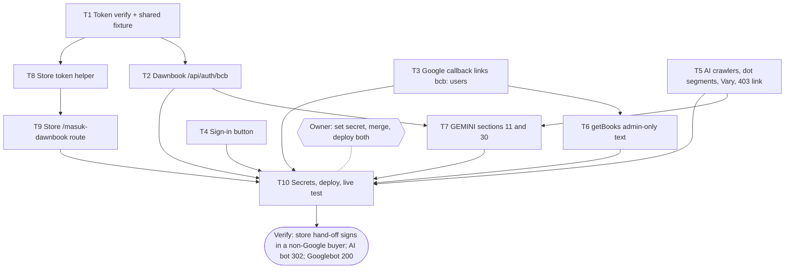

# Premium Follow-ups Implementation Plan

> For agentic workers: REQUIRED EXECUTION METHOD: delegated task execution (recommended) or inline plan execution. Steps use checkbox syntax.

**Goal:** buyers can sign in to Dawnbook through their belajarcarabelajar.com account; verified AI crawlers see only chapter 1 of free books; the last review notes (D5, D11, N3) are closed.

**Architecture:** a store route signs a two-minute single-use token for the session's email and redirects to a Dawnbook endpoint that verifies it and starts a session; both sides share one secret and one test fixture. The middleware's bot pass-through excludes AI crawlers.

**Tech Stack:** Bun 1.4.4, TypeScript, Cloudflare Pages Functions (Dawnbook), Cloudflare Worker `apps/situs` env `apex` (bcb), D1, Web Crypto HMAC-SHA256.

**Active Project Profile:** Dawnbook (`belajarcarabelajar/dawnbook`, main `b42e9eef`, worktree `/mnt/belajarcarabelajar/dawnbook-wt/debt-dawn`) and bcb (`belajarcarabelajar/bcb`, main `ee1077ca`, worktree `/mnt/belajarcarabelajar/bcb-wt/debt-bcb`, dependencies installed in the worktree). Config sources: Dawnbook `package.json`, `wrangler.toml`, `GEMINI.md`; bcb `CLAUDE.md`, `apps/situs/wrangler.toml`.

**Project Commands:** Dawnbook `timeout 120 bun test <file>`, `bun run typecheck`. bcb `timeout 120 bun test <file>`, `bun run typecheck`, gate `bun run check:terarah` (quote `--rencana` in the PR). Deploys: Dawnbook `bash scripts/deploy-website.sh` (needs `~/Proyek/dawnbook-premium`), bcb `bun apps/situs/scripts/build.ts ...` then `wrangler deploy -c wrangler.generated.toml --env apex` (owner).

**Protected Boundaries:** secrets only by the owner (`wrangler secret put DAWNBOOK_SSO_RAHASIA --env apex`, `wrangler pages secret put BCB_SSO_SECRET --project-name dawnbook`); no D1 migration; bcb identifiers and copy in Indonesian, reader copy uses "kamu"; no attribution trailers.

**Spec:** `docs/code-plan/specs/2026-11-01-dawnbook-premium-debt-design.md`

**Scope:** D4 store hand-off (both repos), D2 AI crawlers, D5, D11, N3, docs.

**Non-Goals:** email sending from Dawnbook, `robots.txt` changes, merging user tables.

**Visual Map:**

**Reasoning Lenses:** security (token forgery, replay, open redirect, account linking, fail closed), systems/contract (two repositories, one token format, shared fixture), compatibility (existing Google users unchanged, no migration), operations (secret in two places, two deploys), verification.

**Acceptance Criteria:**

- [x] AC-1: Dawnbook verifies a token only when the signature matches, `exp` is in the future and at most 120 s ahead, the email is valid, and the format is exact; the shared fixture token verifies with the fixture secret.
- [x] AC-2: `GET /api/auth/bcb` with a valid token creates or reuses the user by email (new users get `google_sub = "bcb:<email>"`), starts a session cookie like the Google flow, redirects to a safe same-site `next`; a reused, expired, forged or malformed token, a missing secret, or an unsafe `next` never creates a session; all responses `no-store`.
- [x] AC-3: the Google callback links a user whose `google_sub` starts with `bcb:` and whose email matches; an email held by another Google sub is refused with `account_conflict`; existing Google users are unchanged.
- [x] AC-4: the generated sign-in page shows "Masuk lewat akun belajarcarabelajar.com" linking to `https://belajarcarabelajar.com/masuk-dawnbook?next=<redirect_url path>` and shows Indonesian messages for `sso_invalid`, `sso_unavailable`, `account_conflict`.
- [x] AC-5: a verified AI crawler (GPTBot, ChatGPT-User, OAI-SearchBot, ClaudeBot, Claude-Web, Claude-User, anthropic-ai, PerplexityBot, Perplexity-User, CCBot, Bytespider, Applebot-Extended, meta-externalagent, Amazonbot) gets no pass-through on gated free chapters (302/401); a verified Googlebot still does; `isPublicPath` rejects `.` and `..` segments; the bot branch appends to `Vary`; the premium 403 page links to the store hand-off.
- [x] AC-6: `getBooks` returns `content_md` only when the caller passes an explicit admin flag.
- [x] AC-7: GEMINI.md section 11 records the AI-crawler rule and its revert; section 30 records the store hand-off, the secret names and the revert.
- [x] AC-8: the store helper signs the shared fixture to exactly the fixture token and rejects a short secret; the store route redirects to `/login?next=...` without a session, to Dawnbook with a token with a session, sanitises `next`, answers 503 without the secret; `bun run check:terarah` exits 0.
- [x] AC-9: after the owner sets the secret and deploys both, a non-Google buyer signs in through the store and opens a premium chapter 2; an anonymous request with a GPTBot user agent from a non-verified IP still gets 302 (no change for spoofers), and Googlebot verification is unchanged.

**Traceability:**

| AC | Task | Check | Evidence |
|---|---|---|---|
| AC-1 | T1 | `timeout 120 bun test tests/functions/lib/bcb-sso.test.ts` | exit 0 |
| AC-2 | T2 | `timeout 120 bun test tests/functions/api/auth/bcb.test.ts` | exit 0 |
| AC-3 | T3 | `timeout 120 bun test tests/functions/api/auth/callback-link.test.ts tests/functions/api/auth.test.ts` | exit 0 |
| AC-4 | T4 | `timeout 120 bun test tests/scripts/sign-in-bcb.test.ts` | exit 0 |
| AC-5 | T5 | `timeout 120 bun test tests/functions/ai-crawler.test.ts` | exit 0 |
| AC-6 | T6 | `timeout 120 bun test tests/functions/api/books.test.ts` | exit 0 |
| AC-7 | T7 | `bun ~/vivera/scripts/check-copy-rules.mjs --diff origin/main` | exit 0 and section text |
| AC-8 | T8, T9 | `bun run check:terarah` in the bcb worktree | exit 0 |
| AC-9 | T10 | owner live test and curl probes | recorded in the plan |

**Assumptions & Open Questions:** the reader's Dawnbook `redirect_url` is a same-site path; bcb's `jalurKembaliAman` rules are reused for `next` on both sides; nonce rows live 10 minutes in `rate_limits`; Dawnbook name of the secret `BCB_SSO_SECRET`, bcb name `DAWNBOOK_SSO_RAHASIA`.

**Dependencies & Impact:** bcb route list must also go into `POLA_WORKER_TETAP.apex` and the T6 gate mirror `POLA_AKUN_APEX`; `RAHASIA_WAJIB.apex` documents the new secret.

**Risks & Rollback:** a leaked token is usable for at most 120 s and once; forged tokens need the secret. Rollback: remove the secret on either side (both fail closed), or revert the PRs.

**Security & Compatibility:** constant-time comparison (`crypto.subtle.verify`), domain-separated signing input, fixed redirect origin, `next` validated on both sides; existing Google users unaffected.

**Operations & Rollout:** merge bcb PR and Dawnbook PR, owner sets the secret in both, deploys bcb then Dawnbook; T10 live test.

**CI/Review Gate:** Actions off in Dawnbook; bcb `check:terarah`; independent security review of both diffs before the PRs open.

**Documentation:** GEMINI.md sections 11 and 30 (T7); bcb `apps/situs/wrangler.toml` secret comment block (T9).

**Definition of Done:** AC-1 to AC-9 with evidence; reviews approve; owner live test.

**Plan Status & Version:** Approved 2026-11-01 (`Plan` gate: Approve + fan out), version 1.

**Reproducibility:** shared fixture `tests/fixtures/sso/token.json` (Dawnbook) copied byte for byte into the bcb test.

**Test Reliability:** clocks injected; no network in unit tests.

**Privacy & Data Governance:** the token carries one email in the URL for at most 120 s; never logged; reports and logs never print emails or tokens.

**Dependencies & Supply Chain:** none new.

**UX States:** sign-in page second button; error messages for the three new codes; 403 page link.

**Persistent State & Artifact Storage:** `rate_limits` rows `sso:<nonce>`.

**Entity & Sourcing Verification:** bcb facts from the 2026-11-01 research report (session `cariSesi`, `jalurKembaliAman`, `POLA_WORKER_TETAP`, `tautan-unduh.ts`).

**Verification:** each task's `run[]`; reviews; T10 probes.

## Release evidence (T7, T10, 2026-11-01)

- T7: GEMINI.md sections 11 and 30 written in commit `523d1e2d` (PR #233), checked against `functions/api/auth/bcb.ts` (secret name, `sso:<nonce>`, error codes); copy rules exit 0.
- Merges: bcb #283 (head 315b8ea6), Dawnbook #233 (head 257be169), each with `--match-head-commit`.
- bcb deploy from a clean detached worktree of origin/main `4ef8b49c`: blog and katalog snapshots exit 0, `build.ts --strict --domain` exit 0 (1088 pages, 0 violations), `wrangler deploy --env apex` exit 0, version `cb44ea2a` (previous `942f520c` recorded for rollback).
- Shared secret generated on the owner's PC and set on both sides (values never displayed); rotated once at the owner's request and the new value saved in a Snipset note; Dawnbook redeployed after each Pages secret change (deploys exit 0).
- Live probes: bcb `/masuk-dawnbook` anonymous 303 to `/login?next=...`; Dawnbook `/api/auth/bcb` without a token or with the test-fixture token 302 `sso_invalid`; sign-in page shows the store button; a GPTBot user agent from a non-verified IP gets 302 on a gated free chapter; `redirect_url=%2F%09%2Fevil.com` stores no redirect cookie while a normal path does (positive control); premium regression probes 30 of 30.
- Owner live test: signed in through "Masuk lewat akun belajarcarabelajar.com" with the purchase email and opened a premium chapter 2.

## Global Constraints

- Shared fixture: secret `uji-rahasia-sso-dawnbook-0123456789abcdef` (test only), email `pembeli@contoh.id`, exp `1893456000`, nonce `AAAAAAAAAAAAAAAAAAAAAA`, token computed by T1 and written to `tests/fixtures/sso/token.json`.
- Signing input `dawnbook-sso|<email>|<exp>|<nonce>`; token `base64url(email).<exp>.<nonce>.<base64url signature>`; HMAC-SHA256.
- Max token age 120 s; secrets at least 32 characters.

### Task T1: Token verify and shared fixture
Dawnbook `functions/lib/bcb-sso.ts`: `parseSsoToken`, `verifySsoToken(secret, token, nowSec): { email, nonce } | null`, `signSsoToken` (test-only helper used to build the fixture). Tests: fixture verifies; wrong secret, changed email, expired, exp too far, malformed, short secret all refused.
- [x] Step 1: tests; Step 2: RED; Step 3: implement and write the fixture; Step 4: GREEN; Step 5: commit (parent).

### Task T2: Dawnbook hand-off endpoint
`functions/api/auth/bcb.ts` plus `functions/lib/sso-user.ts` (find user by email; insert with `google_sub = "bcb:<email>"`; mark nonce used in `rate_limits` with `INSERT ... ON CONFLICT DO NOTHING` and check `changes`). Session creation reuses `createSession` and the cookie shape of the Google callback; `next` through the same safe-path check as `safeRedirectPath`.
- [x] Step 1: tests (valid new user, valid existing Google user, reused token, expired, forged, missing secret, unsafe next); Step 2: RED; Step 3: implement; Step 4: GREEN + typecheck; Step 5: commit.

### Task T3: Google callback links store users
In `callback.ts`: lookup by sub, else by email; link when `google_sub` starts with `bcb:`; refuse with `account_conflict` otherwise. `db.ts` gains `linkGoogleSub`.
- [x] Step 1: tests; Step 2: RED; Step 3: implement; Step 4: GREEN; Step 5: commit.

### Task T4: Sign-in button
`template-engine.ts`: second button and three error messages (Indonesian, "kamu").
- [x] Step 1: test on the generated HTML; Step 2: RED; Step 3: implement; Step 4: GREEN; Step 5: commit.

### Task T5: AI crawlers, dot segments, Vary, 403 link
`gating.ts`: `isAiCrawler(ua)`, `.`/`..` rejection in `isPublicPath`; `_middleware.ts`: bypass only for verified non-AI bots, `Vary` appended, 403 page link "Masuk lewat akun belajarcarabelajar.com".
- [x] Step 1: tests; Step 2: RED; Step 3: implement; Step 4: GREEN; Step 5: commit.

### Task T6: getBooks admin-only text
`getBooks(db, { ..., isAdmin })` returns `content_md` only when `includeContent && isAdmin`; caller updated.
- [x] Step 1: test `getBooks admin`; Step 2: RED; Step 3: implement; Step 4: GREEN; Step 5: commit.

### Task T7: Documentation
GEMINI.md section 11 (AI crawler rule, list, revert) and section 30 (store hand-off, secret names, failure modes, revert). No em dash.
- [x] Step 1: write; Step 2: copy-rules exit 0; Step 3: commit.

### Task T8: Store token helper
bcb `packages/data/src/akun/tautan-dawnbook.ts`: `buatTokenDawnbook(rahasia, email, sekarangDetik, nonce?)`, `periksaRahasia` (32 characters). Test: the shared fixture gives exactly the fixture token.
- [x] Step 1: tests; Step 2: RED; Step 3: implement; Step 4: GREEN; Step 5: commit (parent, bcb worktree).

### Task T9: Store route
bcb `apps/situs/src/akun/masuk-dawnbook.ts` (`RE_MASUK_DAWNBOOK`, session via `cariSesi`, `/login?next=` with pathname+search, `next` via `jalurKembaliAman`, 303 to the fixed Dawnbook origin, 503 without the secret, `headerPrivat`); wiring in `worker.ts`; `/masuk-dawnbook` in `host.ts` `POLA_WORKER_TETAP.apex` and `cek-akun.ts` `POLA_AKUN_APEX`; `DAWNBOOK_SSO_RAHASIA` in `RAHASIA_WAJIB.apex` and the `wrangler.toml` comment block.
- [x] Step 1: tests; Step 2: RED; Step 3: implement; Step 4: GREEN; Step 5: `bun run check:terarah` exit 0; Step 6: commit.

### Task T10: Release and live test
- [x] Step 1: merge both PRs (owner).
- [x] Step 2: owner sets the same secret: `wrangler secret put DAWNBOOK_SSO_RAHASIA --env apex` (bcb) and `bunx wrangler pages secret put BCB_SSO_SECRET --project-name dawnbook`.
- [x] Step 3: deploy bcb, then Dawnbook (owner request).
- [x] Step 4: probes: `/api/auth/bcb` without a token redirects to `/sign-in?error=sso_invalid`; GPTBot UA from this machine gets 302 on a gated free chapter; owner signs in through the store with a non-Google purchase email and opens a premium chapter 2.

## Closeout status

- 2026-11-01: `bun ~/vivera/scripts/plan-closeout.mjs --readiness docs/code-plan/plans/2026-11-01-dawnbook-premium-debt.md` verdict NEEDS-HUMAN (exit 3): T1 to T6, T8, T9 DONE by their `skip_if`; T7 and T10 UNPROVEN because their proof is human evidence, recorded under Release evidence; 0 open boxes. Owner answered `Close plan`: Keep it open. Reopen trigger: the owner's call.
- The T6 `skip_if` pointed at the wrong test file (`tests/functions/api/books.test.ts`, where the filter matched no test); corrected to `tests/functions/lib/db.test.ts` in the closeout session.
- Follow-ups selected in the debt sweep and done in the closeout session: D12 (sign-up page Google button never got its click handler), D13 (the store hand-off is bound to a short-lived state cookie set by Dawnbook, against login CSRF), D14 (bcb `/masuk-dawnbook` matches the exact path only, like `run_worker_first`).
- 2026-11-02: closed by the owner. Still open as backlog, not part of this plan: D15 (the sign-up page title loses its `data-i18n="signin.title"` key) and D16 (`session_id` and `oauth_state` cookies have no `__Host-` prefix; renaming signs every reader out once).
