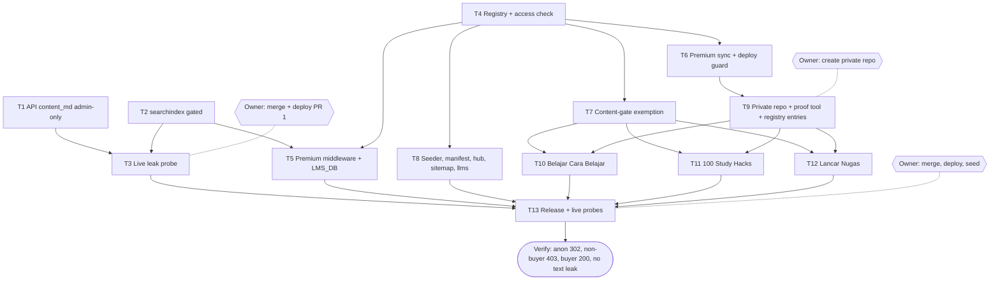

# Premium e-book Dawnbooks Implementation Plan

> For agentic workers: REQUIRED EXECUTION METHOD: delegated task execution (recommended) or inline plan execution. Steps use checkbox syntax.

**Goal:** turn the three paid BCB e-books into premium Dawnbooks, verbatim, whose chapters after the first open only for readers with a purchase right, after closing the three anonymous text leaks for every book.

**Architecture:** the edge middleware gains a premium rule that runs before the public-path rule and the verified-bot pass-through, and asks the store database (`bcbacademy-lms`, new binding `LMS_DB`) one SELECT per gated request. Premium book folders live in a private repository and are copied into gitignored `books/<slug>` folders by a sync step before the build; the build skips content gates for registered premium slugs, and premium text never reaches the seed file, the API, or a public asset.

**Tech Stack:** Bun 1.4.4, TypeScript, Cloudflare Pages Functions, D1, mdBook 0.5.4, markitdown, poppler `pdftotext`/`pdfimages`.

**Active Project Profile:** repository `belajarcarabelajar/dawnbook` (public), main checkout `~/Proyek/dawnbook`, session worktrees under `/mnt/belajarcarabelajar/dawnbook-wt/`, base `fd86ec10` (origin/main, 2026-11-01). Config sources: `package.json`, `wrangler.toml`, `tsconfig.json`, `functions/tsconfig.json`, `GEMINI.md` (AGENTS.md and CLAUDE.md are symlinks to it). GitHub Actions are off (GEMINI.md section 19): every check runs locally.

**Project Commands:** tests `timeout 120 bun test <file>` (targeted, A12); types `bun run typecheck`; build `bun run build`; gates `bun run check:structure`, `bun run check:covers --book <slug>`, `bun run check:voice`, `bun run check:headings`; deploy `set -a && source ~/cloudflare/.env && set +a && bash scripts/deploy-website.sh` (owner request only); seed `bun run scripts/migrate-to-d1.ts` (owner request only).

**Protected Boundaries:** `books/_template/book.toml` and per-book `book.toml` rules (GEMINI.md section 1); the store database is written only by the bcb repository (SELECT only here); no premium text in this repository, `db/seed.sql`, the API, or any public asset; `db/seed.sql` in the main checkout carries an unstaged owner edit and is never touched by a session worktree.

**Spec:** `docs/code-plan/specs/2026-11-01-dawnbook-premium-ebooks-design.md`

**Scope:** the three leak fixes for all books; premium registry, access check, middleware rule and binding; premium sync and deploy guard; content-gate exemption; premium-aware seeder, manifest, hub card, sitemap and llms.txt; private repository; three verbatim books; release and live probes.

**Non-Goals:** email OTP sign-in; Grandbook Pro; the public Drive link on `/membership`; any rewrite of premium text; anonymous in-book search on free books.

**Visual Map:**

**Reasoning Lenses:** intent (owner's four decisions), investigative (three leaks measured with curl), security/privacy (fail-closed gate, no bot bypass, SELECT-only on a foreign database, no premium bytes in public artifacts), systems/contract (`/api/books` contract change, registry shape shared by four modules), trade-off (copy vs symlink vs submodule, scored 36/28/27), compatibility (hub only calls `?content=false`; old seed rows keep working), operations (deploy guard, post-deploy probes, rollback by redeploy), verification (verbatim proof plus a per-chapter read).

**Acceptance Criteria:**

- [x] AC-1: `GET /api/books/<slug>` returns no `content_md` for anonymous and reader sessions and still returns it for admins.
- [x] AC-2: `GET /api/books?content=true` returns no `content_md` unless the session is admin.
- [x] AC-3: `/books/<slug>/searchindex*` requires a session (anonymous HTML gets 302, other clients 401); other book assets keep their current policy.
- [x] AC-4: after the owner deploys PR 1, the three anonymous probes return no book text.
- [x] AC-5: the access check allows a `member` row for any product, an `unduhan` row for one of the book's products, or an `allowlist` row; refuses revoked rows, other products' `unduhan`, and unknown emails; compares emails trimmed and lower-cased; returns `unavailable` on a missing binding or a database error.
- [x] AC-6: on a premium book, the root, `index`, `toc`, chapter 1, theme assets and `images/public/` are served without a session; every other path gives 302 (HTML) or 401 without a session, 403 with the product, bundle and "sign in with your purchase email" links without a right, 200 `private, no-store` with a right, 503 when the check is unavailable; a verified bot gets no bypass.
- [x] AC-7: `premium-sync` copies each registry slug from `DAWNBOOK_PREMIUM_DIR` (default `../dawnbook-premium`) into `books/<slug>`, refuses a slug that is not git-ignored, and skips with a warning when the source is missing; the deploy script refuses to deploy when a registry slug has no `output/books/<slug>/index.html`.
- [x] AC-8: voice, heading-colon, repeated-heading and structure content rules skip registry slugs; structure's technical rules (SUMMARY match, links, description length, no stray markdown) and the cover gate still fail on a broken premium fixture.
- [x] AC-9: the seeder writes `content_md = ''` for premium slugs; `manifest.json` marks premium books; the hub card shows a Premium label; sitemap and llms.txt list only the book root and chapter 1 of a premium book.
- [x] AC-10: `belajarcarabelajar/dawnbook-premium` exists and is private; the registry lists the three slugs with their product ids and product links; the proof tool exits non-zero on a fixture with one dropped word and zero on an identical one.
- [x] AC-11: Belajar Cara Belajar: verbatim proof exit 0, structure and cover gates exit 0 after sync, chapter 1 images only under `images/public/`.
- [x] AC-12: 100 Study Hacks: same checks as AC-11.
- [x] AC-13: Lancar Nugas: same checks as AC-11.
- [x] AC-14: on the owner's request: full build exit 0, deploy, seed; live probes give anonymous chapter 2 a 302, a signed-in non-buyer 403, a buyer 200 (owner's account), and a sentinel sentence from each book appears 0 times in `db/seed.sql`, `/api/books?content=true` and the search index served anonymously.

**Traceability:**

| AC | Task | Check | Evidence |
|---|---|---|---|
| AC-1, AC-2 | T1 | `timeout 120 bun test tests/functions/api/books.test.ts 'tests/functions/api/books/[slug].test.ts'` | RED then exit 0 |
| AC-3 | T2 | `timeout 120 bun test tests/functions/lib/gating.test.ts tests/functions/middleware.test.ts` | RED then exit 0 |
| AC-4 | T3 | the three `curl` probes in T3 `run[]` | exit 0 each |
| AC-5 | T4 | `timeout 120 bun test tests/functions/lib/premium.test.ts` | exit 0 |
| AC-6 | T5 | `timeout 120 bun test tests/functions/premium-middleware.test.ts` | exit 0 |
| AC-7 | T6 | `timeout 120 bun test tests/scripts/premium-sync.test.ts` | exit 0 |
| AC-8 | T7 | `timeout 120 bun test tests/scripts/premium-gates.test.ts` | exit 0 |
| AC-9 | T8 | `timeout 120 bun test tests/scripts/premium-surfaces.test.ts` | exit 0 |
| AC-10 | T9 | `timeout 120 bun test tests/scripts/verbatim-proof.test.ts` | exit 0, repo private |
| AC-11 | T10 | `bun run scripts/premium/verbatim-proof.ts --pdf $HOME/Proyek/dawnbook-premium/.cache/belajar-cara-belajar.pdf --book $HOME/Proyek/dawnbook-premium/books/belajar-cara-belajar --accept $HOME/Proyek/dawnbook-premium/books/belajar-cara-belajar/verbatim-accept.json` | exit 0 plus allowed-difference list |
| AC-12 | T11 | `bun run scripts/premium/verbatim-proof.ts --pdf $HOME/Proyek/dawnbook-premium/.cache/100-study-hacks.pdf --book $HOME/Proyek/dawnbook-premium/books/100-study-hacks --accept $HOME/Proyek/dawnbook-premium/books/100-study-hacks/verbatim-accept.json` | exit 0 plus allowed-difference list |
| AC-13 | T12 | `bun run scripts/premium/verbatim-proof.ts --pdf $HOME/Proyek/dawnbook-premium/.cache/lancar-nugas.pdf --book $HOME/Proyek/dawnbook-premium/books/lancar-nugas --accept $HOME/Proyek/dawnbook-premium/books/lancar-nugas/verbatim-accept.json` | exit 0 plus allowed-difference list |
| AC-14 | T13 | `bun run build` plus the release probes in Task T13 | exit 0, status codes recorded |

**Assumptions & Open Questions:**
- Slugs `belajar-cara-belajar`, `100-study-hacks`, `lancar-nugas`; product ids `P-Z1vYc0z`, `P-ZWIJwL`, `P-Ffa6A` (read from `bcb-admin.products` on 2026-11-01); product pages `/product/ebook-belajar-cara-belajar`, `/product/ebook-100-study-hacks`, `/product/ebook-lancar-nugas`, bundle `/product/bundle-ebook-bcb`.
- The bundle (`P-Z4FtJH`) and Membership VIP (`P-1MUzOd`) are `member` rows, so the `member` rule covers them; Shinobidone (`P-Z1LSw6j`) is included on purpose (Section 3).
- The PDFs are read from `../dawnbook-premium/.cache/` (gitignored in the private repo), copied from R2 `bcb-admin-media/member/<slug>.pdf`.
- Chapter 1 is the e-book's first content section; the subagent proposes the split and the parent reviews it.
- Covers are new hand-written SVGs (GEMINI.md section 27); the author is Iwan Kurniawan.

**Dependencies & Impact:** `bcbacademy-lms` tables `entitlements` and `allowlist` (schema in bcb `apps/dashboard/migrations-lms/`); a schema change there breaks T4's query, so T4's test fixture copies the column names and the release probe runs the real query once. Manifest consumers `announce-new-books.ts` and `broadcast-old-books.ts` must ignore the new `premium` field (the broadcast queue is frozen and never sees new books).

**Risks & Rollback:**
- Fail-open by mistake: covered by the 503 test and the bot test in T5. Rollback: redeploy the previous `output/` (Pages deployment list) and empty the registry.
- Deploy without premium books from a contributor checkout: blocked by the T6 guard.
- Text in images missed by `pdftotext` (100 Study Hacks has 1,206 images): kept as images under the gate; the per-chapter read lists every image kept.
- Rollback of PR 1 alone: `git revert` of its merge and redeploy; no data changes.

**Security & Compatibility:** SELECT-only queries with bound parameters; no email or entitlement data in logs or responses; 403 page shows the signed-in email only to that reader. `/api/books` keeps its shape and drops `content_md` for non-admins; no reader feature uses it.

**Operations & Rollout:** three PRs in order (leaks, gate, content and release). Each deploy is the owner's request; post-deploy probes are T3 and T13. Observability: Pages Functions logs show 503s from the access check.

**CI/Review Gate:** Actions are off; each PR carries the targeted test commands with exit codes, `bun run typecheck` exit 0, an independent review of the diff, and copy-rules (`bun ~/vivera/scripts/check-copy-rules.mjs --diff origin/main`) exit 0.

**Documentation:** GEMINI.md new section 30 (premium books: registry, access rule, sync, deploy guard, exemptions, revert) in PR 2; README of the private repo in T9.

**Definition of Done:** AC-1 to AC-14 checked with evidence; plan ticked from runner logs; owner answered the `Close plan` gate.

**Plan Status & Version:** Approved 2026-11-01 (`Plan` gate: Approve + fan out), version 1.

**Reproducibility:** Bun 1.4.4, mdBook from `~/.cargo/bin`, markitdown at `~/.local/bin/markitdown`, poppler-utils; PDFs fetched with `cf r2 objects get member/<slug>.pdf --bucket-name bcb-admin-media`.

**Test Reliability:** unit tests use fake D1 objects from `tests/helpers/mocks.ts`; no network in unit tests; live probes are separate tasks.

**Privacy & Data Governance:** store emails are personal data: tests use synthetic emails; queries return only `1`; no email lists are written to files or logs.

**Dependencies & Supply Chain:** no new packages; markitdown and poppler are local tools, not dependencies.

**UX States:** sign-in redirect returns to the requested chapter; 403 page in Indonesian with three links; 503 page says to try again later; hub Premium label.

**Persistent State & Artifact Storage:** N/A beyond the registry file and the private repository.

**Entity & Sourcing Verification:** table and column names read from bcb `apps/dashboard/migrations-lms/0000_dasar.sql` and `0001_pembayaran.sql`; product ids from a live read of `bcb-admin.products`.

**Verification:** every task's `run[]` plus the T13 checklist; final message lists each command with its exit code.

## Release evidence (T13, 2026-11-01)

- PRs merged in order: #228 (head 44cb875e), #229 (head 121be898), #230 (head cc4b8cf4), each with `--match-head-commit`.
- Deploy: `bash scripts/deploy-website.sh` from `~/Proyek/dawnbook` (main 4b295239) exit 0; Telegram announced the three books. Pages project bindings via the Cloudflare API: `DB` and `LMS_DB` (`c080046a-...`).
- Seed: `bun run scripts/migrate-to-d1.ts` exit 0; D1 rows of the three books `published` with `length(content_md) = 0`; sentinel phrases from chapters 2 to 4 of each premium book found 0 times in `db/seed.sql` (positive control: 3 of 3 free-book sentinels found).
- Anonymous live probes: API `content_md` absent, `?content=true` without text, free search index gated; per premium book root 200, chapter 1 308 to the clean URL then 200, chapter 2 302 (HTML), 401 (fetch), 302 with `//` and with a Googlebot UA, search index 401, sitemap 2 URLs.
- Signed-in probes by the owner: a purchase-right account opened chapter 2; an account without a right got the 403 "Belum punya akses" page with the buy, bundle and other-account links.

## Global Constraints

- No premium text in this repository, `db/seed.sql`, `/api/books`, or a public asset.
- Store database: SELECT only, bound parameters.
- Premium gate fails closed (503), never open.
- No bot bypass on premium chapters.
- Deploy, seed, merge, and repository creation only on the owner's explicit request.
- Commits as `Iwan Kurniawan <iwan@belajarcarabelajar.com>`, no attribution lines.

### Task T1: Book API returns book text only to admins

**Files:**
- Modify: `functions/api/books/[slug].ts:40-63`, `functions/api/books/index.ts:42-61`
- Test: `tests/functions/api/books/[slug].test.ts`, `tests/functions/api/books.test.ts`

**Interfaces:**
- Consumes: `verifySession` from `functions/lib/auth.ts`.
- Produces: unchanged response shape; `content_md` absent for non-admins.

**Preconditions:**
- [x] Worktree of session `premium-leaks` exists (else `E_PRECOND_UPSTREAM`).

**Idempotency Check:** skip when the `skip_if` test run exits 0.

**Behavior & Acceptance:** AC-1, AC-2.

**Edge Cases & Failure Behavior:** reader (non-admin) session behaves like anonymous; admin draft access unchanged; `?content=false` unchanged.

**Deliberate Shortcuts & Deferrals:** None.

**Dependencies & Risks:** the admin app may read `content_md`; it runs as admin, so it keeps it.

**Review & Evidence:** RED and GREEN exit codes.

**Reasoning Output:** smallest contract change that closes two of three leaks.

**Test Data & Determinism:** mocked session and D1 from existing helpers.

- [x] Step 1: add tests named `... content_md ...` asserting absence for anonymous and reader, presence for admin, on both endpoints.
- [x] Step 2: Run: verify fail | cmd: `timeout 120 bun test tests/functions/api/books.test.ts 'tests/functions/api/books/[slug].test.ts' -t 'content_md'` | expect: exit 1 | retry: 0 | on_fail: n/a
- [x] Step 3: select `content_md` only when `isAdmin`; ignore `content=true` for non-admins.
- [x] Step 4: Run: verify pass | cmd: `timeout 120 bun test tests/functions/api/books.test.ts 'tests/functions/api/books/[slug].test.ts'` | expect: exit 0 | retry: 1 | on_fail: mark FAILED, halt T3
- [x] Step 5: Commit (parent): `git add 'functions/api/books/[slug].ts' functions/api/books/index.ts 'tests/functions/api/books/[slug].test.ts' tests/functions/api/books.test.ts && git commit -m "fix(api): return book text only to admins"`

### Task T2: Search index is gated content

**Files:**
- Modify: `functions/lib/gating.ts` (rule before the asset-extension check)
- Test: `tests/functions/lib/gating.test.ts`, `tests/functions/middleware.test.ts`

**Interfaces:**
- Produces: `isPublicPath("/books/<slug>/searchindex-<hash>.js") === false`, same for `searchindex.json` and `searchindex.js`.

**Preconditions:**
- [x] Session `premium-leaks` worktree.

**Idempotency Check:** skip when the `skip_if` test run exits 0.

**Behavior & Acceptance:** AC-3.

**Edge Cases & Failure Behavior:** other `.js`/`.css`/font assets under `/books/<slug>/` stay public; a URL-encoded path is decoded first (existing behaviour).

**Deliberate Shortcuts & Deferrals:** anonymous search on free books stops working: `defer: accepted loss, upgrade-trigger: owner asks for a public-only index`.

**Dependencies & Risks:** mdBook hashes the file name; the rule matches the `searchindex` prefix.

**Review & Evidence:** RED, GREEN, typecheck exit codes.

**Reasoning Output:** the rule belongs in the shared policy so the middleware needs no change.

**Test Data & Determinism:** pure function tests plus one middleware request test.

- [x] Step 1: add tests named `... searchindex ...` (policy: false for the three names; middleware: anonymous HTML 302, fetch 401).
- [x] Step 2: Run: verify fail | cmd: `timeout 120 bun test tests/functions/lib/gating.test.ts tests/functions/middleware.test.ts -t 'searchindex'` | expect: exit 1 | retry: 0 | on_fail: n/a
- [x] Step 3: add the `searchindex` rule.
- [x] Step 4: Run: verify pass | cmd: `timeout 120 bun test tests/functions/lib/gating.test.ts tests/functions/middleware.test.ts tests/functions/gating.test.ts tests/functions/edge-gating-integration.test.ts` | expect: exit 0 | retry: 1 | on_fail: mark FAILED, halt T3 and T5
- [x] Step 5: Run: `bun run typecheck` | expect: exit 0
- [x] Step 6: Commit (parent): `git add functions/lib/gating.ts tests/functions/lib/gating.test.ts tests/functions/middleware.test.ts && git commit -m "fix(gating): require a session for book search indexes"`

### Task T3: Live leak probe after the PR 1 deploy

**Files:** create `scripts/premium/probe-searchindex.sh` in T2's commit set? No: it is created here, in the same session, before the owner deploys (it reads the live index page, extracts the hashed search index name, and exits 0 only when that URL answers 302 or 401 without a cookie).

**Interfaces:** none.

**Preconditions:**
- [x] PR 1 merged and deployed on the owner's request (gate G1) (else `E_PRECOND_UPSTREAM`).

**Idempotency Check:** skip when the first probe exits 0.

**Behavior & Acceptance:** AC-4.

**Edge Cases & Failure Behavior:** Cloudflare caching disabled by `_headers` (section 3); a stale response means the deploy did not land.

**Deliberate Shortcuts & Deferrals:** None.

**Dependencies & Risks:** network.

**Review & Evidence:** three exit codes and the byte counts before (96,919 / 5,371,594 / 883,950) and after.

**Reasoning Output:** the unit tests prove the code, this proves the deployment.

**Test Data & Determinism:** live site, read-only GETs.

- [x] Step 1: write `scripts/premium/probe-searchindex.sh` and commit it with PR 1 before the merge.
- [x] Step 2: Run the three `run[]` probes | expect: exit 0 each | retry: 1 | on_fail: report to owner, do not start T13

### Task T4: Premium registry and access check

**Files:**
- Create: `data/premium-books.json` (`{"books": {}}` in this PR; entries arrive in T9), `functions/lib/premium.ts`, `tests/functions/lib/premium.test.ts`

**Interfaces:**
- Produces: `type PremiumEntry = { products: string[]; productUrl: string }`; `loadPremiumRegistry(): Record<string, PremiumEntry>`; `premiumSlugOf(pathname: string): string | null`; `isPremiumPublicPage(pathname: string): boolean`; `checkPremiumAccess(lms: D1Database | undefined, email: string, entry: PremiumEntry): Promise<"allowed" | "refused" | "unavailable">`.

**Preconditions:**
- [x] Session `premium-gate` worktree, stacked on the `premium-leaks` branch so PR 2 can start before PR 1 merges (else `E_PRECOND_UPSTREAM`).

**Idempotency Check:** skip when the test file exits 0.

**Behavior & Acceptance:** AC-5.

**Edge Cases & Failure Behavior:** empty email → refused without a query; `products` empty → only `member` and `allowlist` count; query throws → `unavailable`.

**Deliberate Shortcuts & Deferrals:** registry bundled as JSON import: `defer: redeploy to change it, upgrade-trigger: more than 10 premium books or per-book prices`.

**Dependencies & Risks:** store schema drift; mitigated by T13's real query.

**Review & Evidence:** RED (test file before module), GREEN exit 0.

**Reasoning Output:** one query with `UNION ALL ... LIMIT 1` keeps D1 reads at one statement per gated request.

**Test Data & Determinism:** fake D1 that evaluates the bound parameters against in-memory rows (synthetic emails only).

- [x] Step 1: write `tests/functions/lib/premium.test.ts` (allowed via member of any product, via matching unduhan, via allowlist; refused for revoked, other product, unknown; case and whitespace of email; unavailable for missing binding and throwing query; `premiumSlugOf`, `isPremiumPublicPage` for root, index, toc, `content/01_*`, theme assets, `images/public/x.png`, and gated `content/02_*`, `images/x.png`, `searchindex-x.js`).
- [x] Step 2: Run: verify fail | cmd: `timeout 120 bun test tests/functions/lib/premium.test.ts` | expect: exit 1 | retry: 0 | on_fail: n/a
- [x] Step 3: implement `functions/lib/premium.ts` and the empty registry.
- [x] Step 4: Run: verify pass | same cmd | expect: exit 0 | retry: 1 | on_fail: halt T5 to T8
- [x] Step 5: Commit (parent) by explicit paths.

### Task T5: Premium rule in the middleware and the store binding

**Files:**
- Modify: `functions/_middleware.ts` (premium branch before `isPublicPath` and `isVerifiedBotRequest`), `wrangler.toml` (`[[d1_databases]] binding = "LMS_DB"`, `database_name = "bcbacademy-lms"`, `database_id = "c080046a-72d6-4533-98bc-acedcf7b7ea3"`)
- Create: `tests/functions/premium-middleware.test.ts`

**Interfaces:**
- Consumes: T4 exports, `verifySession`.
- Produces: `Env.LMS_DB?: D1Database`; 403 and 503 HTML pages built inside the middleware.

**Preconditions:**
- [x] T2 and T4 committed on this branch's base.

**Idempotency Check:** skip when the new test file exits 0.

**Behavior & Acceptance:** AC-6.

**Edge Cases & Failure Behavior:** registry empty → middleware behaves exactly as today (existing tests stay green); non-HTML gated request without session → 401 JSON; 403 page escapes the email.

**Deliberate Shortcuts & Deferrals:** None.

**Dependencies & Risks:** binding missing in production until deploy reads `wrangler.toml`: covered by 503 and by T13 probes.

**Review & Evidence:** test and typecheck exit codes; independent review of ordering.

**Reasoning Output:** premium check first so neither the public rule nor the bot pass-through can open a premium chapter.

**Test Data & Determinism:** registry injected through a test seam (`setPremiumRegistryForTest`) so the shipped registry stays empty.

- [x] Step 1: write the middleware tests (each AC-6 case, plus a free book unchanged).
- [x] Step 2: Run: verify fail | cmd: `timeout 120 bun test tests/functions/premium-middleware.test.ts` | expect: exit 1 | retry: 0 | on_fail: n/a
- [x] Step 3: implement the branch and the binding.
- [x] Step 4: Run the two `run[]` commands | expect: exit 0 | retry: 1 | on_fail: halt T13
- [x] Step 5: Commit (parent) by explicit paths.

### Task T6: Premium sync and deploy guard

**Files:**
- Create: `scripts/premium-sync.ts` (`--slug <slug>` limits to one), `scripts/check-premium-output.ts`, `tests/scripts/premium-sync.test.ts`
- Modify: `scripts/build.ts` (sync first), `scripts/deploy-website.sh` (run `bun run scripts/check-premium-output.ts` before `wrangler pages deploy`)

**Interfaces:**
- Consumes: `data/premium-books.json`.
- Produces: `syncPremiumBooks({ sourceDir, booksDir, slugs, isIgnored }): { copied: string[]; skipped: string[] }`; `checkPremiumOutput(outputDir): string[]` (missing slugs).

**Preconditions:** T4 committed.

**Idempotency Check:** skip when the test file exits 0.

**Behavior & Acceptance:** AC-7.

**Edge Cases & Failure Behavior:** existing `books/<slug>` replaced wholesale (stale chapters removed); slug not git-ignored → exit 1 naming it; source missing → warning, build continues, deploy guard later refuses.

**Deliberate Shortcuts & Deferrals:** None.

**Dependencies & Risks:** `.gitignore` lines for the slugs are added in T9 together with the registry entries.

**Review & Evidence:** test exit code; `bash -n scripts/deploy-website.sh` exit 0.

**Reasoning Output:** copy keeps the twelve `isDirectory()` scanners working.

**Test Data & Determinism:** temp dirs under `$HOME/.cache/tmp/dawnbook-scratch` (A14); `isIgnored` injected.

- [x] Step 1: write tests; Step 2: RED `timeout 120 bun test tests/scripts/premium-sync.test.ts` expect exit 1; Step 3: implement; Step 4: GREEN expect exit 0; Step 5: commit (parent).

### Task T7: Content gates skip premium books

**Files:**
- Modify: `scripts/check-voice.ts`, `scripts/check-heading-colons.ts`, `scripts/check-book-structure.ts` (content rules only: em dash, emoji, "Anda", opener 155, repeated headings), `scripts/check-repeated-headings.ts`
- Create: `tests/scripts/premium-gates.test.ts`

**Interfaces:** each gate reads `premiumSlugs()` from a small helper exported by `functions/lib/premium.ts` (registry keys).

**Preconditions:** T4 committed.

**Idempotency Check:** skip when the test file exits 0.

**Behavior & Acceptance:** AC-8.

**Edge Cases & Failure Behavior:** a premium fixture with a SUMMARY mismatch, a broken link or a 90-character description still fails.

**Deliberate Shortcuts & Deferrals:** None.

**Dependencies & Risks:** GEMINI.md sections 14, 16, 24, 29 gain a one-line premium exception (written in T8's GEMINI.md section 30, referenced from each).

**Review & Evidence:** test exit code and `bun run check:structure` exit 0 on the current books.

**Reasoning Output:** exemption keyed by the registry, not by a marker in the book, so premium text needs no edit.

**Test Data & Determinism:** fixture books in `tests/fixtures/premium/`.

- [x] Step 1: tests; Step 2: RED expect exit 1; Step 3: implement; Step 4: GREEN expect exit 0; Step 5: `bun run check:structure` exit 0; Step 6: commit (parent).

### Task T8: Seeder, manifest, hub card, sitemap and llms.txt

**Files:**
- Modify: `scripts/migrate-to-d1.ts`, `scripts/builder/template-engine.ts` (manifest `premium` list and hub card label), `scripts/generate-sitemap.ts`, `scripts/generate-llmstxt.ts`, `GEMINI.md` (new section 30)
- Create: `tests/scripts/premium-surfaces.test.ts`

**Interfaces:** `manifest.json` gains `premium: string[]` (slugs); existing keys unchanged.

**Preconditions:** T4 committed.

**Idempotency Check:** skip when the test file exits 0.

**Behavior & Acceptance:** AC-9.

**Edge Cases & Failure Behavior:** announce and broadcast scripts read only `books` and `chapters`, so the new key is ignored (checked by their existing tests).

**Deliberate Shortcuts & Deferrals:** None.

**Dependencies & Risks:** `db/seed.sql` regeneration only on the owner's seed request.

**Review & Evidence:** test and typecheck exit codes.

**Reasoning Output:** one `premium` list in the manifest feeds the hub, sitemap and llms.txt.

**Test Data & Determinism:** fixture manifest and books.

- [x] Step 1: tests; Step 2: RED expect exit 1; Step 3: implement plus GEMINI.md section 30 (registry, access rule, sync, deploy guard, exemptions, revert); Step 4: GREEN expect exit 0; Step 5: typecheck exit 0; Step 6: commit (parent).

### Task T9: Private source, proof tool and registry entries

**Files:**
- Create: `scripts/premium/verbatim-proof.ts`, `tests/scripts/verbatim-proof.test.ts`
- Modify: `data/premium-books.json` (three entries), `.gitignore` (three `books/<slug>/` lines)

**Interfaces:** `verbatim-proof --pdf <file> --book <dir>`: tokenises `pdftotext -layout` output and the chapters in SUMMARY order (Markdown syntax stripped), prints every difference with its page, exits 0 only when each difference matches the allowed list (page numbers, repeated running headers and footers detected as lines on 3 or more pages).

**Preconditions:**
- [x] Owner confirmed creating the private repository (gate G2, its own question with the safe option first).

**Idempotency Check:** skip when the proof test exits 0.

**Behavior & Acceptance:** AC-10.

**Edge Cases & Failure Behavior:** emoji and punctuation compared as tokens; ligatures normalised (NFKC).

**Deliberate Shortcuts & Deferrals:** None.

**Dependencies & Risks:** repository creation is outward-facing (parent only, after G2).

**Review & Evidence:** test exit code; `gh repo view` shows private.

**Reasoning Output:** a mechanical proof first, then a human-style read, matches section 16 and the owner's verbatim request.

**Test Data & Determinism:** synthetic text fixtures, no real e-book text in this repository.

- [x] Step 1: ask G2; on approval `gh repo create belajarcarabelajar/dawnbook-premium --private` and clone to `../dawnbook-premium` with README (layout, sync, never publish) and `.gitignore` (`.cache/`).
- [x] Step 2: copy the three PDFs to `../dawnbook-premium/.cache/`.
- [x] Step 3: proof tool tests; RED expect exit 1; implement; GREEN expect exit 0.
- [x] Step 4: registry entries and `.gitignore` lines; commit (parent).

### Task T10: Belajar Cara Belajar

**Files:** private repository `books/belajar-cara-belajar/` (book.toml, cover.svg, src/SUMMARY.md, src/content/NN_<kebab>.md, src/images/, src/images/public/), `sources/belajar-cara-belajar.markitdown.md`.

**Preconditions:** T7 and T9 done; PDF present.

**Idempotency Check:** skip when the proof exits 0.

**Behavior & Acceptance:** AC-11.

**Edge Cases & Failure Behavior:** a sentence split across pages is joined; a page that is a picture with text keeps the picture and is listed.

**Deliberate Shortcuts & Deferrals:** None.

**Dependencies & Risks:** subagent writes only inside the private book folder; the parent commits in the private repository.

**Review & Evidence:** four `run[]` exit codes; per-chapter read report (chapter, line range, images kept).

**Reasoning Output:** split follows the e-book's own headings; no word is changed.

**Test Data & Determinism:** the PDF in `.cache/`.

- [x] Step 0: until gate G2 creates the private repository, draft in `$HOME/.cache/tmp/dawnbook-premium/` (same layout, never inside this repository); the parent moves it into `../dawnbook-premium` after G2.
- [x] Step 1: `markitdown ../dawnbook-premium/.cache/belajar-cara-belajar.pdf > ../dawnbook-premium/sources/belajar-cara-belajar.markitdown.md`
- [x] Step 2: split into chapters, write SUMMARY, book.toml (description 100 to 160 characters), cover per section 27, images.
- [x] Step 3: run the four `run[]` commands until each exits 0.
- [x] Step 4: read every chapter against the PDF page range and report.

### Task T11: 100 Study Hacks

Same as T10 for `100-study-hacks`; additionally list every image kept and why (1,206 images in the PDF).

**Files:** private repository `books/100-study-hacks/`, `sources/100-study-hacks.markitdown.md`.
**Preconditions:** T7 and T9 done.
**Idempotency Check:** skip when the proof exits 0.
**Behavior & Acceptance:** AC-12.
**Edge Cases & Failure Behavior:** decorative icons dropped, content images kept.
**Deliberate Shortcuts & Deferrals:** None.
**Dependencies & Risks:** largest book (140 pages); report partial progress by turn 25.
**Review & Evidence:** four `run[]` exit codes and the image list.
**Reasoning Output:** as T10.
**Test Data & Determinism:** the PDF in `.cache/`.

- [x] Step 1 to Step 4: as T10 with this slug.

### Task T12: Lancar Nugas

Same as T10 for `lancar-nugas` (97 emoji and 17 "yg" stay as written).

**Files:** private repository `books/lancar-nugas/`, `sources/lancar-nugas.markitdown.md`.
**Preconditions:** T7 and T9 done.
**Idempotency Check:** skip when the proof exits 0.
**Behavior & Acceptance:** AC-13.
**Edge Cases & Failure Behavior:** emoji kept in chapter text; none in headings is required.
**Deliberate Shortcuts & Deferrals:** None.
**Dependencies & Risks:** none beyond T10's.
**Review & Evidence:** four `run[]` exit codes.
**Reasoning Output:** as T10.
**Test Data & Determinism:** the PDF in `.cache/`.

- [x] Step 1 to Step 4: as T10 with this slug.

### Task T13: Release and live probes

**Files:** none in this repository beyond the session PR.

**Preconditions:**
- [x] PR 2 and PR 3 merged; owner asked for deploy and seed (gate G3, its own question with the safe option first).

**Idempotency Check:** `skip_if: "false"`: always run by the agent.

**Behavior & Acceptance:** AC-14.

**Edge Cases & Failure Behavior:** any probe that lets an anonymous or non-buyer reader see chapter 2 → empty the registry, rebuild without premium books is refused by the guard, so redeploy the previous Pages deployment and report.

**Deliberate Shortcuts & Deferrals:** None.

**Dependencies & Risks:** Telegram announcement posts each new book (chosen in Visibilitas).

**Review & Evidence:** every command with its exit code and status code.

**Reasoning Output:** live proof of the gate with real data.

**Test Data & Determinism:** the owner's own account for the buyer probe.

- [x] Step 1: `bun run build` | expect exit 0 | timeout 900 s
- [x] Step 2: on G3: `set -a && source ~/cloudflare/.env && set +a && bash scripts/deploy-website.sh`
- [x] Step 3: on G3: `bun run scripts/migrate-to-d1.ts`, then `rg -c -F '<sentinel sentence>' db/seed.sql` per book expects no match (exit 1)
- [x] Step 4: anonymous chapter 2 of each book: `curl -s -o /dev/null -w '%{http_code}' -H 'Accept: text/html' <url>` expects `302`
- [x] Step 5: one read-only query on `bcbacademy-lms` with the real SQL and a known test email shape, expecting success
- [x] Step 6: owner opens chapter 2 signed in as a buyer (200) and as a non-buyer Google account (403); results recorded here
- [x] Step 7: sentinel sentence absent from `/api/books?content=true` and from the anonymous search index response

## Closeout status

- 2026-11-01: `bun ~/vivera/scripts/plan-closeout.mjs --readiness docs/code-plan/plans/2026-11-01-dawnbook-premium-ebooks.md` verdict NEEDS-HUMAN (exit 3): T1 to T12 DONE by their `skip_if`; T13 UNPROVEN because its proof is the live probes and the owner's signed-in test (recorded under Release evidence); 0 open boxes. Owner answered `Close plan`: Keep it open. Reopen trigger: the owner's call.
- Plan commands for T10 to T12 were corrected in the closeout session: they now pass `--accept` and use `$HOME/Proyek/dawnbook-premium` paths, so the runner works from any worktree.

## Backlog (LATER, each its own plan)

- D4: email OTP sign-in on Dawnbook for buyers whose purchase email is not a Google account. Finish line: an approved plan.
- D2: policy for verified AI crawlers (GPTBot, ClaudeBot, CCBot) that today read gated free chapters by design (GEMINI.md section 11). Finish line: an owner decision recorded in GEMINI.md.
