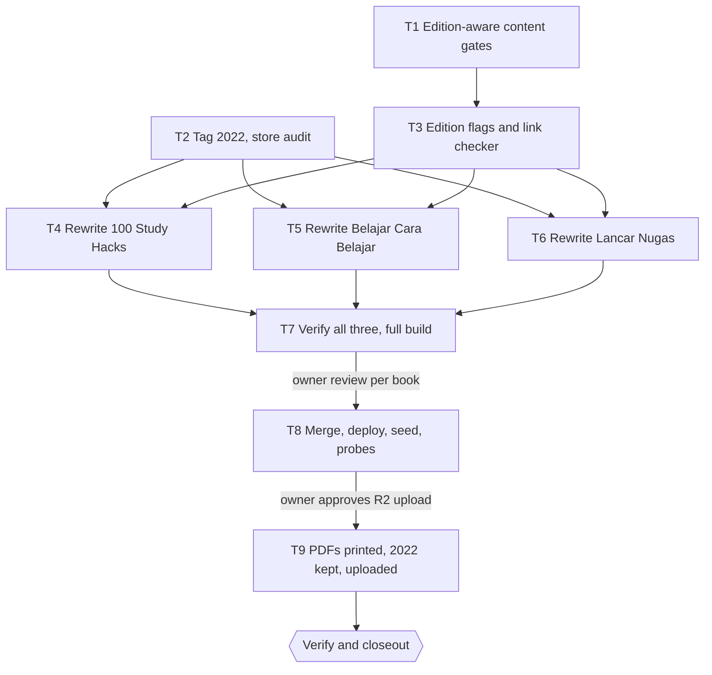

# Premium E-books Revised Edition 2026 Implementation Plan

> For agentic workers: REQUIRED EXECUTION METHOD: delegated task execution (recommended) or inline plan execution. Steps use checkbox syntax.

**Goal:** the three premium e-books are rewritten as the 2026 edition under the same slugs, pass every Dawnbook content gate, carry no illegal, harmful or dead recommendation, and the store PDFs match them.

**Architecture:** the premium registry gains an `edition` field, and the content checkers skip only premium books without it. The book text is rewritten in place in the private repo by one writer subagent per chapter, checked by an independent fact-checker per book, and verified with the public repo's checkers pointed at the private worktree. All three ship in one deploy after the owner's per-book review. The PDFs are then printed from the built `print.html` and uploaded to R2, after the 2022 PDFs are kept under a `-2022` key.

**Tech Stack:** Bun 1.4.4, TypeScript, mdBook, Cloudflare Pages Functions, D1, R2 (`cf r2 objects put`), headless Chromium, `pdfinfo`.

**Active Project Profile:**
- **Public repo:** `belajarcarabelajar/dawnbook` at main `4ca610b7`.
  - Session `edisi-gate` (worktree `/mnt/belajarcarabelajar/dawnbook-wt/edisi-gate`) carries the spec, this plan and T1.
  - Session `edisi-rilis` (worktree `/mnt/belajarcarabelajar/dawnbook-wt/edisi-rilis`) is claimed from main after T1 merges and carries T3.
- **Private repo:** `belajarcarabelajar/dawnbook-premium` at main `95a2cd8`. Session `edisi-teks` (worktree `/mnt/belajarcarabelajar/dawnbook-premium-wt/edisi-teks`) carries T2 and T4 to T6.
- **Configuration sources:** `GEMINI.md` (sections 8, 14 to 16, 21, 24, 25, 27, 29, 30), `package.json`, `data/premium-books.json`, `scripts/build.ts`, and the private repo's `README.md`.

**Project Commands:**
- **Tests:** `timeout 120 bun test <file>` and `bun run typecheck`.
- **Gates:**
  - `bun run scripts/check-book-structure.ts --books-dir <dir> <slug>`
  - `bun run scripts/check-voice.ts --books-dir <dir> <slug>`
  - `bun run scripts/check-heading-colons.ts --root <dir> --books <slug>`
  - `bun run scripts/check-repeated-headings.ts --root <dir>`
- **Build:** `DAWNBOOK_PREMIUM_DIR=<private worktree> bun run build`.
- **Deploy:** `set -a && source ~/cloudflare/.env && set +a`, then `bash scripts/deploy-website.sh`, then `bun run scripts/migrate-to-d1.ts`.

**Protected Boundaries:**
- No premium text in the public repo: not in tests, fixtures, this plan, PR bodies, issues or `db/seed.sql`.
- `db/seed.sql` is the owner's local modification. Never stage it.
- Every write to the private repo goes through its own branch and PR.
- Merge, deploy, the D1 seed and the R2 upload each wait for an explicit owner gate.
- E2E tests are opt-in only.
- No attribution trailers and no em dash.

**Spec:** `docs/code-plan/specs/2026-11-01-premium-edisi-2026-design.md`

**Scope:**
- edition-aware content gates and their tests;
- the 2022 archive tag;
- the audit report stored in the private repo;
- the edition flags;
- a link checker;
- the rewrite of 48 chapter files, with new AI chapters and SVG illustrations;
- a joint release;
- new PDFs.

**Non-Goals:** repricing, new products, the Grandbook Pro PDF, an interim hotfix of the live 2022 text (owner decision), and a Canva-style PDF design.

**Visual Map:**

**Reasoning Lenses:**
- **Intent:** every owner decision from the session is recorded in the spec's approval table.
- **Investigative:**
  - The gate exemption sits in four checkers, through `premiumSlugs()`.
  - Images under `images/` stay gated, and only `images/public/` is public.
  - The PDFs live at R2 `bcb-admin-media/member/<slug>.pdf`, with the same slugs.
- **Critical:** a rewrite can add unsupported claims (section 29.6). Each book therefore gets an independent fact-check and an outcome re-audit.
- **Security and privacy:** no premium text crosses into the public repo, and the forbidden-source scan runs in T7.
- **Operational:** a joint deploy and a separate R2 gate, with rollback through the 2022 tag and the `-2022` PDFs.

**Acceptance Criteria:**

- [x] AC-1: a premium book whose registry entry has `edition: 2026` is checked by the voice, heading-colon, repeated-heading and structure checkers, while a premium book without an edition is still skipped by all four.
- [x] AC-2: the 2022 text is reachable as tag `edition-2022` in `dawnbook-premium`, and the audit report is committed under `audits/2026-11-01/` there.
- [x] AC-3: `data/premium-books.json` marks all three books `edition: 2026`, and the premium registry and sync tests pass.
- [x] AC-4: 100 Study Hacks holds exactly 100 numbered hacks, has an AI chapter, and passes the structure, voice and heading-colon gates.
- [x] AC-5: Belajar Cara Belajar has no mention of STIFIn, renumbered chapter files, a rewritten learning-styles chapter and an AI chapter, and passes the same gates.
- [x] AC-6: Lancar Nugas has a curated tools list without a number in its title, an AI chapter, and the regulation updates, and passes the same gates.
- [x] AC-7: no file of the three books names Z-Library, Sci-Hub, PaperPanda, EssayTyper, PapersOwl, Shortly AI, SehatQ or Trikinet, and every external link in them answers without a dead or parked target.
- [x] AC-8: a full build with the private sources exits 0, and the owner approves each book in the local build.
- [ ] AC-9: production serves the 2026 text: chapter 1 is public, chapter 2 is gated, and a buyer session opens a paid chapter.
- [x] AC-10: R2 holds the 2022 PDFs at `member/<slug>-2022.pdf` and the new PDFs at `member/<slug>.pdf`.

**Traceability:**

| AC | Task | Check | Evidence |
|---|---|---|---|
| AC-1 | T1 | `timeout 120 bun test tests/scripts/premium-edition-gates.test.ts` | exit 0; RED first without the helper |
| AC-2 | T2 | `git -C /home/belajarcarabelajar/Proyek/dawnbook-premium rev-parse --verify --quiet edition-2022` | exit 0 |
| AC-3 | T3 | `timeout 120 bun test tests/functions/lib/premium.test.ts tests/scripts/premium-sync.test.ts` | exit 0 |
| AC-4 | T4 | the T4 `run[]` steps (structure, voice, colons, hack count) | four exit 0 |
| AC-5 | T5 | the T5 `run[]` steps (structure, voice, colons, STIFIn scan exit 1) | four expected exits |
| AC-6 | T6 | the T6 `run[]` steps | three exit 0 |
| AC-7 | T7 | forbidden-source scan (expect exit 1) and `bun run scripts/premium/check-links.ts <books>` | exit 1 then exit 0 |
| AC-8 | T7 | `env DAWNBOOK_PREMIUM_DIR=... bun run build`, then the owner `Review` gate | exit 0, three approvals |
| AC-9 | T8 | premium probes against production (curl status per URL, as in the 2026-11-01 release) | 200 for chapter 1, 302 or 401 anonymous on chapter 2, 200 for a buyer |
| AC-10 | T9 | `cf r2 objects get member/<slug>-2022.pdf --bucket-name bcb-admin-media` per slug, and `/unduh/member/<slug>` from a member session | object present, new PDF served |

**Assumptions & Open Questions:**
- The 2022 masters in the private repo `.cache/<slug>.pdf` are the same files as the current R2 objects (README says they are the masters). T9 compares sizes with `cf r2 objects get` before uploading.
- The owner's tone is semi-formal and warm, addressing the reader as "kamu" (section 29 contract). The books already use "kamu".

**Dependencies & Impact:**
- T1 changes the four checkers used by `bun run build`.
- T3 changes the registry read by the middleware, sync and SEO generators.
- bcb code is unchanged (it serves `member/<slug>.pdf`).
- The sitemap and `llms.txt` list chapter 1, whose title may change.

**Risks & Rollback:**
- **Rewrite quality:** fact-check plus owner review.
- **Build break:** the flags are set only in the release branch, after T4 to T6 pass.
- **Content rollback:** revert the private merge, or reset to tag `edition-2022` and remove the flags.
- **PDF rollback:** re-upload `member/<slug>-2022.pdf` to `member/<slug>.pdf`.
- **Live window:** the 2022 text with gambling and piracy links stays live until T8 (owner decision).

**Security & Compatibility:**
- Gating rules are unchanged.
- New SVG art goes under `src/images/`, which is gated. Art for chapter 1 goes under `images/public/`.
- SVGs carry no script, no external reference and no text elements (same limits as section 27).

**Operations & Rollout:** one deploy (T8), then the D1 seed, premium probes and a GSC sitemap push (section 11, OAuth path per section 23). T9 follows with its own gate. The outcome re-audit runs within 7 days of T8, as a follow-up outside `tasks[]`.

**CI/Review Gate:**
- GitHub Actions are off (section 19). Local gates are the CI.
- An independent `staid` review runs on the T1 diff.
- A fact-check reviewer runs on each book.

**Documentation:**
- GEMINI.md section 30, plus the pointers in sections 14, 16, 24 and 29 (T1).
- The private `README.md` verbatim section (T2).
- The memory `premium-ebook-dawnbooks.md` after the release.

**Definition of Done:** AC-1 to AC-10 checked, the plan closed out with `plan-closeout --readiness`, and the outcome re-audit scheduled.

**Plan Status & Version:** Approved by the owner (`Plan` gate, 2026-11-01), version 2. Version 2 records the `Warnings` gate (2026-11-01, answer "Remove every mention"): the 2026 text names Z-Library, PaperPanda, EssayTyper and the other scanned tools nowhere, not even as a warning, so the T7 name scan stays as written and also covers the spelling "PandaPaper". The `Social links` gate (2026-11-01, "Keep own socials") reads the Contact decision as banning WhatsApp, Typeform, QR and Canva Pro offers, so the owner's own Instagram, YouTube and TikTok links stay. The `Review` gate (2026-11-01) approved all three books in the local build. Version 3 records the owner rule given after release (2026-11-01, `No trace`): the books must not mention the old edition, what it said, or that anything was removed, replaced or corrected; titles carry no edition label and copyright lines keep the original year. It shipped as private PR #2 and a redeploy, and the store PDFs were printed from that text.

**Reproducibility:** Bun 1.4.4, mdBook from `~/.cargo/bin`, `/usr/bin/chromium`, `/usr/bin/pdfinfo`. Commands are as listed above.

**Test Reliability:**
- T1 tests use temporary folders and set the registry through the existing test setter.
- The link checker test uses an injected fetch, with no network.
- The real link run in T7 is network-bound, with `retry: 1`.

**Privacy & Data Governance:**
- Premium text stays in the private repo. Subagent outputs stay in the private worktree or the scratch folder.
- The forbidden-source scan and the audit never print buyer data.

**Dependencies & Supply Chain:** no new dependency. Chromium and `pdfinfo` are system packages.

**UX States:**
- Reader-facing: chapter 1 is the free preview.
- The 403 page and the sign-in page are unchanged.
- The hub card keeps the "Premium" label.

**Persistent State & Artifact Storage:**
- Tag `edition-2022` in the private repo.
- R2 keys `member/<slug>.pdf` and `member/<slug>-2022.pdf`.
- Audit report in `audits/2026-11-01/` (private).

**Entity & Sourcing Verification:** every new claim, tool and regulation is verified with a fetched source during writing. The fact-checker re-opens a sample of them. The regulations named in the audit (Permendiktisaintek 39/2025, UU PDP 27/2022, EYD Edisi V, the Kemendikbudristek GenAI guide of October 2024) are re-verified by the writer that cites them.

**Verification:** each task's `run[]`, then the T8 probes and the T9 object checks, recorded in the PR bodies.

## Global Constraints

- **Chapter writer dispatch:** carries the section 29 voice contract, the section 24 heading rule, the section 25 diagram contract and the section 27-style SVG limits in the prompt text itself (sections 24, 25, 29 require it), plus the audit findings for that chapter.
- **Language:** Indonesian, "kamu", no emoji, no em dash, no "Anda".
- **References:** every reference is a deep link verified in this run (section 15). No archive.org lending links.
- **Evidence label:** each hack and technique ends with one line `Kekuatan bukti: kuat | sedang | terbatas`, followed by one linked source.
- **Chapter 1:** stays the free preview. Its first sentence is at most 155 characters (section 8).
- **Closing and About pages:** link only to the belajarcarabelajar.com product pages in `data/premium-books.json` (`productUrl`).
- **Fan-out width:** 10 to 15 writers in flight, one writer per chapter file, so no two writers own the same file. The orchestrator owns `SUMMARY.md`, renames and git. A writer never runs git.

### Task T1: Edition-aware content gates

**Files:**
- Create: `tests/scripts/premium-edition-gates.test.ts`
- Modify: `functions/lib/premium.ts` (registry type gains `edition?: 2026`; new `contentGateExemptSlugs()`), `scripts/check-voice.ts`, `scripts/check-heading-colons.ts`, `scripts/check-repeated-headings.ts`, `scripts/check-book-structure.ts` (each uses the new helper in place of `premiumSlugs()` for its content skip), `GEMINI.md` (section 30: revised premium books follow the content gates and drop the verbatim proof; one-line pointers in 14, 16, 24, 29)
- Test: `tests/functions/lib/premium.test.ts` (edition parsing: `2026` accepted, missing means verbatim, any other value rejected)

**Interfaces:**
- Produces: `contentGateExemptSlugs(): string[]`, which returns the premium slugs without `edition`. `PremiumBook.edition?: 2026`.

**Preconditions:**
- [x] The `edisi-gate` worktree exists and is clean apart from the spec and plan commits (else abort: `E_PRECOND_UPSTREAM`).

**Behavior & Acceptance:** AC-1.

**Edge Cases & Failure Behavior:** a registry `edition` value other than `2026` throws at load, naming the slug. The structure checker keeps every technical rule for all books. Only the content rules (emoji, em dash, "Anda", openers) follow the helper.

**Deliberate Shortcuts & Deferrals:** None.

**Review & Evidence:** RED run before the helper exists (exit 1), GREEN after, typecheck exit 0, then an independent `staid` review of the diff.

**Test Data & Determinism:** a fixture books folder in a temp dir with one revised and one verbatim premium book, both holding an em dash and a colon heading. The registry is set with the test setter and restored after each test.

- [x] Step 1: Write `tests/scripts/premium-edition-gates.test.ts`: the revised book fails each of the four checkers, and the verbatim book passes them.
- [x] Step 2: Run: verify fail | cmd: `timeout 120 bun test tests/scripts/premium-edition-gates.test.ts` | expect: exit 1 | retry: 0 | on_fail: n/a
- [x] Step 3: Add `edition` to the registry type and `contentGateExemptSlugs()`, and switch the four checkers to it.
- [x] Step 4: Run: verify pass | cmd: `timeout 120 bun test tests/scripts/premium-edition-gates.test.ts tests/functions/lib/premium.test.ts` | expect: exit 0 | retry: 1 | on_fail: mark T1 FAILED, halt T3
- [x] Step 5: Run: `bun run typecheck` | expect: exit 0 | retry: 0
- [x] Step 6: Update GEMINI.md section 30 and the pointers.
- [x] Step 7: The parent commits by explicit path. The PR carries the spec, this plan and T1.

### Task T2: Tag the 2022 edition and store the audit

**Files:**
- Create: `audits/2026-11-01/README.md` plus the three per-book reports and `results.json`, copied from `~/.cache/tmp/dawnbook-scratch/premium-audit/`
- Modify: `README.md` of the private repo (the verbatim rule now applies only to books without an edition; the 2022 text is at tag `edition-2022`)

**Preconditions:**
- [x] `git -C /home/belajarcarabelajar/Proyek/dawnbook-premium status --porcelain` is empty (else abort: `E_PRECOND_INPUT`).

**Behavior & Acceptance:** AC-2.

**Deliberate Shortcuts & Deferrals:** None.

- [x] Step 1: `git -C /home/belajarcarabelajar/Proyek/dawnbook-premium tag -a edition-2022 95a2cd8 -m "Edition 2022, verbatim"` and push the tag (owner gate: push to the private remote).
- [x] Step 2: Claim session `edisi-teks` with `--repo /home/belajarcarabelajar/Proyek/dawnbook-premium --worktree`.
- [x] Step 3: Copy the audit files, update the README, and commit by explicit path.
- [x] Step 4: Run: `git -C /home/belajarcarabelajar/Proyek/dawnbook-premium rev-parse --verify --quiet edition-2022` | expect: exit 0

### Task T3: Edition flags and link checker

**Files:**
- Create: `scripts/premium/check-links.ts` (reads every `.md` under a books folder, extracts `http(s)` links, requests each with a 15 s timeout and redirects followed, and reports a dead link: a status of 400 or more, or a final host that differs from the original host and is on a parked or gambling denylist given in the script. Exits 1 when any link is dead) and `tests/scripts/premium-check-links.test.ts` (injected fetch)
- Modify: `data/premium-books.json` (`"edition": 2026` on all three entries)

**Interfaces:**
- Consumes: `PremiumBook.edition` from T1.
- Produces: `checkLinks(dir, fetchFn): Promise<DeadLink[]>`.

**Preconditions:**
- [x] T1 is merged on main, and session `edisi-rilis` is claimed from main with `--worktree` (else abort: `E_PRECOND_UPSTREAM`).

**Behavior & Acceptance:** AC-3. AC-7 uses the checker in T7.

**Edge Cases & Failure Behavior:** a host that refuses HEAD is retried with GET. A timeout counts as dead after one retry. A `mailto:` link is skipped.

- [x] Step 1: Write the link checker test (a dead link, a redirect to an unrelated host, a live link).
- [x] Step 2: Run: `timeout 120 bun test tests/scripts/premium-check-links.test.ts` | expect: exit 1
- [x] Step 3: Implement the checker and set the three flags.
- [x] Step 4: Run: the T3 `run[]` command | expect: exit 0
- [x] Step 5: The parent commits. The build stays red with the 2022 text until T4 to T6 finish, which is expected on this branch only.

### Task T4: Rewrite 100 Study Hacks

**Files:** every file under `books/100-study-hacks/src/` in the `edisi-teks` worktree: content chapters, a new AI chapter, `SUMMARY.md`, and new SVGs under `src/images/` (the risky images are listed in `audits/2026-11-01/100-study-hacks.md`).

**Behavior & Acceptance:** AC-4.

**Edge Cases & Failure Behavior:**
- Exactly 100 numbered hacks. Hacks dropped as dead or myth are replaced by evidence-based hacks named in the audit's idea list (AI study partner used honestly, legal reading access, a myth check, finding your own focus hours).
- The Referensi and About Us chapters are rewritten.
- The audit's priority actions 1 to 10 are each closed or written down as not applicable, with a reason.

**Deliberate Shortcuts & Deferrals:** None.

- [x] Step 1: Dispatch writers, one per hack group of 10 (two per level chapter) plus the front matter, the AI chapter, the references and About Us. Each writer gets its audit unit report and the Global Constraints.
- [x] Step 2: The orchestrator merges each level chapter's two halves, updates `SUMMARY.md`, and renders diagrams if any (`bun run diagrams:render --book 100-study-hacks` from the `edisi-rilis` worktree with the books folder synced).
- [x] Step 3: An SVG artist subagent draws the replacement images; check with the section 27 rules.
- [x] Step 4: An independent fact-check reviewer reads the whole book against its sources and the audit, and reports unsupported claims. Writers fix them.
- [x] Step 5: Run: the four T4 `run[]` steps | expect: exit 0 each
- [x] Step 6: The parent commits by explicit path in `edisi-teks`.

### Task T5: Rewrite Belajar Cara Belajar

**Files:** every file under `books/belajar-cara-belajar/src/`:
- the STIFIn chapter is deleted, and chapters 12 to 20 are renamed to 11 to 19;
- a new AI chapter is added;
- `SUMMARY.md` is updated;
- new SVGs replace the images the audit flags (the Oakley-like slides and the puzzle photos).

**Behavior & Acceptance:** AC-5. The learning-styles chapter explains that matching instruction to a VAK type is not supported, and what works instead, without naming STIFIn. Active recall and chunking are defined as in the research. B612 becomes a first-day sprint with a spaced review schedule. Evidence labels go on every technique.

- [x] Step 1: Dispatch writers, one per chapter (or the audit unit's grouping), plus the AI chapter.
- [x] Step 2: The orchestrator deletes and renames the chapter files with `git mv`, then updates `SUMMARY.md` and the cross-links between chapters.
- [x] Step 3: The SVG artist subagent draws the replacements, then the fact-check reviewer runs. Writers fix what it finds.
- [x] Step 4: Run: the four T5 `run[]` steps | expect: as declared
- [x] Step 5: The parent commits.

### Task T6: Rewrite Lancar Nugas

**Files:** every file under `books/lancar-nugas/src/`, plus a new AI chapter and `SUMMARY.md`.

**Behavior & Acceptance:** AC-6.
- The tools list is retitled without a number, grouped by task, and each tool shows its free-plan limits. The list closes with "Dicek November 2026".
- The AI chapter follows the Kemendikbudristek GenAI guide (October 2024): when AI helps, when it harms, and how to declare and cite AI use in APA 7.
- The regulation updates are added: EYD Edisi V, Permendiktisaintek 39/2025 for final projects, and UU PDP 27/2022 consent for surveys.
- The Thurow reference is corrected.

- [x] Step 1: Dispatch writers, one per chapter, with two for the tools list, plus the AI chapter.
- [x] Step 2: The orchestrator updates `SUMMARY.md`, then the fact-check reviewer runs. Writers fix what it finds.
- [x] Step 3: Run: the three T6 `run[]` steps | expect: exit 0 each
- [x] Step 4: The parent commits.

### Task T7: Verify all three, full build, owner review

**Behavior & Acceptance:** AC-7, AC-8.

- [x] Step 1: Run: forbidden-source scan | expect: exit 1 (no match)
- [x] Step 2: Run: repeated-heading checker on the private root | expect: exit 0
- [x] Step 3: Run: link checker on the three books | expect: exit 0
- [x] Step 4: Run: full build with `DAWNBOOK_PREMIUM_DIR` | expect: exit 0
- [x] Step 5: Owner `Review` gate per book. The owner reads `output/books/<slug>/` from a local server (`bunx wrangler pages dev output`, section 4.1 exception 2), and each answer is recorded here.

### Task T8: Release

- [x] Step 1: Owner `Merge` gate for the private PR `edisi-teks` (its own question), then the public PR `edisi-rilis` (its own question), each with `--match-head-commit` carrying the full SHA.
- [x] Step 2: Owner `Deploy` gate: deploy from a clean main checkout of the public repo with the private main synced.
- [x] Step 3: `bun run scripts/migrate-to-d1.ts`, then restore the owner's `db/seed.sql` modification (never staged).
- [x] Step 4: Premium probes (AC-9) and a GSC sitemap push (OAuth path, section 23).

### Task T9: PDFs

- [x] Step 1: For each slug, run `chromium --headless --no-sandbox --no-pdf-header-footer --print-to-pdf=/home/belajarcarabelajar/.cache/tmp/dawnbook-scratch/edisi-2026/<slug>.pdf file://<edisi-rilis>/output/books/<slug>/print.html`, then `pdfinfo` on the result (pages > 0). Show page counts and one rendered page per book to the owner.
- [x] Step 2: Owner `Upload` gate (its own question, safe option first).
- [x] Step 3: `cf r2 objects put member/<slug>-2022.pdf --bucket-name bcb-admin-media --file /home/belajarcarabelajar/Proyek/dawnbook-premium/.cache/<slug>.pdf --content-type application/pdf` for each slug.
- [x] Step 4: `cf r2 objects put member/<slug>.pdf --bucket-name bcb-admin-media --file /home/belajarcarabelajar/.cache/tmp/dawnbook-scratch/edisi-2026/<slug>.pdf --content-type application/pdf` for each slug.
- [x] Step 5: Check AC-10 (`cf r2 objects get` of both keys, plus a member-session download).

## Closeout status

- **Readiness (2026-11-01):** `bun ~/vivera/scripts/plan-closeout.mjs --readiness docs/code-plan/plans/2026-11-01-premium-edisi-2026.md`. Verdict `NEEDS-HUMAN` (exit 3): T1 to T3 are `DONE`, and T4 to T9 are `UNPROVEN` because their `skip_if` is `false`. There are 0 open step boxes and 0 open NOW follow-ups.
- **Ticks:** T1 to T6 are ticked from the runner log (`--execute`: T1 to T3 `SKIPPED-IDEMPOTENT`, T4 to T6 `PASSED`). T7 to T9 are ticked with `--task`, on this evidence:
  - **T7.** The name scan exits 1 and repeated headings exit 0. The link check exits 1, but only on hosts that refuse or time out on scripted requests: 6 distinct URLs, and each one opens through a fetch tool or resolves (DOI to castledown.com). No link is dead. The full build exits 0 in both production deploys.
  - **T8.** Private PRs #1 and #2 and public PR #239 are merged. Two deploys exit 0, and D1 is seeded. Live probes: chapter 1 answers 200 with the 2026 title and no traces, chapter 2 and `searchindex.js` answer 401 to an anonymous visitor.
  - **T9.**
    - The 2022 PDFs are copied to `member/<slug>-2022.pdf`, and the new PDFs (105, 86 and 91 pages) are at `member/<slug>.pdf`. Each object is verified by sha256 after upload.
    - `/unduh/member/<slug>` answers 303 to the sign-in page for an anonymous visitor.
    - The member-session download in step 5 was not run, because the agent has no buyer account.
- **Still open:** AC-9, "a buyer session opens a paid chapter". The agent has no buyer account. The owner closes it by opening chapter 2 of each book, and one `/unduh/member/<slug>` download, with a purchase account.
- **Blocked, outside this plan:** the GSC sitemap PUT answers 403, because the OAuth refresh token in `~/cloudflare/.env` only has the `webmasters.readonly` scope. The owner has to redo the consent with the write scope. The URLs in the sitemap did not change, and the last submission (2026-10-25) shows 0 errors.
- **Reopens the Close plan question:** the owner confirms AC-9.
