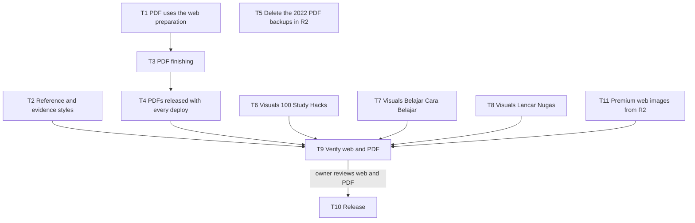

# Premium E-book PDF Layout, Visuals and Web-PDF Sync Implementation Plan

> **For agentic workers:** use `super-ultra-code-plan` to run this plan task by task. Steps use `- [ ]` checkboxes.

**Goal:** the three premium e-books read better on Dawnbook and in the store PDF: a standard reference list, evidence labels that stand out, visuals only where the text needs them, and a PDF with a watermark, bookmarks, clean page breaks and a copy restriction. Every edit reaches both the web and the PDF from one source, and every deploy replaces the store PDFs in R2 without leaving old copies.

**Architecture:**
- **One source.** The book text lives only in the private repo.
- **One preparation.** The web build prepares each book in `.build-tmp/`: it copies the book, inlines Mermaid diagrams from their SVG cache and (T2) adds the reference and evidence decorations. The PDF printer (T1) reuses that same preparation instead of reading `books/<slug>` raw, so a diagram or a decoration cannot appear on one side only.
- **PDF finishing (T3).** Print-only CSS adds the page layout and the watermark. A small pikepdf step then puts the cover in front and adds the copy restriction; the probe on 2026-11-01 proved that the chapter bookmarks survive the cover insertion.
- **Release (T4).** The deploy script reprints every revised premium book after a successful Pages deploy and overwrites `member/<slug>.pdf`. `cf` cannot store custom object metadata, so the script reprints every time instead of checking a source hash. A deploy is owner-approved and rare, and the reprint takes about 1 to 2 minutes.
- **Premium web images in R2 (T11).**
  - Build: after mdBook, the build moves `output/books/<slug>/images/` of every premium book to a gitignored staging folder, so Pages never carries premium images.
  - Deploy: new and changed images go to the bucket `dawnbook-premium-media` under `books/<slug>/images/...` before the Pages deploy, and objects no longer used are deleted after it, so nothing piles up.
  - Middleware: it serves `/books/<slug>/images/...` from the binding `PREMIUM_MEDIA` after the same access check as the pages. `images/public/` (chapter 1) stays open. A missing binding answers 503 and never leaks.
  - PDF: unchanged; it prints from the local prepared copy.

**Tech Stack:**
- Bun 1.4.4, TypeScript, mdBook 0.5.4.
- Headless Chromium 156 (`--generate-pdf-document-outline`; CSS page margin boxes since 131).
- `@resvg/resvg-js` (already a devDependency) to turn the watermark text into paths.
- Python pikepdf through `uv run --with pikepdf==<pinned>`. It bundles qpdf, so no system package is added.
- `pdfinfo` and `pdftotext`, and `cf r2 objects put/get/delete`.

**Active Project Profile:**
- **Root and branches:** public repo `/mnt/belajarcarabelajar/dawnbook-wt/pdf-visual` (branch `2026-11-01-premium-pdf-visual/pdf-visual`); private repo `/mnt/belajarcarabelajar/dawnbook-premium-wt/visual-teks` (branch `2026-11-01-premium-pdf-visual/visual-teks`).
- **Configuration read:** `GEMINI.md` sections 1, 9, 16, 21, 24, 25, 29 and 30; `scripts/builder/mdbook-runner.ts`; `scripts/diagrams/inline.ts`; `scripts/premium/print-pdf.ts`; `scripts/deploy-website.sh`; `books/shared-header.css`; `books/_template/book.toml`.
- **Protected boundaries:**
  - no premium text in the public repo, its PRs or issues;
  - no per-book `book.toml` edits (section 1);
  - `db/seed.sql` in the main checkout is the owner's and never staged;
  - deploy, merge, push and R2 writes only after the owner's answer to their own question.

**Project Commands:**
- Tests: `timeout 120 bun test <file>`.
- Typecheck: `bun run typecheck`.
- Diagrams: `bun run diagrams:render --book <slug>` and `bun run check:diagrams --book <slug>`.
- Book gates: `bun run scripts/check-book-structure.ts --books-dir <private books> <slug>`, plus `check-voice.ts` and `check-heading-colons.ts`.
- Build: `env DAWNBOOK_PREMIUM_DIR=<private worktree> bun run build`.
- Print: `bun run scripts/premium/print-pdf.ts <slug> --out <pdf> --books-dir <books> --cover <books>/<slug>/print-cover.svg`.

**Scope:**
- **Reference list (T2).** The Referensi chapters of the revised premium books render in a standard reference-list style on the web and in the PDF: hanging indent 1.27 cm, left aligned (never justified), a small gap between entries. This is a build-time decoration, so the chapter text is not edited.
- **Evidence labels (T2).** Every paragraph that starts with `**Kekuatan bukti:**` renders as a small callout whose left border colour follows the level (kuat, sedang, terbatas). It works in all five reader themes and in print, and is added at build time.
- **PDF layout (T3).**
  - Clean page breaks: no heading left at the bottom of a page; images, diagrams, tables, code and callouts are never split; at least 2 lines stay together.
  - Chapter bookmarks.
  - A diagonal, very light (about 6 % opacity) "belajarcarabelajar.com" watermark in the middle of every content page, drawn as paths so it is not in the text layer, and not on the cover.
  - A copy restriction: AES-256, empty open password, text extraction and changes not allowed, printing allowed.
- **Shared preparation (T1).** The PDF uses the web build's preparation, including diagrams.
- **Automatic release (T4).** Every deploy reprints and replaces the store PDFs (hash-verified, no backup objects).
- **R2 cleanup (T5).** The three `member/<slug>-2022.pdf` backups are deleted from R2. The 2022 text stays as tag `edition-2022` in the private repo, and the 2022 PDFs stay on the owner's laptop in `~/Proyek/dawnbook-premium/.cache/`.
- **Visuals and reading flow (T6 to T8).** These follow the owner's answers of 2026-11-01:
  - the core and optional visuals of the appendix;
  - low-value images replaced or dropped;
  - repeated retellings of the same study trimmed;
  - the inconsistent evidence labels fixed;
  - group subheadings in Lancar Nugas chapter 17.
- **Premium web images in R2 (T11).** Owner request, new bucket `dawnbook-premium-media`.

**Non-Goals:**
- A per-buyer personal watermark (it needs PDF stamping per download in the bcb Worker; a separate plan in the bcb repo).
- A watermark on Dawnbook web pages (owner decision: PDF only).
- Free books: their Referensi chapters keep their current style.
- A designed (Canva-style) PDF.

**Visual Map:**



**Reasoning Lenses:** intent (owner's four requests plus the watermark), investigative (pipeline read, R2 and Chromium probes), systems (one preparation for two outputs), failure-oriented (diagram on one side only, a stale PDF after a deploy, a watermark in the text layer), security (copy restriction is a signal, not protection), verification.

**Acceptance Criteria:**

- [x] AC-1: a premium chapter with a Mermaid block shows the same inlined SVG on the built web page and in the PDF, and the PDF text has no "```mermaid".
- [x] AC-2: the Referensi chapters of 100 Study Hacks and Belajar Cara Belajar render with a 1.27 cm hanging indent, left aligned, on the web and in the PDF.
- [x] AC-3: every `**Kekuatan bukti:**` paragraph renders as a callout of its level on the web and in the PDF; the built HTML has as many callouts as the source has labels.
- [x] AC-4: each store PDF opens with the full-page cover, has one bookmark per chapter, shows the diagonal watermark on every content page but not on the cover, keeps the watermark out of the text layer, and `pdfinfo` reports `copy:no`.
- [x] AC-5: every production deploy reprints the revised premium books and replaces `member/<slug>.pdf`; the object's sha256 equals the local file, and no other object is written.
- [x] AC-6: R2 `member/` holds only `100-study-hacks.pdf`, `belajar-cara-belajar.pdf`, `lancar-nugas.pdf` and `grandbook-pro.pdf`.
- [x] AC-7: every approved visual is in its chapter, grounded in that chapter's text, and the diagram, structure, voice and heading gates exit 0.
- [x] AC-8: the owner approves the web pages and the PDFs of the three books in a local review.
- [x] AC-9: production serves the new pages and the store serves the new PDFs.
- [x] AC-10: no premium image is in the Pages output; Dawnbook serves premium images from R2 to an entitled reader, refuses them to an anonymous one (except `images/public/`), and the bucket holds only the images the current books use.
- [x] AC-11: the repeated study retellings are trimmed (each study told in full once per book), the same study carries the same evidence label for the same claim, and Lancar Nugas chapter 17 has one subheading per tool group.

**Traceability:**

| AC | Task | Check | Evidence |
|---|---|---|---|
| AC-1 | T1, T9 | print test with a fixture diagram; a built chapter and its PDF page | test exit 0; `rg -c '<svg' <chapter html>`; pdftotext has no fence |
| AC-2 | T2, T9 | decoration test; built Referensi HTML; PDF page render | test exit 0; `rg -c 'daftar-pustaka'`; page image |
| AC-3 | T2, T9 | decoration test; count labels in source and callouts in output | equal counts |
| AC-4 | T3, T9 | print tests; pdfinfo; pdftotext; outline count; page images | `Encrypted: yes (... copy:no ...)`; outline entries = chapters |
| AC-5 | T4, T10 | release test with fake runner; deploy log; sha256 compare | test exit 0; hash lines |
| AC-6 | T5 | `cf r2 objects list --prefix member/` | 4 keys |
| AC-7 | T6, T7, T8, T9 | `check:diagrams`, structure, voice, colon gates; full build | exit 0 |
| AC-8 | T9 | owner `Review` gate | answer |
| AC-9 | T10 | live probes; R2 objects | 200/401 probes; hashes |
| AC-10 | T11, T10 | media sync and middleware tests; `find output/books/<slug>/images` empty; live image probe anonymous and entitled; `cf r2 objects list` vs staged set | tests exit 0; 401 anonymous, 200 public image; key sets equal |
| AC-11 | T6, T7, T8 | `rg -c` of each retold study per book; label consistency check; chapter 17 headings | counts and diffs in the PR body |

**Assumptions & Open Questions:**
- The owner approves the visual candidate list in the appendix at the `Plan` gate; dropping or adding items is part of that answer.
- The pikepdf version is pinned when T3 starts (latest release at that time), and the pin is recorded in `finish-pdf.py`.

**Dependencies & Impact:**
- T1 changes how print-pdf prepares a book, and T3 builds on that.
- T4 uses T3 and changes the deploy script, so every later deploy also writes R2.
- T2 changes `books/shared-header.css`, which every book loads. The new classes only match markup that T2 adds to revised premium books, so free books do not change.
- T6 to T8 change private chapters and add diagram caches to the private repo.

**Risks & Rollback:**
- **Release step.** A deploy succeeds but the PDF release fails: the script exits non-zero and names the books whose PDF is stale. The store keeps serving the previous PDF; rerun `bun run scripts/premium/release-pdfs.ts`.
- **Copy restriction.** It breaks a reader app: drop the `--restrict` step in `release-pdfs.ts` (one flag) and redeploy.
- **Code rollback.** Revert the public PR (preparation, styles, release step), then redeploy.
- **Content rollback.** Revert the private PR (visuals), then redeploy.
- **R2 cleanup (T5).** The deletion is final. It runs only after its own question, and the 2022 sources stay in git and on the laptop.

**Security & Compatibility:**
- The PDF restriction is a request to reader apps, not protection; it is described that way to the owner.
- The empty open password keeps the PDF readable everywhere; the owner password is random per print and never stored.
- The watermark is an image (paths), so screen readers and quoting are not polluted.

**Operations & Rollout:**
- The owner reviews locally first.
- Then the public and private PRs are merged, each with its own question.
- Then one deploy, which also releases the PDFs.
- T5 runs once with its own question.

**CI/Review Gate:**
- Actions stay off (section 19); local tests and the typecheck gate every commit.
- An independent `staid` review of the public diff runs before the PR.

**Documentation:**
- GEMINI.md section 30 describes the PDF pipeline, the release step and the copy restriction.
- The print-pdf header documents its options.

**Definition of Done:** AC-1 to AC-9 checked with evidence and the plan closed out with `plan-closeout --readiness`.

**Plan Status & Version:** Approved by the owner (`Plan` gate, 2026-11-01), version 1. Owner answers recorded: core and optional visuals, low-value images replaced or dropped, repetition trimmed, chapter 17 subheadings, watermark "belajarcarabelajar.com" diagonal and PDF only, extras (bookmarks, page breaks, evidence callouts, copy flag), new R2 bucket `dawnbook-premium-media`.

**Reproducibility:** Bun 1.4.4, mdBook 0.5.4 from `~/.cargo/bin`, `/usr/bin/chromium` 156, poppler `pdfinfo`/`pdftotext`, `uv` with a pinned pikepdf, Noto fonts for the covers.

**Test Reliability:** tests use fake runners and temp folders under `/tmp`; no browser, mdbook or network runs in a test (owner rule on e2e).

**Privacy & Data Governance:** no buyer data is involved; premium text never leaves the private repo except through the gated builds.

**Dependencies & Supply Chain:** pikepdf is fetched by `uv` at a pinned version (it ships qpdf). No new npm dependency.

**UX States:** the callout and reference styles are checked in the light and coal themes on the web, and in print.

**Persistent State & Artifact Storage:**
- PDFs are printed to a temp folder and uploaded; they are not kept in the repo.
- Diagram caches are committed in the private repo next to the chapters.

**Entity & Sourcing Verification:** every visual is grounded in its own chapter (section 25); no new fact is added.

**Verification:** each task's `run[]`, then T9's build, prints and page images, then the T10 probes and R2 hashes.

## Global Constraints

- No premium text in the public repo, PR bodies or issues.
- Content edits by Read and Edit only (section 16); no batch scripts on prose.
- No em dash, "kamu", no colon headings, no emoji, section 25 diagram contract in every visual dispatch.
- R2: overwrite in place; never create backup objects; deletions only after their own question.

### Task T1: The PDF uses the web build's preparation

**Files:** `scripts/premium/print-pdf.ts`, `scripts/builder/mdbook-runner.ts`, `.gitignore`, `tests/scripts/premium-print-pdf.test.ts`.

**Interfaces:**
- `prepareBookForMdbook` (existing) and `inlineDiagramsInBook` (existing) are called by print-pdf exactly as by the web build.
- The prepared copy lives in a repo-local folder (`.build-tmp-pdf/`, gitignored), so the theme's relative paths (`../shared-header.css`, `../../apps/...`) resolve as in the web build.
- mdbook writes to `<fresh /tmp mkdtemp>/build/<slug>` (two levels deep; Chromium cannot read under `~/.cache`).

**Behavior & Acceptance:** AC-1.

**Edge Cases & Failure Behavior:** a diagram cache miss fails the print with the same message as the web build; the prepared copy is removed afterwards.

**Deliberate Shortcuts & Deferrals:** None.

**Review & Evidence:** RED test with a fixture book holding a Mermaid block and its cached SVG (fake mdbook records the prepared file), GREEN, typecheck exit 0.

- [x] Step 1: Write the failing test: the file mdbook receives has the inlined SVG instead of the fence.
- [x] Step 2: Run: `timeout 120 bun test tests/scripts/premium-print-pdf.test.ts` | expect: exit 1.
- [x] Step 3: Implement the shared preparation in print-pdf.
- [x] Step 4: Run the test and `bun run typecheck` | expect: exit 0.

### Task T2: Reference list and evidence label styles

**Files:** `scripts/builder/decorate-premium.ts` (new), `scripts/builder/mdbook-runner.ts`, `books/shared-header.css`, `tests/scripts/decorate-premium.test.ts`.

**Interfaces:**
- `decoratePremiumBook(bookDir: string): { references: number; labels: number }`, called from `prepareBookForMdbook` for books whose registry entry has `edition: 2026`.
- It wraps the body of a chapter file named `*_referensi.md` (below its `##` title) in `<div class="daftar-pustaka">` with blank lines around the Markdown.
- It wraps each paragraph that starts with `**Kekuatan bukti:** kuat|sedang|terbatas` in `<div class="bukti bukti-<level>">`.
- CSS in `books/shared-header.css`:
  - `.daftar-pustaka p`: `padding-left: 1.27cm; text-indent: -1.27cm; text-align: left`, with a 0.6em gap.
  - `.bukti`: left border 4px in the level colour, `var(--quote-bg)` background, padding, rounded corners.
  - Level colours: kuat green, sedang amber, terbatas grey. Each keeps at least 3:1 contrast in the five themes.

**Behavior & Acceptance:** AC-2, AC-3.

**Edge Cases & Failure Behavior:** a label inside a list item or blockquote is left as it is (none exist today, and the test pins it); a book without the edition flag is not decorated; the decoration only runs on the prepared copy, never on the source.

**Deliberate Shortcuts & Deferrals:** None.

**Review & Evidence:** RED, GREEN, typecheck; a built page checked in the light and coal themes.

- [x] Step 1: Write the failing tests (references wrapped, each label level wrapped, no wrap without the edition flag, source file unchanged).
- [x] Step 2: Run: `timeout 120 bun test tests/scripts/decorate-premium.test.ts` | expect: exit 1.
- [x] Step 3: Implement the decoration and the CSS.
- [x] Step 4: Run the test and the typecheck | expect: exit 0.

### Task T3: PDF finishing

**Files:** `scripts/premium/print-pdf.ts`, `scripts/premium/finish-pdf.py` (new), `tests/scripts/premium-print-pdf.test.ts`.

**Interfaces:**
- **Print style.**
  - The reference list is excluded from the justify rule (left aligned, hanging indent).
  - Break rules: `h1-h4 { break-after: avoid }`; `img, svg, table, pre, figure, .bukti { break-inside: avoid }`; `p, li { orphans: 2; widows: 2 }`.
  - The watermark: a `position: fixed` element repeated by Chromium on every page, with a path-only SVG (resvg `toString`) of "belajarcarabelajar.com" in Noto Sans Bold (700; SemiBold is not installed here and resvg fell back to Bold anyway) rotated -30 degrees at 6 % opacity.
- **Chromium flag:** `--generate-pdf-document-outline` for the book pass.
- **Final step (as built):** `uv run --no-project --with pikepdf==10.17.0 python3 -I scripts/premium/finish-pdf.py <book.pdf> <out.pdf> [--cover <cover.pdf>] [--restrict]` runs on every print. It inserts the cover as page 1, prints `{"pages", "outline", "encrypted"}` for print-pdf.ts to check, and with `--restrict` saves and, with `--restrict`, saves with AES-256, an empty user password, a random owner password, and `extract=False, modify=False, print=True, accessibility=True`. It replaces `pdfunite`.

**Behavior & Acceptance:** AC-4.

**Edge Cases & Failure Behavior:**
- The watermark is not on the cover, because the cover is printed separately.
- If "belajarcarabelajar.com" appears in the PDF text more often than in the book text, the print fails (the watermark would be in the text layer).
- Without uv or pikepdf, the print fails with an install hint; it never ships an unrestricted file silently.

**Deliberate Shortcuts & Deferrals:** None.

**Review & Evidence:** RED, GREEN, typecheck, then one real print per book checked with pdfinfo (`copy:no`), the outline count, pdftotext and page images.

- [x] Step 1: Write the failing tests (break rules, watermark element and SVG has no `<text`, outline flag, finish step called with the cover first, restrict flag passed).
- [x] Step 2: Run the test file | expect: exit 1.
- [x] Step 3: Implement the style, the watermark and `finish-pdf.py`.
- [x] Step 4: Run the tests and the typecheck | expect: exit 0.

### Task T4: The PDFs are released with every deploy

**Files:** `scripts/premium/release-pdfs.ts` (new), `scripts/deploy-website.sh`, `GEMINI.md`, `tests/scripts/premium-release-pdfs.test.ts`.

**Interfaces:**
- `bun run scripts/premium/release-pdfs.ts [--books-dir <dir>] [--dry-run]` takes each registry book with `edition: 2026` and a `print-cover.svg`.
- For each one it prints the book (with `--hide-image` read from an optional `print.json` beside the cover), uploads it with `cf r2 objects put member/<slug>.pdf --bucket-name bcb-admin-media --content-type application/pdf`, downloads it again and compares sha256.
- `deploy-website.sh` runs it after the Pages deploy.

**Behavior & Acceptance:** AC-5.

**Edge Cases & Failure Behavior:**
- One failed book does not stop the others.
- The script exits 1 and lists the stale books.
- It never writes any other key and never creates a backup object.
- `--dry-run` prints and checks without uploading.

**Deliberate Shortcuts & Deferrals:** `defer: reprint all revised books on every deploy, upgrade-trigger: more than 5 premium books or a deploy that takes over 10 minutes because of it`.

**Review & Evidence:** RED, GREEN, typecheck; a `--dry-run` on the three books.

- [x] Step 1: Write the failing tests (only key member/<slug>.pdf, hash compare, failure list, dry run uploads nothing).
- [x] Step 2: Run the test file | expect: exit 1.
- [x] Step 3: Implement the script and the deploy step; document it in GEMINI.md section 30.
- [x] Step 4: Run the tests and the typecheck | expect: exit 0.

### Task T5: Delete the 2022 PDF backups in R2

**Files:** none (R2 only).

**Preconditions:** the owner answers this task's own question, after the three 2022 PDFs are confirmed present in `~/Proyek/dawnbook-premium/.cache/` with the sha256 recorded on 2026-11-01.

**Behavior & Acceptance:** AC-6.

- [x] Step 1: `cf r2 objects delete member/<slug>-2022.pdf --bucket-name bcb-admin-media --force` for each slug.
- [x] Step 2: `cf r2 objects list --bucket-name bcb-admin-media --prefix member/` | expect: 4 keys. Done 2026-11-01 after the owner's `R2 delete` answer: the three deletes exit 0, and four keys remain.

### Task T6: Visuals and reading flow for 100 Study Hacks

**Files:** the chapters named in the appendix, `books/100-study-hacks/diagrams/`, and new SVGs under `src/images/`, all in the private worktree.

**Behavior & Acceptance:** AC-7, AC-11. The book gets:
- the core and optional visuals of the appendix, each written with the section 25 contract (diagrams), as an original wordless SVG in the house palette, or as a Markdown table;
- the replaced images;
- the trimmed retellings.

**Rules for the writers:**
- **Grounding.** Every node, number and table cell comes from the same chapter. No new fact.
- **Trimming retold studies.** The full account stays in one chapter. Each other place keeps one sentence and names the chapter.
- **Images.** An image change edits the sentence that describes it.
- **SVG.** Illustrations carry no `<text>` (labels go in the alt text). Diagram caches are committed in the private repo, because `premium-sync` wipes the public copy.

**Edge Cases & Failure Behavior:** an item whose grounding turns out weaker than the appendix says is dropped and reported, not stretched. A chapter never gets more than 3 diagrams, and a diagram is never its first block.

**Review & Evidence:** check-diagrams, structure, voice and colon gates exit 0; each diagram and SVG rendered and looked at; a read-only reviewer checks grounding against the chapter text.

- [x] Step 1: Write the approved items and the trims, one writer per chapter.
- [x] Step 2: Render the diagram caches in the public worktree's synced copy and copy `diagrams/` back to the private book.
- [x] Step 3: Run the gates | expect: exit 0.

### Task T7: Visuals and reading flow for Belajar Cara Belajar

Same shape and rules as T6, for the BCB items in the appendix. It also fixes:
- the evidence label of one study cited in several chapters, so the same claim carries the same level everywhere;
- the chapter 15 sentence that points at a formula the chapter never shows.

- [x] Step 1: Write the approved items, the trims and the two fixes.
- [x] Step 2: Render and copy the diagram caches back.
- [x] Step 3: Run the gates | expect: exit 0.

### Task T8: Visuals and reading flow for Lancar Nugas

Same shape and rules as T6, for the LN items in the appendix. It also turns the bold group names of chapter 17 into `###` subheadings, changing no wording.

- [x] Step 1: Write the approved items, the trims and the chapter 17 subheadings.
- [x] Step 2: Render and copy the diagram caches back.
- [x] Step 3: Run the gates | expect: exit 0.

### Task T11: Premium web images from R2

**Files:** `functions/_middleware.ts`, `functions/lib/premium.ts`, `scripts/build.ts`, `scripts/premium/sync-media.ts` (new), `scripts/deploy-website.sh`, `wrangler.toml`, `GEMINI.md`, `.gitignore`, tests in `tests/scripts/premium-sync-media.test.ts` and `tests/functions/premium-middleware.test.ts`.

**Interfaces:**
- `wrangler.toml` gains `[[r2_buckets]] binding = "PREMIUM_MEDIA"`, `bucket_name = "dawnbook-premium-media"`.
- **Build.** After the mdBook builds, `output/books/<slug>/images/` of each premium book moves to `.premium-media/books/<slug>/images/` (gitignored). `check-premium-output` keeps passing, because it checks pages, not images.
- **`bun run scripts/premium/sync-media.ts upload|prune [--dry-run]`.**
  - `upload` puts every staged file whose MD5 differs from the object's ETag in `cf r2 objects list`, with its content type. R2 sets a single-part upload's ETag to its MD5: measured on 2026-11-01, `member/lancar-nugas.pdf` ETag `dc17f5fb...` equals the local MD5. Unchanged images are not re-uploaded.
  - `prune` lists `books/` in the bucket and deletes every key not in the staged set.
  - The deploy runs `upload` before the Pages deploy and `prune` after it.
- **Middleware.** For a premium path under `/books/<slug>/images/`, after the existing access check (or without it for `images/public/`), it answers from `env.PREMIUM_MEDIA.get(key)`:
  - the stored content type;
  - `private, no-store` for gated images and the site's no-store policy for public ones;
  - 404 for a missing key, and 503 when the binding is missing.

**Behavior & Acceptance:** AC-10.

**Edge Cases & Failure Behavior:**
- **Path safety.** A path with `..`, `.` or an encoded slash is refused before the bucket is read. `isPublicPath` already rejects dot segments; the media route reuses the decoded and collapsed path.
- **Prune refusal.** `prune` refuses to run when the staged set is empty, so a build without the private books can never wipe the bucket.
- **Non-premium images.** A free book's images are untouched and still come from Pages.

**Deliberate Shortcuts & Deferrals:** `defer: no image resizing or format conversion, upgrade-trigger: premium images above 50 MB or an image above 2 MB`.

**Review & Evidence:** RED, GREEN, typecheck; a local `wrangler pages dev` run with a local R2 binding seeded from the staging folder, showing 200 for an entitled session, 302 or 401 for an anonymous one, and 200 for `images/public/`; an independent `staid` review of the middleware diff.

- [x] Step 1: Write the failing tests (media route allowed, refused, public, missing key, missing binding, dot segments; sync upload, unchanged skip, prune, empty-staging refusal).
- [x] Step 2: Run: `timeout 120 bun test tests/scripts/premium-sync-media.test.ts tests/functions/premium-middleware.test.ts` | expect: exit 1.
- [x] Step 3: Implement the build move, the sync script, the middleware route, the binding and the deploy steps; document them in GEMINI.md section 30.
- [x] Step 4: Run the tests and the typecheck | expect: exit 0.

### Task T9: Verify the web and the PDF

- [x] Step 1: `bun run check:diagrams` and the full build with the private worktree | expect: exit 0.
- [x] Step 2: Print the three PDFs with `--dry-run` of the release script; check AC-1 to AC-4 with pdfinfo, pdftotext, the outline and page images.
- [x] Step 3: Local preview of the web pages; owner `Review` gate for web and PDF.

### Task T10: Release

- [x] Step 1: Public PR and private PR, each merged after its own question.
- [x] Step 2: Create the bucket `dawnbook-premium-media` after its own question (`cf r2 buckets create dawnbook-premium-media`), then check it is listed.
- [x] Step 3: Deploy after its own question. The media upload runs before the Pages deploy, the PDF release and the media prune after it; check the sha256 lines and the media key list.
- [x] Step 4: Live probes: chapter 1 public; a paid chapter and a paid image answer 401 to an anonymous visitor; `images/public/` answers 200.

## Owner addition 2026-11-02: contrast framing and reveal colons

While reviewing the PDFs the owner called the "bukan X, tetapi Y" framing and the many colons inside paragraphs sloppy AI writing, asked for a fix "sekalian sekarang" and for a check of every other part. Recorded as GEMINI.md section 29 item 9 and one sentence in the voice dispatch contract. The three books were swept chapter by chapter (15 writers, Edit tool only, no batch script), followed by a coordinator pass on cross-chapter quotes and meaning drift. The private commit records the text; counts only here: "bukan" 330 to 9 (the rest are plain negations or form text), detector "bukan ... tetapi" 27 to 0, colons inside paragraphs and list items about 600 to 189 (reference entries, definition labels, list lead-ins and sample-sentence lead-ins stay). The four content gates and `check:diagrams` exit 0 for all three books. The 60 free books were not swept (1,639 "bukan"); that is a separate decision for the owner.

## Appendix: Visual Candidates

The candidate list quotes book headings, so it lives in the private repo: `plans/2026-11-01-premium-pdf-visual-candidates.md` (branch `2026-11-01-premium-pdf-visual/visual-teks`). It comes from three read-only researchers, one per book, who read every chapter on 2026-11-01. The owner chose the core and the optional sets, replaced or dropped low-value images, trimmed repeated retellings and added chapter 17 subheadings.

| Book | Core | Optional | Image changes | Other |
|---|---|---|---|---|
| 100 Study Hacks | 7 | 5 | 1 replaced (3 small images become one) | 2 retellings trimmed |
| Belajar Cara Belajar | 6 | 4 | 1 dropped (duplicate) | 1 retelling trimmed, 2 fixes |
| Lancar Nugas | 6 + 1 reuse | 4 | none | 2 retellings trimmed, chapter 17 subheadings |

## Closeout status

- 2026-11-02: closed by the owner ("kedua plan itu seharusnya bisa diclose"). Evidence: public #244, #246, #247 and private dawnbook-premium #6 merged; deploys on 2026-11-02 ran the media upload, Pages, `release-pdfs.ts` (sha256 match per book) and the media prune, all exit 0; AC-8 approved by the owner in the local review. AC-9 (store PDFs as a buyer sees them) rests on the release script's sha256 check, not on a signed-in buyer session; the owner accepted that.
